# Technical Specification

# 1. Introduction

## 1.1 Executive Summary

`hello_world` is a minimal, production-unready Node.js HTTP service. Its entire implementation is a 15-line CommonJS module, `server.js`, which starts a Node core `http` server on `127.0.0.1:3000` and answers every request with a fixed `text/plain` body of `Hello, World!`. The repository contains six tracked files at its root and no sub-folders: that one executable, two npm metadata files (`package.json`, `package-lock.json`), and three empty `*.blitzyignore.txt` placeholders. There is no README, no documentation folder, no test suite, no CI configuration, and no third-party dependency — `package-lock.json` holds only the root package entry, and `npm ls --all` resolves to an empty tree.

**Core problem being solved.** The repository records no business problem: `package.json` states only `"description": "Hello world in Node.js"` (line 4), and no other file carries a requirements, rationale or design statement. What the code demonstrably does is establish that a Node.js HTTP service can be started and can serve traffic in its environment — a single, uniform, dependency-free request/response path whose correctness can be checked with one HTTP call. It is therefore best read as an executable baseline (a starter sample or smoke test) rather than as a system that solves a business problem. The Technical Specification describes it at that scope.

**Key stakeholders and users.** None is declared in the repository; the table below lists the parties the artifacts imply, with the evidence for each.

| Stakeholder / user | Interest in the system | Evidence in repository |
|---|---|---|
| Node.js runtime owner | Keeps a working Node install so `node server.js` binds its port | `server.js` requires only the core `http` module; `package.json` declares no `engines` constraint |
| Package maintainer / publisher | Owns name, version, license and scripts | `package.json` — `hello_world` v1.0.0, author `hxu`, MIT, single `test` script |
| QA / environment validator | Uses the service as a check that the toolchain and network path work | Repository remote `existing-projects-qa-18-nov`; commit authored by `sandeep@blitzy.com`; no test automation of any kind exists |
| HTTP client on the local host | Consumes the single endpoint | `server.js` lines 6–10 return `200` / `text/plain` / `Hello, World!\n` to every request |

**Business impact and value proposition.** Both are small and entirely technical, and the specification states them at that size. The value the code delivers is (a) zero dependency surface — nothing to install, patch or audit, since the only import is Node core `http`; (b) a trivially verified liveness signal — any request to any path on the loopback interface returns `200` with a constant 14-byte body; and (c) a working npm-visible package identity (name, version, MIT license, lockfile v3) usable as a scaffold. Against that, the repository carries no measurable business outcome, no instrumented metric, and no production capability: the listener is loopback-only, the port is hardcoded, the request object is never read, a bind failure terminates the process, and `npm test` exits non-zero by design. Any expectation of commercial value, service levels or user-facing functionality is outside what this repository delivers.


## 1.2 System Overview

### 1.2.1 Project Context

**Business context and market positioning.** The repository makes no market claim. `package.json` has no `keywords`, `repository`, `homepage`, `bugs` or `files` fields, and the only descriptive text anywhere is `"description": "Hello world in Node.js"` (line 4). Positioned by its artifacts, the project sits in the sample/scaffold tier of Node.js projects: one source file that requires a single standard-library module (`const http = require('http')`, `server.js` line 1), no framework, no build step, no configuration file, and an npm package metadata block that is publish-shaped (no `private: true`) yet points `main` at `index.js`, a file that does not exist in the checkout — `require('./index.js')` fails with `MODULE_NOT_FOUND`. The package is thus installable in metadata terms but not consumable as a library; its only usable surface is `node server.js`.

**Current system limitations.** The project does not replace or upgrade a predecessor — the history is a single commit, `8bb4eb6 "Add files via upload"`, with no migration, deprecation or compatibility material. Its limitations are instead those of the implementation itself, each observed directly:

| Limitation | Observable effect | Evidence |
|---|---|---|
| Hardcoded bind address and port | No environment variable or CLI override; a busy port 3000 cannot be changed without editing source | `server.js` lines 3–4 (`hostname = '127.0.0.1'`, `port = 3000`); no `process.env` or `process.argv` usage in the file |
| Loopback-only listener | Service is unreachable from any other host | Bind to `127.0.0.1`; a request to the host address `10.11.1.15:3000` returned no response |
| Request object never read | Method, path, query, headers and body have no influence on the response; no routing is possible | `server.js` line 6 declares `(req, res)`; `req` is never referenced in the handler (lines 6–10) |
| No error handling | A second instance on the same port dies with an uncaught `'error'` event (`EADDRINUSE`) instead of reporting and exiting cleanly | `server.js` lines 12–14 register only a success callback on `listen()` |
| No tests, no CI, no linting | Nothing guards behavior; the sole script always fails | `package.json` line 7 — `test` runs `echo "Error: no test specified" && exit 1`; no workflow or linter files exist |
| Dangling package entry point | `main` resolves to nothing; the package cannot be imported | `package.json` line 5 vs. absent `index.js` (`MODULE_NOT_FOUND`) |
| No observability | One startup line on stdout, nothing per request; no health endpoint, metric or access log | Only `console.log` is the bind message, `server.js` line 13; stdout stayed at that single line across repeated requests |

**Integration with the existing enterprise landscape.** There is none to inherit. The dependency graph is empty by construction (`package-lock.json` `lockfileVersion: 3` with only the root `""` package entry; `npm ls --all` prints an empty tree), and the source imports exactly one module, Node core `http`. The complete integration surface is therefore:

| Boundary | Counterpart | Mechanism | Evidence |
|---|---|---|---|
| Inbound network | Any TCP client on the same host | HTTP over `127.0.0.1:3000` | `server.js` lines 3–4, 12 |
| Runtime | Node.js process launched from a shell | `node server.js`; CommonJS `require` | `server.js` lines 1, 6 |
| Tooling | npm client | `npm install` (no packages to fetch), `npm test` (fails) | `package.json`, `package-lock.json` |
| Outbound | Nothing | No HTTP client, database driver, queue or filesystem access exists | Only import is `http`; no other `require` in the repository |

### 1.2.2 High-Level Description

**Primary capabilities.** The system has one capability: answering HTTP requests with a constant acknowledgement. Everything else in the repository is metadata.

| Capability | Trigger | Observable result | Evidence |
|---|---|---|---|
| Serve a fixed HTTP response | Any request to any path on `http://127.0.0.1:3000/` | `HTTP/1.1 200 OK`, `Content-Type: text/plain`, body `Hello, World!\n` (14 bytes) | `server.js` lines 6–10 |
| Bind a loopback HTTP listener | `node server.js` | Process holds TCP 3000 on `127.0.0.1`; prints `Server running at http://127.0.0.1:3000/` | `server.js` lines 12–14 |
| Publish package identity | `npm` reading the manifest | Package `hello_world` v1.0.0, MIT licensed, lockfile v3, zero dependencies | `package.json`, `package-lock.json` |

**Major system components.** The component inventory is small enough to enumerate exhaustively; there are no sub-folders and no modules beyond these.

| Component | Role | Key contents |
|---|---|---|
| `server.js` (15 lines) | The whole runtime: bootstrap plus request handling | `hostname`/`port` constants (lines 3–4), `http.createServer` with an inline arrow handler (lines 6–10), `server.listen` with a logging callback (lines 12–14). No exports — the module exists for its side effect |
| `package.json` (11 lines) | Package identity and the npm script surface | name, version, description, `main: index.js`, single failing `test` script, author, MIT |
| `package-lock.json` (13 lines) | Empty resolved dependency graph | `lockfileVersion: 3`, `requires: true`, one root package entry |
| `*.blitzyignore.txt` (3 files, 0 bytes) | Exclusion-list placeholders | No patterns, so nothing is excluded; they contribute no behavior |

The runtime interaction is a single unbroken path from a client socket through the one listener to a constant response, with no branching, persistence or downstream call:

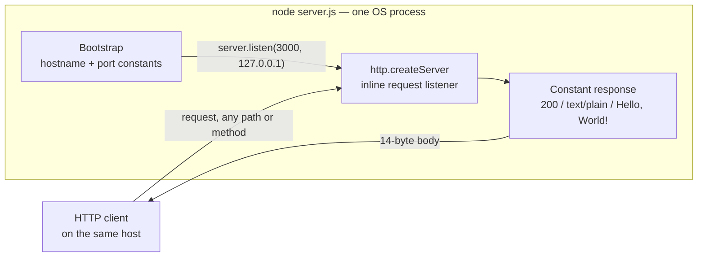

**Core technical approach.** CommonJS execution of a single side-effect-only module on the Node.js standard library, with no framework, no transpilation, no bundler, no build artifact and no configuration layer. The handler is synchronous and stateless: it sets `res.statusCode = 200`, sets the `Content-Type: text/plain` header, and calls `res.end` with a constant string (lines 7–9). Because it never inspects `req`, behavior is deliberately uniform — verification confirmed identical `200` responses for `GET /`, `GET /anything`, `POST` with a JSON body, `PUT` and `HEAD` — and the process emits exactly one log line, at bind time. The runtime that executes this is unconstrained by metadata: `package.json` declares no `engines` or `packageManager` field, and the behavior above was verified on Node.js v22.23.4 with npm 11.21.0.

### 1.2.3 Success Criteria

The repository declares no success criteria, KPIs or service levels. The criteria below are the objectives the implementation itself encodes — each derived from observed code or runtime behavior and each checkable without instrumenting the service. They are stated as derived, not as requirements issued by the project.

| Objective | Acceptance check | Verified outcome | Evidence |
|---|---|---|---|
| The service starts and binds a known endpoint | Run `node server.js`, then request `http://127.0.0.1:3000/` | Starts in under a second; prints `Server running at http://127.0.0.1:3000/`; request succeeds | `server.js` lines 12–14; runtime probe |
| Every request is acknowledged identically | Request several paths and methods; compare status, header and body | `200`, `text/plain`, `Hello, World!\n` for `GET /`, `GET /anything`, `POST`, `PUT`, `HEAD` | `server.js` lines 7–9; runtime probe |
| No third-party dependency is required | Resolve the dependency graph | `package-lock.json` holds only the root entry; `npm ls --all` is empty | `package-lock.json` lines 6–12 |
| The project installs as an npm package | `npm install` in a clean checkout | Nothing to fetch; no install-time errors (no dependencies or lifecycle hooks) | `package.json`, `package-lock.json` |

**Critical success factors.** Three conditions must hold for the single capability to work, and the code enforces none of them:

| Factor | Why it is critical | Current handling |
|---|---|---|
| A Node.js runtime on the host | There is no container, bundled binary or version constraint to supply one | None — no `engines` field; verified working on Node v22.23.4 |
| TCP port 3000 free on the host | The port is a constant; a second instance is not tolerated | None — an occupied port raises an uncaught `'error'` event and the process exits non-zero |
| The client runs on the same host | The socket is bound to `127.0.0.1` only | None — no configurable bind address; remote requests get no response |

**Key performance indicators.** No metric is instrumented anywhere: no logger, counter, timer, health endpoint or trace exists in the repository (a keyword sweep over every tracked file found no logging, metrics or health references). The only quantitative facts available are those an external observer can measure, and they are listed below as the candidate indicators — with the caveat that each must be measured from outside the process.

| Candidate KPI | How it would be measured | Nature of the observed baseline |
|---|---|---|
| Startup latency to first successful request | Time `node server.js` until an HTTP `200` returns | Sub-second in the verified environment; no startup telemetry exists |
| Response correctness rate | Share of requests returning `200` with the constant body | 100% by construction — the handler has one code path |
| Third-party dependency count | Size of the resolved dependency graph | 0 (empty lockfile package map) |
| Per-request observability coverage | Count of log/metric/trace emissions per request | 0 — stdout shows only the single bind message |


## 1.3 Scope

### 1.3.1 In-Scope: Core Features and Functionalities

**Must-have capabilities.** These are the capabilities without which the system as shipped does not function. Each is present in the current code.

| Capability | Behavior as shipped | Evidence |
|---|---|---|
| HTTP request acknowledgement | Every request receives `200` with `Content-Type: text/plain` and the body `Hello, World!\n` | `server.js` lines 6–10 |
| Loopback listener on a fixed port | Process binds TCP 3000 on `127.0.0.1` and holds it for its lifetime | `server.js` lines 3–4, 12 |
| Start-up confirmation | One stdout line naming the URL the service is reachable at | `server.js` lines 12–14 |
| Dependency-free package definition | npm-readable identity (`hello_world` v1.0.0, MIT) with a resolved graph containing no external package | `package.json`, `package-lock.json` |

**Primary user workflows.** The system supports exactly one workflow, with three actor steps and no variants:

1. An operator starts the service from a shell with `node server.js`; the process binds `127.0.0.1:3000` and prints `Server running at http://127.0.0.1:3000/` (`server.js` lines 12–14).
2. A client on the same host issues any HTTP request to that address — path, method, query string, headers and body are all ignored — and receives the constant `200` / `text/plain` / `Hello, World!\n` response (`server.js` lines 6–10).
3. The operator terminates the process externally; the code implements no shutdown path, signal handler or drain logic.

`npm install` and `npm test` are also available entry points, but neither contributes to the workflow: the first has nothing to install, and the second is npm's default placeholder that prints `Error: no test specified` and exits 1 (`package.json` line 7).

**Essential integrations.** One integration is essential — the Node.js core `http` module, required on `server.js` line 1 and used for `createServer` and the returned server's `listen`. A Node.js runtime and an available TCP port 3000 on the loopback interface are the corresponding environmental prerequisites. The npm CLI is needed only to read the package metadata; the service itself runs correctly with no `node_modules` directory.

**Key technical requirements.** The constraints the shipped design imposes on any environment that hosts it:

| Requirement | Value as shipped | Evidence |
|---|---|---|
| Language and module system | JavaScript (CommonJS); no TypeScript, transpilation or build step | `server.js` line 1 (`require`); no build tooling in `package.json` |
| Runtime | Any Node.js release that provides core `http`; no version is declared | `package.json` has no `engines`/`packageManager`; verified on Node v22.23.4, npm 11.21.0 |
| Network binding | `127.0.0.1`, port `3000`, both hardcoded constants | `server.js` lines 3–4 |
| Configuration | None — no environment variables, CLI arguments, config files or secrets | No `process.env`/`process.argv` usage in `server.js` |
| Third-party packages | None; the only import is a Node core module | `server.js` line 1; empty lockfile package map |
| License | MIT, declared in both `package.json` (line 10) and `package-lock.json` (line 10) | `package.json`, `package-lock.json` |

### 1.3.2 In-Scope: Implementation Boundaries

| Boundary | Definition as shipped | Evidence |
|---|---|---|
| System boundary | One OS process holding one listening TCP socket on the loopback interface; no subprocesses, workers, caches, files or external calls | `server.js` is the entire executable surface (15 lines, one `require`) |
| User groups covered | Any HTTP client able to reach `127.0.0.1:3000` on the same host — operators running the process and local tooling such as `curl`. No roles, credentials or identity concepts exist | No authentication, session, cookie or authorization code; handler ignores `req` |
| Geographic / market coverage | None defined. The loopback bind confines reach to a single host, so there is no multi-host, regional or public deployment scope | `server.js` line 3; a request to host address `10.11.1.15:3000` received no response |
| Data domains included | One static string literal returned per response. No persistent store, no in-memory state and no request data is read or retained | `server.js` lines 7–9; no database, cache or filesystem access anywhere in the repository |

### 1.3.3 Out-of-Scope

**Explicitly excluded features and capabilities.** Each exclusion below is an absence verified in the code, not a deferral recorded by the project.

| Excluded capability | Evidence of exclusion |
|---|---|
| Routing, path or method handling | The handler never reads `req` (`server.js` line 6); identical responses confirmed for `/`, `/anything`, `POST`, `PUT`, `HEAD` |
| Request parsing — bodies, query strings, headers, cookies, uploads | No parser, no body accumulation, no header access anywhere in `server.js` |
| Authentication, authorization, sessions, TLS | No credential, token, certificate or key material in any tracked file; the listener is plain HTTP |
| Persistence and data access | No database driver, ORM, SQL, cache client or filesystem write; dependency graph is empty |
| Configuration management | No environment variables, CLI flags, config files or secret injection (`server.js` lines 3–4 are constants) |
| Observability — access logs, metrics, traces, health/readiness endpoints | Sole log is the bind message (`server.js` line 13); a keyword sweep of all tracked files found no logging, metric or health references |
| Error handling, graceful shutdown, process supervision | No `server.on('error')`, `try/catch` or signal handler; an occupied port causes an uncaught `'error'` event; no Dockerfile or orchestrator manifest |
| Automated tests, CI, linting, coverage | `test` script always exits 1 (`package.json` line 7); no workflow, linter or test files exist |
| Library consumption of the code | No `module.exports`/`export`; `main` points at the absent `index.js` (`MODULE_NOT_FOUND`) |
| Documentation and operational runbooks | No README, `docs/` folder, LICENSE file or `.gitignore` in the checkout |

**Future phase considerations.** None are recorded. A keyword sweep across every tracked file found no TODO, FIXME, roadmap, phase or backlog note, and the repository history is a single commit. The three zero-byte `*.blitzyignore.txt` files (`.blitzyignore.txt`, `test.blitzyignore.txt`, `test1.blitzyignore.txt`) appear to be placeholder fixtures for ignore-list handling; they define no patterns and exclude nothing. Any roadmap beyond the current behavior is an assumption the repository does not support.

**Integration points not covered.** No database or persistence layer, message broker, external HTTP API, identity provider, object storage, telemetry backend or deployment platform integration exists — the only import in the repository is Node core `http`, and the lockfile resolves zero packages. Any such integration would be new construction rather than configuration of something present.

**Unsupported use cases.** The shipped implementation cannot support, without code changes:

- Access from any host other than the machine running the process, including public or multi-tenant exposure.
- Distinct responses per path, method or client — all requests receive the same constant body.
- Processing of submitted data, since the request object is never read.
- HTTPS or any transport security.
- Multiple instances on one host, or any restart-after-crash guarantee: the port is a constant and a bind collision terminates the process.
- Stateful behavior of any kind — sessions, counters, records, or content that changes without redeployment.
- Operation as a dependency of another application, since the module exports nothing and its declared entry point is missing.
- Any use that relies on tests, service levels, monitoring or documented operational procedure, none of which exist.


## 1.4 References

- `server.js` — the entire executable surface (15 lines): `require('http')`, `hostname = '127.0.0.1'` and `port = 3000` constants (lines 3–4), the `http.createServer` handler returning `200` / `text/plain` / `Hello, World!\n` while ignoring `req` (lines 6–10), and `server.listen` with the bind-message callback (lines 12–14); no exports, no configuration, no error handling.
- `package.json` — package identity `hello_world` v1.0.0, description "Hello world in Node.js", dangling `main: index.js`, sole `test` script that exits 1, author `hxu`, MIT license, and the absence of any dependency, `engines`, `private` or repository metadata.
- `package-lock.json` — `lockfileVersion: 3` with only the root `""` package entry, establishing that the resolved dependency graph contains zero third-party packages.
- `.blitzyignore.txt`, `test.blitzyignore.txt`, `test1.blitzyignore.txt` — each 0 bytes with no patterns, establishing that no repository content is excluded and that these are placeholder ignore-list fixtures.
- Repository root (path `""`) — the complete file inventory: exactly six tracked files and no sub-folders (confirmed by `get_source_folder_contents`, `git ls-files` and `find`), establishing the absence of a README, `docs/`, tests, CI configuration, Dockerfile, `.gitignore` and LICENSE file.
- Git history (`8bb4eb6`, branch `main`, remote `existing-projects-qa-18-nov`) — a single "Add files via upload" commit, establishing that no predecessor system, migration path or roadmap record exists.
- Runtime probes against `node server.js` on Node.js v22.23.4 with npm 11.21.0 — verified `200` responses for `GET /`, `GET /anything`, `POST` with a body, `PUT` and `HEAD`; the single bind-message log line; loopback-only reachability (host address `10.11.1.15:3000` unreachable); uncaught `EADDRINUSE` on a second bind; empty `npm ls --all`; and `npm test` exiting 1.
- No web sources were used: the one external lookup attempted (whether the handler reproduces a published Node.js example) returned no reachable documentation, so no external claim appears in this section.


# 2. Product Requirements

## 2.1 Feature Catalog

The repository ships four discrete, independently testable features. Every one is implemented and observable in the current checkout; there is no requirements document, backlog or roadmap in the repository (`git ls-files` lists six files, none of which carry a requirements statement), so the identifiers, categories and priorities below are derived from the code and from the consequence of removing each behavior. Status **Completed** means the behavior is present and verified in commit `8bb4eb6`; where a feature is complete but carries a defect, the defect is recorded under its Implementation Considerations in §2.5 rather than hidden by the status.

| Feature ID | Feature Name | Category | Priority · Status |
|---|---|---|---|
| F-001 | Fixed-Response HTTP Acknowledgement | Request Handling | Critical · Completed |
| F-002 | Loopback HTTP Listener Bootstrap | Runtime & Networking | Critical · Completed |
| F-003 | Start-up URL Confirmation Log | Operability | Medium · Completed |
| F-004 | Dependency-Free npm Package Identity | Packaging & Distribution | Medium · Completed |

**Capabilities deliberately absent from the catalog.** Routing, request parsing, authentication, persistence, error handling, graceful shutdown, automated tests, CI, linting, access logging and health endpoints are all verified absent (a keyword sweep of `server.js`, `package.json` and `package-lock.json` matched only `console.log` at `server.js` line 13 and the `"author"` field at `package.json` line 9). They are therefore not listed as Proposed or Approved features — they are recorded as constraints and exclusions in §2.5 and in §1.3.3.

### 2.1.1 F-001 — Fixed-Response HTTP Acknowledgement

| Field | Value |
|---|---|
| Unique ID | F-001 |
| Feature Name | Fixed-Response HTTP Acknowledgement |
| Feature Category | Request Handling (product-facing capability) |
| Priority Level | Critical — without it the process holds a socket but answers nothing, and no other feature produces user-visible output |
| Status | Completed (verified by runtime probe on Node v22.23.4) |
| Implementation | `server.js` lines 6–10 — inline arrow handler passed to `http.createServer` |

**Overview.** Every HTTP request reaching the listener is answered with the same complete response. The handler sets `res.statusCode = 200` (`server.js` line 7), sets the header `Content-Type: text/plain` (line 8) and closes the response with the constant string `'Hello, World!\n'` (line 9). It receives `req` (line 6) but never reads it, so method, path, query string, headers and body have no influence on the outcome. Verified responses: `GET /`, `GET /anything?x=1`, `POST` with a JSON body and `PUT` each returned `200` with a 14-byte `text/plain` body; `HEAD /` returned the same headers with no body.

**Business Value.** The feature converts the running process into something an external party can check. Because the handler has exactly one code path, response correctness is 100% by construction — a single HTTP call is sufficient evidence that the service is alive and speaking HTTP, which is the only value the repository claims anywhere (`"description": "Hello world in Node.js"`, `package.json` line 4). It also delivers that value at zero dependency cost: the handler uses only `ServerResponse` methods from Node core.

**User Benefits.** A client on the same host needs no knowledge of the API — no path, method, header or payload is required, and no request shape can be rejected. The response is produced synchronously inside the handler, with no downstream call, disk access, lock or queue, so latency is bounded by the HTTP stack alone, and the body is constant and cacheable-free of ambiguity (always 14 bytes: `H e l l o ,   W o r l d ! \n`).

**Technical Context.** CommonJS module, no framework, no middleware chain, no transpilation. The handler is an anonymous arrow function with no name to reference in a stack trace, and the module keeps no reference to it beyond the `server` object. Node derives `Content-Length: 14` from the string passed to `res.end`, and the observed responses carried Node's default `Connection: keep-alive` and `Keep-Alive: timeout=5` headers alongside `Date`. No branch, `try/catch`, timeout or streaming path exists, so there is nothing for a test to vary except the request method and path — all of which were confirmed to produce identical output.

| Dependency Type | Detail | Evidence |
|---|---|---|
| Prerequisite Feature | F-002 — a listening socket must exist before a request can arrive; F-001 has no independent trigger | `server.js` line 6 creates the handler as an argument to `http.createServer`, and lines 12–14 bind it |
| System Dependencies | Node.js runtime providing core `http` and the `ServerResponse` API (`statusCode`, `setHeader`, `end`) | `server.js` line 1 — the file's only import |
| External Dependencies | None — no third-party package, no outbound call, no configuration value | `package-lock.json` resolved graph is empty; no other `require` in the repository |
| Integration Requirements | Inbound TCP connection accepted by the F-002 listener; nothing else | `server.js` lines 6–10 reference only `res` |

### 2.1.2 F-002 — Loopback HTTP Listener Bootstrap

| Field | Value |
|---|---|
| Unique ID | F-002 |
| Feature Name | Loopback HTTP Listener Bootstrap |
| Feature Category | Runtime & Networking |
| Priority Level | Critical — it is the process's reason to exist; without it the module is a script that exits immediately |
| Status | Completed (bind, confinement and collision behavior verified) |
| Implementation | `server.js` lines 3–4 (constants), line 6 (server creation), lines 12–14 (`listen`) |

**Overview.** Running `node server.js` creates one `http` server and binds it to the loopback address `127.0.0.1` on TCP port `3000`, both declared as module-scope constants (`server.js` lines 3–4), then holds the socket for the lifetime of the process (`server.listen(port, hostname, callback)`, lines 12–14). The module exports nothing (`module.exports` and ESM `export` are both absent), so this side effect of opening a listening socket is the entire behavior of loading the file. Startup completes in well under a second in the verified environment.

**Business Value.** Provides a deterministic, memorably addressed endpoint that any local tool — a shell, a browser, a load generator, a CI smoke step — can target without discovery or configuration. Because the address and port are literals rather than inputs, there is no configuration surface to mis-set, no secret to distribute and no environment matrix to maintain; the same command produces the same endpoint on every host.

**User Benefits.** A single command, `node server.js`, starts everything; there is no build step, no `node_modules` install and no environment file. The operator learns the reachable URL from stdout (§2.1.3) rather than from source. Process lifecycle is left to the operator's shell, which matches the single-command usage the repository documents.

**Technical Context.** JavaScript (CommonJS), no TypeScript, no bundler, no build artifact. The listener is confined to the loopback interface: a request to the host's own address `10.11.1.15:3000` was refused (`curl` exit 7, no response) while `127.0.0.1:3000` answered immediately, so the feature is reachable only from the machine that runs it. There is no configuration channel — `server.js` contains no `process.env` or `process.argv` reference — so the port cannot be changed without editing source. Failure handling is absent: a second instance on the same port terminates with an uncaught `'error'` event (`Error: listen EADDRINUSE: address already in use 127.0.0.1:3000`, thrown at `node:events:497`) and exit code 1, because `listen()` is given only a success callback and no `server.on('error')` listener exists.

| Dependency Type | Detail | Evidence |
|---|---|---|
| Prerequisite Features | None — F-002 can start before any request arrives and does not depend on F-004 (the process runs with no `node_modules` present) | `server.js` line 1 imports only core `http` |
| System Dependencies | A Node.js runtime exposing core `http`; no version is declared, and behavior was verified on Node v22.23.4 with npm 11.21.0 | `package.json` has no `engines` or `packageManager` field |
| External Dependencies | TCP port 3000 free on the host's loopback interface for the process lifetime | `server.js` line 4 (`port = 3000`); EADDRINUSE probe on a second instance |
| Integration Requirements | Operating-system socket bind on `127.0.0.1:3000`; a supervisor or shell to keep the foreground process alive (none is provided) | `server.js` lines 12–14; no Dockerfile, orchestrator manifest or signal handler in the repository |

### 2.1.3 F-003 — Start-up URL Confirmation Log

| Field | Value |
|---|---|
| Unique ID | F-003 |
| Feature Name | Start-up URL Confirmation Log |
| Feature Category | Operability |
| Priority Level | Medium — the service functions without it, but the operator then has no runtime confirmation of the endpoint or of a successful bind |
| Status | Completed (single-line output verified across six requests) |
| Implementation | `server.js` lines 12–14 — `console.log` inside the `listen` callback |

**Overview.** When the socket bind succeeds, the `listen` callback logs one line built from the same two constants used for binding: `Server running at http://127.0.0.1:3000/` (`server.js` line 13). The message goes to stdout and reports the URL a client should use.

**Business Value.** It is the only runtime signal the system emits, and the only confirmation that the bind succeeded — the process prints nothing else, and prints nothing at all if the port is occupied (that case raises an uncaught error instead). It also serves as the operator's discovery mechanism for the endpoint, which matters because the address is hardcoded and discoverable nowhere else.

**User Benefits.** One unambiguous line to copy into a browser or `curl`, produced only after the server is actually accepting connections (the callback fires on success, so the log cannot precede readiness).

**Technical Context.** Emitted exactly once, at bind time, through `console.log` to `process.stdout`. Verified: after six requests across four methods the log file still contained one line, so there is no per-request access logging, no request counter and no error stream output. The URL is composed from `hostname` and `port` by template literal, so the message cannot drift from the actual bind values while those constants are edited together. Output format is unstructured single-line text — no timestamp, level, correlation ID or JSON fields — so it is consumable by a log collector only as opaque text.

| Dependency Type | Detail | Evidence |
|---|---|---|
| Prerequisite Features | F-002 — the callback belongs to the `listen` call and fires only after a successful bind | `server.js` line 12 |
| System Dependencies | Node.js runtime global `console` writing to `process.stdout` | `server.js` line 13 |
| External Dependencies | None; the stdout consumer (terminal, file, collector) is optional | No log configuration, transport or destination exists in the repository |
| Integration Requirements | A process attached to the stdout stream — a terminal, a redirect to a file, or a supervisor that captures it | Verified by capturing stdout to a file; no other output channel exists |

### 2.1.4 F-004 — Dependency-Free npm Package Identity

| Field | Value |
|---|---|
| Unique ID | F-004 |
| Feature Name | Dependency-Free npm Package Identity |
| Feature Category | Packaging & Distribution |
| Priority Level | Medium — not required to run the service, but it is what makes the project installable, identifiable and auditable as a package |
| Status | Completed for identity and dependency-free installation; the declared library entry point is not implemented (see §2.5.4) |
| Implementation | `package.json` (11 lines), `package-lock.json` (13 lines) |

**Overview.** The manifest declares the project as npm package `hello_world` version `1.0.0`, described as `Hello world in Node.js`, authored by `hxu`, licensed MIT, with a single `test` script (`package.json` lines 1–11). The lockfile records `lockfileVersion: 3` with `requires: true` and a `packages` map containing only the root `""` entry, so the resolved dependency graph is empty — `npm ls --all` prints `(empty)`. The package is therefore installable with nothing to fetch and no lifecycle hook to run.

**Business Value.** The project has a stable, publishable identity without a supply-chain surface: no third-party package is present to be patched, audited, licensed or hijacked. MIT licensing is declared consistently in both the manifest and the lockfile, and the empty graph is auditable in thirteen lines, which is the strongest governance property this repository holds.

**User Benefits.** A clean checkout is ready to run in one step, with no `npm install` required at all — `node server.js` works with no `node_modules` directory. Any consumer reading the manifest learns the package name, version, description and license without inspecting source.

**Technical Context.** The manifest declares no `dependencies`, `devDependencies`, `engines`, `packageManager`, `private`, `keywords`, `repository`, `homepage`, `bugs` or `files` fields. Two properties are defective or unexercised: `main` points at `index.js`, which does not exist in the checkout, so `require('./index.js')` fails with `MODULE_NOT_FOUND` and the package cannot be consumed as a library; and the sole script is npm's default placeholder, which prints `Error: no test specified` and exits 1 (verified exit code 1), so `npm test` registers a quality gate that always fails. Absence of `private: true` leaves the package publish-eligible, but no publish workflow, registry configuration or CI exists.

| Dependency Type | Detail | Evidence |
|---|---|---|
| Prerequisite Features | None — metadata stands alone and no other feature reads it at runtime | `server.js` contains no reference to the manifest |
| System Dependencies | npm CLI, needed only to read or act on the manifest; the server itself runs without it | `package-lock.json`; `npm ls --all` and `npm test` probes |
| External Dependencies | None at runtime or install time — the resolved graph holds zero packages, so no registry fetch is needed | `package-lock.json` `packages` map has only the `""` entry |
| Integration Requirements | npm script surface (`test`, which exits 1) and the `main` field (`index.js`, which is absent) | `package.json` lines 5–7 |


## 2.2 Functional Requirements

Each requirement carries an ID of the form `F-XXX-RQ-YYY` (feature · requirement), a Must-Have / Should-Have / Could-Have priority and a High / Medium / Low complexity. Every requirement below is stated against behavior that currently exists and was exercised at runtime; the one requirement the implementation does not satisfy is marked as such in §2.5. Requirement verification method and evidence pointers are consolidated in the traceability matrix (§2.5).

The requirements describe a single, branch-free request path: a request arrives on the socket created by F-002, passes through the handler of F-001 unchanged, and produces one constant response.

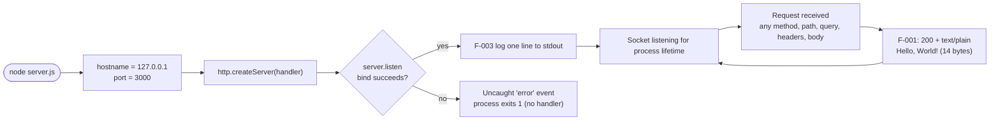

### 2.2.1 F-001 — Fixed-Response HTTP Acknowledgement

| Requirement ID | Description | Acceptance Criteria | Priority · Complexity |
|---|---|---|---|
| F-001-RQ-001 | Answer every accepted request with HTTP status 200 | Response status line is `HTTP/1.1 200 OK` for `GET /`, `GET /anything?x=1`, `POST` with a JSON body, `PUT` and `HEAD` | Must-Have · Low |
| F-001-RQ-002 | Declare the response media type as plain text | Every response carries the header `Content-Type: text/plain` with no charset parameter, on non-HEAD and HEAD responses alike | Must-Have · Low |
| F-001-RQ-003 | Return the constant body `Hello, World!` followed by one line feed | Body is exactly 14 bytes (`H e l l o ,   W o r l d ! \n`, verified byte-wise) and `Content-Length: 14` is present on non-HEAD responses | Must-Have · Low |
| F-001-RQ-004 | Treat every method, path, query string, header and body identically | Changing any request attribute changes no response byte; five request variants and four methods all produce the identical status, header and body | Must-Have · Low |
| F-001-RQ-005 | Complete the response inside the handler with a single `res.end` call | `res.end` is the handler's final statement; the response is not chunked and no handle is left open beyond the keep-alive connection | Must-Have · Low |
| F-001-RQ-006 | Never consume or retain request data | The handler contains no reference to `req`; a 200,000-byte `POST` body is answered in the same round trip without buffering, reading or storing it | Should-Have · Low |

| Requirement ID | Input Parameters | Output / Response | Performance Criteria · Data Requirements |
|---|---|---|---|
| F-001-RQ-001…004 | None required. Method, path, query, headers and body are accepted and ignored; no parameter is read or validated | Status `200`; header `Content-Type: text/plain`; body `Hello, World!\n`; Node adds `Content-Length: 14`, `Date`, and `Connection: keep-alive` with `Keep-Alive: timeout=5` | One request/response round trip with no downstream I/O, so latency is bounded by the HTTP stack; a 200,000-byte request body was answered in 0.0005 s. No data is stored, cached or logged |
| F-001-RQ-005…006 | A complete HTTP request of any size | One complete response, then the connection returns to keep-alive | Synchronous, single write, constant work per request independent of payload size. Zero bytes of request data persist after the response |

| Requirement ID | Business Rules | Data Validation | Security & Compliance Requirements |
|---|---|---|---|
| F-001-RQ-001…003 | One response shape for the whole product: the body is a fixed string literal, never derived from input; there is no alternate, error or negotiation path | No input is validated, so no request can be rejected on validation grounds; absence or malformation of every optional element still yields `200` | No request data reaches any sink (`req` is never referenced), so injection, deserialization and path-traversal classes do not apply. Transport is plaintext HTTP with no authentication — no PII or credential is processed. MIT license governs use |
| F-001-RQ-004…006 | The service must remain stateless: no counter, cache, session or per-client differentiation | Request bodies of arbitrary size are discarded without inspection | No data storage implies no data-retention or privacy obligation; the absence of input handling removes the input-validation attack surface entirely |

### 2.2.2 F-002 — Loopback HTTP Listener Bootstrap

| Requirement ID | Description | Acceptance Criteria | Priority · Complexity |
|---|---|---|---|
| F-002-RQ-001 | Bind TCP port 3000 on `127.0.0.1` and no other interface | After start, `http://127.0.0.1:3000/` answers `200` while `http://<host-ip>:3000/` is refused (`curl` exit 7 with no response) | Must-Have · Low |
| F-002-RQ-002 | Start from a single command with no configuration input | `node server.js` in a checkout with no `node_modules` and no environment variables serves requests; `server.js` reads no `process.env`, `process.argv` or config file | Must-Have · Low |
| F-002-RQ-003 | Serve requests continuously for the whole process lifetime | Twenty back-to-back and parallel requests all return `200`; the process never idles out, self-terminates or requires a restart between requests | Must-Have · Low |
| F-002-RQ-004 | Fail fast, with a non-zero exit, when the port cannot be bound | A second instance on port 3000 exits with code 1 and reports `listen EADDRINUSE: address already in use 127.0.0.1:3000` on stderr | Should-Have · Low |

| Requirement ID | Input Parameters | Output / Response | Performance Criteria · Data Requirements |
|---|---|---|---|
| F-002-RQ-001…003 | The command `node server.js`, nothing else — the bind address and port are compile-time constants (`server.js` lines 3–4) | A listening TCP socket on `127.0.0.1:3000` that answers every request for the process lifetime | Bind completes in well under one second and the socket is ready before the start-up log is written; sustained throughput is bounded only by the Node HTTP stack because no handler work is per-request. No state is held beyond the socket |
| F-002-RQ-004 | A port already occupied by another process | Exit code 1 and a Node stack trace naming `EADDRINUSE` on stderr; nothing on stdout | Immediate — the error surfaces at bind time, before the process serves anything. No retry, backoff or partial state |

| Requirement ID | Business Rules | Data Validation | Security & Compliance Requirements |
|---|---|---|---|
| F-002-RQ-001…002 | Exactly one instance per host is supported: the port is a literal, so a second instance is not tolerated | No configuration is accepted, so there is no invalid-configuration state to validate; the two bind values are literals that cannot be supplied by a caller | Network exposure is confined to the loopback interface, which is the system's only access-control mechanism: no authentication, authorization, session, token or TLS exists. No secret material is read or held |
| F-002-RQ-003…004 | The process must run unattended once started; shutdown is the operator's responsibility, since no signal handler or drain logic exists | Not applicable — no external data enters the process | Port collision is handled by an uncaught exception rather than a designed error path, so the diagnosis reaches stderr but the failure is ungraceful. Running as a non-privileged user is sufficient, as port 3000 is unprivileged and the bind is loopback-only |

### 2.2.3 F-003 — Start-up URL Confirmation Log

| Requirement ID | Description | Acceptance Criteria | Priority · Complexity |
|---|---|---|---|
| F-003-RQ-001 | Emit exactly one start-up line naming the reachable URL | stdout contains exactly `Server running at http://127.0.0.1:3000/` and nothing else at start; the count stays at one line after repeated traffic | Should-Have · Low |
| F-003-RQ-002 | Emit the line only after the socket bind succeeds | When the port is occupied, stdout is empty (zero occurrences of `Server running`) and the failure appears on stderr only | Should-Have · Low |
| F-003-RQ-003 | Compose the logged URL from the values actually bound | The host and port in the message equal the bind constants, so editing one constant keeps message and binding consistent | Could-Have · Low |
| F-003-RQ-004 | Emit nothing per request and nothing on stderr during normal operation | After twenty requests across four methods, stdout line count is unchanged and stderr is empty | Could-Have · Low |

| Requirement ID | Input Parameters | Output / Response | Performance Criteria · Data Requirements |
|---|---|---|---|
| F-003-RQ-001…003 | The bind success event; message content derives from the `hostname` and `port` constants | One unstructured text line on `process.stdout` via `console.log` | Written once at bind time — no measurable cost, no per-request overhead. Holds no data beyond the URL string; no timestamp, level, correlation ID or JSON envelope exists |
| F-003-RQ-004 | Every served request (deliberately produces no output) | Silent stdout; empty stderr | Zero per-request I/O, so logging cannot become a throughput bottleneck; the trade-off is that no request is traceable |

| Requirement ID | Business Rules | Data Validation | Security & Compliance Requirements |
|---|---|---|---|
| F-003-RQ-001…002 | One line per successful start; no line for a failed start, so absence of output is itself a failure signal | No external data is formatted into the message — only the two literals are interpolated | Discloses only the bind address and port, which are already the service's public identity; no request, client or identity data is logged. The failure path writes a Node stack trace, including absolute source paths, to stderr |
| F-003-RQ-003…004 | The message must stay truthful to the binding, and the service must not become a log source | Not applicable | Absence of access logs means no audit trail of who called the service; any compliance requirement for request attribution is unmet and would need new construction |

### 2.2.4 F-004 — Dependency-Free npm Package Identity

| Requirement ID | Description | Acceptance Criteria | Priority · Complexity |
|---|---|---|---|
| F-004-RQ-001 | Declare a readable package identity | `npm pkg get name version license author description` returns `hello_world`, `1.0.0`, `MIT`, `hxu`, `Hello world in Node.js` | Should-Have · Low |
| F-004-RQ-002 | Resolve zero third-party packages | `package-lock.json` carries `lockfileVersion: 3` and a `packages` map with only the root `""` entry; `npm ls --all` prints `(empty)`; `npm install` fetches nothing | Must-Have · Low |
| F-004-RQ-003 | Run with no installed packages | With no `node_modules` directory present, `node server.js` binds the port and serves requests | Must-Have · Low |
| F-004-RQ-004 | Provide the npm script surface declared in the manifest | `npm test` executes the declared command, prints `Error: no test specified` and exits 1 | Could-Have · Low |
| F-004-RQ-005 | Declare a library entry point that resolves to a real file (currently **not satisfied**) | `main` in `package.json` resolves to an existing module; today `require('./index.js')` fails with `MODULE_NOT_FOUND` because `index.js` is absent | Should-Have · Low |

| Requirement ID | Input Parameters | Output / Response | Performance Criteria · Data Requirements |
|---|---|---|---|
| F-004-RQ-001…003 | `package.json` and `package-lock.json` read by npm; nothing at runtime | Normalized package metadata; an empty dependency tree; a runnable service requiring no install step | No install latency and no registry round trip, since the graph is empty. Data held: name, version, description, author, license, `main`, one script — no dependency, engine, repository or `files` metadata |
| F-004-RQ-004…005 | The npm subcommands `test`, `install`, `pkg get`, and any `require` of the package | Script output plus an exit status (`test` → 1); `main` → `MODULE_NOT_FOUND` today | Immediate — no lifecycle script or build step runs; install cost is zero. Verification state of RQ-005 is a defect, not a performance concern |

| Requirement ID | Business Rules | Data Validation | Security & Compliance Requirements |
|---|---|---|---|
| F-004-RQ-001…003 | Identity fields must agree between manifest and lockfile, and no third-party package may enter the graph | Lockfile `name`/`version`/`license` (`hello_world`, `1.0.0`, `MIT`) match the manifest exactly | Zero dependency surface means zero supply-chain exposure, no transitive license obligations and nothing to patch. MIT is declared in both files. `private` is absent, so the package is publish-eligible — a governance decision nobody has recorded |
| F-004-RQ-004…005 | Every script the manifest declares must be able to pass; a permanently failing script must not be presented as a quality gate | Not applicable — no test data or fixtures exist | The always-failing `test` script yields no compliance or quality evidence, and no CI pipeline exists to invoke it. The dangling `main` blocks any consumer from depending on the package, so distribution as a library is non-compliant with the manifest's own declaration |


## 2.3 Feature Relationships

The four features form a single chain rather than a network: F-002 brings the socket into existence, F-001 answers on it, F-003 reports the bind, and F-004 describes the project to npm without ever being loaded by the running process. Nothing in the repository introduces a second runtime participant, so every relationship below is visible in the eighteen lines of `server.js` plus the two metadata files.

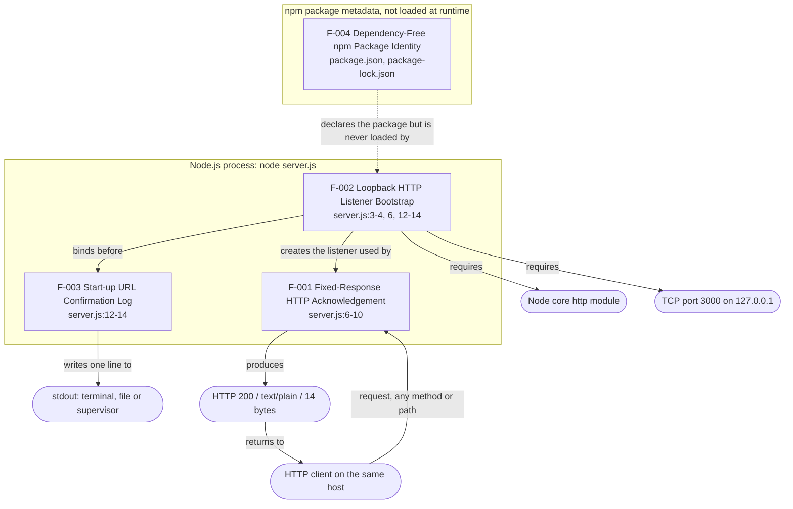

### 2.3.1 Feature Dependencies Map

| Feature | Prerequisite Features | Features Depending On It | Evidence |
|---|---|---|---|
| F-001 Fixed-Response Acknowledgement | F-002 — its handler is registered as the argument to `http.createServer` and can only fire once the socket is listening | None | `server.js` lines 6, 12 — handler created before `listen`, invoked only by incoming requests |
| F-002 Loopback Listener Bootstrap | None — it starts with no prior feature and does not read the manifest | F-001 (provides the listener), F-003 (provides the success callback) | `server.js` lines 1–4 and 12–14; the process runs with no `node_modules` |
| F-003 Start-up URL Log | F-002 — the log statement lives inside the `listen` callback and cannot execute before a successful bind | None | `server.js` line 12–14; a failed bind produced zero stdout lines |
| F-004 Dependency-Free Package Identity | None | None at runtime — no source file reads the manifest; the relationship is documentation and tooling only | `server.js` contains no reference to `package.json`; the lockfile graph is empty |

**Ordering constraint.** Only one ordering is enforced by the code: F-002 must precede F-003 (same callback) and F-002 must precede F-001's first request (a request cannot arrive before the bind). F-004 is unordered with respect to all three — the service's behavior is identical whether or not npm ever reads the manifest, as demonstrated by running `node server.js` in a checkout with no `node_modules` directory.

### 2.3.2 Integration Points

| Boundary | Counterpart | Mechanism | Evidence |
|---|---|---|---|
| Inbound network | Any HTTP client on the same host | Plain HTTP over `127.0.0.1:3000`; requests on any path or method are accepted; off-host calls are refused | `server.js` lines 3–4, 12; host-address probe refused, loopback probe answered |
| Node.js runtime | The `http` core module | CommonJS `require('http')` and `http.createServer`; no other module is imported anywhere | `server.js` line 1 — the only `require` in the repository |
| Operating-system socket layer | Host network stack | `server.listen(port, hostname, callback)` binds one TCP socket and holds it | `server.js` line 12; `EADDRINUSE` on a second bind |
| stdout | Operator terminal, redirect or supervisor | One `console.log` line at bind time; no other output on success | `server.js` line 13; one line captured after twenty requests |
| stderr | Same as stdout | Emitted only on an uncaught failure (`EADDRINUSE`), by Node rather than by application code | Failed-bind probe: 20 stderr lines, empty stdout, exit 1 |
| npm tooling | npm CLI (`install`, `test`, `pkg get`) | Manifest fields and the `packages` map; no lifecycle script, no registry fetch | `package.json`, `package-lock.json`; `npm ls --all` empty, `npm test` exits 1 |

No outbound integration exists: there is no HTTP client, database driver, message broker, cache client, identity provider, telemetry exporter, filesystem read or write, or deployment-platform manifest anywhere in the six tracked files.

### 2.3.3 Shared Components

| Shared Element | Consumed By | How It Is Shared | Evidence |
|---|---|---|---|
| The single `server` object | F-002 (created and bound), F-001 (its listener answers requests) | One `http.createServer` return value held in a module-scope `const`; never exported | `server.js` lines 6, 12 |
| The `hostname` and `port` constants | F-002 (bind target), F-003 (message text) | Read by both the `listen` call and the log template, so the two cannot diverge | `server.js` lines 3–4, 12–13 |
| Package metadata (name, version, license) | F-004's manifest, F-004's lockfile | Same three values restated in `package.json` and the lockfile's root entry | `package.json` lines 2–3, 10; `package-lock.json` lines 2–3, 10 |
| The `http` core module | F-002 (`createServer`) and, through the created server, F-001's response object | Required once at module scope; the handler uses the `ServerResponse` methods that module provides | `server.js` lines 1, 7–9 |

There is no shared library, utility module, middleware, configuration object or data store to share — `server.js` is the only code file, so the only sharing that can occur is through module-scope constants inside it.

### 2.3.4 Common Services

| Service | Role | Shared By | Evidence |
|---|---|---|---|
| Node.js core `http` | The sole runtime service: HTTP server creation, socket listening and the `ServerResponse` interface | F-001, F-002; indirectly F-003, which runs inside its `listen` callback | `server.js` line 1; no other import exists |
| Node.js process globals (`console`, `process.stdout`, `process.stderr`) | Output channel for the start-up line and for failure diagnostics | F-003 (writes the line); Node itself writes the error trace | `server.js` line 13; failed-bind stderr output |
| npm CLI | Reads and acts on package metadata; not part of the serving path | F-004 | `package.json` scripts and fields; `npm ls --all`, `npm test`, `npm pkg get` probes |

No other common service exists in the system: there is no logger, configuration provider, secret store, database, queue, scheduler, cache, health-check endpoint or service-discovery mechanism, and no third-party package is available to provide one, since the resolved dependency graph is empty.


## 2.4 Implementation Considerations

Each entry below records what the current implementation actually imposes, the evidence for it, and the action a team would have to take to move the feature toward production use. Performance figures are the ones measured in the verified environment (Node v22.23.4, npm 11.21.0, single host) and are stated as observations rather than service levels — the repository declares no SLA or KPI (§1.2.3).

### 2.4.1 F-001 — Fixed-Response HTTP Acknowledgement

| Aspect | Observed State | Evidence | Required Action |
|---|---|---|---|
| Technical constraints | Handler is a synchronous, branch-free arrow function; the response is one constant string; no access to `req`, no body parsing, no streaming | `server.js` lines 6–10 | Any variation in output (per-path responses, echo, negotiation) requires new handler code and a routing decision |
| Performance | Single write per request, no downstream I/O or filesystem access; a 200,000-byte `POST` was answered in 0.0005 s with the 14-byte body; 20 parallel requests all returned `200` | Runtime probes; `server.js` line 9 | None while the response stays constant; any added I/O becomes the latency floor |
| Scalability | Scaling is horizontal by process only — a second instance cannot bind port 3000, so no multi-process or multi-host fan-out is possible as written | `server.js` line 4; `EADDRINUSE` on second instance | Port must become configurable and the bind address widened before more than one instance per host can serve |
| Security implications | `req` is never referenced, so no request data reaches any sink — no injection, deserialization or traversal surface; transport is plaintext HTTP with no authentication and no rate limiting | `server.js` lines 6–10; no `req` reference anywhere in the file | Before exposing beyond the loopback interface: TLS, authentication, request-size limits and rate limiting all need construction |
| Maintenance | One code path, 5 lines, no configuration and no dependencies to upgrade; nothing to keep in sync | `server.js` lines 6–10; empty dependency graph | No maintenance work is required while the response stays fixed |

### 2.4.2 F-002 — Loopback HTTP Listener Bootstrap

| Aspect | Observed State | Evidence | Required Action |
|---|---|---|---|
| Technical constraints | `hostname` and `port` are literal constants; the module exports nothing and exists for its side effect; no build step, no TypeScript, no framework | `server.js` lines 3–4, 6, 12; no `module.exports` | Port and address must move to configuration (`process.env` or CLI) before deployment into any shared environment |
| Performance | Bind completes in well under one second and the socket is ready before the start-up line is written; no per-request work is added by the bootstrap | Runtime probe; `server.js` line 13 | None at this scale; startup telemetry does not exist and would be needed to track it |
| Scalability | Exactly one instance per host; no cluster module, worker threads, reverse proxy or orchestrator manifest; a bind collision terminates the process | `server.js` lines 12–14; no Dockerfile, no CI, no orchestrator file in the repository | Multi-instance operation requires configurable ports plus a supervisor/load balancer, none of which exist |
| Security implications | Access control is the loopback bind alone: the host address refused the connection while `127.0.0.1` answered; plaintext HTTP; no secrets, credentials or certificates are read or stored | `server.js` line 3; host-address probe; no auth or TLS code anywhere | Widening the bind address without adding TLS and authentication would expose an unauthenticated service — the two must ship together |
| Maintenance | No error handler around `listen`, no `server.on('error')`, no signal handling or graceful shutdown; failure surfaces as an uncaught exception and exit code 1 | `server.js` lines 12–14; `Error: listen EADDRINUSE` thrown at `node:events:497` | Add an `'error'` listener and SIGTERM/SIGINT handling for predictable startup failure and clean restarts under a supervisor |

### 2.4.3 F-003 — Start-up URL Confirmation Log

| Aspect | Observed State | Evidence | Required Action |
|---|---|---|---|
| Technical constraints | One unstructured `console.log` string built by template literal from the two bind constants; no logging library, no level, no timestamp, no JSON envelope | `server.js` line 13 | Structured logging (level, timestamp, service name) needs a library or hand-written formatter, adding the project's first dependency if a library is chosen |
| Performance | Zero per-request cost: after twenty requests across four methods the stdout line count was still 1 | Runtime probe on captured stdout | None; there is no logging volume to tune or sample |
| Scalability | One line per process start — the log path cannot become a throughput constraint, and equally cannot support aggregation across instances | `server.js` line 13 | Multi-instance fleet observability requires request-level logs, metrics and a collector, none of which exist |
| Security implications | The message discloses only the bind address and port, which are already the service's identity; no request, client or identity data is logged; the failure path writes a Node stack trace containing absolute source paths to stderr | `server.js` line 13; failed-bind stderr capture | Treat stderr traces as internal-only output before exposing logs to any external party |
| Maintenance | Message text and URL derive from the bind constants, so it stays truthful when those constants change; no log configuration to maintain | `server.js` lines 3–4, 13 | Add a per-request access log if request attribution is ever required; the current silence makes incidents invisible |

### 2.4.4 F-004 — Dependency-Free npm Package Identity

| Aspect | Observed State | Evidence | Required Action |
|---|---|---|---|
| Technical constraints | Manifest has no `engines`, `packageManager`, `dependencies`, `private`, `repository` or `files` fields; `main` points at the absent `index.js`; the only script is npm's failing placeholder | `package.json` lines 1–11; `require('./index.js')` → `MODULE_NOT_FOUND`; `npm test` exit 1 | Either create `index.js` that exports the server, or correct `main`; declare an `engines` range to pin the runtime the code was verified on |
| Performance | Install cost is zero — nothing to fetch, no lifecycle script to run; `npm ls --all` prints `(empty)` | `package-lock.json` `packages` map; `npm ls --all` probe | None |
| Scalability | Metadata does not affect runtime scale; the empty graph does mean nothing can be reused from the ecosystem without adding the project's first dependency | `package-lock.json`; `server.js` line 1 | Introducing any library (framework, logger, test runner) ends the zero-dependency property and must be treated as an architectural decision |
| Security implications | Zero third-party code means zero supply-chain exposure, no transitive license obligations and nothing to patch; MIT is declared in both manifest and lockfile; absence of `private: true` leaves the package publish-eligible | `package.json` lines 9–10; `package-lock.json` lines 3, 10; both files contain no dependency keys | Record the publish intent explicitly (`private: true`, or `repository`/`publishConfig`) — an unintended publish cannot be undone |
| Maintenance | Identity fields must be kept in step between manifest and lockfile; `npm test` always fails, so no automated quality gate exists to preserve that consistency | `package.json` line 7; `package-lock.json` lines 2–3; no lockfile `integrity` or dependency entries to maintain | Replace the placeholder `test` script with a real check and add CI if the project is to be maintained rather than treated as a sample |


## 2.5 Traceability Matrix and Assumptions

### 2.5.1 Requirement Traceability Matrix

Every requirement in §2.2 is traced to the code that implements it, the method that verifies it, and its current state. `server.js` line numbers refer to the 14-line, 342-byte file (`wc -l` and `wc -c` on the checkout); a length figure given informally elsewhere in this section is superseded by this measurement.

| Requirement ID | Implemented At | Verification Method | State |
|---|---|---|---|
| F-001-RQ-001 | `server.js` line 7 — `res.statusCode = 200` | Runtime probe: `curl -i` on `GET /`, `GET /anything?x=1`, `POST`, `PUT`, `HEAD` → all `HTTP/1.1 200 OK` | Verified |
| F-001-RQ-002 | `server.js` line 8 — `res.setHeader('Content-Type','text/plain')` | Response headers captured for each probe, including `HEAD`, which returned the header with no body | Verified |
| F-001-RQ-003 | `server.js` line 9 — `res.end('Hello, World!\n')` | Byte-level dump of the saved body (`od -c`) → 14 bytes; `Content-Length: 14` present on non-HEAD responses | Verified |
| F-001-RQ-004 | `server.js` line 6 — `req` declared and never referenced | Identical status, header and body across five request variants and four methods | Verified |
| F-001-RQ-005 | `server.js` line 9 — single terminal `res.end` | Response completes with no chunked encoding; connection remains reusable (`Connection: keep-alive`) | Verified |
| F-001-RQ-006 | `server.js` lines 6–10 — no `req` access | 200,000-byte `POST` answered `200` with 14 bytes in 0.000533 s, without buffering or inspection | Verified |
| F-002-RQ-001 | `server.js` lines 3–4, 12 — constants and `listen` | `curl 127.0.0.1:3000` → `200`; `curl 10.11.1.15:3000` → connection refused (`curl` exit 7) | Verified |
| F-002-RQ-002 | `server.js` lines 1–14 — no `process.env`/`process.argv` | `node server.js` in a checkout with no `node_modules` and no environment setup served requests | Verified |
| F-002-RQ-003 | `server.js` lines 12–14 — listener held for process lifetime | Twenty parallel requests (`xargs -P 10`) all returned `200`; the process stayed up | Verified |
| F-002-RQ-004 | `server.js` lines 12–14 — `listen` given only a success callback | Second instance → `Error: listen EADDRINUSE: address already in use 127.0.0.1:3000`, exit code 1 | Verified, ungraceful |
| F-003-RQ-001 | `server.js` line 13 — `console.log` in the `listen` callback | Captured stdout contains exactly `Server running at http://127.0.0.1:3000/` | Verified |
| F-003-RQ-002 | `server.js` lines 12–14 — callback fires only on success | Failed bind produced empty stdout and 20 lines on stderr | Verified |
| F-003-RQ-003 | `server.js` line 13 — template literal over `hostname`/`port` | Code inspection; logged URL matches the bind constants and the address that answered | Verified |
| F-003-RQ-004 | `server.js` line 13 — the only log statement in the repository | stdout still one line after twenty requests; stderr empty during normal operation | Verified |
| F-004-RQ-001 | `package.json` lines 2–4, 9–10 | `npm pkg get name version license author description` returned `hello_world`, `1.0.0`, `MIT`, `hxu`, `Hello world in Node.js` | Verified |
| F-004-RQ-002 | `package-lock.json` lines 5–12 — root-only `packages` map | `npm ls --all` printed `(empty)`; `npm install` has nothing to fetch | Verified |
| F-004-RQ-003 | `server.js` line 1 — only core `http` imported | `node server.js` served traffic with no `node_modules` directory present | Verified |
| F-004-RQ-004 | `package.json` line 7 — `test` script | `npm test` printed `Error: no test specified` and exited 1 | Verified |
| F-004-RQ-005 | `package.json` line 5 — `main: index.js` | `require('./index.js')` → `MODULE_NOT_FOUND`; no `index.js` exists in the checkout | **Not satisfied** |

**Coverage.** 19 requirements are catalogued: 18 verified in the current checkout and 1 open defect (F-004-RQ-005). Requirements are testable without instrumenting the service — every acceptance criterion is checkable with `curl`, `npm`, a byte count, or a line count on captured output.

### 2.5.2 Requirement Versioning

| Requirement Set | Version | Baseline | Derivation Basis and Change Trigger |
|---|---|---|---|
| F-001 to F-004, F-001-RQ-001 … F-004-RQ-005 | 1.0 | Commit `8bb4eb6` ("Add files via upload") — the repository's only commit | Derived entirely from observed code and runtime probes, because no requirement, backlog or roadmap document exists in the repository. Re-version whenever `server.js`, `package.json` or `package-lock.json` changes; a change to any of the three can invalidate the state column in §2.5.1 |

### 2.5.3 Assumptions

| ID | Assumption | Basis and Risk If Wrong |
|---|---|---|
| A-1 | A Node.js runtime providing core `http` exists on the host | No `engines` or `packageManager` field constrains it; behavior was verified on Node v22.23.4 / npm 11.21.0. Older or newer releases are untested, and no version floor is enforced anywhere |
| A-2 | The client runs on the same host as the process | The bind is `127.0.0.1`; a host-address request was refused. Any client elsewhere gets no response, not an error page |
| A-3 | TCP port 3000 is free on that host for the process lifetime | The port is a literal in `server.js`. A collision means the service cannot start at all — there is no fallback port |
| A-4 | An operator or shell keeps the foreground process running | There is no supervisor, daemonization, restart policy or signal handler; when the shell exits, the service ends |
| A-5 | Priority, status and category values are derived by this specification, not issued by the project | The repository contains no requirement artifacts; the values reflect the consequence of removing each behavior and should be revisited if the project ever publishes its own requirements |
| A-6 | The three `*.blitzyignore.txt` files are inert placeholders | Each is 0 bytes and defines no pattern, so nothing is excluded and no behavior depends on them |
| A-7 | No product behavior exists outside the six tracked files | `git ls-files` and a repository-wide `find` both return those six files only; there is no build output, generated source or configuration directory |

### 2.5.4 Constraints and Known Defects

| ID | Constraint or Defect | Effect on the Product | Evidence |
|---|---|---|---|
| C-1 | Zero third-party dependencies | No library can be reused without ending the project's only governance property (an auditable, empty dependency graph) | `package-lock.json` root-only `packages` map; `npm ls --all` `(empty)` |
| C-2 | Bind address and port are source literals | No environment can be retargeted without editing code; one instance per host | `server.js` lines 3–4; no `process.env`/`process.argv` reference |
| C-3 | CommonJS, single-file runtime, no build, test or lint toolchain | Total product surface is 342 bytes of `server.js`, 251 bytes of `package.json` and 247 bytes of `package-lock.json`; nothing verifies behavior automatically | `wc -c` / `wc -l` on the three files; no CI, linter or test directory in the repository |
| C-4 | No request-level observability | Incidents leave no trace beyond the single bind line; no health or readiness endpoint exists to probe | Sole log statement is `server.js` line 13; stdout unchanged after traffic |
| D-1 | Declared entry point does not exist (`F-004-RQ-005`) | The package cannot be consumed as a library; any `require` or `import` of it fails | `package.json` line 5 vs. absent `index.js`; `MODULE_NOT_FOUND` |
| D-2 | `test` script always fails | `npm test` is a permanent red signal, so it cannot gate anything; no coverage or regression evidence exists | `package.json` line 7; verified exit code 1 |
| D-3 | Bind failure is handled by an uncaught exception | Startup failure is loud but ungraceful: stack trace on stderr, exit 1, and no diagnostic beyond Node's own message | `server.js` lines 12–14; `node:events:497` trace from the second-instance probe |
| D-4 | No shutdown path | Termination is external only; no drain, no socket close, no signal handling | No `SIGTERM`/`SIGINT` listener anywhere in `server.js` |

**Related specification sections.** Capability and component inventories are in §1.2.2; the derived objectives and candidate KPIs are in §1.2.3; the shipped capability list is in §1.3.1; and the excluded capabilities that this catalog deliberately omits are in §1.3.3. The request-path flowchart in §2.2 and the dependency map in §2.3 depict the same single code path from different angles.


## 2.6 References

- `server.js` — the entire runtime: `hostname`/`port` constants (lines 3–4), the fixed-response handler (lines 6–10), and the `listen` call with its start-up log (lines 12–14). Establishes F-001, F-002 and F-003 and every performance, security and constraint statement about them.
- `package.json` — package identity `hello_world` v1.0.0, description, `main: index.js` (line 5), the failing `test` script (line 7), author `hxu`, MIT license. Establishes F-004 and defects D-1 and D-2.
- `package-lock.json` — `lockfileVersion: 3`, `requires: true`, and a `packages` map containing only the root `""` entry. Establishes the empty dependency graph for F-004 and constraint C-1.
- `.blitzyignore.txt`, `test.blitzyignore.txt`, `test1.blitzyignore.txt` — 0 bytes each, defining no exclusion patterns; establishes assumption A-6.
- Repository root (`""`) — holds exactly these six tracked files with no sub-folders, establishing assumption A-7 and the absence of any source tree, test directory, documentation, CI configuration or build tooling.

No web sources were used; every fact in this section derives from the repository files above and from runtime probes against the service they define.


# 3. Technology Stack

## 3.1 Programming Languages

JavaScript is the only programming language in the repository. The tracked file census is one `.js` file, two `.json` files and three `.txt` files, and all three `.txt` files are zero-byte `*.blitzyignore.txt` placeholders, so the code inventory reduces to a single 15-line JavaScript source file executed by Node.js. No compiled language, no TypeScript, no Python and no second runtime is present: a sweep of every tracked file for those names returned zero hits, and no build, transpile or code-generation step exists that could introduce one.

### 3.1.1 Language Inventory by Component

| Component | Language | Dialect / module system | Declared version constraint | Evidence |
|---|---|---|---|---|
| Service runtime — `server.js` | JavaScript | CommonJS: `const http = require('http')`; no `import`/`export` | None — no `engines`, no `packageManager`, no `type` field | `server.js` line 1; `package.json` |
| Package manifest — `package.json` | JSON | npm manifest schema | Read by npm 11.21.0 (verified) | `package.json` lines 1–11 |
| Lockfile — `package-lock.json` | JSON | npm lockfile, `lockfileVersion: 3` | Format version 3; unchanged by a successful `npm install` | `package-lock.json` line 4 |
| Ignore placeholders — `.blitzyignore.txt`, `test.blitzyignore.txt`, `test1.blitzyignore.txt` | None (0 bytes each) | — | — | `wc -c` reports 0 for all three |

Only the first row executes. Both JSON files are data consumed by the npm client and are never loaded by the service, whose single `require` targets a Node core module rather than a local file.

### 3.1.2 Selection Criteria and Justification

The repository records no language rationale — `package.json` carries only `"description": "Hello world in Node.js"` (line 4). The criteria below are the properties the shipped code demonstrably satisfies, and each is the reason JavaScript as used here is sufficient for the system's one capability.

| Criterion | How the shipped code satisfies it | Evidence |
|---|---|---|
| HTTP serving without an ecosystem | The Node core `http` module supplies both server creation and socket binding | `server.js` lines 1, 6, 12 |
| No build or transpile stage | The source file is the deployed artifact; `node --check server.js` reports it valid | `server.js`; no bundler, transpiler or compiler configuration anywhere in the repository |
| Minimal reviewable surface | One file, 15 lines, one import, one execution path | `server.js` lines 1–15 |
| Portability across operating systems | No native addon, binding, FFI or platform-specific API; socket work is delegated to the runtime | `server.js` line 1 is the only `require` in the repository |
| Zero install surface | Nothing is fetched at deploy time; the sole dependency ships inside the runtime | `package-lock.json` `packages` map; `npm ls --all` prints `(empty)` |

The decisive factor is the last row: because the required HTTP capability already sits in the standard library, the language choice imposes no ecosystem on the project. Section 3.3 records that consequence, and §3.6.5 records the resulting deviation from the assumed default stack.

### 3.1.3 Constraints and Dependencies

| Constraint | Detail | Evidence | Consequence |
|---|---|---|---|
| No declared runtime version | `package.json` has no `engines` or `packageManager` field; its seven keys are `name`, `version`, `description`, `main`, `scripts`, `author`, `license` | `package.json` lines 1–11 | Nothing prevents an incompatible Node.js release from being used. The verified environment is Node.js v22.23.4 (V8 12.4.254.21-node.57, libuv 1.51.0) with npm 11.21.0 |
| ES2015 language floor | The newest constructs are `const`, the arrow functions at lines 6 and 12, and the template literal at line 13 | `server.js` lines 3–13 | An engine without ES2015 support cannot parse the file; nothing newer (async/await, classes, optional chaining) appears |
| CommonJS-only module resolution | `require` is the sole module-system marker; no `module.exports`, `export` or `import` exists, and `package.json` sets no `type` | `server.js` line 1; `package.json` (no `type` key) | The file loads as CommonJS. Adding `"type": "module"` would break the `require` call until the source is converted |
| No importable surface | `main` names `index.js`, which does not exist; `require('./index.js')` throws `MODULE_NOT_FOUND` | `package.json` line 5; absent `index.js` | The code can only be used by launching the process, never by importing it |
| Runtime supplied by the environment | No bundled interpreter, container image, `.nvmrc` or version pin exists | No Dockerfile, no `engines`, no `.nvmrc` in the checkout | The host must provide a Node.js installation; this is the system's single external execution dependency |

None of the assumed default-stack languages — Python, TypeScript, Swift, Kotlin or Objective-C — appears in any tracked file; §3.6.5 records the full deviation.


## 3.2 Frameworks &amp; Libraries

No application framework and no third-party library is used. The complete import surface of the system is one Node core module, `http`, required on `server.js` line 1 and used for `createServer` and the returned server's `listen`. There is no web framework, template engine, ORM, HTTP client, logger or utility library anywhere in the repository, and `package.json` declares no `dependencies` or `devDependencies` block at all.

### 3.2.1 Core Frameworks

**None.** The framework-equivalent role is played by the Node.js standard library. `http.createServer(handler)` (line 6) supplies the request/response lifecycle, and `server.listen(port, hostname, callback)` (line 12) supplies the transport binding.

```javascript
const http = require('http');                                   // line 1
const server = http.createServer((req, res) => { /* ... */ });  // line 6
server.listen(port, hostname, () => { /* ... */ });             // line 12
```

The diagram below is the complete technology dependency chain of the system. It contains every component that executes and every artifact that describes them; nothing omitted from it exists in the repository.

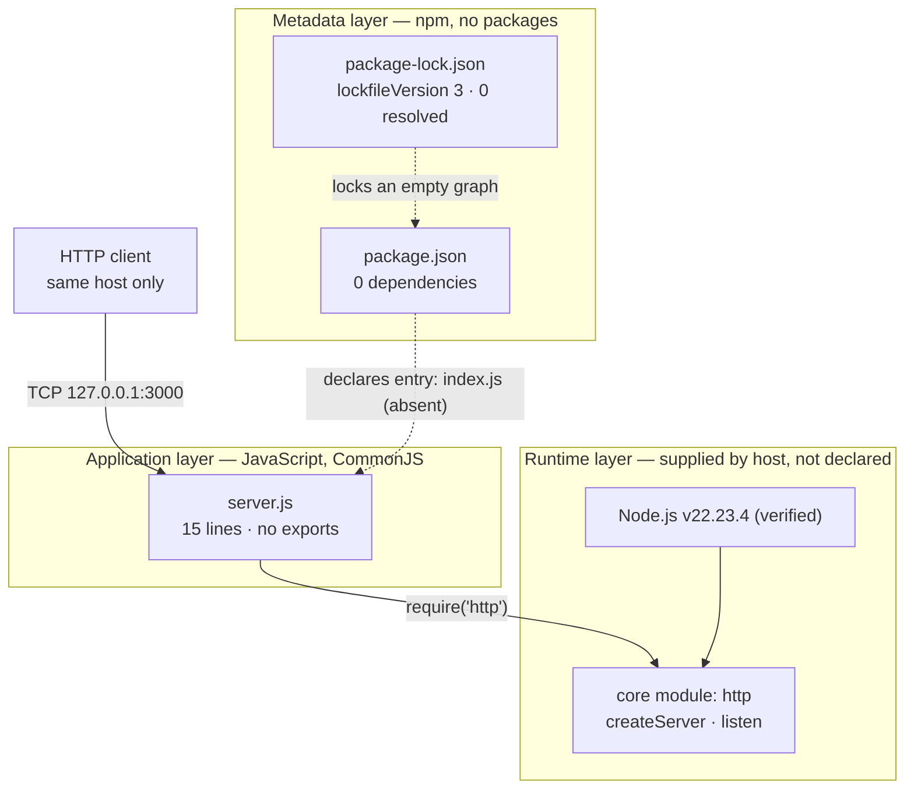

Each responsibility a framework usually owns is either absent or handled inline by three statements in the request listener:

| Concern | Provider in this system | Framework capability not present |
|---|---|---|
| HTTP server and transport | Node core `http` | Express, Fastify, Koa, Hapi, NestJS |
| Routing or dispatch | None — every path and method receives the identical response | Router or dispatcher |
| Middleware chain | None — the handler is a single branch-free arrow function | `app.use`-style pipeline |
| Request parsing (body, query, headers, cookies) | None — `req` is declared at line 6 and never referenced | `body-parser`, query, cookie parsers |
| Response serialization | Manual `res.setHeader` plus `res.end` with a constant string (lines 8–9) | `res.json`, view/template engines |
| Error handling | None — no `try/catch`, no `server.on('error')` | Framework error middleware |
| Configuration | None — `hostname` and `port` are literals (lines 3–4) | Config loaders (`dotenv`, `convict`) |

### 3.2.2 Supporting Libraries

**None.** `package.json` contains no `dependencies`, `devDependencies`, `peerDependencies`, `optionalDependencies` or `bundleDependencies` key, `package-lock.json` resolves zero packages, and no `node_modules` directory exists. The only standard-library module used is `http`; `fs`, `path`, `url`, `os`, `crypto`, `https`, `net`, `cluster` and `http2` are imported nowhere (zero hits across all tracked files).

The practical effect is that every concern normally delegated to a library is simply absent: no structured logger (§3.4.3), no configuration loader, no test framework (§3.6.1), no validation, no HTTP client. Introducing any of them would be the project's first third-party dependency, which §2.4.4 already records as an architectural decision rather than a routine addition.

### 3.2.3 Runtime and Compatibility Requirements

| Item | Declared in repository | Verified in environment | Compatibility note |
|---|---|---|---|
| Node.js runtime | Not declared — no `engines`, no `packageManager`, no `.nvmrc` | v22.23.4 | Must provide core `http` and ES2015 syntax support; every Node.js release that does will run the file unchanged |
| V8 / libuv | — | 12.4.254.21-node.57 / 1.51.0 | Bundled with the runtime and not separately selectable or constrained |
| npm CLI | Not declared | 11.21.0 | Reads the manifest and honours `lockfileVersion: 3`; `npm install` leaves the lockfile version unchanged |
| Lockfile format | `lockfileVersion: 3`, `requires: true` | Stable across an install | No `packageManager` field records which npm release produced it |
| Minimum ECMAScript level | Not declared | ES2015 constructs are the newest used | An engine predating ES2015 fails at parse time on lines 6, 12 and 13 |
| Module resolution | CommonJS (implicit default) | Loads as CommonJS | No `type` field, so ESM syntax would fail without conversion |
| Operating system | Not declared | Linux | No native addon, binary or platform-specific call exists, so the file is portable to any Node.js-supported OS |
| `node_modules` | — | Absent | The service starts from a clean checkout with no install step |

A plain `npm install` in a clean copy reports `up to date, audited 1 package in 159ms` and `found 0 vulnerabilities` — the audited package being the project itself. The service then runs with `node server.js` and answers `200 OK` with `Content-Type: text/plain` and a 14-byte body at `http://127.0.0.1:3000/`.

### 3.2.4 Justification of the Framework Choices

**A framework would add capability the system cannot use.** Routing, middleware and body parsing all operate on the request object, and `req` is never referenced in the handler (`server.js` lines 6–10). Every request — `GET /`, `GET /anything`, `POST` with a JSON body, `PUT`, `HEAD` — returns the same `200` / `text/plain` / `Hello, World!` response. A framework layered over this code would have no input to act on.

**The zero-dependency property is the project's main asset.** With one standard-library import, there is no transitive dependency tree to patch, no license obligation beyond the project's own MIT declaration, and no supply-chain exposure. Because Node's `http` server is exactly the substrate that mainstream Node.js frameworks wrap, adopting one later is additive rather than a rewrite — nothing in the current code conflicts with that path.

**Security implications of the choice.** The absence of third-party code removes the supply-chain and transitive-license risk entirely, but it also means no framework-provided protections exist: no CORS handling, no security headers, no rate limiting, no request-size limits. Transport is plaintext HTTP, there is no authentication of any kind, and the request object is never read, so no request data reaches any sink. Access control is the loopback bind alone (`server.js` line 3); a request to the host address rather than `127.0.0.1` receives no response. Those are properties of the current stack, not of a framework gap to be filled silently — any widening of the bind address must ship together with TLS and authentication (see §2.4.2).

### 3.2.5 Component Integration Requirements

Every integration point in the system is enumerated below; nothing outside this table is connected to anything.

| Boundary | Counterpart | Mechanism that must hold | Evidence |
|---|---|---|---|
| Listener ↔ client | Any TCP client on the same host | HTTP/1.1 over `127.0.0.1:3000`; the address and port are constants, so both ends must agree on them | `server.js` lines 3–4, 12 |
| Application ↔ runtime | Node.js process | CommonJS `require('http')` must resolve against a runtime that ships the `http` module | `server.js` line 1 |
| Manifest ↔ lockfile | npm client | Package identity (`hello_world` v1.0.0, MIT) must agree between the two files; it currently does | `package.json` lines 2–3, 10; `package-lock.json` lines 8–11 |
| Manifest ↔ source tree | npm client | `main` must resolve to a real file; it does not — `index.js` is absent, and `require('./index.js')` throws `MODULE_NOT_FOUND` | `package.json` line 5 |
| Service ↔ logging surface | Host stdout/stderr | Startup line on stdout; uncaught bind failure stack trace on stderr | `server.js` line 13 |
| Service ↔ everything else | Nothing | No outbound HTTP, database, cache, queue or filesystem boundary exists | Only import is `http`; dependency graph is empty |


## 3.3 Open Source Dependencies

The open-source dependency set is empty. No package is declared, resolved, downloaded or installed anywhere in the repository, and the service runs correctly with no `node_modules` directory present.

### 3.3.1 Declared and Resolved Dependencies

| Mechanism | State in repository | Evidence |
|---|---|---|
| `dependencies` | Absent — the manifest has exactly seven keys (`name`, `version`, `description`, `main`, `scripts`, `author`, `license`) | `package.json` lines 1–11 |
| `devDependencies`, `peerDependencies`, `optionalDependencies`, `bundleDependencies` | All absent | `package.json` |
| `overrides`, `resolutions`, workspaces | Absent | `package.json` |
| Resolved packages in lockfile | Zero — the `packages` map holds one entry, keyed `""` for the root project, restating name, version and license | `package-lock.json` lines 6–12 |
| Integrity hashes / tarball URLs | None — nothing to verify, because nothing is fetched | `package-lock.json` |
| Resolved tree as reported by npm | `hello_world@1.0.0 └── (empty)` | `npm ls --all` |
| `node_modules` directory | Absent from the checkout and not created by `npm install` | Filesystem inspection |
| Install-time lifecycle scripts (`preinstall`, `install`, `postinstall`) | None | `package.json` `scripts` contains only `test` |

The only code that executes from outside this repository is the Node.js runtime itself, supplied by the host environment. It is not declared as a dependency in any form — no `engines` range, no `packageManager` field and no container image pin (§3.2.3).

### 3.3.2 Package Registry and Lockfile

| Property | Observed | Evidence |
|---|---|---|
| Registry | npm's public default, `https://registry.npmjs.org/` | `npm config get registry` |
| Repository-level registry configuration | None — no `.npmrc` file exists, so no scoped registry, auth token or proxy override is defined | Filesystem inspection |
| Lockfile format | `lockfileVersion: 3`, `requires: true` | `package-lock.json` lines 3–5 |
| Lockfile stability | `npm install` in a clean copy reports `up to date, audited 1 package` / `found 0 vulnerabilities` and leaves `lockfileVersion` at `3` | Install run against a copy of the three runtime files |
| Toolchain provenance | Unrecorded — no `packageManager` field states which npm release wrote the lockfile | `package.json` |

Because the resolved graph is empty, the registry is configured but never exercised: no request is made, no cache is populated and no integrity metadata is stored. The lockfile's only function is to record package identity.

### 3.3.3 Supply Chain and Licensing Posture

| Aspect | Position | Evidence |
|---|---|---|
| Transitive dependency exposure | Zero packages, so zero transitive code paths to audit or patch | Empty `packages` map; `npm ls --all` → `(empty)` |
| Vulnerability surface | `npm audit` reports 0 vulnerabilities across 1 audited package — the project itself | `npm install` output |
| License declared by the project | MIT, stated twice and consistently | `package.json` line 10; `package-lock.json` line 10 |
| License text distributed | None — no `LICENSE` or `LICENSE.md` file exists in the checkout, so MIT is a metadata declaration only | Filesystem inspection |
| Obligations inherited from dependencies | None, since no third-party package is bundled, linked or installed | `package-lock.json` |
| Publish eligibility | The manifest sets no `private: true`, `repository`, `homepage` or `publishConfig`, and `files` is absent, so the package is publish-eligible by default with publish intent unrecorded | `package.json` lines 1–11 |
| Author of record | `"author": "hxu"` | `package.json` line 9 |

Two consequences follow directly. First, the project's supply-chain risk is confined to the Node.js runtime itself, which it neither pins nor vendors — an upgrade or downgrade of the host runtime is invisible to the repository. Second, the zero-dependency property is fragile in one direction only: it holds until the first library is added, after which every statement in this sub-section ceases to be true. §2.4.4 records that as the reason any added dependency must be treated as an architectural decision.


## 3.4 Third-Party Services

No third-party service of any kind is integrated. The system makes no outbound network call, holds no credentials for a remote system, and emits telemetry to no backend. The single external relationship recorded in the repository is the GitHub remote used to host the source code, which is a development-time concern rather than a runtime dependency (§3.6.4).

| Service category | Integrated | Evidence of absence |
|---|---|---|
| External / partner APIs | No | Sole import is Node core `http`, used in server mode only; no HTTP client call exists; zero hits for `https`, `net`, `fetch` across all tracked files |
| Authentication provider | No | No identity SDK, tenant, client ID, callback URL or token handling anywhere |
| Monitoring, APM or log aggregation | No | One `console.log` at bind time; no agent, SDK, exporter or DSN exists |
| Cloud provider services | No | No AWS, Azure or GCP SDK, credential file, service endpoint or IaC declaration |
| Message broker, queue or scheduler | No | No client library, and no dependency graph through which one could arrive |
| Object storage or CDN | No | No storage client, bucket name, signed-URL logic or asset reference |

### 3.4.1 External APIs and Integrations

None. The handler never reads `req` and never issues an outbound request: `res.end('Hello, World!\n')` (line 9) completes the exchange with no downstream call. There is no client library through which an external API could be reached, since the dependency graph is empty, and no standard-library client (`https`, `net`, `dns`) is imported. The system is a pure callee — it answers, it never calls.

### 3.4.2 Authentication and Identity Services

None. There is no identity provider integration, no OpenID Connect or SAML configuration, no API-key or bearer-token check, no cookie or session handling, and no credential, secret or certificate material in any tracked file. Because `req` is declared but never referenced (`server.js` line 6), no header, cookie or query parameter could influence a decision even if one were presented. The listener is plaintext HTTP and access control is confined to the loopback bind address.

### 3.4.3 Monitoring and Observability Tooling

None. The complete telemetry emission of the system is one unstructured `console.log` line written when the socket binds:

```javascript
console.log(`Server running at http://${hostname}:${port}/`);   // line 13
```

No APM agent, OpenTelemetry SDK, metrics client, tracing library, log shipper or health/readiness endpoint exists; a sweep of every tracked file for logging, metric and health references found none. Request-level observability is therefore zero — after repeated requests across four methods the captured stdout still held that one line. Any external monitoring would have to probe the service from outside, and would have only `200 OK` on `127.0.0.1:3000` as a signal; §2.4.3 records the same conclusion for feature F-003.

### 3.4.4 Cloud Services and Platform Integrations

None. No cloud SDK is present, no infrastructure-as-code declaration exists (no Terraform, no CloudFormation, no Pulumi), no managed database, queue, cache or object store is referenced, and no platform manifest (Kubernetes, ECS task definition, `Procfile`, `app.yaml`, serverless function definition) is in the checkout. The service is designed to run as a bare OS process started from a shell (`node server.js`), with the host supplying nothing beyond a Node.js installation and a free TCP port 3000.

The one externally hosted element the repository depends on is its Git remote, `github.com/Sandeep01Kumar/existing-projects-qa-18-nov`. That is a source-hosting relationship with no bearing on what executes at runtime; no deployment target, environment URL or hosted service is named anywhere in the repository.


## 3.5 Databases &amp; Storage

There is no database, no cache and no storage service. The system holds no data of its own: the only content it serves is a string literal compiled into `server.js`, and no file, socket or remote store is read or written at any point in its lifecycle.

### 3.5.1 Database Engines

**None** — neither a primary nor a secondary database exists. No driver package is installed (the dependency graph is empty), no standard-library data client is imported, and a sweep of every tracked file for `mongo`, `mongoose`, `redis`, `postgres`, `mysql`, `sqlite` and `sql` returned zero hits. Consequently there is no connection string, no credentials, no schema, no migration, no connection pool and no ORM or query builder anywhere in the repository.

### 3.5.2 Data Persistence Strategy

The system is stateless with no persistence layer of any kind. The complete data inventory is:

| Data | Location | Lifetime | Mutability |
|---|---|---|---|
| Response body `Hello, World!\n` (14 bytes) | String literal in `server.js` line 9 | The life of the process image | Immutable — changing it requires editing source and restarting |
| Response status `200` and header `Content-Type: text/plain` | `server.js` lines 7–8 | Per request | Constant per request |
| Bind address `127.0.0.1` and port `3000` | Module-scoped constants, `server.js` lines 3–4 | Process lifetime | Immutable without a source change |

Nothing is accumulated between requests: the handler allocates no state, writes no file (the `fs` module is not imported), emits no event for later consumption, and retains no reference to `req` or `res`. A restart is therefore lossless by definition, and two sequential processes behave identically. Any persistence requirement — a record, a counter, a session, uploaded content, or a response that changes without redeployment — is unsupported by the current implementation and would be new construction rather than configuration (§1.3.3).

### 3.5.3 Caching

**None.** No cache client, in-memory store, memoisation or HTTP cache directive exists:

| Caching mechanism | Present | Evidence |
|---|---|---|
| External cache (Redis, Memcached) | No | No client library; empty dependency graph |
| In-process cache or memoisation | No | The handler has one expression per response field and stores nothing between calls |
| HTTP caching headers | No | Only `Content-Type` is set (line 8); no `Cache-Control`, `ETag`, `Last-Modified` or `Expires` is emitted |
| Conditional-request handling | No | `req` is never read, so `If-None-Match` and `If-Modified-Since` cannot be honoured |

The response is regenerated from constants on every request, which costs nothing at this size; the absence of cache headers means every intermediate proxy or client would be free to apply its own heuristics rather than a declared policy.

### 3.5.4 Storage Services

**None.** No object storage, block storage, NFS mount, file share, CDN origin or backup target is referenced. The repository contains no binary assets, no static file directory and no upload path, and nothing is served from disk — the response is written from memory. The deployment footprint of the persistence layer is therefore zero bytes, matched by an equally total absence of backup, retention, encryption-at-rest or data-residency considerations.


## 3.6 Development &amp; Deployment

Development and deployment tooling is limited to the npm client and a shell. There is no build pipeline, no container image, no infrastructure definition and no automation of any kind — the deployable artifact is the source file itself, started by hand with `node server.js`.

### 3.6.1 Development Tooling

| Tool category | Present | Evidence | Consequence |
|---|---|---|---|
| Package manager | npm only; version not pinned (`packageManager` absent) | `package.json`, `package-lock.json` | Any npm release that understands `lockfileVersion: 3` can consume the project |
| Test runner | None | `scripts.test` is npm's placeholder: `echo "Error: no test specified" && exit 1` (`package.json` line 7); no test directory and no test file exists | No automated behavioural check survives in the repository |
| Linter / formatter | None | Zero hits for `eslint`, `prettier`, `biome`; no lint or format config file in the checkout | Style and defect classes that a linter would catch are unguarded |
| Type checker | None | No TypeScript, no `.d.ts`, no JSDoc-typed build | No static verification beyond parse-time syntax |
| Bundler / transpiler | None | No `webpack`, `vite`, `rollup`, `babel`, `esbuild` configuration anywhere | Source is executed as written |
| Editor / environment config | None | No `.editorconfig`, no `.vscode/`, no `.nvmrc`, no `.tool-versions` | Editor and runtime version are per-developer choices |
| Version control | Git; one commit (`8bb4eb6 "Add files via upload"`) on branches `main` and `QA-18-nov-branch`; remote `github.com/Sandeep01Kumar/existing-projects-qa-18-nov` | Git history inspection | No reviewable change history, no tags and no release process |
| Ignore rules | None functional | No `.gitignore`; the three `*.blitzyignore.txt` files are 0 bytes and exclude nothing | No protection against committing build output or secrets |
| Syntax validation | The runtime itself | `node --check server.js` reports the file valid | This is the only automated check the stack supports without adding a tool |

A change is therefore validated the way the project was verified: start the process and issue a request. There is no gate between a modification and a commit.

### 3.6.2 Build System and Artifact

**There is no build step.** JavaScript is executed directly, so `server.js` is simultaneously the source, the build output and the deployed artifact; `node --check server.js` confirms it parses, and no directory such as `dist/`, `build/`, `out/` or `.next/` exists or is produced. The single npm script is not a build task.

| Build-related item | State | Evidence |
|---|---|---|
| npm scripts | One — `test`; no `build`, `start`, `lint` or `prepublish` script | `package.json` lines 6–8 |
| Transpilation or bundling | None | No tool configuration in the repository |
| Generated artifacts | None | No output directory, no lockfile change on install |
| Declared entry point | `main: index.js`, which does not exist; `require('./index.js')` throws `MODULE_NOT_FOUND` | `package.json` line 5 |
| Package consumability | None — the source exports nothing, so the package cannot be imported even if `main` were correct | `server.js` has no `module.exports` |

The dangling `main` field is the one build-adjacent defect: nothing generates or ships `index.js`, so the manifest describes a library entry that the build system — which does not exist — would have had to produce.

### 3.6.3 Containerization and Orchestration

**None.** No container or orchestration artifact exists:

| Artifact | Present | Evidence |
|---|---|---|
| `Dockerfile`, `.dockerignore` | No | Full-tree glob returned no match |
| `docker-compose.yml` / `compose.yaml` | No | Same |
| Kubernetes or Helm manifests | No | Same; the only `.yaml`/`.yml` search returned nothing |
| `Procfile`, `systemd` unit, `supervisord` config | No | Same |
| Serverless or PaaS descriptors | No | Same |

Two integration consequences follow from the code as written, and both matter if the service is ever containerized. First, the listener binds `127.0.0.1` (`server.js` line 3): inside a container that address is the container's own loopback, so the port would not be reachable from another container or from the host — a request to the host address already receives no response today. Second, no health endpoint exists, so a container health check could only be a TCP connect to port 3000 or an HTTP `GET` to any path expecting `200`, since every path returns the same answer. Supervising the process also requires the runtime to tolerate a dead one: a bind collision raises an uncaught `'error'` event and the process exits 1, and no signal handler or graceful-shutdown path exists.

### 3.6.4 CI/CD Requirements

**No CI/CD pipeline exists.** There is no `.github/workflows` directory, no `.gitlab-ci.yml`, no `Jenkinsfile`, no CircleCI or Travis configuration, no deployment script and no release tag. The repository is hosted on GitHub, so GitHub Actions is the natural host for a pipeline, but none has been defined.

If a pipeline is introduced, these are the requirements the current stack imposes on it:

| Stage | Requirement | Current state |
|---|---|---|
| Install | `npm install` or `npm ci` | Succeeds trivially — nothing to fetch, `audited 1 package`, `found 0 vulnerabilities` |
| Static check | `node --check server.js` | Passes; no linter or type checker exists to add |
| Unit test | A test command that exits 0 | **Blocker:** `npm test` exits 1 by design, so any pipeline that runs it fails on every commit |
| Smoke test | Start `node server.js`, then assert `200` with a 14-byte `text/plain` body on `http://127.0.0.1:3000/` | Viable as written; the endpoint is deterministic |
| Package | Publish or archive an artifact | **Blocker:** the package exports nothing and its `main` target is absent, so there is no library artifact to publish or consume |
| Deploy | Provide a Node.js runtime (ES2015 or later), a free TCP port 3000, and a process supervisor | Host-side only; the repository supplies no manifest, image or config |
| Configure | Inject environment-specific settings or secrets | None required or possible — no environment variable or CLI argument is read (`process.env` and `process.argv` appear nowhere) |
| Observe | Verify the deployment is live | Only the stdout bind line and the HTTP `200` are available; no health endpoint exists |

The absence of configuration injection is a genuine simplification for CI: the artifact is environment-independent and needs no secret store. The cost is that the port and bind address are compiled in, so every environment must be identical or the source must change.

### 3.6.5 Deviation Register against the Assumed Default Stack

The assumed default stack does not apply to this system, and none of its sixteen named components appears in any tracked file — a keyword sweep over the whole repository returned zero hits for each. Recording them as part of this stack would misrepresent what runs.

| Layer | Assumed default component | Observed in repository | Status |
|---|---|---|---|
| Core infrastructure | Cloud platform: AWS | No provider SDK, credential, endpoint or resource declaration | Absent |
| Core infrastructure | Containerization: Docker | No `Dockerfile`, no `.dockerignore`, no compose file | Absent |
| Core infrastructure | Infrastructure as Code: Terraform | No `.tf` or `.tfvars` file | Absent |
| Core infrastructure | CI/CD: GitHub Actions | GitHub hosts the source; no workflow directory exists | Absent |
| Backend | Primary language: Python | JavaScript is the only language present | Replaced |
| Backend | Framework: Flask | Node core `http` — no framework at all | Replaced |
| Backend | Authentication: Auth0 | No auth provider, SDK, credential or auth logic | Absent |
| Backend | Database: MongoDB | No database of any kind | Absent |
| Backend | AI framework: LangChain | No AI, model or inference code | Absent |
| Frontend | Web: React with TypeScript | No frontend, no UI assets, no component code | Absent |
| Frontend | CSS: TailwindCSS | No stylesheet or build config | Absent |
| Frontend | Mobile: React Native with TypeScript | No mobile project | Absent |
| Native | iOS: Swift | No iOS project | Absent |
| Native | Android: Kotlin | No Android project | Absent |
| Native | macOS: Objective-C | No macOS project | Absent |
| Native | Desktop: ElectronJS | No desktop shell | Absent |

The stack as actually built, in full:

| Layer | Component | Version | Declared by the repository |
|---|---|---|---|
| Language | JavaScript (CommonJS) | ES2015 constructs are the newest used | No version constraint |
| Runtime | Node.js | v22.23.4 verified (V8 12.4.254.21-node.57, libuv 1.51.0) | Not declared — no `engines`, no `packageManager`, no `.nvmrc` |
| HTTP layer | Node core module `http` | Bundled with the runtime | Not applicable |
| Package manager | npm | 11.21.0 verified | Not declared |
| Lockfile | npm `package-lock.json` | `lockfileVersion: 3` | Yes |
| Third-party packages | None | — | Yes, by omission |
| Database / cache / storage | None | — | Yes, by omission |
| Third-party services | None | — | Yes, by omission |
| Build tooling | None — source is the artifact | — | Yes, by omission |
| Test tooling | None — placeholder script exits 1 | — | Yes, by omission |
| Containerization, IaC, CI/CD | None | — | Yes, by omission |
| Source hosting | GitHub | `origin` remote | Yes |

The deviation is total rather than partial, and it is consistent with the system's scope: the assumed baseline presupposes a multi-tier product with a frontend, mobile and desktop clients, a persistence layer and a managed cloud deployment, whereas this repository contains one 15-line server that answers every request with a constant string. Only the assumed stack's `GitHub Actions` row has any footing at all, and only as unused hosting capability.


## 3.7 References

- `server.js` — the entire executable surface (15 lines): CommonJS `require('http')` on line 1, the `127.0.0.1:3000` bind constants on lines 3–4, the branch-free request listener on lines 6–10, and the single startup `console.log` on line 13. Establishes the language, module system, sole import, response constants, absent error handling and absent exports.
- `package.json` — package identity and the only npm script: name `hello_world` v1.0.0, description on line 4, dangling `main: index.js` on line 5, placeholder `test` script on line 7, author on line 9, MIT on line 10. Establishes that no `dependencies`, `devDependencies`, `engines`, `packageManager` or `type` field exists.
- `package-lock.json` — `lockfileVersion: 3` on line 4 and a `packages` map holding only the root `""` entry on lines 6–12. Establishes the empty resolved dependency graph and the absence of integrity hashes or tarball URLs.
- `""` (repository root folder) — the complete six-file tree with no sub-folders, confirming that no source directory, build configuration, Dockerfile, IaC file, CI workflow or test directory exists anywhere in the checkout.
- `.blitzyignore.txt`, `test.blitzyignore.txt`, `test1.blitzyignore.txt` — 0-byte ignore-list placeholders that define no patterns and exclude nothing; relevant only to show that the ignore mechanism contributes no configuration.
- Runtime verification of the checkout (Node.js v22.23.4, V8 12.4.254.21-node.57, libuv 1.51.0, npm 11.21.0) — established `npm ls --all` → `(empty)`, `npm install` → `audited 1 package` / `0 vulnerabilities` with `lockfileVersion` unchanged, `npm test` → exit 1, `node --check server.js` → valid, `require('./index.js')` → `MODULE_NOT_FOUND`, a live `200` / `text/plain` / 14-byte response on `http://127.0.0.1:3000/`, and a second instance exiting 1 with `EADDRINUSE`.
- No external web source is cited. Every statement in this section derives from the tracked repository artifacts above and from the runtime verification described in the final bullet; the version numbers of the assumed default stack are not asserted because nothing in the repository records them.


# 4. Process Flowchart

## 4.1 Workflow Scope, Actors, and Boundaries


The repository implements one executable workflow family and nothing else. `server.js` (15 lines) binds a loopback socket and answers every request with a constant payload; `package.json` and `package-lock.json` carry identity only. Consequently the process flows documented in this section are the complete set of flows that exist in the code — seven of them, of which six are implemented and one (graceful termination) is absent by construction. Every diagram below is derived from `server.js` lines 1–15 and was confirmed against a live instance on Node.js v22.23.4.

### 4.1.1 Actors, System Boundaries, and User Touchpoints

Three actors participate at runtime, and a fourth interacts with the repository without executing it.

| Actor | Role in the workflow | Touchpoint | Evidence |
|---|---|---|---|
| Operator (shell) | Starts the process; the only control input it can supply is the command itself | `node server.js`; no arguments, no environment variables, no config file are read | `server.js` lines 1–14; no `process.env` or `process.argv` reference in the repository |
| Node.js runtime process | The system itself: bootstrap, socket, request listener | Single OS process owning `127.0.0.1:3000` for its whole lifetime | `server.js` lines 6, 12–14 |
| Loopback HTTP client | Supplies every request; its input is accepted and ignored | Any method, path, query, header set or body over `http://127.0.0.1:3000/` | `server.js` line 6 declares `(req, res)`; `req` is never referenced in lines 6–10 |
| npm CLI | Reads package identity; never reaches the runtime path | `npm install`, `npm test`, `npm pkg get` against `package.json` / `package-lock.json` | `package.json` lines 1–11, `package-lock.json` lines 1–13 |

The system boundary is narrow and closed on three sides: one process, one listening socket, no outbound channel, no persistence, no filesystem access beyond module load. The only crossing point is the loopback TCP port.

| Direction | Crosses the boundary? | Mechanism | Verified behavior |
|---|---|---|---|
| Operator → process | Yes, once | Process launch | `node server.js` starts and binds; nothing else is accepted as configuration (`server.js` lines 3–4 hold literals) |
| Client → process | Yes, repeatedly | HTTP over `127.0.0.1:3000` | `localhost:3000` and `127.0.0.1:3000` answer `200`; the host address `10.11.1.15:3000` refuses the connection (curl exit 7, status `000`) |
| Process → client | Yes, per request | Response written by `res.end` | Status `200`, `Content-Type: text/plain`, 14-byte body |
| Process → any other system | No | — | The only import is Node core `http` (`server.js` line 1); no database, queue, HTTP client or filesystem call exists in the repository |
| Process → process (restart, drain, signal) | No | — | SIGTERM terminates with exit status 143 and no shutdown message; no signal handler is registered |

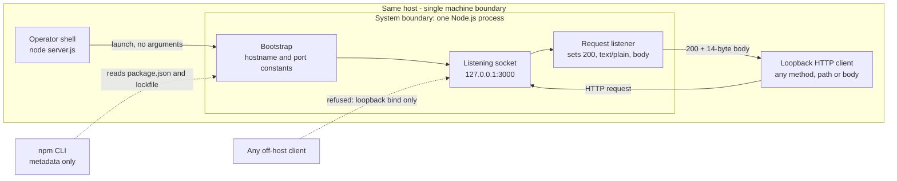

### 4.1.2 Workflow Inventory and Notation

| Workflow ID | Workflow | Trigger | Implementation | Status |
|---|---|---|---|---|
| W-01 | Bootstrap and port binding | Process launch | `server.js` lines 1, 3–4, 6–10, 12 | Implemented |
| W-02 | Start-up URL confirmation log | `'listening'` event | `server.js` line 13 | Implemented |
| W-03 | Bind-failure abort | Port unavailable at bind time | Absent from code; surfaces as an unhandled `'error'` event and exit 1 | Implemented implicitly, ungracefully |
| W-04 | Request acceptance and fixed response | Any inbound HTTP request | `server.js` lines 6–10 | Implemented |
| W-05 | Connection keep-alive lifecycle | Response completion | Delegated entirely to Node's HTTP server defaults; no application code | Implemented by the runtime |
| W-06 | Malformed-request rejection | Protocol-level parse error | Delegated to Node's HTTP parser; no `clientError` listener exists | Implemented by the runtime |
| W-07 | Graceful termination and drain | SIGTERM / SIGINT | Absent: no signal handler, no connection drain, immediate exit | Not implemented |
| W-08 | Package metadata resolution | `npm` subcommand | `package.json`, `package-lock.json`; empty dependency graph | Implemented, non-runtime |

**Notation.** Every diagram in this section uses Mermaid.js with the following conventions: a rounded terminator (`([...])`) marks a start or end point; a rectangle marks a process step; a diamond (`{...}`) marks a decision point; `subgraph` blocks act as swimlanes, one per actor or runtime layer; timings and observed values appear inside edge labels or node labels; and each diagram names the source lines it depicts. Where a step exists only inside the Node.js runtime rather than in repository code, the label says so, because no corresponding statement can be cited from `server.js`.

Requirement identifiers from §2.2 (`F-001` fixed-response acknowledgement, `F-002` loopback listener bootstrap, `F-003` start-up log, `F-004` package identity) are referenced at the step they govern, so each flow is traceable to the functional requirement it satisfies.


## 4.2 High-Level System Workflow


The process has one life cycle with three consecutive phases — bootstrap, bind, and serve — and one terminal phase that the code does not design. Nothing loops back to configuration, nothing re-reads state, and nothing is torn down at the end.

### 4.2.1 End-to-End Lifecycle Flowchart

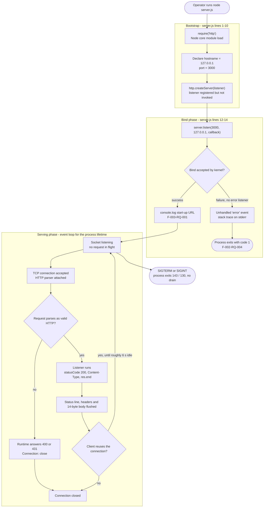

The diagram exposes the structural asymmetry of the system: the happy path is a two-node loop (reply, wait, reply again), while the only way out of the loop is an operator signal. There is no branch that leads back to configuration, to a retry, or to a second process.

### 4.2.2 Phase Timing and Observable Signals

| Phase | Entry condition | Observed duration or window | Observable signal |
|---|---|---|---|
| P1 Module load and parse | Process launch | Included in the 40–44 ms measured from launch to first `200` | No output until bind; `node --check server.js` confirms the file needs no build step |
| P2 Bind | `server.listen` at `server.js` line 12 | Sub-millisecond; completed before any log output | Socket accepts a connection immediately (a request issued the moment the poll succeeds returns `200`) |
| P3 Start-up confirmation | Successful bind | Once only, never repeated | Exactly one stdout line, `Server running at http://127.0.0.1:3000/`, and the count stays at one after 20 sequential and 10 parallel requests; stderr stays at 0 bytes (F-003-RQ-001, F-003-RQ-004) |
| P4 Steady-state listening | Bind success | Process lifetime; no application-level idle timeout or self-termination exists | Port answers continuously; there is no health endpoint to observe (`server.js` lines 6–10 answer every path identically) |
| P5 Per-request handling | One complete request line plus headers | 0.62 ms for `GET /anything?x=1`; 0.74 ms for a small `POST`; 4.2 ms for a 200,000-byte `POST` (time to first byte 4.15 ms) | `200` with a 14-byte body; no log line, no metric, no trace is emitted |
| P6 Keep-alive idle window | Response completed, client keeps the connection | Advertised as `Keep-Alive: timeout=5`; a raw-socket probe saw the server close the idle socket at approximately 6,030 ms | A request written before the close is served on the same connection; after the close the client reconnects transparently |
| P7 Termination | SIGTERM or SIGINT | Immediate | Exit status 143 on SIGTERM, no shutdown message, port released at once (the next connection is refused with curl exit 7). An in-flight request still returned `200` |
| P8 Bind-failure exit | Port 3000 already held | Immediate, before any stdout write | Empty stdout, 20-line stderr stack trace naming `EADDRINUSE`, exit code 1 |

**Timing constraints and service-level considerations.** No SLA, timeout, or latency budget is declared anywhere in the repository, and no timer is registered in code: a search of every JavaScript file for `setTimeout`, `setInterval` and `setImmediate` returns no hits. The observable service levels are therefore those the implementation happens to exhibit — 100% response correctness (the listener has a single code path), sub-millisecond handler latency that is independent of request size because the body is never read, and the approximately 6-second keep-alive idle window that bounds how long a client may hold an idle connection. Availability is unmanaged: one process, no supervisor, no restart loop, no health check, and a hard dependency on TCP port 3000 being free on the host. The single quantitative constraint the code imposes is the fixed endpoint — a second instance cannot coexist, and there is no way to move the port short of editing `server.js` line 4.


## 4.3 Core Business Processes


Two business processes exist: bringing the listener up, and answering a request once it is up. Both are short enough to specify step by step, and both were exercised against a live instance.

### 4.3.1 Process Startup and Port Binding

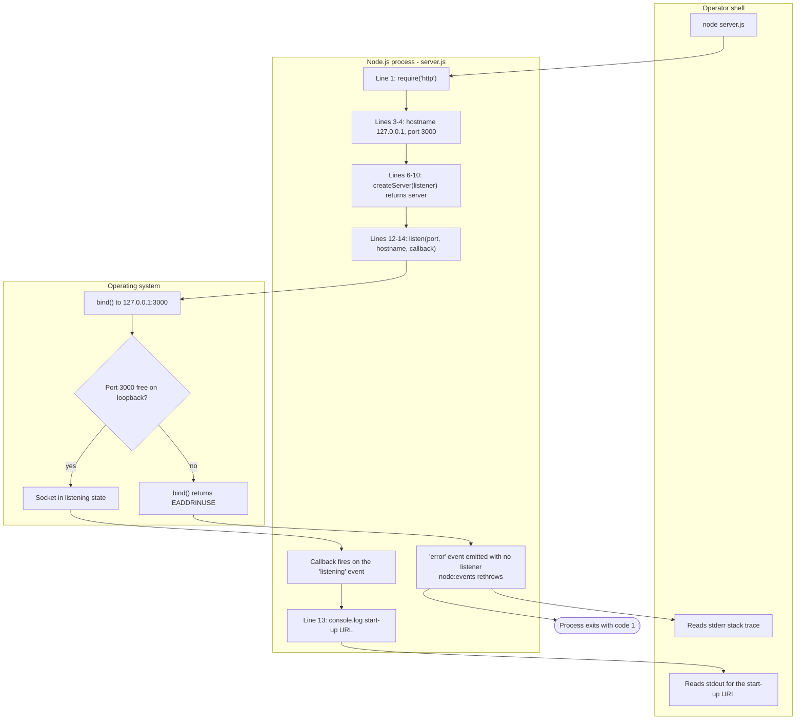

Step detail, with the statement each step corresponds to:

| Step | Action | Source | Business rule applied |
|---|---|---|---|
| S-01 | Load the only dependency, Node core `http` | `server.js` line 1 | The package must remain dependency-free (F-004-RQ-002, F-004-RQ-003) |
| S-02 | Fix bind address and port as module constants | `server.js` lines 3–4 | Binding is not configurable; 127.0.0.1 / 3000 is the product's identity (F-002-RQ-001, F-002-RQ-002) |
| S-03 | Register the request listener and obtain the server object | `server.js` lines 6–10 | One listener serves every request; no routing table exists (F-001-RQ-004) |
| S-04 | Request the bind and register a success callback | `server.js` lines 12–14 | Only the success path is handled; no `'error'` listener, `try`/`catch`, retry or alternative port exists |
| S-05 | On success, write the single start-up line | `server.js` line 13 | One line per successful start, composed from the values actually bound (F-003-RQ-001, F-003-RQ-003) |
| S-06 | On failure, let the `'error'` event go unhandled | — | Node rethrows the unhandled event (`node:events:497`), a stack trace goes to stderr, and the process exits 1 (F-002-RQ-004) |

The failure branch is not a designed error path: nothing in `server.js` attempts recovery, and the diagnosis exists only because Node's default behaviour for an unhandled `'error'` event is to throw. Verbatim evidence from the bind-collision probe: `Error: listen EADDRINUSE: address already in use 127.0.0.1:3000` with `code: 'EADDRINUSE'`, `errno: -98`, `syscall: 'listen'`.

### 4.3.2 Request Acceptance and Fixed-Response Handling

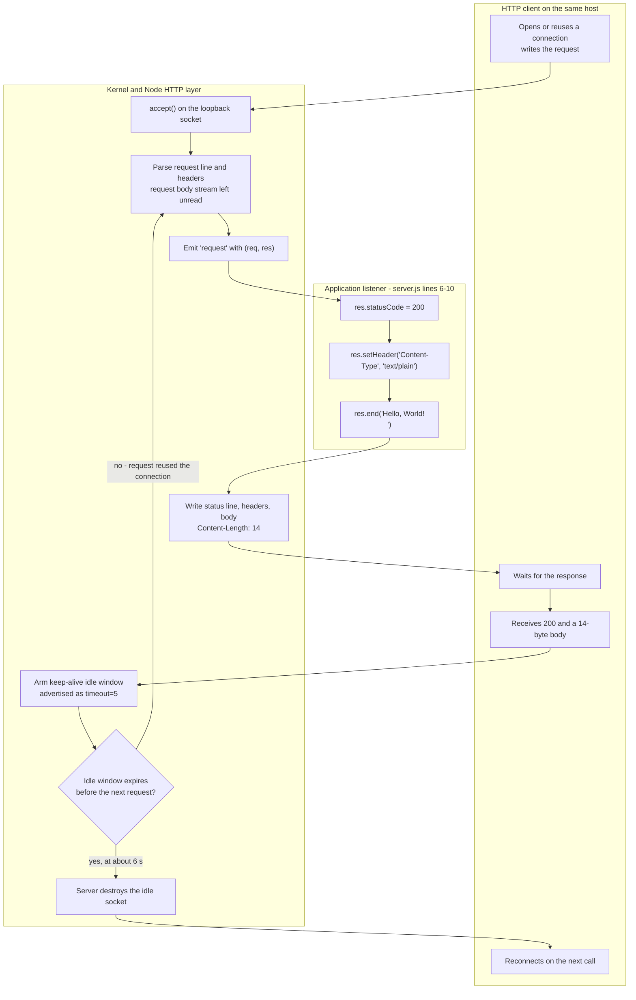

The listener is synchronous and completes in three statements:

```js
res.statusCode = 200;                             // F-001-RQ-001
res.setHeader('Content-Type', 'text/plain');      // F-001-RQ-002
res.end('Hello, World!\n');                       // F-001-RQ-003
```

Because the handler never reads `req`, no request attribute can reach a decision: the method, path, query string, headers and body travel through the parser and are discarded. The measured consequence is that a 200,000-byte upload is answered in 4.2 ms with a 14-byte reply (time to first byte 4.15 ms), and that `GET /`, `GET /anything?x=1`, `POST` with a JSON body, `PUT`, `DELETE /nope/deep` and `HEAD` all return `200` with an identical body.

### 4.3.3 Decision Points, Validation Rules, and Authorization Checkpoints

| Decision ID | Condition evaluated | Branches and outcomes | Where the rule lives |
|---|---|---|---|
| DP-01 | Is TCP port 3000 free on `127.0.0.1`? | Free → bind and serve; taken → unhandled `'error'`, exit 1 | Kernel `bind()`, surfaced by `server.js` lines 12–14 with no handler |
| DP-02 | Is the request line syntactically valid? | Valid → `'request'` emitted; invalid → runtime answers `400 Bad Request` with `Connection: close` | Node HTTP parser, not application code |
| DP-03 | Is the HTTP version supported? | Supported → proceed; `GET / HTTP/9.9` → `400 Bad Request` | Node HTTP parser |
| DP-04 | Do the headers fit the parser's size limit? | Within limit → proceed; 20,000-byte single header → `431 Request Header Fields Too Large` | Node HTTP parser |
| DP-05 | Which method, path, or query was requested? | Never evaluated — every value yields the same response | Absent by design (F-001-RQ-004) |
| DP-06 | Was a request body supplied, and how large is it? | Never evaluated, never buffered, never read | Absent by design (F-001-RQ-006) |
| DP-07 | Does the client reuse the connection? | Reused → next request served on the same socket; idle beyond the window → socket destroyed at approximately 6 s | Node keep-alive defaults, advertised to the client as `Keep-Alive: timeout=5` |
| DP-08 | Is the caller on the same host? | Loopback (`127.0.0.1`, `localhost`) → served; host address `10.11.1.15` → connection refused (curl exit 7) | Literal bind address, `server.js` line 3 |

**Validation rules.** Only protocol-level validation exists, and none of it is written in this repository.

| Rule ID | Rule | Enforced by | Observable rejection |
|---|---|---|---|
| VR-01 | The request line must parse as `METHOD SP TARGET SP VERSION` | Node HTTP parser | `400 Bad Request` for a garbage request line |
| VR-02 | The HTTP version must be one the parser supports | Node HTTP parser | `400 Bad Request` for `HTTP/9.9` |
| VR-03 | Header bytes must stay within the parser's limit | Node HTTP parser | `431 Request Header Fields Too Large` |
| VR-04 | Business-field validation (types, ranges, required fields) | Nothing — no field is read | Cannot occur; no request can be rejected on business grounds |
| VR-05 | Enumerated value or schema checks on a payload | Nothing — payloads are discarded unread | Cannot occur |

Every rejection above was produced by Node's parser while the application emitted no log line and stayed alive, which is why the system can reject malformed traffic without any code of its own.

**Authorization checkpoints.** One control exists and it is network reachability, not authorization: the listener is bound to the loopback address, so only processes on the same host can connect. Beyond that there is no authentication, no authorization, no session, token or cookie handling, no transport encryption (plain HTTP), no CORS or CSP configuration, no rate limiting, and no audit trail — a search of the repository for authentication, TLS, CORS or CSP constructs finds nothing. The absence of stored or logged request data means no data-protection obligation is triggered by processing, while the absence of access logging means any requirement for request attribution is unmet and would need to be built.


## 4.4 Integration Workflows


The system has exactly one integration: a loopback HTTP request and its fixed reply. There is no outbound channel, no event consumer or producer, and no batch schedule to document — the integration inventory below records those absences with the evidence that establishes them, so a reader can tell "not documented" apart from "does not exist".

### 4.4.1 Inbound HTTP Data Flow

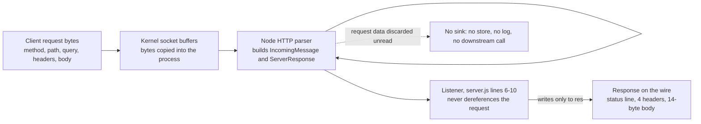

| Data element | Enters the process? | Consumed by application code? | Retained after the response? | Leaves the process? |
|---|---|---|---|---|
| Request method, path, query string | Yes, parsed into `IncomingMessage` | No — `req` is declared at `server.js` line 6 and never referenced | No | No |
| Request headers | Yes | No | No | No |
| Request body of any size | Streamed into the process, then discarded unread | No | No — a 200,000-byte body left no trace | No |
| Response status and headers | Produced by the listener | Yes | No | Yes: `200`, `Content-Type`, `Date`, `Connection`, `Keep-Alive`, `Content-Length` |
| Response body | Produced as a string literal | Yes | No | Yes: `Hello, World!` plus a line feed, 14 bytes |

The only transformation in the flow is constant substitution: whatever arrives, `200 / text/plain / Hello, World!\n` departs.

### 4.4.2 Outbound Integrations, Event Processing, and Batch Sequences

| Integration type | Present? | Evidence |
|---|---|---|
| Outbound HTTP or API client | No | The repository's single import is Node core `http` (`server.js` line 1); no client request is ever constructed |
| Database or persistence driver | No | No driver import, no connection string, no schema; `package-lock.json` resolves zero packages |
| Message queue, broker, or webhook | No | No client library and no connection code anywhere in the six tracked files |
| Cache or in-memory store | No | No store, map, counter, or module-level mutable state; the handler writes only to `res` |
| Filesystem or object storage | No | No `fs` import, no path handling, no upload or download route |
| Scheduled, batch, or cron work | No | A search of every JavaScript file for `setTimeout`, `setInterval`, and `setImmediate` returns no hits; there is no job file, manifest, or scheduler |
| Event consumption or publication | No | The only event the application observes is the bind callback (`server.js` lines 12–14); no `server.on(...)` subscription exists, so not even the socket's `'error'` event is handled |
| Build, package, or deployment integration | No | No Dockerfile, CI workflow, pipeline manifest, or build script; the sole npm script is the placeholder `test` (F-004-RQ-004) |

Two out-of-process interactions touch the package without touching the running service: `npm install`, which resolves an empty graph and fetches nothing (`package-lock.json` holds only the root entry), and `npm test`, which runs `echo "Error: no test specified" && exit 1` from `package.json` line 7 and therefore always exits 1. Neither participates in a request flow.

### 4.4.3 Integration Sequence Diagram

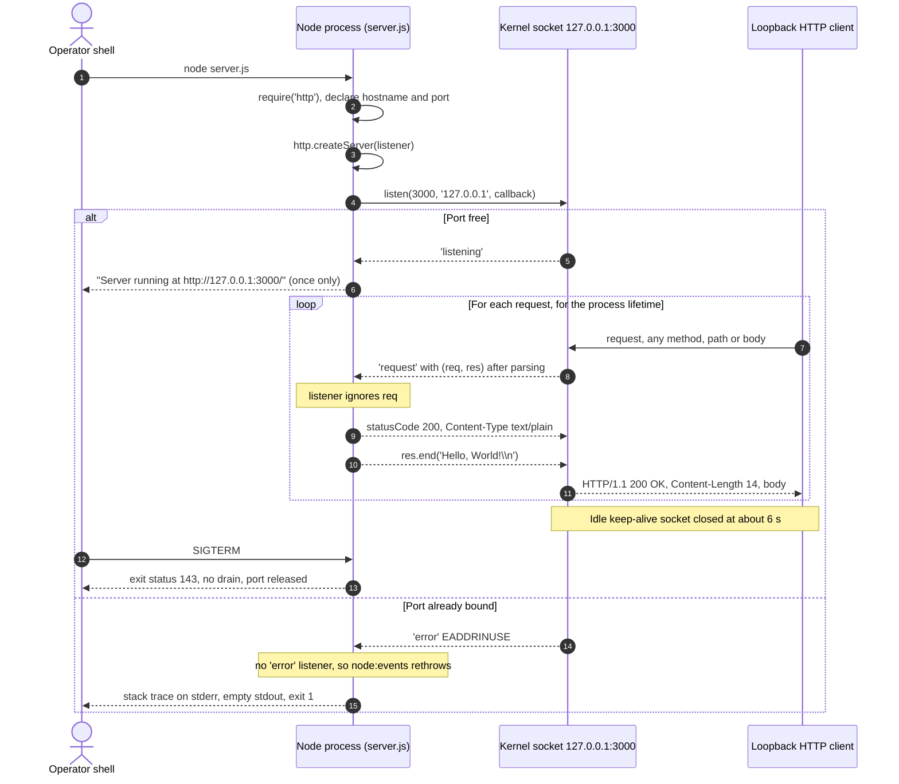

The sequence makes the integration budget visible: one inbound interaction, one startup notification, and no participant on the right-hand side other than the client that initiated the conversation.


## 4.5 Technical Implementation


### 4.5.1 State Management and State Transitions

The application holds no state machine of its own: it has two immutable module constants and one object reference, and every other state transition is owned by the Node.js runtime or the kernel. The diagram below therefore labels the runtime-owned transitions as such.

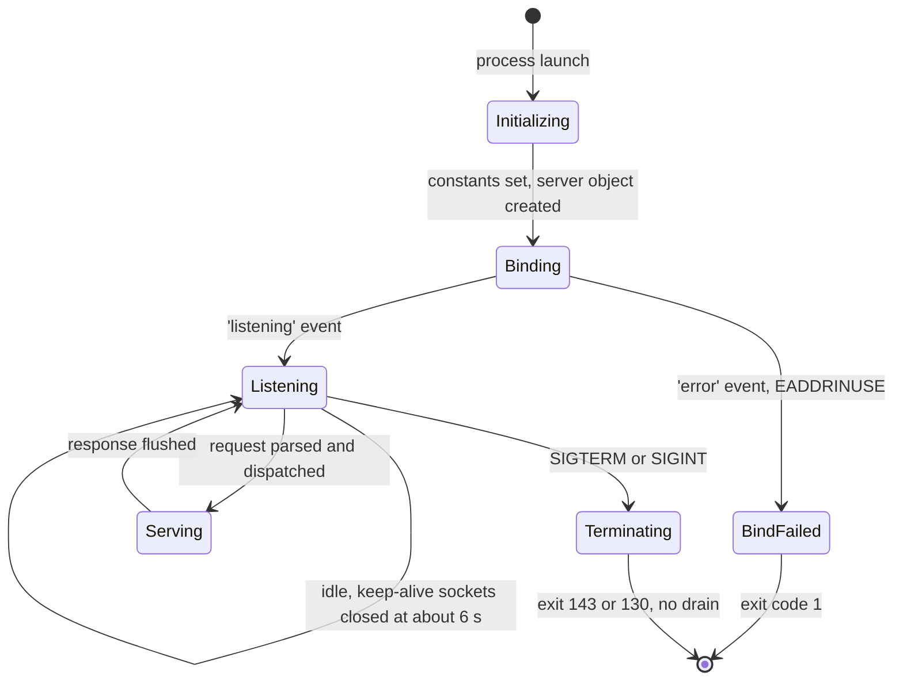

| State | Entered when | State held by the application | Exit transitions | Evidence |
|---|---|---|---|---|
| Initializing | Process launch | Nothing yet | → Binding | `server.js` line 1 |
| Binding | `server.listen` called | `hostname`, `port`, and the `server` reference — all `const`, never reassigned | → Listening, or → BindFailed | `server.js` lines 3–4, 12 |
| Listening | Kernel completes the bind | Nothing beyond the immutable listener | → Serving, → Terminating | `server.js` line 12; a live instance answers immediately after the start-up line |
| Serving | A parsed request reaches the listener | Per-request `res` handle only, scoped to the callback | → Listening after `res.end` | `server.js` lines 6–10 |
| BindFailed | `'error'` event with no listener | Nothing; `node:events` rethrows | → terminated | Bind-collision probe: `EADDRINUSE`, exit 1 |
| Terminating | A signal arrives | Nothing; no signal handler is registered | → terminated | SIGTERM probe: exit status 143, port released at once |

**State that does not exist.** There is no session store, no cookie or token state, no per-client object, no request counter, no feature flag, and no cached configuration. `req` is never dereferenced, so no request-scoped state can escape the callback. Connection-level state — socket, keep-alive timer, parser buffers — belongs to the runtime: the sole hint the client sees is the `Keep-Alive: timeout=5` header, while the actual idle close was observed at approximately 6,030 ms.

### 4.5.2 Data Persistence, Caching, and Transaction Boundaries

| Concern | Implementation | Evidence |
|---|---|---|
| Persistence points | None. The service writes no file, row, or key | No `fs`, database, or storage import in the repository; the only import is `http` (`server.js` line 1) |
| Data read at runtime | `server.js` itself, loaded once by the module system at launch | `node --check server.js` passes; no dynamic `require` or lazy load exists |
| Caching | None. No memoization, warm-up, TTL, or cache client; the response body is a literal in the compiled module | `server.js` line 9 |
| Transaction boundary | The single `res.end` call is the only commit point: status, headers, and body are handed to the runtime in one statement, and there is nothing to roll back | `server.js` lines 7–9 |
| Idempotency | Every request produces the byte-identical response, so all methods are effect-free and repeatable | `GET`, `POST`, `PUT`, `DELETE`, `HEAD` all returned `200` with a 14-byte body |
| Durability on client abort | Nothing is left behind when a transfer fails; the server stayed in Listening with unchanged stdout and empty stderr | Abort probe: connection closed mid-request, then a fresh request returned `200` |
| Durable artifacts in the repository | Three files: `server.js`, `package.json`, `package-lock.json` (plus three empty ignore lists) | `git ls-files` returns exactly six paths |

Because nothing is stored, there is no backup, migration, restore, or retention procedure attached to the runtime, and no data-repair path exists to document.

### 4.5.3 Error Handling, Retry, Fallback, and Recovery

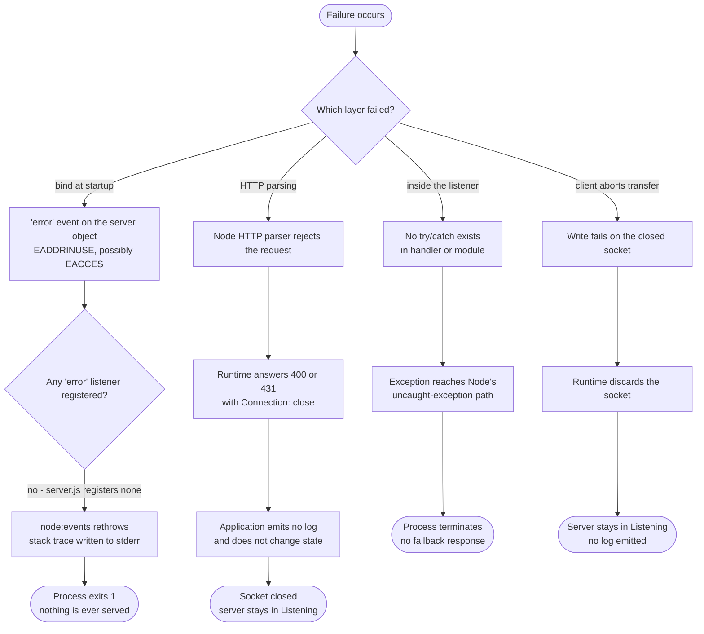

| Error class | Detection | Application handling | Client-visible outcome | Recovery |
|---|---|---|---|---|
| Port already bound | `'error'` event, `EADDRINUSE`, `errno -98`, `syscall listen` | None: no listener, no `try`/`catch`, no alternate port | No response; the operator sees a 20-line stderr stack trace, empty stdout, exit 1 | Operator frees port 3000 and restarts |
| Bind permission denied (`EACCES`) | `'error'` event | None | Same ungraceful exit; not reachable in practice on unprivileged port 3000 | Run as a user permitted to bind the port |
| Malformed request line or unsupported HTTP version | Node HTTP parser | None; the runtime answers | `400 Bad Request`, `Connection: close` | Client corrects the request |
| Oversized headers | Node HTTP parser | None; the runtime answers | `431 Request Header Fields Too Large`, `Connection: close` | Client reduces header size |
| Exception inside the listener | V8 throw during the callback | None — no `try`/`catch` anywhere in the module | Connection dropped; the process dies through the uncaught-exception path | Operator restarts |
| Client disconnect mid-response | Failed socket write | None | Connection closed with no response; the probe that closed the socket received nothing | None needed: the next request succeeds |
| Request that no application rule can serve | Not applicable | Not applicable | Cannot occur — one handler covers every input | Not applicable |

**Retry and fallback.** No retry loop, backoff, circuit breaker, or alternate endpoint exists: a failed bind is terminal for that process, and there is no wait-for-port or fallback-to-other-port logic in `server.js` lines 12–14. No fallback response body or error page exists either; the only non-200 responses a client can receive are the parser-generated `400` and `431`, which carry no application content.

**Notification flows.** One path only: a failed bind writes a Node stack trace — including absolute source paths — to stderr, and nothing is written to stdout. Successful operation produces a single line on stdout at bind time and no per-request notification of any kind; there is no log file, structured event, metric, trace, alert hook, or health endpoint. An operator therefore learns about a request-path problem only from the client side.

**Recovery procedure.** The full documented recovery is operator-restart, exercised end to end in the probes behind this section:

1. Determine whether the process is alive; if the port refuses connections, the process is gone.
2. Identify the occupant of TCP port 3000 and stop it, since the port is a hard-coded constant (`server.js` line 4) with no override.
3. Start the service with `node server.js`.
4. Confirm exactly one stdout line, `Server running at http://127.0.0.1:3000/`; an empty stdout with a stack trace on stderr means the bind failed again.
5. Verify the endpoint with a request to `http://127.0.0.1:3000/`, expecting `200`, `Content-Type: text/plain`, and a 14-byte body.

Anything more sophisticated — an `'error'` listener on the server, a `try`/`catch` around the handler, a `SIGTERM` handler that stops accepting, drains in-flight requests, and closes the socket, or a supervisor that restarts the process — would be new construction: none of it exists in the repository today, which is why SIGTERM terminates with status 143 and an immediate, undrained exit.


## 4.6 Diagram Index and Requirement Traceability


Every diagram required by this section is present, and each is traceable to the workflow, the source lines, and the functional requirement it depicts.

| Diagram ID | Diagram | Type | Location |
|---|---|---|---|
| D-1 | Actor, boundary, and touchpoint context | Flowchart with swimlane subgraphs | §4.1.1 |
| D-2 | End-to-end process life cycle | Flowchart, start/end points and decisions | §4.2.1 |
| D-3 | Startup and port binding | Flowchart with operator, runtime, and kernel swimlanes | §4.3.1 |
| D-4 | Request acceptance and fixed response | Flowchart with client, runtime, and listener swimlanes | §4.3.2 |
| D-5 | Inbound HTTP data flow | Data-flow flowchart | §4.4.1 |
| D-6 | Client, process, and socket interaction | Sequence diagram with a bind-failure alternative | §4.4.3 |
| D-7 | Runtime and application states | State transition diagram | §4.5.1 |
| D-8 | Failure classification and recovery | Error handling flowchart | §4.5.3 |

| Required diagram | Provided by | Coverage note |
|---|---|---|
| High-level system workflow | D-2 | Covers bootstrap, bind decision, serving loop, and termination |
| Detailed process flow for each core feature | D-3 (F-002 bootstrap, includes the F-003 log step), D-4 (F-001 fixed response) | F-004 is metadata-only and has no runtime flow; its interaction is recorded in §4.1.2 and §4.4.2 |
| Error handling flowchart | D-8 | Four failure layers: bind, parsing, listener, client abort |
| Integration sequence diagram | D-6 | One inbound conversation plus the `alt` bind-failure branch |
| State transition diagram | D-7 | Includes the runtime-owned idle transition and the undrained termination |

| Requirement | Flows and decisions that implement it | Diagram | Sub-section |
|---|---|---|---|
| F-001-RQ-001…003 | `res.statusCode = 200`, `setHeader('Content-Type','text/plain')`, `res.end('Hello, World!\n')` | D-4 | §4.3.2 |
| F-001-RQ-004 | DP-05: method and path never evaluated; identical response for `GET`, `POST`, `PUT`, `DELETE`, `HEAD` | D-4 | §4.3.3 |
| F-001-RQ-005…006 | Single `res.end` transaction boundary; `req` never read, 200,000-byte body discarded | D-4, D-5 | §4.3.2, §4.5.2 |
| F-002-RQ-001…002 | S-02, S-04: literal loopback bind with no configuration input | D-2, D-3 | §4.3.1 |
| F-002-RQ-003 | Steady-state Listening loop (P4) | D-2, D-7 | §4.2.2, §4.5.1 |
| F-002-RQ-004 | S-06: unhandled `'error'` event, stderr trace, exit 1 | D-3, D-8 | §4.3.1, §4.5.3 |
| F-003-RQ-001…004 | S-05: one start-up line, none on failure, none per request | D-3, D-6 | §4.2.2, §4.3.1 |
| F-004-RQ-001…005 | Off-runtime: package metadata read by npm; no runtime flow | — | §4.1.2, §4.4.2 |

**Cross-references.** §1.2.2 enumerates the components these flows traverse; §2.2 states each requirement referenced above, with its acceptance criteria; §2.4 records the implementation considerations that constrain any change to these flows (notably that adding a library is an architectural decision for a dependency-free package); §3.6 covers how the process is started and deployed, which is the operator leg of D-1 and D-3.

**Documented absences.** No workflow in this section covers authentication, data mutation, outbound calls, scheduled jobs, retries, or graceful shutdown, because none of them exists in the repository. Each absence is recorded with its evidence in §4.4.2, §4.5.3, and the workflow inventory in §4.1.2.


## 4.7 References


Every flow, timing and failure path in this section was established from the files below or from a live instance of `server.js` running on Node.js v22.23.4 with npm 11.21.0. No external web sources were consulted.

- `server.js` — the whole runtime and therefore the whole subject of this section: `require('http')` (line 1), `hostname = '127.0.0.1'` and `port = 3000` (lines 3–4), the inline `(req, res)` listener with `statusCode = 200`, `setHeader('Content-Type','text/plain')` and `res.end('Hello, World!\n')` (lines 6–10), and `server.listen(port, hostname, callback)` with the single `console.log` start-up line (lines 12–14). It established that `req` is never read, that no `'error'` or signal handler, `try`/`catch`, timer, export or outbound call exists, and it is the source of the step, decision and validation tables in §4.3 and the state and error tables in §4.5.
- `package.json` — package identity `hello_world` 1.0.0, MIT, author `hxu`, the dangling `main: index.js`, and the sole script `test: echo "Error: no test specified" && exit 1` (line 7). It established that no start script, `engines`, dependency or lifecycle hook exists, which fixes the operator's only entry point (`node server.js`) and the metadata-only nature of workflow W-08.
- `package-lock.json` — `lockfileVersion: 3`, `requires: true`, and a `packages` map holding only the root `""` entry. It established the empty resolved dependency graph behind the "no third-party integration" finding in §4.4.2 and the dependency-free constraint cited in §4.3.1 step S-01.
- `.blitzyignore.txt` — 0 bytes, no patterns; confirmed nothing was excluded from this analysis.
- `test.blitzyignore.txt` — 0 bytes, no patterns; same confirmation.
- `test1.blitzyignore.txt` — 0 bytes, no patterns; same confirmation, and part of the six durable artifacts counted in §4.5.2.
- repository root (`""`) — the complete tree: exactly six tracked files and zero sub-folders, with no source tree, tests, CI workflow, container or build tooling. It established that the seven workflows inventoried in §4.1.2 are the entire set and that every absence recorded in §4.4.2 and §4.6 is a genuine absence rather than an unexamined area.


# 5. System Architecture

## 5.1 High-Level Architecture

### 5.1.1 System Overview

**Architecture style and rationale.** The system is a **single-process, single-module monolith executed directly on the Node.js standard library**. One 15-line CommonJS file (`server.js`) both bootstraps the process and serves every request; there is no layer, tier, service, or framework between the network socket and the response. The full dependency graph is empty (`package-lock.json` `lockfileVersion: 3`, one root `""` entry; `npm ls --all` prints an empty tree), and the only import in the repository is the core module `http` (`server.js` line 1).

The style follows from the artifact's purpose as recorded in `package.json` line 4 — `"description": "Hello world in Node.js"` — and is the canonical shape of that example: an event-driven HTTP listener whose handler sets a status code, one header, and a fixed body. No alternative style appears anywhere in the checkout, and there is no configuration, build, or deployment layer in which one could be expressed. Two consequences frame every later decision in this section: the whole runtime surface is one file, and nothing in it can be changed without editing source and restarting the process.

**Key architectural principles.** Each principle below is enforced by the code as written, not by convention or tooling.

| Principle | How the code enforces it | Evidence |
|---|---|---|
| Zero third-party dependencies | The sole import is a runtime-bundled core module; the resolved package graph is empty | `server.js` line 1; `package-lock.json` lines 6–12; `npm ls --all` → `(empty)` |
| Source is the artifact | JavaScript is executed as written: no transpile, bundle, or `dist/` output; `node --check server.js` passes | No build configuration or tool dependency anywhere; `package.json` scripts contain only `test` |
| Uniform, input-independent handling | The handler never dereferences `req`, so method, path, query, headers, and body cannot influence the response | `server.js` line 6 declares `(req, res)`; `req` is unreferenced in lines 6–10 |
| Configuration as compiled constants | Bind address and port are module-scoped `const` values; `process.env` and `process.argv` appear zero times | `server.js` lines 3–4; absence sweep over every tracked file |
| Least network exposure by default | The listener binds loopback only, so no other host can reach it | `server.js` line 3 (`'127.0.0.1'`); a request to host address `10.11.1.15:3000` returns no response |
| Side-effect-only module, no exported API | No `module.exports` or `export` exists; importing the package yields nothing | `server.js` (whole file); `main: index.js` (`package.json` line 5) points at a file that is absent |
| No in-process state across requests | No mutable module state, session, counter, or cache; each response is rebuilt from literals | `server.js` lines 7–9; §3.5.2 data inventory |

**Patterns present.** Two recognizable patterns appear, both supplied by the runtime's idiom rather than by application design. The first is **event-driven listener registration**: `http.createServer(listener)` (line 6) and `server.listen(port, hostname, callback)` (lines 12–14) attach callbacks that the event loop invokes on the `request` and `listening` events respectively. The second is the **handler-completes-the-response contract**: the handler owns the response from `res.statusCode` (line 7) through `res.setHeader` (line 8) to `res.end` (line 9), which is the single point at which the reply becomes visible to the client. Everything is synchronous inside the handler — there is no `await`, promise, callback, or timer in it — so the handler returns before the runtime writes the bytes.

**Patterns explicitly absent.** The repository contains no routing table, middleware chain, controller/service/repository layering, dependency injection, hexagonal port, message broker, CQRS split, or microservice boundary. The absence sweep over every tracked file returned zero hits for `router`, `route`, `middleware`, `express`, `fastify`, `koa`, `pool`, `queue`, `kafka`, `retry`, `circuit`, and `timeout`; the only application code path is the one arrow function at `server.js` lines 6–10. Documenting such patterns would misrepresent what runs.

**System boundaries and major interfaces.** Four boundaries exist, and only the first crosses the process.

| Boundary | Inside the boundary | Outside | Interface |
|---|---|---|---|
| Network | The one request listener | Any HTTP client that can reach `127.0.0.1:3000` | TCP socket carrying HTTP/1.1, parsed and serialized by the runtime |
| Runtime | `server.js` module scope: `hostname`, `port`, `server` | The Node.js event loop, HTTP parser, and socket layer | CommonJS `require('http')`; the `http.createServer` / `server.listen` API |
| Process | The application's observable effects | Host operating system, shell, and any supervisor | One stdout line at bind; uncaught-exception stack traces on stderr; exit codes `0`, `1`, `143` |
| Package metadata | `package.json`, `package-lock.json` | npm client, registries, CI tooling | JSON manifest fields: `name`, `version`, `license`, `description`, `main`, `scripts` |

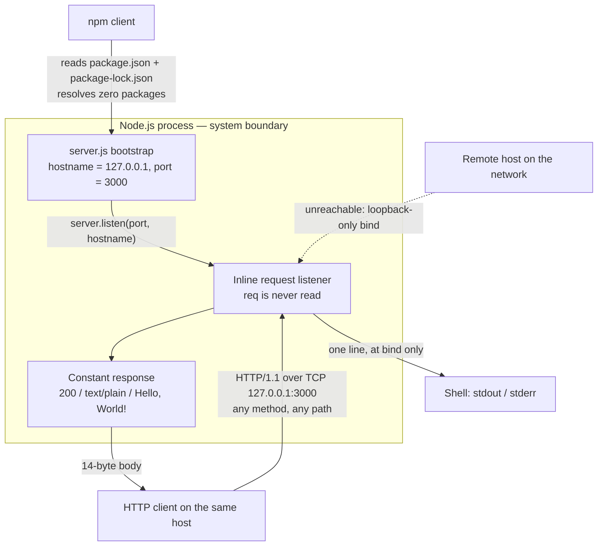

The npm client and the remote host reach the process only in the ways shown: metadata is read at development time, and the remote client's connection attempt is refused because the socket does not exist on any non-loopback address.

### 5.1.2 Core Components

The component inventory is exhaustive rather than representative — the repository contains six files and no sub-folders, so every component is listed. Two rows are development-time metadata artifacts, included because they define the package identity the rest of the stack consumes; the three zero-byte `*.blitzyignore.txt` files are not components and contribute no behavior (they declare no patterns, so nothing is excluded from analysis or build).

**Responsibilities and dependencies.**

| Component | Primary responsibility | Key dependencies |
|---|---|---|
| Bootstrap and listener registration (`server.js` lines 3–4, 6, 12–14) | Construct the HTTP server object, bind TCP 3000 on the loopback address, and emit the start-up confirmation line | Node core `http`; the OS TCP stack; a free port |
| Request listener (`server.js` lines 6–10) | Produce the complete reply for every inbound request: status `200`, `Content-Type: text/plain`, body `Hello, World!\n` | The runtime-supplied `res` object; three string/number literals |
| Node.js runtime and HTTP parser (bundled with the runtime, verified v22.23.4) | Accept sockets, parse HTTP/1.1 request heads, dispatch `request` events, serialize responses, manage keep-alive, and answer protocol errors itself | V8 and libuv; no declared version constraint (`engines` and `packageManager` absent) |
| Package manifest (`package.json`, 11 lines) | Declare package identity (`hello_world` v1.0.0, MIT) and the npm script surface | npm; consumed by any installer or CI job |
| Lockfile (`package-lock.json`, 13 lines) | Pin the resolved dependency graph — currently empty — at `lockfileVersion: 3` | npm 7 or later, which is the first client to understand version 3 |

**Integration points and critical considerations.**

| Component | Integration points | Critical considerations |
|---|---|---|
| Bootstrap and listener registration | Kernel port 3000; process stdout; the `server` object handed to the listener | Address and port are compiled constants with no override; no `'error'` listener exists, so a bind collision surfaces as an uncaught `'error'` event and exit code 1; only one instance per host can start |
| Request listener | Every inbound request, regardless of method, path, or body; the `res` handle scoped to that request | Reads no input, so no routing, content negotiation, or method semantics are possible; fully synchronous and allocation-light; the `res.end` call is its only effect |
| Node.js runtime and HTTP parser | The listener (upward); the kernel socket layer (downward); client connections | Sole owner of connection lifecycle, keep-alive (`Keep-Alive: timeout=5` advertised, idle close observed at roughly 6,030 ms), and protocol errors (`400` for a malformed request line, `431` for oversized headers); version is unpinned, so behavior is whatever the host installs |
| Package manifest | npm install, `npm test`, and any package consumer | `main` names `index.js`, which does not exist (`require('./index.js')` throws `MODULE_NOT_FOUND`) and could not work even if present because the module exports nothing; the single script `test` runs `echo "Error: no test specified" && exit 1` and therefore fails every run |
| Lockfile | npm install / `npm ci` | Records a genuinely empty graph, so installation fetches nothing and reports `audited 1 package`, `found 0 vulnerabilities`; the v3 format imposes an implicit npm 7+ floor that the manifest itself does not state |

### 5.1.3 Data Flow Description

**Primary flow — request and response.** The system has exactly one runtime data flow, and it is linear with a single transformation point. A client opens a TCP connection to `127.0.0.1:3000`. The runtime accepts the socket on its event loop, parses the request head per HTTP/1.1, materializes an `IncomingMessage` (`req`) and a `ServerResponse` (`res`), and dispatches the `request` event to the listener registered at `server.js` line 6. The handler sets `res.statusCode = 200` (line 7), sets the `Content-Type: text/plain` header (line 8), and calls `res.end('Hello, World!\n')` (line 9). The runtime then serializes the status line, applies default headers (`Date`, `Connection: keep-alive`, `Keep-Alive: timeout=5`, `Content-Length: 14`), writes the bytes to the socket, and returns the connection to the keep-alive pool for reuse. No component downstream of the handler exists to receive, record, or forward anything.

**Startup flow.** Process launch evaluates the module: two `const` declarations bind `hostname` and `port` (lines 3–4), `http.createServer` returns a `Server` object with the inline handler attached (line 6), and `server.listen(port, hostname, callback)` (line 12) asks the kernel to bind. On the `listening` event the callback writes `Server running at http://127.0.0.1:3000/` to stdout (line 13). Startup moves no application data: nothing is read from disk, no remote call is made, and no configuration is resolved.

**Integration patterns and protocols.** One inbound pattern: synchronous client-initiated request/response over HTTP/1.1 on TCP, with connection reuse (keep-alive verified — a second request on the same connection reported zero new connects). There are no outbound calls, no publish/subscribe, no batch or scheduled jobs, no webhooks, and no streaming: the body is delivered in a single `res.end` rather than written incrementally. Because `req` is never read, the request body is never consumed, so response latency does not depend on request size — a 200,000-byte `POST` was answered in roughly 0.5 ms with the same 14-byte body. The observable data-encoding contract is narrow: UTF-8 plain text, no charset parameter, no compression, no content negotiation, and no HTTP cache directives (`Cache-Control`, `ETag`, `Last-Modified`, and `Expires` are all absent).

**Data transformation points.** Exactly one: the handler composes a reply from three literals — the integer `200`, the header pair `Content-Type: text/plain`, and the 14-byte body. No inbound value is transformed, normalized, validated, or persisted, so there is no schema mapping, no serialization layer owned by the application, and no place where request data could be reinterpreted. Protocol-level parsing and serialization are performed by the Node.js HTTP implementation and are not addressable from application code.

**Key data stores and caches.** None. There is no database, cache, queue, file store, or object storage (§3.5), and the handler writes no file — the `fs` module is not imported anywhere. The only data the process retains is its immutable module scope (`hostname`, `port`, the `server` reference) and the string literals compiled into the module image, all of which reset on restart. No cache headers are emitted, so any caching is left entirely to the client or an intermediary's own heuristics; there is no in-process memoisation and no warm-up step.

**Flow-integrity characteristics.** The flow has no branch, retry, or compensation path: one code path serves every input, which makes the response byte-identical across methods and paths (`GET /`, `GET /anything`, `POST`, `PUT`, `HEAD` all returned `200` with a 14-byte body). A client that disconnects mid-response leaves nothing behind, and the runtime discards the socket without application involvement.

### 5.1.4 External Integration Points

The system integrates with nothing beyond the host it runs on. Its dependency graph is empty, and the sweep over every tracked file found no client library, credential, endpoint, or provider reference. The four points below are the complete set of things outside the process with which it exchanges anything, and only the first is a runtime integration with another system.

**Integration inventory.**

| System name | Integration type | Data exchange pattern | Protocol / format |
|---|---|---|---|
| Local HTTP client (curl, browser, script on the same host) | Inbound runtime integration | Client-initiated request/response; the server replies identically to every method and path; connection reused via keep-alive | HTTP/1.1 over TCP `127.0.0.1:3000`; response `text/plain`, UTF-8, 14-byte body, no auth, no versioning header |
| Node.js runtime (v22.23.4 verified) | In-process library linkage | Module loaded once at launch; the runtime invokes the listener per `request` event and delivers responses | CommonJS `require('http')`; `http.createServer(listener)`, `server.listen(port, host, cb)`, `res.statusCode`, `res.setHeader`, `res.end` |
| Host operating system and shell | Process and socket integration | Socket ownership for the process lifetime; line-oriented text on stdout/stderr; exit status on termination | TCP bind on `127.0.0.1:3000`; stdout line `Server running at http://127.0.0.1:3000/`; stderr stack traces; exit codes `0`, `1`, `143` |
| npm client and package tooling (`package.json`, `package-lock.json`) | Development-time metadata integration | Manifest and lockfile are read; zero packages are resolved, fetched, or installed | JSON; `lockfileVersion: 3`; one script (`test`) that exits 1 |

**Service-level requirements and observed behavior.**

| System name | Declared SLA | Observed or implied requirement |
|---|---|---|
| Local HTTP client | None — no SLA, timeout, rate limit, or quota is declared anywhere | Response in sub-millisecond time in probes; identical answer for every input; client must originate on the same host because the bind is loopback-only |
| Node.js runtime | None — `engines`, `packageManager`, and `.nvmrc` are all absent | A Node.js runtime must be present on the host; only the version bundled with the host is guaranteed, and behavior was verified on v22.23.4 / npm 11.21.0 |
| Host operating system and shell | None — no supervisor, restart policy, or health check is defined | TCP 3000 must be free, since the port cannot be changed without editing source; the process must be started by hand (`node server.js`) and restarted by an operator after any failure |
| npm client and package tooling | None | An npm release that understands `lockfileVersion: 3` (npm 7 or later) is required to consume the lockfile; installation succeeds because it has nothing to do |

**Explicitly absent integrations.** There is no authentication or identity provider, no database or cache endpoint, no message broker, no third-party HTTP API, no cloud provider SDK, no object storage, and no telemetry backend (§3.4, §3.5). The runtime also exposes no health, readiness, or metrics endpoint: every path returns the same `200`, so a liveness probe can only be an HTTP request to any path or a TCP connect to port 3000 (§3.6.3).


## 5.2 Component Details

### 5.2.1 Bootstrap and Listener Registration

**Purpose and responsibilities.** The module body of `server.js` outside the handler is the composition root: it declares the bind address and port as immutable module-scoped constants (lines 3–4), constructs the HTTP server with the handler attached (`http.createServer`, line 6), starts listening and registers a success callback (lines 12–14), and writes the single start-up confirmation line (`console.log`, line 13). It performs no validation, no configuration resolution, and no dependency wiring, because there is nothing to resolve or wire.

| Aspect | Detail |
|---|---|
| Technologies | CommonJS module evaluation by the Node.js runtime; core `http` module; the built-in `console` (stdout) |
| Key interfaces | `http.createServer([requestListener]) → http.Server`; `server.listen(port[, host][, backlog][, callback]) → http.Server`; module-level side effect with no export |
| Persistence requirements | None — reads no file, opens no data store, and holds nothing across process restarts |
| Scaling considerations | The port `3000` and address `'127.0.0.1'` are compiled constants, so a second instance on the same host dies with `EADDRINUSE`; no `cluster` or worker API is used, so the deployment unit is exactly one process on one core, and scale-out requires editing source or wrapping the process externally |

The failure mode of this component is observable and unhandled: `server.listen` has only a success callback, no `'error'` listener is attached, and no `try`/`catch` exists, so a bind collision is reported by `node:events` as `throw er; // Unhandled 'error' event` (`Error: listen EADDRINUSE: address already in use 127.0.0.1:3000`), the process exits with code 1, and the start-up line is never printed.

### 5.2.2 Request Listener

**Purpose and responsibilities.** The inline arrow function at `server.js` lines 6–10 is the entire request-processing surface for every input. It sets `res.statusCode = 200` (line 7), sets the `Content-Type: text/plain` header (line 8), and terminates the response with the constant body `'Hello, World!\n'` (line 9). It reads nothing from `req`, so it has no branches and its output is invariant.

| Aspect | Detail |
|---|---|
| Technologies | Plain ES2015 arrow function and template/literal strings; Node core `http.ServerResponse` API; no framework, no middleware, no transpilation |
| Key interfaces | Signature `(req: http.IncomingMessage, res: http.ServerResponse) => void`; writes `res.statusCode`, `res.setHeader(name, value)`, `res.end([data])`. `req` is declared and never dereferenced, so no method, URL, query, header, or body accessor is exercised |
| Persistence requirements | None — no `fs`, database, or storage import anywhere in the repository; the response is emitted from module-scope literals |
| Scaling considerations | Work per request is constant and non-blocking: three property/method writes and a 14-byte body, with no I/O, no CPU-bound computation, and no per-request allocation retained after return. Because the request body is never consumed, response time does not grow with request size — a 200,000-byte `POST` was answered in roughly 0.5 ms. Concurrency is bounded only by the event loop of the single process and by keep-alive socket limits; there is no worker pool, thread offload, or response cache to tune |

**Interfaces deliberately not exposed.** There is no route table (every path resolves to the same handler outcome), no query-parameter or body contract, no content-negotiation or method handling, no error-response shape beyond the runtime's own `400`/`431`, no CLI flags or environment variables (`process.argv` and `process.env` appear zero times), and no programmatic module API (`module.exports` is absent, and `main: index.js` points at no file). The listener therefore presents no surface that a client or an embedding program could parameterize.

### 5.2.3 Node.js Runtime and HTTP Parser

**Purpose and responsibilities.** The runtime owns everything the application does not: socket acceptance, HTTP/1.1 parsing and serialization, keep-alive management, protocol-level error responses, and the uncaught-exception path. The application supplies only the handler; the runtime supplies the connection lifecycle that makes the handler reachable.

| Aspect | Detail |
|---|---|
| Technologies | Node.js with bundled `http` module; verified on Node v22.23.4 (V8 12.4.254.21-node.57, libuv 1.51.0) with npm 11.21.0. No version is declared — `engines`, `packageManager`, and `.nvmrc` are all absent |
| Key interfaces | Upward: `'listening'` and `'request'` events, `IncomingMessage`/`ServerResponse` objects. Downward: TCP sockets via libuv. Emitted headers: `Content-Type`, `Date`, `Connection: keep-alive`, `Keep-Alive: timeout=5`, `Content-Length: 14` |
| Persistence requirements | None. The only durable artifacts are the three tracked source and metadata files; the runtime writes no log file, no pid file, and no cache |
| Scaling considerations | Connection reuse is the only concurrency lever present: the advertised `Keep-Alive: timeout=5` was observed to close an idle socket at roughly 6,030 ms (the 5,000 ms default plus the runtime's 1,000 ms buffer), and a second request on the same connection reported zero new connects. Protocol limits are runtime defaults and are not tuned anywhere in the repository — a malformed request line produced `400 Bad Request` with `Connection: close`, and a 20,000-byte single header produced `431 Request Header Fields Too Large` |

### 5.2.4 Package Manifest and Lockfile

**Purpose and responsibilities.** `package.json` establishes package identity — `hello_world` v1.0.0, description `Hello world in Node.js`, author `hxu`, license MIT — and the npm script surface, which contains exactly one entry. `package-lock.json` pins the resolved graph at `lockfileVersion: 3` and records that the graph is empty.

| Aspect | Detail |
|---|---|
| Technologies | JSON manifests consumed by the npm client; `lockfileVersion: 3` is the npm 7+ package-map format. npm 11.21.0 verified |
| Key interfaces | Fields present: `name`, `version`, `description`, `main`, `scripts`, `author`, `license`. Fields absent: `dependencies`, `devDependencies`, `peerDependencies`, `optionalDependencies`, `engines`, `packageManager`, `private`, `repository`, `homepage`, `bugs`, `files`, `keywords`. `scripts` contains only `test` |
| Persistence requirements | These are the only durable configuration artifacts in the system; neither is read at runtime — `server.js` imports no manifest and no configuration file |
| Scaling considerations | Installation is trivially reproducible because nothing is fetched (`npm ls --all` prints an empty tree; `npm install` reports `audited 1 package`, `found 0 vulnerabilities`), but the manifests constrain nothing at run time: with no `engines` field any Node.js version may be used, and with no `private: true` the package is implicitly publish-eligible even though it exports nothing |

Two defects in this component are architectural rather than cosmetic. `main` resolves to `index.js`, a file absent from the checkout, so `require('./index.js')` throws `MODULE_NOT_FOUND`; and even with a correct target the package would expose nothing, because `server.js` declares no exports. The `test` script runs `echo "Error: no test specified" && exit 1`, so any gate that invokes it fails by construction.

### 5.2.5 Component Interaction Diagram

All interactions are in-process callbacks or kernel socket operations; no component communicates over a network with another component.

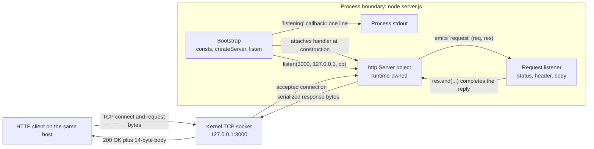

### 5.2.6 State Transitions of a Connection

The application holds no state machine: it has three immutable references (`hostname`, `port`, `server`) and no mutable state between requests. Process-level states (initializing, binding, listening, serving, bind failure, termination) are documented in §4.5.1; the diagram below tracks the states the runtime assigns to an individual client connection, which is the only lifecycle an architect can observe from outside the process.

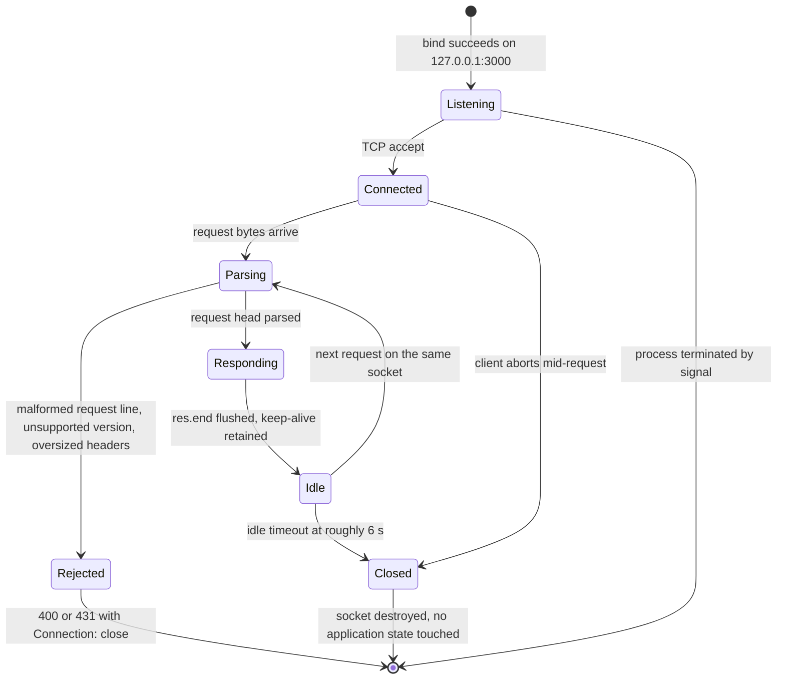

| State | Entered when | Held by | Exit conditions |
|---|---|---|---|
| Listening | Kernel completes the bind on `127.0.0.1:3000` | The runtime; the application holds only the `server` reference | TCP accept, or process termination |
| Connected | A client completes the TCP handshake | Runtime | Bytes arrive, or the client aborts |
| Parsing | The parser receives a request head | Runtime; `req` exists but is never read | Head parsed, or a protocol error produces `400`/`431` |
| Responding | The listener has executed lines 7–9 | The `res` handle, scoped to the callback | `res.end` flushed; socket returns to Idle |
| Idle | The response is complete and the connection is kept alive | Runtime keep-alive timer | A new request on the socket, or idle close at roughly 6 s |
| Rejected / Closed | A protocol error, an abort, or an idle timeout | Runtime | Terminal — nothing in the application observes either transition |

### 5.2.7 Sequence Diagrams for Key Flows

Two flows exist: start-up, which ends with the process listening, and request handling, which repeats for the life of the process.

**Start-up sequence.** No application data moves; the only observable effects are the bound socket and one stdout line.

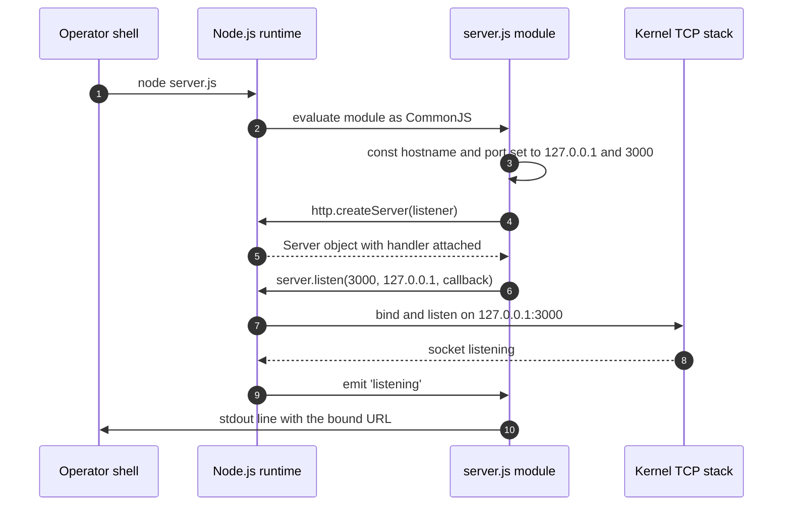

**Request-response sequence.** The same seven steps apply to every method and path, because the listener inspects neither.

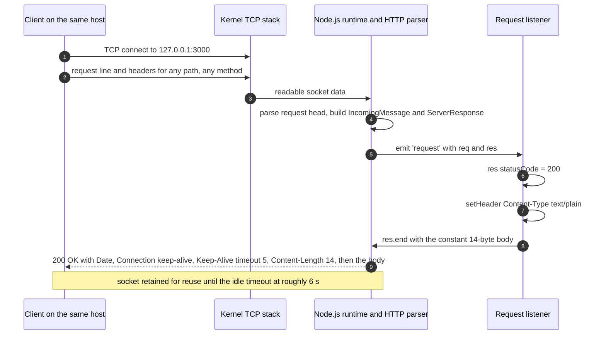

| Flow step | Application responsibility | Runtime responsibility | Evidence |
|---|---|---|---|
| Bind | Supply constants and a success callback | Kernel bind, `'listening'` event | `server.js` lines 3–4, 12–14 |
| Accept and parse | None | Socket acceptance, HTTP/1.1 parsing, `400`/`431` on protocol errors | Runtime-owned; malformed request line returned `400`, oversized header returned `431` |
| Dispatch | Receive `(req, res)` | Emit `'request'` | `server.js` line 6 |
| Compose | Set status, set header, write body | None until `res.end` | `server.js` lines 7–9 |
| Serialize and flush | None | Add default headers, write bytes, manage keep-alive | Observed headers on a live instance; reuse verified with zero new connects on the second request |
| Terminate | None — no signal handler | Default signal disposition; exit code 143 on SIGTERM | Signal probe: status 143, port released immediately, no drain |


## 5.3 Technical Decisions

### 5.3.1 Architecture Decision Records

The project keeps no decision log: the repository holds a single commit (`8bb4eb6 "Add files via upload"`), no documentation folder, and no comment in `server.js`. The records below are therefore **reconstructed** — each states the decision the code actually embodies, the evidence that fixes it, and the consequence an architect inherits. Where the code fixes a decision by omission (no database, no auth), the absence itself is recorded, because a later change must consciously reverse it.

| ID | Decision | Rationale and evidence | Consequence |
|---|---|---|---|
| AD-01 | One process, one module, no layering | The entire runtime is a 15-line file (`server.js`); no sub-folders or additional modules exist in the checkout | Any capability change edits the sole entry point; no independently deployable or separately scalable unit exists |
| AD-02 | Node core `http` only, no web framework | Zero hits for `express`, `fastify`, `koa`, `router`, or `middleware` in any tracked file; the reply needs no routing (`server.js` lines 6–10) | No routing, middleware, body parsing, or framework-level error handling can be configured; adding a framework is an architectural change (§2.4.4) |
| AD-03 | Zero third-party dependencies | `package-lock.json` resolves an empty graph (`npm ls --all` → `(empty)`); only `require('http')` appears in source | Installation fetches nothing and no package supply-chain surface exists; anything needing a library (logging, validation, metrics) forces a new dependency decision |
| AD-04 | Synchronous request/response over HTTP/1.1 | Handler contains no promise, callback, or timer; body is emitted in a single `res.end` (line 9) | No streaming, server push, WebSocket, or long-poll capability; every interaction is client-initiated |
| AD-05 | Bind to loopback `127.0.0.1` | `hostname = '127.0.0.1'` (`server.js` line 3); a request to host address `10.11.1.15:3000` returned no response | The service is unreachable from other hosts and from other containers (§3.6.3); exposure requires editing source |
| AD-06 | Configuration compiled into source | `hostname` and `port` are `const` (lines 3–4); `process.env` and `process.argv` appear zero times | The artifact is environment-independent with no secret store needed, but a busy port 3000 is fatal and a second instance on the same host cannot start |
| AD-07 | No persistence and no caching layer | No `fs`, database, cache, or queue import; no `Cache-Control`, `ETag`, or `Last-Modified` emitted; payload is a string literal (line 9) | Restart is lossless, with nothing to back up or migrate; any stateful requirement — counter, session, editable content — is new construction (§3.5.2) |
| AD-08 | No authentication or authorization | Zero hits for `auth`, `token`, `session`, `jwt`, `cors`, `helmet` (the sole `auth` occurrence is the `author` manifest field); `req` is never read | Access is controlled only by the loopback bind; any exposure decision must ship identity and access control with the bind change |
| AD-09 | No error handling and no graceful shutdown | No `'error'` listener, no `try`/`catch`, no `SIGTERM`/`SIGINT` handler; bind collision produced an uncaught `'error'` event and exit 1, SIGTERM produced exit 143 with no drain (§4.5.3) | Failures are terminal for the process and recovery is an operator restart; a supervisor or error listener is new construction |
| AD-10 | No module boundary, so nothing is importable or unit-testable | No `module.exports`; `main: index.js` names an absent file, so `require('./index.js')` throws `MODULE_NOT_FOUND` | The handler cannot be imported and exercised in isolation; the only verification available is a live HTTP request (§3.6.4) |

### 5.3.2 Architecture Style and Tradeoffs

The style is a **single-process, single-threaded, event-driven HTTP monolith with no tiers**. It is the correct shape for the capability actually implemented — one invariant acknowledgement — and its costs appear only when a requirement falls outside that capability.

| Style decision | Benefit realized | Cost incurred |
|---|---|---|
| Monolith in one file | Complete system readable in 15 lines; no inter-module contracts to keep in sync | No separation between transport, business logic, and configuration; every change touches the only file |
| Standard library only | No dependency upgrades, no transitive CVE surface, installation is a no-op | No ready-made logging, validation, metrics, or routing; each would be a supply-chain decision |
| Event-driven, non-blocking runtime | Constant per-request work executed on one core with no thread management | Concurrency tuning is limited to keep-alive behavior; no worker offload exists for future CPU-bound work |
| Stateless by construction | Any restart is safe; instances are interchangeable in principle; no consistency problem | No accumulation of any kind — counters, sessions, and history cannot be expressed |

### 5.3.3 Communication Pattern

The only communication pattern is **synchronous client-initiated request/response over HTTP/1.1 on TCP**, with connection reuse. The application contributes the response triple; the runtime contributes parsing, default headers, keep-alive, and protocol-error replies. Verified behavior across `GET /`, `GET /anything?x=1`, `POST` with a JSON body, `PUT`, `DELETE`, and `HEAD` was identical — `200`, `text/plain`, 14 bytes — which confirms the pattern carries no application semantics at all.

Alternatives are absent rather than rejected on record: there is no message queue or broker, no publish/subscribe, no gRPC or binary protocol, no WebSocket or server-sent events, no batching or scheduled jobs, and no outbound HTTP client. The kept connection is the only performance-relevant choice in the pattern: the response advertises `Keep-Alive: timeout=5`, a second request on the same connection reported zero new connects, and an idle socket was closed at roughly 6,030 ms.

### 5.3.4 Data Storage Solution

No storage solution was chosen, and none is needed for the capability as built. The complete data inventory is three items: the body literal `'Hello, World!\n'` (`server.js` line 9), the status and header assignments (lines 7–8), and the `hostname`/`port` constants (lines 3–4). All live in the process image and are immutable; no file, row, key, or object is read or written at any point in the lifecycle (§3.5.2).

| Candidate need | Storage decision implied | Current state |
|---|---|---|
| Serve a fixed payload | None — a string literal suffices | Implemented (`server.js` line 9) |
| Change the payload without redeployment | A configuration source or a store, plus a read path | Not implemented; the literal requires an edit and restart |
| Record requests for audit or analytics | Append-only sink plus a write path in the handler | Not implemented; the handler has no write and emits no per-request log |
| Hold session or user state | A store plus identity, neither of which exists | Not implemented; no cookie, token, or session code exists |

Because nothing is stored, there is no backup, restore, retention, migration, or consistency concern attached to the runtime — and, equally, no durability guarantee to state in a service level.

### 5.3.5 Caching Strategy

**No caching strategy exists at any layer.** There is no cache client (the dependency graph is empty), no in-process memoisation (the handler stores nothing between calls), and no HTTP cache policy: only `Content-Type` is set (line 8), so `Cache-Control`, `ETag`, `Last-Modified`, and `Expires` are all absent.

| Caching layer | Present | Justification observed in the code |
|---|---|---|
| Client-side HTTP cache | No policy declared | Without directives an intermediary or client may apply heuristics of its own rather than a declared freshness rule |
| Conditional requests | Impossible | `req` is never read, so `If-None-Match` and `If-Modified-Since` cannot be evaluated |
| In-process memoisation | Unnecessary at this size | The response is regenerated from three literals per request, costing no measurable time |
| External cache | Not applicable | No database or expensive computation exists to protect |

The regeneration cost is nil, so the absence of caching has no performance consequence today; its real consequence is a **contract gap** — the service declares no freshness policy, leaving caching behavior to whatever sits between the client and the socket.

### 5.3.6 Security Mechanism Selection

The security posture rests on **one control: the loopback bind**. Every other control is absent, and the sweep over all tracked files returned zero hits for `auth`, `token`, `jwt`, `session`, `cors`, `helmet`, `tls`, and `https`.

| Control | Status | Evidence and consequence |
|---|---|---|
| Network scope restriction | Present | Bind to `127.0.0.1` (`server.js` line 3) keeps the listener off non-loopback interfaces; this is the only access control in the system |
| Transport encryption | Absent | Plain HTTP/1.1; no `https` module, no certificate, no key material. Traffic is confined to the loopback interface, so exposure would require TLS to be added first |
| Authentication and authorization | Absent | No credential is accepted or checked; `req` is never read. Any process on the host that can reach port 3000 receives the response |
| Input-handling risk | Structurally absent | No request data reaches any sink: no SQL, no shell, no filesystem path, no deserialization, no `eval`, no template rendering |
| Secret and credential management | Not applicable | The repository contains no secret, token, key, or `.env` file, and reads no environment variable |
| Error-information exposure | Present | A failed bind writes a Node stack trace, including absolute source paths, to stderr — visible to the operator, not to any client |
| Response hardening headers | Absent | No `Strict-Transport-Security`, `X-Content-Type-Options`, or CSP header is emitted |

The selection is defensible only in combination: because the socket is loopback-only and the handler ignores all input, the missing identity and transport controls are not currently exploitable over the network. Removing the loopback bind without adding authentication and TLS would turn the absence of both into an exposure.

### 5.3.7 Decision Tree for Evaluating Change

The tree converts the decisions above into a routing guide for the next requirement, so that any change is assessed against the constraint it actually breaks.

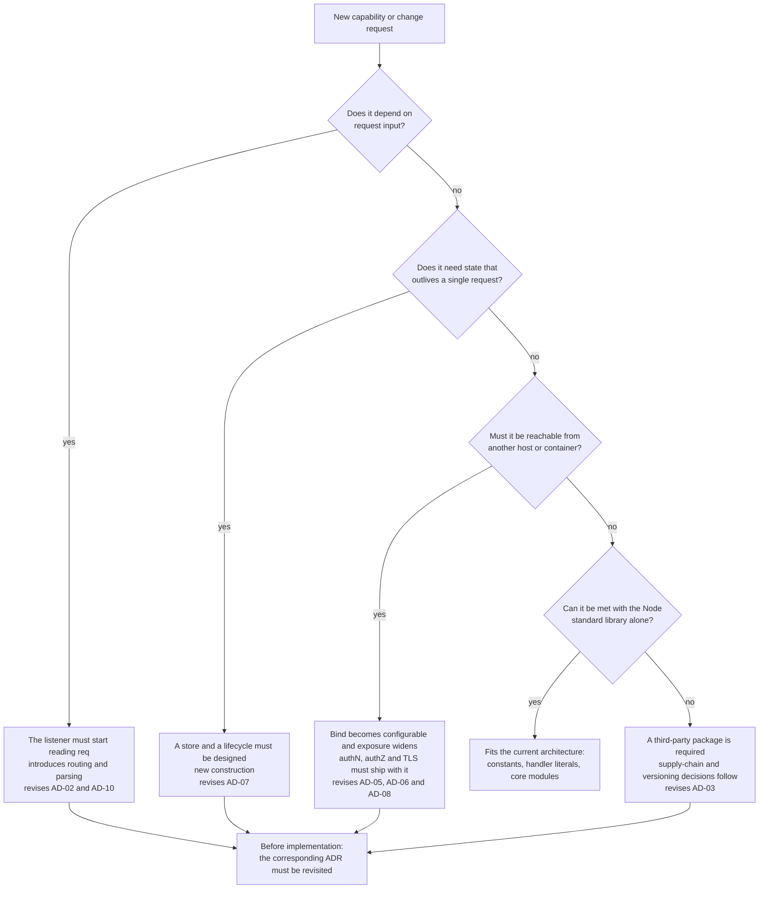


## 5.4 Cross-Cutting Concerns

### 5.4.1 Monitoring and Observability

**No monitoring or observability mechanism exists.** There is no logger, metric, counter, timer, distributed trace, health endpoint, readiness probe, or dashboard hook anywhere in the repository: the sweep over every tracked file returned zero hits for `logger`, `winston`, `pino`, `morgan`, `metrics`, `prometheus`, `health`, `readiness`, `liveness`, `trace`, and `opentelemetry`, and the dependency graph is empty, so no instrumentation package is installed either.

| Observability concern | Implementation | Evidence |
|---|---|---|
| Process liveness | Inferred from a successful HTTP request; no health endpoint exists | Every path returns the same `200`, so any path can serve as a probe (§3.6.3) |
| Startup confirmation | One stdout line written in the `listen` callback | `server.js` line 13: `Server running at http://127.0.0.1:3000/` |
| Request visibility | None — no access log, counter, or latency measurement is emitted per request | stdout stayed at exactly one line after sequential, parallel, and large-body traffic |
| Resource and saturation metrics | None | No metric library, no `/metrics` route, no runtime inspector hook |
| Dependency or version telemetry | None | No `engines`/`packageManager` declaration to report against |
| SLO measurement | Impossible from inside the process | All measurable facts (latency, throughput, exit status) must be observed externally |

The practical consequence is that an operator can confirm start-up and detect a dead socket, but cannot answer how many requests were served, how long they took, or which error a client received. Every number in §5.4.5 was measured from outside the process for that reason.

### 5.4.2 Logging and Tracing

**Logging consists of a single statement, executed once per process.** `console.log` inside the `listen` callback (`server.js` line 13) writes the bound URL to stdout when the kernel completes the bind; it is the only logging call in the codebase, and it is not executed on a bind failure — a second instance produced empty stdout and a 20-line stderr stack trace.

| Aspect | Implementation |
|---|---|
| Sink and format | Process stdout for the one start-up line; process stderr for uncaught-exception stack traces written by the runtime. Unstructured, line-oriented text; no JSON, no fields, no severity level |
| Per-request logging | None. No log statement executes in the request path, and no request identifier is generated |
| Error logging | None by the application. The runtime prints the uncaught `EADDRINUSE` stack trace, which includes absolute source paths |
| Log levels or configuration | None — no level setting, no `LOG_LEVEL` variable, no logging configuration file |
| Log rotation, retention, shipping | Not applicable — nothing is written to a file, and nothing forwards stdout |
| Distributed tracing | None. No trace or span API, no correlation or propagation header, no exporter |
| Audit trail | None. Nothing records who called which path, because the path is never read |

Because the process retains no per-request record, the only durable evidence of traffic is what a client retains. Any future observability would have to be introduced as a dependency decision (AD-03) and would need a side-effect-free place in the handler to run.

### 5.4.3 Error Handling Patterns

**The application registers no error-handling construct of any kind**: no `'error'` event listener on the server object, no `try`/`catch`, no validation clause, no fallback response, no retry, and no signal handler — the sweep for `try`, `catch`, `retry`, `circuit`, and `timeout` returned zero hits. Failure handling is therefore distributed by layer, and the diagram below shows which layer owns each failure and what the architecture provides at that layer. §4.5.3 classifies each failure individually and documents the operator recovery procedure; the concern here is the ownership pattern.

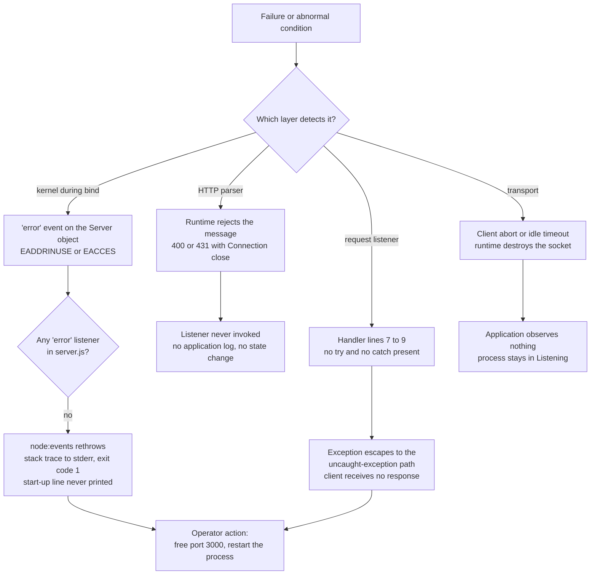

| Failure class | Detected by | Handled by | Client-visible result | Architectural gap |
|---|---|---|---|---|
| Port already bound | Runtime `'error'` event | Nobody — rethrown | No response; exit code 1, stack trace on stderr | No `'error'` listener, no port fallback, no supervisor |
| Malformed request or oversized headers | Runtime parser | Runtime | `400 Bad Request` or `431 Request Header Fields Too Large`, `Connection: close` | No application-level validation or error body |
| Exception inside the handler | V8 | Nobody — uncaught path | Connection dropped; process terminates | No `try`/`catch`, no last-resort response |
| Client disconnect or idle timeout | Runtime socket layer | Runtime | Connection closed; subsequent requests succeed | No logging, no timeout configuration |
| Termination signal | Kernel | Default disposition | Exit code 143 on SIGTERM; in-flight requests abandoned | No signal handler, no connection draining |

**Patterns that are absent by construction.** There is no retry with backoff, no circuit breaker, no timeout configuration, no bulkhead, no dead-letter path, and no fallback payload, because none has a place in a synchronous handler with no outbound call. The nearest thing to an error-handling pattern is the runtime's own separation: protocol faults are answered inside the runtime, while application and bind faults escalate to process exit. That separation is sound for protocol errors and unsafe for anything else, since a bind failure or handler exception takes the whole service down without a response.

### 5.4.4 Authentication and Authorization

**No authentication or authorization framework exists.** No credential is accepted, parsed, or checked, and no principal, role, scope, or permission concept appears in the repository. The sweep returned zero hits for `auth`, `jwt`, `token`, `session`, `login`, `cors`, and `helmet`; the single `auth` occurrence in the tree is the `author` field in `package.json`.

| Concern | Status | Evidence |
|---|---|---|
| Identity establishment | Absent | No credential header, cookie, or token is read; `req` is never dereferenced (`server.js` lines 6–10) |
| Access decision | Absent | There is one handler with one outcome; no branch can deny a request |
| Authorization boundary | The loopback bind only | `hostname = '127.0.0.1'` (line 3) restricts reachability to processes on the same host; this is the sole control |
| Session or token management | Absent | No store, no signing key, no expiry logic anywhere |
| Cross-origin policy | Absent | No `Access-Control-*` header is set, so browser cross-origin access is governed by the browser's default rather than a declared policy |
| Secret handling | Not applicable | No secret, key, or environment variable is read |

The architecture's justification is coherent as long as it holds: with a loopback-only socket and a handler that reads no input, there is no remote attack surface requiring identity. The two decisions are coupled — exposing the listener on a routable interface without adding both authentication and transport security would immediately make this absence a vulnerability, which is why AD-05 and AD-08 must be revisited together (§5.3.7).

### 5.4.5 Performance Requirements and Service Levels

**No performance requirement or service level is declared.** `package.json` contains no non-functional targets, there is no SLA document, and no metric is instrumented. The figures below are external measurements of the implementation as it runs, taken on Node.js v22.23.4; they describe observed behavior, not a commitment the system makes.

| Measured property | Observed value | Method and evidence |
|---|---|---|
| Time to first successful response after launch | Approximately 40–44 ms across repeated runs | Polling `127.0.0.1:3000` until the first `200` after `node server.js` |
| Response body and size | `Hello, World!\n`, 14 bytes, `Content-Type: text/plain` | Headers and body captured from a live instance |
| Per-request latency | Sub-millisecond (about 0.5–0.8 ms) | `curl` timing on `GET /anything?x=1` (0.000624 s), `POST` with JSON body (0.000744 s), and a 200,000-byte `POST` (0.000533 s) |
| Latency sensitivity to request size | None observable | The 200,000-byte body was answered in the same time as a small one, because `req` is never consumed |
| Concurrency behavior | 20 sequential and 10 parallel requests all returned `200` | Sequential and `xargs -P 10` parallel probes; no failure and no stdout growth |
| Connection reuse | Second request on the same connection opened zero new connections | Keep-alive reuse probe; idle socket closed at roughly 6,030 ms against an advertised `Keep-Alive: timeout=5` |
| Throughput ceiling | Not measured; bounded by one event loop on one core | No `cluster`, worker, or thread offload exists to raise it |
| Startup failure latency | Immediate — exit code 1 within the process's first tick | Second-instance probe: `EADDRINUSE`, empty stdout |

The realistic service-level statement the architecture supports is narrow and honest: while the process is alive and port 3000 is free on the loopback interface, every request receives an identical `200` reply with a constant 14-byte body in well under a millisecond. There is no availability commitment, no throughput ceiling, no rate limit, and no declared timeout, so any external SLA would have to be measured and enforced by the caller.

### 5.4.6 Disaster Recovery

Recovery is trivial in mechanism and entirely manual in practice, which follows directly from statelessness (AD-07): nothing is persisted, so nothing can be lost, corrupted, or need restoring.

| Recovery concern | Position |
|---|---|
| Recovery point objective | Zero data loss by construction — there is no persistent state; restarting yields byte-identical behavior |
| Recovery time objective | The duration of one manual restart: run `node server.js`, then confirm one stdout line and a `200` response |
| Backup and restore | Not applicable; the only durable artifacts are the three tracked source and metadata files in Git |
| Failover | None. One process, one hardcoded port, no replica, no load balancer, no multi-instance capability on the same host |
| Automatic restart | None. No supervisor, container restart policy, or systemd unit exists; a crash or bind failure stays down until an operator intervenes |
| Graceful shutdown | None. SIGTERM produced exit code 143 with no connection draining and immediate port release |
| Data repair or migration | Not applicable — no schema, dataset, or migration path exists |
| Configuration recovery | Not applicable — nothing is configurable; the deployable artifact is the source file itself |
| Disaster scenarios with real impact | Loss of the host (no redundancy), an occupier of port 3000 on restart (fatal, since the port cannot be overridden), and an unnoticed outage (no health check or alert exists) |

The full documented recovery procedure — confirm the process is gone, free port 3000, relaunch, verify the stdout line, verify a `200` on any path — is recorded in §4.5.3.

### 5.4.7 Cross-Cutting Coverage Summary

| Concern | Coverage | Mechanism in place | Consequence for operators and architects |
|---|---|---|---|
| Monitoring and observability | None | A single stdout start-up line | Health must be inferred externally; no request or latency history exists |
| Logging and tracing | Start-up only | `console.log` at bind (line 13); runtime stack traces on stderr | No access log, no correlation, no audit trail |
| Error handling | Layered by default, unowned | Runtime answers protocol faults; everything else escalates to process exit | Bind collisions and handler exceptions take the service down without a response |
| Authentication and authorization | None, compensated by network scope | Loopback bind as the sole boundary | Safe only while the listener stays unreachable from other hosts |
| Performance and SLAs | Unmeasured, undeclared | Constant-work synchronous handler; keep-alive reuse | Sub-millisecond replies observed; no commitment, ceiling, or rate limit can be quoted |
| Disaster recovery | Manual restart of a stateless process | Lossless restart; source is the artifact | Recovery needs an operator; no supervisor, failover, or graceful shutdown exists |


## 5.5 References

- `server.js` — the entire runtime: `hostname`/`port` constants (lines 3–4), `http.createServer` with the inline listener that sets status, `Content-Type`, and the 14-byte body (lines 6–10), `server.listen` with the logging callback (lines 12–14); establishes the absence of exports, error listeners, signal handlers, routing, and configuration input.
- `package.json` — package identity `hello_world` v1.0.0, MIT, author `hxu`, description "Hello world in Node.js", the dangling `main: index.js`, and the single placeholder `test` script that exits 1.
- `package-lock.json` — `lockfileVersion: 3` with a single root `""` entry, establishing the empty third-party dependency graph.
- `.blitzyignore.txt`, `test.blitzyignore.txt`, `test1.blitzyignore.txt` — zero-byte exclusion lists containing no patterns; recorded as non-functional metadata, not components, and evaluated before any repository read (they exclude nothing).
- Repository root (`""`) — enumerated with `git ls-files` and `find`: exactly six tracked files and no sub-folders, confirming the exhaustive component inventory and the absence of source trees, tests, CI, containers, and infrastructure definitions.
- §1.2 System Overview, §3.5 Databases & Storage, §3.6 Development & Deployment, §4.5 Technical Implementation — the previously written specification sections cross-referenced here for the component inventory, the stateless storage position, the deployment and CI constraints, and the process-state and per-failure error handling that §5.2.6 and §5.4.3 deliberately do not restate.


# 6. SYSTEM COMPONENTS DESIGN

## 6.1 Core Services Architecture

### 6.1.1 Applicability Determination

**Determination: Core Services Architecture is not applicable for this system.**

The repository contains exactly one deployable unit — a 15-line CommonJS module, `server.js`, executed as a single operating-system process — and no second unit with which it could interact. The evidence is exhaustive rather than sampled: the full tree and `git ls-files` both list six files (`server.js`, `package.json`, `package-lock.json`, and three zero-byte `*.blitzyignore.txt` placeholders), with no sub-folders; the only import anywhere is the runtime-bundled core module (`const http = require('http')`, `server.js` line 1); the resolved dependency graph is empty (`package-lock.json`, `lockfileVersion: 3`, single root entry); and a repository-wide sweep for `cluster`, `docker`, `compose`, `kubernetes`, `nginx`, `pm2`, `health`, `readyz`, `livez`, `retry`, `circuit`, and `load balanc` returned no matches.

The vocabulary the service-architecture checklist presumes does not map onto this code. A *service boundary* presumes at least two independently deployable components; here the listener is created and bound inside the same module that defines the handler (`server.js` lines 6 and 12), so the only boundary is the process edge. *Inter-service communication* presumes a callee behind a network hop; the sole transport is a client-initiated HTTP/1.1 conversation with the loopback interface. *Service discovery* presumes a mutable endpoint; the endpoint is two module-scoped constants — `hostname = '127.0.0.1'` and `port = 3000` (`server.js` lines 3–4) — with no `process.env`, `process.argv`, or registry client anywhere. *Load balancing* presumes a pool of interchangeable instances; a second instance on the same host fails immediately with an uncaught `EADDRINUSE` and exit code 1. *Circuit breakers, retries, and fallbacks* presume an outbound call that can fail; the process makes no outbound call and imports nothing capable of making one.

| Checklist concern | Status | Evidence |
|---|---|---|
| Service boundaries and responsibilities | Single deployable unit; process edge is the only boundary | `server.js` lines 1, 6, 12; six-file tree, no sub-folders |
| Inter-service communication | None; inbound HTTP only, no outbound client | Only import is `http` (line 1); no `request()`, `fetch`, or socket call in the file |
| Service discovery | None; endpoint compiled as constants | `server.js` lines 3–4; no `process.env` / `process.argv` match |
| Load balancing, circuit breaking, retry, fallback | None; one listener, no outbound dependency | Repository-wide grep returned zero matches for all four concepts |

**What this section documents instead.** Because the deployment really is a single service component, the three areas below are documented at process level: the one component that does exist, the scaling envelope it has, and the resilience posture it holds. Each requested sub-topic is addressed explicitly, and each absence is stated as a finding with its evidence rather than left implicit, so that an architect reading this section knows precisely which operational controls the system has and which must be added before the listener is exposed beyond the host.

| Sub-section | What it establishes |
|---|---|
| 6.1.2 Service Components | The single component's boundary and responsibility, and the status of communication, discovery, balancing, circuit breaking, retry, and fallback |
| 6.1.3 Scalability Design | The one supported scaling dimension, the absent auto-scaling inputs, measured resource use, and capacity constraints |
| 6.1.4 Resilience Patterns | Fault tolerance, recovery, redundancy, failover, and degradation status, and the conditions under which each would have to be introduced |

The architectural context this determination depends on — the single-process monolith style, the four system boundaries, and the absence of layering — is established in §5.1.1 and §5.1.2; deployment and tooling are covered in §3.6; the per-failure classification is in §4.5.3 and §5.4.3.


### 6.1.2 Service Components

**Service boundaries and responsibilities.** The system has one service component: the Node.js process launched by `node server.js`. It owns three responsibilities and nothing else — resolve two constants, construct and bind the HTTP server, and produce a constant reply for every request it receives. The reflection of that scope is that the process exposes no API to its own package: there is no `module.exports`, and `package.json` points `main` at `index.js`, a file that does not exist.

| Element | Inside the component | Crosses the boundary |
|---|---|---|
| Identity | One process, one listener on `127.0.0.1:3000` | Flat 7-thread runtime; no cluster, worker, or fork |
| Code | `server.js` lines 1–15, entire application surface | None — no module boundary beyond the runtime's own |
| State | `hostname`, `port`, `server` in module scope; no request state | Nothing persisted across requests or restarts |
| Interface | The inline listener registered at line 6 | HTTP/1.1 over TCP; every method and path answered identically |
| Output | One stdout line at bind (`server.js` line 13) | Runtime stack traces on stderr; exit codes 0, 1, 143 |

**Inter-service communication patterns.** None exist. The process initiates no outbound connection of any kind: the file contains a single `createServer` call, a single `listen` call, and one `console.log`, and the only import is the `http` module used to build the server. No message broker, RPC, queue, webhook, or scheduled job appears in any tracked file. All traffic is inbound and client-initiated, and it is answered synchronously without reference to the request — `req` is declared at line 6 and never dereferenced, so method, path, headers, and body have no influence on the reply. Connection reuse is the only communication optimization present: the runtime advertises `Keep-Alive: timeout=5` and holds idle sockets until the runtime closes them (observed at roughly 6,030 ms, §5.4.5).

**Service discovery mechanisms.** There are none, and none is possible without a source change. The endpoint is compiled in as `const hostname = '127.0.0.1'` and `const port = 3000` (`server.js` lines 3–4); neither `process.env` nor `process.argv` is read anywhere in the file, there is no configuration file, and no DNS name, service registry, or environment lookup participates in binding. Consumers must therefore be told the address out of band, and because the address is the loopback interface, only processes on the same host can act on it.

**Load balancing strategy.** No load balancer, reverse proxy, or multi-instance arrangement exists: no `nginx`, HAProxy, `pm2`, container, or orchestration descriptor appears in the tree, and the code sets no `SO_REUSEPORT` or `server.maxConnections` value. Every connection to port 3000 is accepted by the single listener and handled by the single event loop, with the kernel's accept queue absorbing bursts. The arrangement is actively exclusive — a second instance on the same host dies with `Error: listen EADDRINUSE: address already in use 127.0.0.1:3000` and exit code 1 — so balancing would first require making the port configurable and the bind address routable.

**Circuit breaker patterns.** Absent, and without a trigger condition: a circuit breaker guards a call that can fail, and this process makes none. No breaker state, failure counter, half-open probe, or timeout wrapper exists; a sweep of the file for `timeout`, `setTimeout`, and `circuit` returned no matches, and the listener itself is registered without an `'error'` handler.

**Retry and fallback mechanisms.** Absent on both sides of the boundary. The server has one code path and therefore no fallback payload, alternate route, or degraded response it could return instead; on the client side the only recovery available is a new request, since no `Retry-After`, error body, or idempotency contract is published. When the process exits — an occupied port, an uncaught exception, or `SIGTERM` (exit code 143) — no supervisor restarts it and no standby takes over, so "retry" is entirely an external decision.

| Missing component | Substituting mechanism actually present | Consequence |
|---|---|---|
| Load balancer / proxy | Kernel accept queue feeding one listener | One instance per host; no distribution, no TLS termination |
| Service registry / discovery | Two compiled constants (`server.js` lines 3–4) | Endpoint changes require editing and redeploying source |
| Circuit breaker / bulkhead | None — no outbound call exists to protect | Overload is absorbed or refused by the kernel, not shaped by the app |
| Retry / failover | Operator restart (`node server.js`) | Recovery latency is human, not automated |

**Figure 6.1-1 — Service Interaction Diagram.** The complete set of runtime interactions: one client, one loopback socket, one listener, one constant reply.

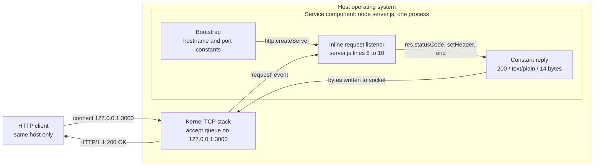

Every request follows this one path. No edge leaves the component toward a database, cache, peer service, or third party, which is precisely why the five checklist concerns above resolve to "absent" rather than to a design choice.


### 6.1.3 Scalability Design

**Horizontal and vertical scaling approach.** Only one dimension is available.

*Vertical* scaling is implicit and unbounded by the code: the process takes whatever CPU, memory, and file descriptors the host grants it. Inside that envelope, JavaScript executes on a single event loop, so additional cores do not increase request throughput — a point confirmed by the shape of the code rather than by configuration, since `cluster` and `worker_threads` appear nowhere in the repository and `server.js` starts no child process. *Horizontal* scaling is not merely unconfigured but actively blocked by three properties of the source: the bind address is the loopback interface (`server.js` line 3), so a replica on another host would be unreachable; the port is a constant (`server.js` line 4), so a second replica on the same host fails with `EADDRINUSE` and exit code 1; and there is no container, orchestrator, or process manager in the tree to place replicas at all. The one property that would make horizontal scaling easy is already present — the process is stateless, holding nothing but its two constants and the `server` reference — so the prerequisite for replicas is a configuration surface for address and port, not a redesign of request handling.

**Auto-scaling triggers and rules.** None exist, because none of the inputs an autoscaler consumes is produced or consumed. There is no metric endpoint (every path returns the same `200`, so no `/metrics` route can exist), no CPU or latency telemetry, no orchestrator to receive a scaling decision, and no manifest to express min/max replica counts. Scaling is a manual act: an operator edits source or provisions a larger host.

| Autoscaling input | State | Why |
|---|---|---|
| CPU or memory metric | Absent | No instrumentation; the only stdout line is the bind message (`server.js` line 13) |
| Request-rate or latency signal | Absent | No access log, counter, or timer executes in the handler |
| Queue-depth or saturation signal | Absent | No in-process queue exists; the kernel's accept backlog is not observable from the app |
| Scaling policy or manifest | Absent | No container, Kubernetes, or PaaS descriptor in the tree (§3.6.3) |

**Resource allocation strategy.** Resources are allocated by the host, not by the application: no container limit, cgroup, `--max-old-space-size` flag, or `maxConnections` setting appears anywhere. Measured on the verified runtime (Node.js v22.23.4), one instance occupies one process identifier with seven runtime threads, a resident set of about 48 MB at start and about 59 MB after 500 requests, and an address space that grew from roughly 750 MB to 1.01 GB while serving traffic — address space, not residency, and therefore not a capacity constraint in itself. Because the handler performs constant work, memory scales with open connections rather than with request volume or payload size.

| Resource | Observed baseline | Observed after 500 requests | Governing mechanism |
|---|---|---|---|
| CPU | One event loop; JS executes on one core | Unchanged — no worker pool for application code | Single-threaded runtime; no `cluster` or worker offload |
| Memory | RSS ≈ 48,156 KB; VSZ ≈ 750,332 KB | RSS ≈ 58,756 KB; VSZ ≈ 1,014,144 KB | V8 heap and socket buffers; no limits declared |
| File descriptors | One listening socket, loopback only | One per concurrent connection plus runtime handles | Host `ulimit -n`; app sets no `maxConnections` |
| Persistent storage | None | None | No database, cache, or filesystem write exists |

**Performance optimization techniques.** The optimizations present are structural consequences of the design rather than tuning: the handler does constant work (`server.js` lines 7–9), never consumes the request body, and completes the response in a single `res.end` call, so latency is independent of payload size — a 200,000-byte `POST` was answered in about 0.5 ms, the same as a small request (§5.4.5). Connection reuse reduces per-request cost, with `Keep-Alive: timeout=5` advertised and idle sockets closed by the runtime at roughly 6,030 ms. What is absent is equally relevant for capacity work: no compression, no HTTP cache directives, no HTTP/2, no static-asset path, no connection cap, and no graceful-shutdown draining.

**Capacity planning guidelines.** The measurements below are external observations of one instance on one host, taken with the runtime verified as v22.23.4; they describe an envelope, not a commitment, since the system declares no SLA, rate limit, or timeout.

| Dimension | Observed or derived value | Planning consequence |
|---|---|---|
| Per-request service time | ≈ 0.5–0.8 ms single-request; ≈ 4 ms for the first request after start | Capacity is bounded by connections in flight, not by handler work |
| Burst tolerance | 500 requests at concurrency 50 returned 500 × `200` in 411 ms, zero failures | Sustained load is bounded by the single event loop and host descriptors |
| Startup cost | First successful response ≈ 40–44 ms after launch (§5.4.5) | Instances are cheap to start; cold-start is not a constraint |
| Placement constraints | One instance per host; port 3000 exclusive; loopback-only | Capacity grows only by adding hosts, and each needs its own client process |

**Figure 6.1-2 — Scalability Architecture.** The vertical axis the design supports, the single process that consumes it, and the horizontal placements the source currently forbids.

```mermaid
flowchart TB
    subgraph Vertical["Vertical axis — supported"]
        Cpu["Host CPU<br/>JS uses one core"]
        Mem["Host memory<br/>RSS about 48 MB baseline"]
    end
    subgraph Proc["Single process: node server.js"]
        Loop["One event loop<br/>no cluster, no worker_threads"]
        Handler["Constant-work handler<br/>lines 7 to 9"]
        Loop --> Handler
    end
    subgraph Horizontal["Horizontal axis — blocked by source"]
        H1["Replica on same host<br/>fails EADDRINUSE, exit 1"]
        H2["Replica on another host<br/>unreachable, loopback bind"]
        H3["Autoscaler or orchestrator<br/>no artifact exists"]
    end
    Cpu -->|"more resident cycles"| Loop
    Mem -->|"heap and socket buffers"| Loop
```

The dashed intent is the missing arrow: there is no supported path from the horizontal axis into the process. Adding one requires making `hostname` and `port` configurable, binding a routable interface, and introducing a supervisor or orchestrator — a change set that spans source, configuration, and deployment (§3.6.4).


### 6.1.4 Resilience Patterns

**Fault tolerance mechanisms.** The application contributes none: the file contains no `try`/`catch`, no `'error'` listener on the server object, and no signal handler, so every fault resolves either inside the runtime or by terminating the process. Fault tolerance is therefore entirely delegated, and delegation is only effective for protocol-level faults, where the runtime answers `400` for a malformed request line and `431` for oversized headers and keeps serving. Everything else escalates: an occupied port surfaces as an uncaught `Error: listen EADDRINUSE` on `node:events:497`, printed to stderr with exit code 1 and without the start-up line, and a termination signal ends the process at exit code 143 with in-flight requests abandoned. The per-failure classification is in §5.4.3; the pattern-level consequence is that the component has no internal boundary at which a failure can be contained.

**Disaster recovery procedures.** Recovery is a manual restart, and it is lossless for the only reason that matters here: the process holds no persistent state. The recovery point objective is zero by construction — restarting reproduces byte-identical behavior from the same source file, since the response is composed from literals at `server.js` lines 7–9 — and the recovery time objective is the length of one operator action (`node server.js`, then confirm one stdout line and a `200` reply), plus roughly 40–44 ms of start-up before the first successful response (§5.4.5). No backup, restore, migration, or configuration-recovery step exists because there is nothing durable to recover: the sole artifacts are the three tracked source and metadata files in Git. The procedure and its verification steps are recorded in §4.5.3 and the recovery posture in §5.4.6.

**Data redundancy approach.** Not applicable, and stated here so the absence is not read as an omission. No database, cache, queue, object store, or file write exists anywhere in the tree — `fs` is never imported — and the handler retains nothing between requests. The only state in the process is the immutable module scope (`hostname`, `port`, the `server` reference) plus in-memory socket buffers, all of which are discarded on exit. Redundancy for the *service definition* is supplied by Git (one commit, `8bb4eb6 "Add files via upload"`), not by the runtime.

**Failover configurations.** None. There is no replica, standby, load balancer, health check, or supervisor: a sweep of the tree found no container, orchestration, `systemd`, or `pm2` artifact, the process in all cases being started by hand. Failover is not merely absent but structurally prevented by the same constraints that block horizontal scaling — the loopback bind (line 3) makes a second host unreachable, and the constant port (line 4) makes a second local instance fatal. Detection is equally absent: because every path returns `200`, an external probe can confirm liveness but nothing reports degradation, and a crash is visible only through the port going dead.

**Service degradation policies.** The system has no degraded mode. The handler has one code path and one outcome, so it cannot shed load selectively, return a reduced payload, or serve stale content; a request either receives the constant `200` or the connection fails. There is no rate limit, queue, timeout, bulkhead, or admission control in the code, so overload is absorbed by the kernel's accept queue and by host file-descriptor limits, and the first client-visible symptom is a refused or stalled connection rather than a declared degradation. The practical benefit is that partial failure inside the application is impossible; the practical cost is that availability is binary and unmanaged.

| Pattern | Present in this system | Operational consequence |
|---|---|---|
| Protocol error handling | Yes — performed by the runtime (`400`, `431`) | Malformed traffic does not affect the listener |
| Application error containment | No — no `try`/`catch`, no `'error'` listener | A bind collision or handler exception ends the process |
| Graceful shutdown / draining | No — `SIGTERM` gave exit 143 with no draining | In-flight requests are abandoned on restart |
| Replica, standby, failover, supervision | No — one process, no health check, no manager | Recovery latency equals operator response time |
| Circuit breaking, retry, timeout, bulkhead | No — and no outbound call to protect | Overload is handled by the kernel, not by the application |

**Figure 6.1-3 — Resilience Pattern Implementations.** Where a fault can be contained, and which resilience patterns collapse to redundancy because the trigger conditions for them do not exist.

```mermaid
flowchart TD
    Event["Fault or overload event"] --> Detect{"Detected by the<br/>runtime or the app?"}
    Detect -->|"HTTP parser: malformed or<br/>oversized headers"| P1["Runtime answers 400 or 431<br/>connection closed"]
    P1 --> Ok["Listener keeps serving<br/>process unaffected"]
    Detect -->|"kernel during bind:<br/>EADDRINUSE or EACCES"| P2{"Application 'error'<br/>listener present?"}
    P2 -->|"no: node:events rethrows"| Dead["Process exits 1<br/>no supervisor, no replica"]
    Detect -->|"signal or overload"| P3{"Draining or<br/>admission control?"}
    P3 -->|"no by construction"| Dead
    Event --> Outbound{"Outbound dependency<br/>to protect?"}
    Outbound -->|"none exists"| Na["Circuit breaker, retry,<br/>fallback not applicable"]
    Dead --> Manual["Operator restarts:<br/>free port 3000, node server.js"]
    Manual --> Ok
```

The loop from `Dead` back through `Manual` to `Ok` is the whole recovery architecture: human-triggered, stateless, and complete only when the operator confirms a `200` reply.


### 6.1.5 References

- `server.js` — lines 1–15: the sole runtime component; `require('http')` (line 1), the compiled `hostname`/`port` constants (lines 3–4), the inline listener that returns `200` / `text/plain` / `Hello, World!\n` without reading `req` (lines 6–10), and the `listen` call whose callback writes the single stdout line (lines 12–14); the source of every service-boundary, discovery, and fault-tolerance finding above.
- `package.json` — package identity `hello_world` v1.0.0 (MIT), the `main: index.js` entry that does not exist, and the single `test` script (`echo "Error: no test specified" && exit 1`); establishes that no service, script, or start command is declared.
- `package-lock.json` — `lockfileVersion: 3` with a single root entry: the empty dependency graph proving no library, client, registry, or instrumentation package is installed.
- `.blitzyignore.txt`, `test.blitzyignore.txt`, `test1.blitzyignore.txt` — zero-byte ignore placeholders; confirm no exclusions apply and that the tree contains nothing beyond the artifacts listed here.
- Repository root (six tracked files, one commit `8bb4eb6 "Add files via upload"`, branches `main` and `QA-18-nov-branch` identical) — establishes the exhaustive inventory of deployable units, deployment descriptors, and configuration.
- Runtime probes of `node server.js` on Node.js v22.23.4 / V8 12.4.254.21-node.57 — one process with seven runtime threads, `Keep-Alive: timeout=5` and `Content-Length: 14` on the reply, second instance failing with `EADDRINUSE` and exit 1, `SIGTERM` exit 143, RSS 48,156 KB → 58,756 KB, and 500 requests at concurrency 50 answered `200` in 411 ms.
- §5.1.1–§5.1.4 (High-Level Architecture) — the single-process monolith style, component inventory, and boundary table this section builds on.
- §5.4.3, §5.4.5, §5.4.6 (Cross-Cutting Concerns) — failure ownership, externally measured latency and connection-reuse figures, and the recovery posture referenced above.
- §3.6.3–§3.6.4 (Development & Deployment) — the absence of containerization, orchestration, and CI/CD that constrains scaling and failover.
- §1.2.2 (System Overview) — the capability inventory and component list used to confirm that no second service component exists.
- No external or web sources were consulted; every statement rests on the repository files and runtime observations listed above.


## 6.2 Database Design

### 6.2.1 Applicability Determination

**Database Design is not applicable to this system.**

The repository contains no database, no embedded store, no cache, no message queue, no object store, and no file I/O of any kind. The determination rests on an exhaustive rather than sampled inventory, because the tree is small enough to enumerate completely: `git ls-files` lists exactly six paths — `server.js`, `package.json`, `package-lock.json`, and three zero-byte `*.blitzyignore.txt` placeholders — and there is no sub-folder at any depth. History agrees with the working tree: the only commit (`8bb4eb6 "Add files via upload"`, branches `main` and `QA-18-nov-branch` in identical state) added those same six paths, so no persistence layer was deleted, renamed, or stashed on a branch.

Every layer at which a data store could appear is empty:

| Layer where persistence could appear | Observed state | Evidence |
|---|---|---|
| Application code | Single 15-line module whose only import is the runtime-bundled `http` core module; no `fs`, `net`, `dns`, or database client is imported | `server.js` line 1; repository-wide keyword sweep for `fs.`, `readFile`, `writeFile`, `storage`, `persist` returned zero matches |
| Dependency graph | No installed package of any kind, so no driver, ORM, query builder, or cache client exists | `package-lock.json` — `lockfileVersion: 3` with a single `""` root entry and no `node_modules/...` keys; no `node_modules` directory on disk |
| Configuration surface | Nothing configurable: no `process.env`, `process.argv`, config file, DSN, or connection string is read | `server.js` lines 1–15 read no external input; `package.json` declares no `config` field or environment contract |
| Request path | The request object is declared and never dereferenced, so no client-supplied value can reach a store | `server.js` line 6 declares `(req, res)`; `req` is absent from lines 7–9 |
| Runtime footprint | A live instance held one listening socket and no data-plane file descriptor or outbound connection | `/proc/<pid>/fd` during a served request showed the listener plus `eventpoll`/`io_uring`/pipe handles only |

The vocabulary this section's checklist presumes does not map onto this code, and naming each mismatch is what makes the absence a finding rather than an omission. An *entity relationship* presumes two or more entity types with cardinality between them; the process holds three module-scoped bindings and two string literals. A *data model* presumes a shape that outlives a request; here the only values are compiled constants. An *index* presumes a lookup structure over a growing collection; nothing in the process grows, because nothing is collected. *Partitioning*, *replication*, and *backup* presume a dataset that can be split, copied, or restored; there is no dataset — restarting the process reproduces byte-identical output from the same source file. A *migration* presumes a schema that evolves; the only version numbers in the repository are the package identity `1.0.0` in `package.json` and `package-lock.json`, which describe the artifact, not stored data.

**What this section documents instead.** Because a factual specification is more useful than an empty one, the sub-sections below address every area the Database Design checklist requests — schema, data management, compliance, and performance — and record for each concern the status of the system and the evidence that establishes it. The resulting tables are a negative inventory: they state precisely which persistence controls exist (none) and which operational capabilities would have to be introduced, and where, before this service could hold data at all.

| Sub-section | What it establishes |
|---|---|
| 6.2.2 Schema Design | Entity relationships, data structures, indexing, partitioning, replication, and backup status, plus the complete index and constraint inventory |
| 6.2.3 Data Management | Migration and versioning position, archival, storage/retrieval mechanics, and caching policy |
| 6.2.4 Compliance Considerations | Retention, backup and fault tolerance, privacy, audit, and access-control posture |
| 6.2.5 Performance Optimization | Query, caching, pooling, read/write splitting, and batch-processing status, with the measured latency envelope |
| 6.2.6 Required Diagrams and Diagram Index | Data flow, entity-model, and replication diagrams drawn to show the persistence boundary |

**Scope of this determination.** The finding holds for the artifact as it stands: `server.js` compiled with the empty dependency graph described above. It would stop holding the moment any of four changes landed — a dependency that opens a store (`pg`, `mysql2`, `mongoose`, `redis`, `better-sqlite3`), an `fs` call that writes durable bytes, a request handler that dereferences `req` into a stored value, or a build step that generates a migration directory. None of those exists in the tree, and none appears in the history, so the present tense of this section is safe for the artifact under review. The architectural context for that judgment — the single-process monolith style and the absence of layering — is established in §5.1, the storage findings are recorded in §3.5, and the recovery consequence of statelessness is in §5.4.6 and §6.1.4.


### 6.2.2 Schema Design

The schema-design concerns below are addressed individually because each presumes a persisted model that this code does not define. The complete set of values the process holds is four module-scoped bindings created once at load and never mutated.

| Concern | Status | Evidence |
|---|---|---|
| Entity relationships | None — no entity type, foreign key, or cardinality exists | `server.js` lines 1–15 declare only `http`, `hostname`, `port`, and `server`; no collection, table, document, or record is referenced |
| Data models and structures | Three module-scope bindings plus a constant response literal; no schema declaration | `server.js` lines 3–4 (`hostname`, `port`), line 6 (`server`), line 9 (`'Hello, World!\n'`) |
| Indexing strategy | None — no lookup structure over stored data | Sweep for `index`, `key`, `primary`, `unique`, `createIndex` returned no match outside `main: "index.js"` in `package.json` |
| Partitioning approach | None — no dataset to divide | Nothing accumulates across requests; every reply is composed from literals |
| Replication configuration | None for data; the source file replicates only through Git | No replica set or standby is possible: a second local instance fails with `EADDRINUSE` and exit code 1 (§6.1.3) |
| Backup architecture | None — nothing durable exists to back up | No write path exists; `git status --porcelain` stayed empty after serving traffic |

**Entity relationships.** There are none, and none can be expressed without inventing a model. The process has no persisted entity, so no relationship type — one-to-one, one-to-many, many-to-many, ownership, or aggregation — has a subject. The nearest structural analogue is that the `server` object created at `server.js` line 6 is referenced by the `listen` call at line 12 within the same module scope: a single in-memory reference between two bindings in one file, dissolved when the process exits, with no identity, no lifetime beyond the process, and no stored counterpart. It is recorded here only so that a reader looking for a relationship does not mistake an omission for a finding.

**Data models and structures.** The system's entire data model is the following four bindings plus one literal. Each is immutable after initialization, holds no client-supplied value, and is discarded at process exit.

| Binding / literal | Type and scope | Origin and lifetime |
|---|---|---|
| `hostname` | `string`, module scope | Literal `'127.0.0.1'` at `server.js` line 3; created once at load, never reassigned |
| `port` | `number`, module scope | Literal `3000` at `server.js` line 4; created once at load, never reassigned |
| `server` | `http.Server` instance, module scope | Returned by `http.createServer` at line 6; holds the listener and the open socket |
| Reply payload | `string` literal, handler frame | `'Hello, World!\n'` written by `res.end` at line 9; rebuilt per request, never stored |

No model carries a field, a type declaration, a validation rule, or a default. There is no serialization or deserialization boundary: nothing is parsed from a request body, encoded to a storage format, or decoded from one, since `req` is never read (`server.js` lines 6–10) and the response is a fixed string constant. `package.json` names `index.js` as `main`, but that file does not exist — a dangling manifest entry with no data-model content behind it.

**Indexing strategy.** No index exists, because an index is a structure maintained over a growing set of records and this process maintains no collection. Nothing is keyed, sorted, hashed, or searched: the handler performs constant work with no lookup of any kind, so per-request latency is independent of payload size — a 200,000-byte `POST` was answered in the same time as a small request (§5.4.5). The word `index` appears in the repository only in the `main` field of `package.json`, which denotes a module entry point rather than a data-access path.

**Partitioning approach.** Not applicable. Partitioning divides a dataset for size, locality, or concurrency reasons; there is no dataset, no storage engine, and no key range over which a partition could be defined. The only division of labor in the system is at the operating-system level — the kernel's accept queue feeding one event-loop listener — which is a traffic-handling arrangement, not a data partition (§6.1.2).

**Replication configuration.** No data replication exists: with no primary store there is no replica, no replication stream, no read replica, no lag, and no promotion rule to configure. Source replication is a VCS concern rather than a runtime one — the deployable artifact is `server.js` itself, carried by Git (one commit, branches `main` and `QA-18-nov-branch`), so a copy of the source on another host would reproduce identical behavior because the behavior is composed of literals at `server.js` lines 7–9. Runtime redundancy is structurally blocked: the loopback bind at line 3 makes a replica on another host unreachable, and the constant port at line 4 makes a second instance on the same host fatal with `EADDRINUSE` and exit code 1 (§6.1.3).

**Backup architecture.** None, and none is needed in the sense a backup serves: the sole durable artifacts are the tracked source and metadata files stored in Git, and restoring them reproduces byte-identical behavior. There is no write path to protect — a live instance served traffic without creating a file, without modifying the working tree, and without opening a single data-plane file descriptor — so no snapshot, journal, WAL archive, point-in-time recovery window, or restore drill exists. The recovery posture that follows is recorded in §5.4.6: recovery point objective zero by construction, recovery time objective one manual `node server.js` plus roughly 40–44 ms to the first successful response.

**Index and constraint inventory.** The requested documentation of every index and constraint resolves to the following, which is complete rather than illustrative:

| Category | Count in repository | Detail |
|---|---|---|
| Indexes (primary, secondary, unique, composite, partial, full-text) | 0 | No store, no collection, no key definition |
| Integrity constraints (primary key, foreign key, unique, check, not-null) | 0 | No schema declaration exists at any layer |
| Defaults, generated columns, triggers, procedures, views | 0 | No DDL, no migration file, no ORM model |
| Declarative application-level validation | 0 | No validator, guard clause, or type annotation; `req` is never read |

Constraints that do exist are properties of the deployment rather than of a schema, and are stated precisely because they behave like invariants: one instance per host (port `3000` is a constant), reachability from the local host only (bind address `127.0.0.1`), and a reply identical for every method and path.


### 6.2.3 Data Management

Data management covers everything that governs how stored data changes over time. This system stores nothing, so each concern resolves to an absence with a specific cause.

| Concern | Status | Evidence |
|---|---|---|
| Migration procedures | None — no schema to migrate, no migration directory, no script | `package.json` declares one script, `test` (`echo "Error: no test specified" && exit 1`); no `migrate`, `db`, or `seed` script exists |
| Versioning strategy | Artifact version only; no schema or dataset version | `package.json` and `package-lock.json` both state `version: 1.0.0`; `lockfileVersion: 3` versions the dependency graph, not data |
| Archival policies | None — nothing accumulates, so nothing ages out | The process retains no per-request record; stdout receives one line per process lifetime (`server.js` line 13) |
| Storage and retrieval mechanisms | In-memory module scope only; retrieval is a constant, not a lookup | `server.js` lines 3–4, 6, 9; no `fs`, no client, no store handle |
| Caching policies | None at any layer | No cache module, no `Cache-Control`, `ETag`, `Last-Modified`, or `Expires` header; only `Content-Type` is set (line 8) |

**Migration procedures.** None exist and none is conceivable against the current artifact, because a migration transforms a schema and there is no schema. The deployable unit is a single source file whose behavior is composed of literals; deploying a change means replacing that file and restarting the process, not transforming stored state. The practical consequence for anyone planning to add persistence is ordering: a migration framework (`node-pg-migrate`, `knex migrate`, `prisma migrate`, `sequelize-cli`) would have to arrive as the project's first dependency, alongside a configuration surface for a connection string — neither of which exists today, since no `process.env` read and no config file appear anywhere (§3.5, §5.3). A migration directory would also have to be created; `git ls-files` shows no `migrations/`, `db/`, or `sql/` folder at any depth.

**Versioning strategy.** Two version numbers exist, and neither versions data. `package.json` declares the package as `hello_world` v1.0.0 under MIT, and `package-lock.json` restates the same name, version, and license in its single root `""` entry with `lockfileVersion: 3` — the npm v7+ package-map format, which versions the *dependency graph*. That graph is empty: the `packages` map contains no `node_modules/...` keys, so there is no transitive dependency whose version could drift between environments. Nothing in the repository carries a schema version, a migration counter, a dataset generation, or a compatibility marker, so there is no forward/backward-compatibility contract to state and no data format that a rollback could contradict. The source itself has one commit (`8bb4eb6`), so artifact versioning is effectively at its first revision.

**Archival policies.** Not applicable: archival moves aged data out of an active set, and no data set exists to age. The only record the process emits is the single stdout line written in the `listen` callback (`server.js` line 13), produced once per process start and never appended to per request; it is unstructured text on stdout, with no rotation, retention window, or shipping pipeline, and it disappears with the container or terminal that captured it (§5.4.2). There is consequently nothing to tier to cold storage, purge, or tombstone.

**Data storage and retrieval mechanisms.** Storage is limited to module scope in process memory: `hostname` and `port` as primitives (`server.js` lines 3–4) and the `server` object holding the listening socket (line 6). Retrieval is not a lookup at all — the handler returns the literal `'Hello, World!\n'` (line 9) without consulting memory, a file, a socket, or a peer. The runtime probe confirms the boundary: while serving `GET /any/path?q=1`, the process held one listening socket and no regular-file descriptors beyond its own stdout/stderr, and the working tree stayed byte-identical (`git status --porcelain` empty). No write-ahead log, journal, temporary file, or lock file appears at any moment. Inbound data is likewise never captured: `req` is declared at line 6 and never dereferenced, so method, path, query string, headers, and body have no sink and no retention.

**Caching policies.** None, at any of the four layers where a cache could sit. There is no application cache (no module, no `Map`, no memoization), no client cache directive (the handler sets only `Content-Type: text/plain` and `statusCode = 200`, leaving `Cache-Control`, `ETag`, `Last-Modified`, and `Expires` unset, so client caching falls to browser or proxy defaults rather than a declared policy), no shared cache or CDN in the tree, and no query-result cache because there is no query. The one reuse mechanism present is transport-level and belongs to the runtime rather than the application: the reply advertises `Keep-Alive: timeout=5` and a second request on the same connection opened no new connection, with the idle socket closed at roughly 6,030 ms (§5.4.5). That is connection reuse, not data caching — no response body, computed value, or client input is retained between requests.


### 6.2.4 Compliance Considerations

Compliance obligations attach to stored or transmitted personal data and to records of who did what. This system neither stores nor transmits client data, so the compliance surface is nearly empty — and where it is not empty, the obligation is discharged by the absence of the data rather than by a control.

| Concern | Position | Consequence |
|---|---|---|
| Data retention rules | No retained data of any kind; nothing to expire, purge, or honor in an erasure request | Retention policy is vacuous rather than configured |
| Backup and fault tolerance | No backup; stateless restart reproduces identical behavior | RPO zero by construction; RTO one manual restart (§5.4.6) |
| Privacy controls | No personal data accepted, derived, logged, or sent onward | `req` is never read; the reply is a constant literal |
| Audit mechanisms | No audit record, access log, or request identifier | Cannot reconstruct who called what (§5.4.2) |
| Access controls | No store to authorize against; loopback bind is the sole boundary | No credential, role, or secret exists in the tree |

**Data retention rules.** There is nothing to retain. The process keeps no per-request record, writes no file, and appends nothing to a store: the response is a constant 14-byte literal (`server.js` line 9), and the only output beyond it is one stdout line per process lifetime (line 13). Because no record is created, no retention window needs to be defined, no deletion job scheduled, and no subject-erasure path implemented — a deletion request has no addressable target. The corollary is that the system also cannot produce a historical record on demand, which matters to any future audit requirement and is why auditability is listed as absent rather than satisfied.

**Backup and fault tolerance policies.** No backup policy exists, because no durable state exists to protect; the tracked source files in Git are the only artifacts, and restarting from them reproduces byte-identical behavior. Fault tolerance is delegated entirely to the runtime and to operator action: the application registers no `'error'` listener, no `try`/`catch`, and no signal handler, so a bind collision ends the process with exit code 1 and `SIGTERM` ends it at exit code 143 with in-flight requests abandoned (§5.4.3). Recovery point objective is zero by construction, and the recovery time objective is the duration of one manual `node server.js` plus roughly 40–44 ms to the first successful response (§5.4.5, §5.4.6). No supervisor, replica, standby, or health check exists to make that recovery automatic.

**Privacy controls.** No personal data enters or leaves the process. Inbound: `req` is declared at `server.js` line 6 and never dereferenced, so no path, query string, header, cookie, or body is parsed, logged, or stored — client IP addresses are not captured either, since no logging statement runs in the request path. Outbound: the only reply is the constant literal at line 9, with `Content-Type: text/plain` and no other header carrying data. No analytics, telemetry, tracing exporter, or third-party SDK is present in the empty dependency graph (`package-lock.json`), so there is no onward transfer to disclose. The privacy posture is therefore clean by construction rather than by policy — and fragile in one respect worth flagging: because nothing sanitizes or validates input, the first change that dereferences `req` and echoes a value would create a personal-data path with no accompanying control.

**Audit mechanisms.** No audit trail exists at any layer: no access log, no database audit table, no event stream, no request identifier, and no correlation header. The sole log statement is the start-up line (`server.js` line 13), written once per process and never on the request path, so a served request leaves no trace in the system (§5.4.1, §5.4.2). An auditor could confirm that the process started and, externally, that a socket answered; nothing records which client called which path, when, or with what result. Because every path and method returns an identical `200`, even external reconstruction cannot distinguish a legitimate call from a probe.

**Access controls.** With no data store, there is no schema-level grant, row-level policy, role, or credential to administer: no username, password, token, key, or connection string appears anywhere in the tree, and no environment variable is read. Protection is confined to two layers beneath the application. First, the network boundary — the listener binds `127.0.0.1` (`server.js` line 3), so only processes on the same host can reach it, and that loopback scope is the system's only access control (§5.4.4). Second, artifact-level file permissions of the checkout (`-rw-r--r--` on all six tracked files, `drwxr-sr-x` on the directory), which are properties of the filesystem and hosting environment rather than of the code. Neither layer provides identity, attribution, or per-client authorization; both are all-or-nothing.


### 6.2.5 Performance Optimization

Every technique in this area exists to reduce the cost of moving data between an application and a store. With no store and no data movement, the techniques have no subject; what remains measurable is the request path itself, whose cost is a constant.

| Technique | Status | Why it cannot apply here |
|---|---|---|
| Query optimization | None — no query, planner, or statement is issued | The handler composes a literal and returns it (`server.js` lines 7–9); no client library is installed |
| Caching strategy | None at application, HTTP, or shared layer | Only `Content-Type` is set (line 8); no `Cache-Control`, `ETag`, or `Last-Modified` |
| Connection pooling | None outbound; inbound side is the kernel accept queue | No outbound connection is opened, so no pool exists to size, warm, or drain |
| Read/write splitting | None — no reads and no writes exist | Nothing is persisted, so primary/replica routing has no target |
| Batch processing | None — one synchronous handler, no queue, job, or stream | Each request is answered individually in the event loop; nothing is accumulated |

**Query optimization patterns.** No query exists to optimize. The process issues no statement, prepared or ad hoc, and cannot: the dependency graph is empty, so there is no client library, no connection to a planner, and no result set to shape. The nearest equivalent is that the handler performs constant work — set the status, set one header, write a fixed 14-byte body through a single `res.end` call (`server.js` lines 7–9) — which is why observed per-request latency is sub-millisecond (about 0.5–0.8 ms) and insensitive to request size: a 200,000-byte `POST` was answered in roughly the same time as a small request (§5.4.5). The absence of a store removes the usual latency sources entirely — no round trip, no parse, no plan cache, no lock wait, no network hop.

**Caching strategy.** No cache is used, and none is declared. At the application layer there is no memoization, no in-process `Map`, and no shared cache client. At the HTTP layer the response carries no caching directive: `Cache-Control`, `ETag`, `Last-Modified`, and `Expires` are all absent, so intermediaries fall back to their own heuristics for a `text/plain` `200` rather than to a policy the system chose. The single reuse mechanism is transport-level — `Keep-Alive: timeout=5` with the idle socket closed at roughly 6,030 ms, and no new connection opened for the second request on a reused connection (§5.4.5) — which saves handshake cost without retaining any data.

**Connection pooling.** No pool exists, because the process initiates no outbound connection of any kind: `server.js` contains one `createServer` call, one `listen` call, and one `console.log`, and the only import is `http`, used to build the listener rather than to make a request. There is therefore no pool size, no idle timeout, no maximum-lifetime, no health check, and no acquisition wait to tune — the usual pool parameters have no counterpart. On the inbound side, concurrency is absorbed by the kernel's accept queue ahead of the single listener and bounded by host file-descriptor limits; the application sets no `maxConnections` and no request timeout, so it neither shapes nor refuses load (§6.1.3).

**Read/write splitting.** Not applicable. Read/write splitting routes statements to a primary or a replica on the basis of their access type; this system issues neither reads nor writes, holds no primary to write to and no replica to read from, and would have no reason to distinguish the two. The related capability a reader might look for — separating read traffic from write traffic at the HTTP layer, such as routing `GET` to one handler and `POST` to another — is also absent, since every method and path reaches the same listener and receives the same reply.

**Batch processing approach.** None. There is no queue, worker, scheduled job, cron entry, stream pipeline, or buffer that accumulates work between requests; each connection is handled synchronously in the event loop and completed in a single write. Nothing is aggregated for a bulk insert, flushed on an interval, or retried in a batch, and nothing is offloaded to a thread — `worker_threads` and `cluster` appear nowhere in the repository. The consequence is a capacity profile in which the handler is never the bottleneck: 500 requests at concurrency 50 returned 500 × `200` in 411 ms with zero failures on Node.js v22.23.4, so throughput is bounded by the single event loop and by host descriptors rather than by any data operation (§5.4.5).

**Where the measurements come from.** The latency and concurrency figures quoted above are external observations of one instance on one host, taken against the implementation as it runs; the repository declares no SLA, rate limit, or timeout, and instruments no metric of its own. They are cited here to describe the cost of a request path that touches no data, not as commitments the system makes (§5.4.1, §5.4.5).


### 6.2.6 Required Diagrams and Diagram Index

Three diagrams were requested: a database schema diagram, a data flow diagram, and a replication architecture diagram. All three are provided, drawn so that the absence of a persistence tier is visible rather than asserted. A conventional schema diagram would show tables and relationships; the equivalent here is a data-flow diagram of the request path with the persistence tier drawn as an explicitly empty region, plus an entity model of the only values the process holds.

| Required diagram | Delivered as | What it establishes |
|---|---|---|
| Database schema diagram | Figure 6.2-2 — in-memory entity model | The process's complete "schema": one unpersisted entity with three attributes and no relationship |
| Data flow diagram | Figure 6.2-1 — request path and persistence boundary | Where data would enter, be stored, and be read, and that every such path is absent |
| Replication architecture | Figure 6.2-3 — redundancy and backup topology | That no data replica, standby, or backup exists; Git is the only durable copy of anything |

**Figure 6.2-1 — Data Flow and Persistence Boundary.** One client, one loopback socket, one constant reply, and an explicitly empty persistence tier. Dashed edges mark the read and write paths the handler does not take.

```mermaid
flowchart LR
    Client["HTTP client<br/>any method, any path"]
    subgraph Host["Host operating system — loopback only"]
        Socket["TCP socket<br/>127.0.0.1:3000"]
        subgraph Proc["node server.js — one process"]
            Scope["Module scope<br/>hostname, port, server"]
            Handler["Inline listener<br/>server.js lines 6 to 10"]
            Literal["Reply literal<br/>200 / text/plain / 14 bytes"]
            Scope -->|"values read at bind"| Handler
            Handler -->|"res.end with constant"| Literal
        end
    end
    subgraph Empty["Persistence tier — absent from this system"]
        DS["Database or ORM<br/>not present"]
        Cache["Cache or session store<br/>not present"]
        Queue["Queue or broker<br/>not present"]
        FS["File or object store<br/>not present"]
    end
    Client -->|"request, body never consumed"| Socket
    Socket -->|"'request' event"| Handler
    Literal -->|"14 bytes written"| Socket
    Socket -->|"HTTP/1.1 200 OK"| Client
    Handler -.->|"no write path exists"| DS
    Handler -.->|"no read path exists"| Cache
    Handler -.->|"no publish path exists"| Queue
    Handler -.->|"no fs or stream call"| FS
```

Every request follows the solid path and none follows a dashed one. Because no edge crosses into the persistence tier, no client-supplied value has a sink: the request body, path, query string, and headers are read by the runtime's parser and then discarded, since `req` is declared at `server.js` line 6 and never dereferenced at lines 7–9.

**Figure 6.2-2 — Entity Model (the complete in-memory "schema").** One entity, three attributes, no keys, no relationships, no persistence. Property names are annotated as comments rather than declared types, because no storage engine enforces them.

```mermaid
erDiagram
    PROCESS_MODULE_SCOPE {
        string hostname "127.0.0.1 constant at server.js line 3"
        number port "3000 constant at server.js line 4"
        object server "http.Server from line 6, holds listener"
    }
```

The entity exists only for the lifetime of the operating-system process: it is created when the module loads, is never mutated, and is discarded on exit with nothing written anywhere. There is no second entity, and therefore no cardinality — one-to-one, one-to-many, and many-to-many all lack a subject. The absence of primary keys, foreign keys, unique constraints, check constraints, and not-null constraints is complete, as recorded in the index and constraint inventory in §6.2.2.

**Figure 6.2-3 — Replication and Backup Architecture.** The only durable copy of anything is Git history; the runtime tier has a single instance and no redundancy; the data tier has no primary, no replica, and no backup, because there is no data.

```mermaid
flowchart TB
    subgraph Durable["Durable tier — Git is the only replica of anything"]
        Git["Git history<br/>commit 8bb4eb6"]
        Src["server.js<br/>package.json<br/>package-lock.json"]
        Git -->|"checkout reproduces"| Src
    end
    subgraph Runtime["Runtime tier — no redundancy"]
        Main["node server.js<br/>127.0.0.1:3000"]
        Second["Second instance on same host<br/>EADDRINUSE, exit code 1"]
    end
    subgraph DataTier["Data tier — no replication, no backup"]
        NoPrimary["No primary store<br/>no writes, no journal"]
        NoReplica["No replica or standby<br/>no promotion path"]
        NoBackup["No snapshot or backup<br/>RPO zero by construction"]
    end
    Src -->|"node server.js"| Main
    Main -.->|"port 3000 is a constant"| Second
    Main -.->|"nothing to replicate"| NoPrimary
    NoPrimary -.->|"nothing to copy"| NoReplica
    NoPrimary -.->|"nothing to restore"| NoBackup
```

The diagram's honest reading is that redundancy exists for the service *definition* and not for the service *instance*: any host with a checkout can start an identical listener, but no running process has a peer, and a restart is entirely manual. The recovery path — free port 3000, run `node server.js`, confirm one stdout line and a `200` reply — is recorded in §4.5.3 and §5.4.6; the scaling constraints that block replicas are in §6.1.3; the service-interaction view of the same single component is Figure 6.1-1 in §6.1.2.

**Diagram index.** Four figures in this section and its neighbour describe the system at the data layer.

| Figure | Type | Location |
|---|---|---|
| 6.1-1 Service Interaction | Flowchart — single component, one reply | §6.1.2 |
| 6.2-1 Data Flow and Persistence Boundary | Flowchart — request path with empty persistence tier | §6.2.6 |
| 6.2-2 Entity Model | Entity-relationship diagram — one unpersisted entity | §6.2.6 |
| 6.2-3 Replication and Backup Architecture | Flowchart — durable versus runtime versus data tier | §6.2.6 |


### 6.2.7 References

- `server.js` — 15-line sole runtime module; `require('http')` (line 1), the compiled `hostname = '127.0.0.1'` and `port = 3000` constants (lines 3–4), the inline listener that sets `statusCode = 200` and `Content-Type: text/plain` and calls `res.end('Hello, World!\n')` without ever dereferencing `req` (lines 6–10), and the `listen` call whose callback writes the single stdout line (lines 12–14). Source of every finding about absent schema, storage, retrieval, caching, and replication.
- `package.json` — package identity `hello_world` v1.0.0 (MIT), the `main: "index.js"` entry pointing at a file that does not exist, and the single `test` script (`echo "Error: no test specified" && exit 1`); establishes that no migration, seed, or database script and no configuration field is declared.
- `package-lock.json` — `lockfileVersion: 3` with a single root `""` entry and no `node_modules/...` keys; proves the dependency graph is empty, so no driver, ORM, query builder, migration tool, or cache client is installed.
- `.blitzyignore.txt`, `test.blitzyignore.txt`, `test1.blitzyignore.txt` — all zero bytes; confirm no exclusions apply, so the six-file inventory is exhaustive.
- Repository root (path `""`) — six tracked files, no sub-folder at any depth; establishes that no `migrations/`, `db/`, `sql/`, or `node_modules/` directory exists.
- Git history — single commit `8bb4eb6 "Add files via upload"`; `git log --all --diff-filter=A --name-only` lists only those six paths, proving no persistence layer existed in any branch (`main`, `QA-18-nov-branch`).
- Repository-wide keyword sweep of every tracked file (including JSON metadata) for `sql`, `mysql`, `postgres`, `mongo`, `mongoose`, `sequelize`, `prisma`, `knex`, `redis`, `sqlite`, `leveldb`, `database`, `db.`, `pool`, `persist`, `storage`, `fs.`, `readFile`, `writeFile`, `cache`, `migration`, `schema`, `model`, `index`, `key`, `primary`, `unique` — zero matches beyond `package.json:5 "main": "index.js"`.
- Runtime probe of `node server.js` on Node.js v22.23.4 — `GET /any/path?q=1` returned `HTTP/1.1 200 OK`, `Content-Type: text/plain`, `Content-Length: 14`, `Keep-Alive: timeout=5`, body `Hello, World!`; `/proc/<pid>/fd` showed one listening socket and no regular-file descriptors or outbound connections; `git status --porcelain` empty and no lock, journal, or temporary file created after serving; checkout file modes `-rw-r--r--` on all six files.
- §5.4 Cross-Cutting Concerns — logging and audit posture (§5.4.1–§5.4.2), failure ownership (§5.4.3), loopback-only access boundary (§5.4.4), externally measured latency, concurrency, and keep-alive figures (§5.4.5), and the backup/recovery position this section's replication diagram reflects (§5.4.6).
- §6.1 Core Services Architecture — single-component inventory and Figure 6.1-1 (§6.1.2), the scaling constraints that block replicas and standby instances (§6.1.3), and recovery/failover status (§6.1.4).
- §3.5 Databases & Storage and §5.1 High-Level Architecture — the storage and layering findings this section builds on; §4.5.3 — the operator recovery procedure referenced in Figure 6.2-3.
- No external or web sources were consulted; every statement rests on the repository files listed above and on runtime observations of the local instance.


## 6.3 Integration Architecture

### 6.3.1 Applicability Determination

**Determination: Integration Architecture is not applicable for this system in the sense the checklist presumes.** The service integrates with no external system or service. It is a pure callee: it answers inbound HTTP requests and initiates no outbound interaction of any kind — no API client, no message broker, no database driver, no identity provider, no telemetry backend, no webhook. The one integration surface that does exist, the loopback HTTP listener, is the system's entire contract with the outside world, and it is documented in full in §6.3.2 through §6.3.5 rather than dismissed.

The determination rests on an exhaustive inventory, not a sample. `git ls-files` lists exactly six paths with no sub-folder at any depth: `server.js` (14 lines), `package.json`, `package-lock.json`, and three zero-byte `*.blitzyignore.txt` placeholders. A single commit (`8bb4eb6 "Add files via upload"`) added all six, and branches `main` and `QA-18-nov-branch` are identical, so no integration code was deleted, renamed, or parked on a branch. The dependency graph is empty — `package-lock.json` is `lockfileVersion: 3` with one root `""` entry and no `node_modules/...` keys — and no `node_modules` directory exists on disk. The only import in the repository is the runtime-bundled core module (`const http = require('http')`, `server.js` line 1), used exclusively in server mode to construct a listener; `http.request` and `https.request` appear nowhere, and `https`, `net`, and `dns` are never imported.

| Integration surface | Direction | Status | Evidence |
|---|---|---|---|
| Inbound HTTP endpoint | Inbound only | Present — the sole integration point | Listener at `server.js` line 6; every method and path answered `200` |
| Outbound HTTP or API client | Outbound | Absent | Only import is `http` (line 1), used for `createServer`; no client call exists in any tracked file |
| Message broker, queue, or event bus | Outbound | Absent | Zero hits across all six files for `amqp`, `kafka`, `mqtt`, `nats`, `sqs`, `redis`; empty lockfile |
| Database, cache, or object store | Outbound | Absent | Empty dependency graph; no `fs` import; detailed in §6.2 |
| Identity provider or authorization service | Outbound | Absent | No credential, token, client ID, or callback URL; no `401`/`403` path exists |
| Telemetry, APM, or log backend | Outbound | Absent | One `console.log` at bind (line 13); no exporter, DSN, or agent |

**Why the checklist vocabulary does not map onto this code.** Naming each mismatch is what turns an absence into a finding. An *API contract* presumes a caller and a callee with a negotiated interface; the caller here is unspecified and the reply is a literal that no request influences. *Authentication* presumes a principal to identify; `req` is declared at `server.js` line 6 and never dereferenced, so no header, cookie, or token can reach a decision point. *Authorization* presumes protected resources; every path, including `/.env` and `/admin`, returns the same `200` and 14-byte body. *Rate limiting* presumes a counter and a quota; there is no state, no counter, and no `429` anywhere in the runtime or the application. *Versioning* presumes a contract that can change; the response is composed from literals at lines 7–9 and has never had a second revision. *Message processing* presumes asynchronous traffic; the handler is synchronous, one message in and one out, and the request body is never read. *External systems* presumes at least one peer; the live process held exactly one socket file descriptor — its listener — and no outbound connection.

**What this section documents instead.** Because a factual account is more useful than an empty one, the sub-sections below address every requested area and record, for each concern, the status of the system and the evidence that establishes it. The resulting tables are a negative inventory: they state precisely which integration controls exist (one inbound listener) and which would have to be introduced, and where, before this service could participate in an integration at all.

| Sub-section | What it establishes |
|---|---|
| 6.3.2 API Design | Protocol specification, API surface, authentication, authorization, rate limiting, versioning, documentation standards, error model, and Figure 6.3-1 |
| 6.3.3 Message Processing | Event, queue, stream, and batch status, the synchronous request/reply path, error-handling strategy, and Figure 6.3-2 |
| 6.3.4 External Systems | Third-party patterns, legacy interfaces, gateway configuration, service contracts, the external dependency register, and Figure 6.3-3 |
| 6.3.5 Integration Flows | The complete flow inventory with observed timings, two sequence diagrams, and the diagram index |

**Scope of this determination.** The finding holds for the artifact as it stands. It would stop holding the moment any of four changes landed: an import capable of an outbound call (`https`, `net`, or a client library), a broker or client package entering the dependency graph, a gateway or container descriptor appearing in the tree, or a configuration surface (`process.env`, `process.argv`) that let an endpoint be injected. None of the four exists, and none appears in the history. Because the bind address and port are compiled in as `const hostname = '127.0.0.1'` and `const port = 3000` (`server.js` lines 3–4), even the one inbound surface is reachable only from processes on the same host — the property §5.4.4 records as the system's sole access boundary. Architectural context is in §5.1, the third-party inventory in §3.4, deployment and tooling in §3.6, the integration workflow in §4.4, and the adjacent service and data findings in §6.1 and §6.2.


### 6.3.2 API Design

**Protocol specification.** The system speaks one protocol on one endpoint: cleartext HTTP/1.1 over TCP, bound to the loopback interface at `127.0.0.1:3000` by two compiled constants (`server.js` lines 3–4). The application contributes three bytes of protocol behaviour — `res.statusCode = 200`, `res.setHeader('Content-Type', 'text/plain')`, and the 14-byte body written by `res.end` (lines 7–9). Every other protocol property in the table below is supplied by the Node.js HTTP parser and socket layer, because the source configures nothing: it makes no call to `server.setTimeout`, `server.timeout`, `server.headersTimeout`, `server.maxConnections`, or `server.keepAliveTimeout`.

| Protocol aspect | Specification as it behaves | Observed evidence |
|---|---|---|
| Transport and security | Cleartext TCP; no TLS, no certificate, no cipher policy | `https` and `tls` are never imported; no key or certificate file exists; status line is `HTTP/1.1` |
| Bind endpoint | `127.0.0.1:3000`, compiled; unreachable from other hosts | `server.js` lines 3–4; no `process.env` or `process.argv` read anywhere |
| HTTP versions | HTTP/1.1 handled; HTTP/1.0 accepted and forced to close; HTTP/2 preface rejected | `GET / HTTP/1.0` returned `200` with `Connection: close`; `PRI * HTTP/2.0` returned `400` |
| Reply framing | Fixed `Content-Length: 14`; chunked only on runtime error replies | `Content-Length: 14` on every `200`; `400` for a missing `Host` used `Transfer-Encoding: chunked` |
| Connection reuse | Keep-alive with a 5 s advertised idle window; `close` honoured | `Keep-Alive: timeout=5`; an idle socket closed at 6.03 s; `Connection: close` produced `Connection: close` |
| Pipelining | Supported by the runtime; replies stay in order | Three pipelined requests on one socket returned three sequential `200` responses |
| Upgrade and WebSocket | Not supported; no protocol switch path exists | `Upgrade: websocket` with a valid key returned `200 text/plain`, never `101` |
| Compression | None; encoding preferences ignored | `Accept-Encoding: gzip, br` produced no `Content-Encoding` and an uncompressed 14-byte body |
| Content negotiation | None; a single fixed representation is always returned | `Accept: application/json` returned `Content-Type: text/plain`; no charset parameter is set |
| Runtime limits | 16 KB header budget, 60 s header read, 300 s request, unlimited requests per socket | Oversized header or request line → `431`; incomplete headers → `408` at 62.4 s; defaults introspected as `headersTimeout 60000`, `requestTimeout 300000`, `keepAliveTimeout 5000`, `maxRequestsPerSocket 0` |
| Request integrity | Ambiguous framing rejected by the parser | `Content-Length` with `Transfer-Encoding`, and duplicate `Content-Length`, both returned `400` |
| Defensive disclosures | No `Server` header and no `X-Powered-By`; only the runtime's `Date` is added | Full header set on a `200`: `Content-Type`, `Date`, `Connection`, `Keep-Alive`, `Content-Length` |

**API surface.** There is exactly one endpoint and it is a catch-all: the listener is registered without any path or method predicate, so the request is answered before its target is considered. No routing table, no resource identifier, and no method semantics exist; `req.method`, `req.url`, and `req.headers` are never read.

| Request form | Observed response | Consequence for clients |
|---|---|---|
| `GET`, `POST`, `PUT`, `PATCH`, `DELETE`, `OPTIONS`, `TRACE` on any path | `200`, 14-byte body | No method distinction and no `405` with an `Allow` header |
| `HEAD` on any path | `200`, zero-byte body, no `Content-Length` emitted by the app | Only because the runtime suppresses the body of a `HEAD` reply |
| `CONNECT` | Connection not established | No tunnel or proxy semantics exist |
| `/`, `/foo/bar/baz`, `/api/v1/users`, `/.env`, `/admin`, `/no/such/route` | `200`, identical 14-byte body | No `404` path exists; unlisted paths are indistinguishable from the root |
| Any query string, e.g. `/?a=1&b=2` | `200`, identical body | Query is never parsed |
| Any body up to 200,000 bytes, chunked or with `Content-Length` | `200` in roughly 0.9 ms | Body is streamed by the runtime and discarded unread |
| Malformed or oversized request | `400`, `408`, or `431`, with an empty body | Refusal is the runtime's, not the application's |

**Figure 6.3-1 — API Architecture.** The single implemented layer stack on the left, and the API layers the checklist presumes drawn as explicitly absent regions on the right. Every arrow crosses the loopback boundary; none leaves the host.

```mermaid
flowchart LR
    Client["HTTP client<br/>same host only"]
    subgraph Implemented["Implemented path — node server.js"]
        Kernel["Kernel TCP accept queue<br/>127.0.0.1:3000"]
        Parser["Node HTTP parser<br/>400 / 408 / 431 raised here"]
        Listener["Inline listener<br/>server.js lines 6 to 10"]
        Reply["Fixed reply<br/>200 / text/plain / 14 bytes"]
        Kernel -->|"request bytes"| Parser
        Parser -->|"'request' event"| Listener
        Listener -->|"status, header, end"| Reply
    end
    subgraph Absent["Absent API layers — no code exists"]
        Gateway["API gateway or reverse proxy<br/>none in tree"]
        Tls["TLS termination<br/>no certificate"]
        Auth["Authentication middleware<br/>no principal"]
        Router["Router and validator<br/>every path matches"]
        Spec["Contract artifact<br/>no OpenAPI document"]
    end
    Client -->|"cleartext HTTP/1.1"| Kernel
    Reply -->|"14 bytes on the socket"| Client
    Gateway -.->|"not present"| Kernel
    Tls -.->|"not present"| Parser
    Auth -.->|"not present"| Listener
    Router -.->|"not present"| Listener
    Spec -.->|"not present"| Listener
```

**Authentication methods.** None are implemented, and none could take effect without a source change. No API key, bearer token, HTTP Basic challenge, mutual TLS, HMAC signature, or session cookie is checked; no credential, secret, or certificate material appears in any tracked file; and no cryptographic module is imported. The proof is behavioural rather than merely structural: a request carrying `Authorization: Bearer abc` and `Cookie: s=1` received the same `200` and 14-byte body as an anonymous request, and no response ever carried `WWW-Authenticate`, `401`, or `407`. Because `req` is declared at `server.js` line 6 and never dereferenced, authentication cannot be added by configuration — the first line of application code that reads a header would be the beginning of an auth implementation.

**Authorization framework.** None exists, because there is no authenticated principal to authorize and no protected resource to distinguish: every path returns the same reply, including `/.env` and `/admin`, so a caller cannot even observe whether a resource exists. There are no roles, scopes, claims, ownership rules, or tenant boundaries; no access-decision log records who was granted or denied what (§5.4.1–§5.4.2). The only access control in the system is ambient and all-or-nothing: the listener binds the loopback interface, so a process on another host cannot reach it at all, while any process on the host can reach every path. That boundary is a property of `server.js` line 3, not of an authorization model, and §5.4.4 records the same conclusion from the security posture.

**Rate limiting strategy.** None. There is no limiter, token bucket, leaky bucket, sliding window, quota store, client identifier, or back-pressure signal in the source, and no `429` response or `RateLimit-*`, `Retry-After`, or `X-RateLimit-*` header can be produced. Measurement confirms the absence on the live instance: 300 requests in a tight sequence all returned `200`, and 200 requests at concurrency 20 returned 200 × `200` with no throttle, no queue rejection, and no degraded reply. Admission control is therefore entirely inherited from the operating system — the kernel's accept queue and the host file-descriptor limit ahead of a single event loop — so the first client-visible symptom of overload is a stalled or refused connection rather than a declared limit (§6.1.3, §6.1.4).

| Limiting mechanism | Present | Evidence |
|---|---|---|
| Request-rate or concurrency limiter | No | No counter, window, or limiter construct in `server.js`; 300 sequential and 200 concurrent requests all returned `200` |
| Per-client quota or API-key throttling | No | No client identity is derived; `Authorization` and `Cookie` are ignored; no key registry exists |
| `429` with `Retry-After` | No | No status other than `200` is ever produced by the application |
| Response caching or CDN offload | No | No `Cache-Control`, `ETag`, `Last-Modified`, or `Expires` header is set (§6.2.3) |
| Connection cap or timeout tuning | No | `maxConnections` and the timeout properties are left at runtime defaults |

**Versioning approach.** The API is unversioned, and none of the five conventional versioning mechanisms is implemented. Path-prefix versioning does not exist — `/api/v1/users` and `/` return byte-identical replies — because no path is inspected. Header, query-parameter, and media-type negotiation do not exist because the request is never read (`req` is unused at lines 7–9) and the response type is a fixed literal. Host-based versioning does not exist because the bind address is a compiled constant. The only version number in the repository is the package identity `1.0.0` in `package.json` and `package-lock.json`, which describes the artifact, not a wire contract; the source has a single commit (`8bb4eb6`), so the reply has never had a second revision to version. The consequence for consumers is that the contract cannot evolve compatibly or incompatibly — it can only be replaced — and running two versions concurrently would require a router, a second listener, or a second process, none of which the code provides.

| Versioning mechanism | Implemented | Evidence |
|---|---|---|
| URI path version prefix | No | `/api/v1/users` returned the same `200` and 14 bytes as `/` |
| Custom request header | No | `req.headers` is never read; any `Accept-Version` or `X-API-Version` is inert |
| Query parameter or media type | No | Query strings are unparsed; `Content-Type` is fixed at `text/plain` with no parameters |
| Host or subdomain | No | Single compiled bind address `127.0.0.1:3000` (`server.js` lines 3–4) |

**Documentation standards.** No API documentation artifact exists in any form: there is no OpenAPI, Swagger, RAML, or AsyncAPI document, no `README`, no JSDoc comment, and no documentation route — the natural candidates `/docs`, `/openapi.json`, and `/swagger` all return `200` with the 14-byte greeting, so a consumer cannot discover a schema at runtime either. The authoritative contract is the source itself, which is why the two tables above are exhaustive rather than illustrative: the entire callable interface is one method-agnostic endpoint returning `Content-Type: text/plain` with the body `Hello, World!` followed by a line feed, plus whatever the runtime adds. That is the whole specification, and it fits in one sentence — which is the accurate documentation standard for this system.

**Error handling and the error model.** The application produces no error response: it has one code path, no conditional, no `try`/`catch`, and no `'error'` listener on the server object, so every fault is either absorbed by the Node.js HTTP parser or terminates the process. The error surface a client can observe is therefore entirely the runtime's, and it is uniform in shape — an empty body with `Connection: close`, no correlation identifier, and no machine-readable error object.

| Condition | Response | Body | Raised by |
|---|---|---|---|
| Malformed request line, invalid method token, HTTP/2 preface | `400 Bad Request` | Empty, `Connection: close` | Node.js parser |
| HTTP/1.1 request without `Host` | `400 Bad Request` | Empty, chunked framing | Node.js parser |
| `Content-Length` with `Transfer-Encoding`, or duplicate `Content-Length` | `400 Bad Request` | Empty, `Connection: close` | Node.js parser |
| Header block or request line beyond the 16 KB budget | `431 Request Header Fields Too Large` | Empty, `Connection: close` | Node.js parser |
| Headers not completed within 60 s | `408 Request Timeout` | Empty, `Connection: close` | Node.js socket layer |
| Port 3000 already bound at start-up | No HTTP response; exit code 1 | Stack trace on stderr | Runtime, with no handler in the app |
| Any application-level failure | Not representable — the reply is a constant `200` | None | N/A |

**Where an integration contract would begin.** The seam is narrow and identifiable: the single listener at `server.js` line 6 and the three statements inside it. Adding authentication, versioning, routing, rate limiting, or documentation means replacing that function with a dispatcher; nothing else in the system — no middleware chain, no configuration surface, no service layer — exists to extend, which is why every capability in this sub-section is recorded as absent rather than as unconfigured.


### 6.3.3 Message Processing

**Message processing is not present in this system.** There is no asynchronous path of any kind: no producer, no consumer, no broker client, no queue, no stream pipeline, no scheduler, and no worker. The single unit of work is one HTTP request handled synchronously on the event loop and completed with one write, so the entire "message" lifecycle is a function call bounded by the request. The evidence is exhaustive for the six-file tree: `server.js` contains no `setTimeout`, `setInterval`, `setImmediate`, `process.nextTick`, `EventEmitter`, `.on(`, `.once(`, `.emit(`, `pipe`, `worker`, `cluster`, `fork`, `spawn`, `process.on`, `async`, `await`, or `Promise`, and no broker or client library name (`amqp`, `kafka`, `mqtt`, `nats`, `sqs`, `redis`, `bullmq`) appears in any tracked file.

**Event processing patterns.** No application-level event is produced, consumed, or subscribed to. The only execution the application registers is the bind callback (`server.js` lines 12–14), which runs once per process lifetime; the only event it observes is the runtime's `'request'` notification, delivered directly into the inline listener. Critically, the application never registers an `'error'` listener on the server object, so a socket-level failure is an unhandled `'error'` event that the runtime rethrows — the process exits rather than handling the event. The event patterns the checklist presumes are absent without exception.

| Event pattern | Status | Evidence |
|---|---|---|
| Publish/subscribe or event bus | Absent | No broker client in any tracked file; empty dependency graph |
| Domain or integration event emission | Absent | The handler's only effect is `res.end` (line 9); no outbound write exists |
| Event consumption or subscription | Absent | No `.on(` subscription anywhere; not even `'error'` is handled |
| Event sourcing, CQRS, outbox | Absent | No event log, projection, or durable write of any kind (§6.2) |
| Webhook delivery or receipt | Absent | No outbound client, no signature verification, no callback registration |

**Message queue architecture.** There is no queue, no broker, and no client library through which either could be reached; the dependency graph is empty, so no broker package could arrive without a manifest change. The only queue-like structures in the runtime path belong to the operating system and the runtime, and they are traffic buffers rather than application messaging: the kernel's TCP accept backlog ahead of the listener, the socket receive and send buffers, and the keep-alive slot held for a connection that has completed a request (advertised as `Keep-Alive: timeout=5`, closed at 6.03 s). The consequence is that back-pressure, ordering, delivery guarantees, acknowledgement, poison-message handling, and dead-lettering have no application-side counterpart at all: ordering is per-socket TCP ordering, "acknowledgement" is the HTTP response itself, and there is no retry or dead-letter destination because there is no consumer to fail.

| Queue concern | Status | What actually governs it |
|---|---|---|
| Producer and consumer | Absent | The runtime's `'request'` event and the inline listener |
| Broker and topology | Absent | No host, port, exchange, topic, or queue name appears in the tree |
| Acknowledgement and delivery guarantee | Absent | HTTP request/response completion; no at-least-once or exactly-once semantics |
| Ordering, partitioning, dead-lettering, retry | Absent | Per-socket TCP ordering only; no retry path, no DLQ, no backoff |

**Stream processing design.** No stream pipeline exists in application code. The request body is surfaced by the runtime as a `Readable` stream on `req`, and the application never reads, drains, `pipe`s, or `transform`s it, so the bytes are received by the process and discarded; the response is produced with a single `res.end` of a string literal, so nothing is streamed out and no application-level chunked encoding ever occurs. Measurement bounds the cost: a 200,000-byte `POST` was answered in about 0.9 ms — the same order as a two-byte `GET` — because latency is independent of payload size, and a chunked request without `Content-Length` was answered identically. There is no windowing, watermark, aggregation, or state store, and no `stream` module import to build one with.

**Batch processing flows.** No batch flow exists. There is no cron entry, no scheduler library, no job table, no worker loop, and no timer of any kind in the source, and no orchestration or platform manifest in the tree that could schedule the process (§3.6.3). The only execution paths in the repository are interactive: `node server.js`, which starts the listener and blocks, and `npm test`, which runs the placeholder from `package.json` (`echo "Error: no test specified" && exit 1`) and therefore always exits `1` without contacting the service. `npm install` resolves an empty dependency graph and fetches nothing. No batch job, nightly aggregation, bulk import, or export exists anywhere.

**Error handling strategy.** Error handling is delegated in full to the runtime and to the operator. In the request path the application has one code path and cannot fail: it performs no I/O, no parse, no allocation proportional to input, and no branch, so a request either receives the constant `200` or the connection itself fails. Protocol-level faults are classified and answered by the Node.js HTTP parser before the listener runs — `400` for malformed or ambiguous requests, `431` for oversized headers, `408` for a header block not completed within 60 s — each with an empty body and `Connection: close`. Everything else escalates to process exit with no containment boundary (§5.4.3, §6.1.4).

| Failure class | Handling | Client-visible outcome |
|---|---|---|
| Malformed request line, invalid method, HTTP/2 preface | Runtime parser rejects | `400 Bad Request`, connection closed |
| Missing `Host`, ambiguous `Content-Length`/`Transfer-Encoding` | Runtime parser rejects | `400 Bad Request`, connection closed |
| Oversized header block or request line | Runtime enforces the 16 KB budget | `431 Request Header Fields Too Large` |
| Slow or incomplete headers | Runtime `headersTimeout` of 60 s | `408 Request Timeout` at 62.4 s |
| Port already bound at start-up | No `'error'` listener, so the runtime rethrows | No response; exit code 1, stack trace on stderr |
| Overload or abrupt termination | No admission control, no draining | Refused or reset connection; `SIGTERM` exits 143 |

**Idempotency and delivery semantics.** The handler has no side effect of any kind — no write, no counter, no log line on the request path — so every request is trivially idempotent and repetition is harmless. That property is a consequence of statelessness (§6.2.3) rather than of a designed idempotency contract: no idempotency key is read, no deduplication window exists, and no reply varies with retry count, which also means a client gains nothing from retrying beyond re-attempting the connection.

**Figure 6.3-2 — Message Flow.** The complete message path: one request in, one constant reply out, the request body discarded unread by the application, and the asynchronous tier drawn as absent.

```mermaid
flowchart LR
    Client["Requesting client<br/>same host only"]
    subgraph Proc["node server.js — one process, one event loop"]
        Parser["HTTP parser<br/>builds IncomingMessage"]
        Body["Request body stream<br/>never read by the handler"]
        Listener["Inline listener<br/>lines 6 to 10, synchronous"]
        Reply["res.end with literal<br/>14 bytes"]
        Drop["Discarded<br/>no sink, no retention"]
        Parser -->|"'request' event"| Listener
        Parser -->|"body left unread"| Body
        Body -.->|"no pipe, no drain"| Drop
        Listener -->|"single write"| Reply
    end
    subgraph Async["Asynchronous tier — absent from this system"]
        Q["Queue or broker<br/>no client installed"]
        DLQ["Dead-letter or retry store<br/>no consumer exists"]
        Sched["Scheduler or batch job<br/>no timer in source"]
        Worker["Worker or consumer process<br/>no fork, no cluster"]
    end
    Client -->|"HTTP/1.1 request"| Parser
    Reply -->|"HTTP/1.1 200 OK"| Client
    Listener -.->|"no publish path"| Q
    Q -.->|"no redelivery"| DLQ
    Sched -.->|"nothing scheduled enqueues work"| Q
    Worker -.->|"no consumer to launch"| Q
```

Every message in the system follows the two solid edges from `Parser` to `Reply` and none follows a dashed edge. Because no asynchronous tier exists, there is no place for a message to wait, be retried, or be ordered — which is why the queue and stream concerns above resolve to "absent" rather than to a configuration choice.


### 6.3.4 External Systems

**The system integrates with no external system.** Every integration direction other than inbound HTTP is empty: no outbound call, no partner API, no third-party SDK, no legacy adapter, no gateway, and no credential for a remote system. The claim is verifiable at three layers rather than asserted from the source alone. In the code, the only import is `http` (`server.js` line 1) and it is used solely to construct a server; `http.request`, `https.request`, `fetch`, and `net.connect` appear nowhere. In the dependency graph, `package-lock.json` resolves zero packages, so no client library, SDK, or agent could be loaded even if the code called one. At runtime, the live process held exactly one socket file descriptor — its listening socket — and no outbound connection, which is the observable consequence of never initiating one.

**Third-party integration patterns.** None of the patterns through which a system participates in an external conversation is present. There is no synchronous client call, no fire-and-forget emit, no subscription, no scheduled extraction, no file transfer, and no callback endpoint registered with a third party. The handler's entire effect is a write to its own response object, so no payload, identifier, or derived value leaves the process toward a remote party.

| Integration pattern | Present | Evidence of absence |
|---|---|---|
| Synchronous client call to an external API | No | No client invocation in `server.js`; no client library in the empty lockfile |
| Fire-and-forget or async event publish | No | No broker client, no outbound socket, no `EventEmitter` usage |
| Subscription to an external feed | No | No subscription, polling loop, or timer exists in the source |
| Batch or file-based exchange (SFTP, S3, drop folder) | No | No `fs` import, no storage client, no path handling, no scheduled job |
| Third-party SDK or embedded agent | No | Zero dependencies; no agent, APM, or telemetry exporter |

**Legacy system interfaces.** No legacy interface exists in either direction, and the terms that normally accompany one have no referent here: there is no adapter, no transformation or mapping layer, no canonical message format, no EDI or flat-file parser, no SOAP/WSDL binding, no CORBA or RMI stub, no shared-database link, and no screen-scraping bridge. What the system does offer a legacy client is inbound compatibility of the narrowest and most widely supported kind — cleartext HTTP/1.1 with no TLS handshake, no authentication, no content negotiation, and a fixed `text/plain` body — so any HTTP-capable consumer that can reach `127.0.0.1:3000` on the same host can call it without adaptation. That compatibility is a property of the protocol dialect, not a designed legacy integration, and it is bounded by the loopback bind: a legacy system on another host cannot reach the listener at all.

**API gateway configuration.** No gateway exists and none is configured. No `nginx`, HAProxy, Kong, Traefik, Envoy, or service-mesh descriptor appears in the tree — the checkout holds six files and no configuration of any kind — and there is no route table, upstream definition, listener spec, or plugin chain to document. Three consequences follow directly from the code. First, the listener binds `127.0.0.1` (`server.js` line 3), so a gateway or reverse proxy would have to run on the same host and would still find a service that never inspects the path it was routed by; there is nothing for path-based routing to select between. Second, no TLS termination point exists in front of or inside the process, so traffic is cleartext end to end. Third, the observable response carries no `Server` header and the application reads no `X-Forwarded-*` or `Forwarded` header — in fact it reads no header at all — so the reply would be identical whether a proxy were present or not.

| Gateway function | Implemented | Consequence |
|---|---|---|
| TLS termination | No | Cleartext HTTP only; no certificate exists in the tree |
| Authentication or authorization offload | No | No gateway, and the app has no principal concept to consume a verified identity |
| Rate limiting and quota enforcement | No | 300 sequential and 200 concurrent requests were all answered `200` |
| Path routing and upstream balancing | No | One catch-all listener; one instance per host (`EADDRINUSE` otherwise, §6.1.3) |
| Response caching, compression, WAF | No | No cache directives, no `Content-Encoding`, no inspection point |

**External service contracts.** No contract with an external service exists: there is no credential, API key, OAuth client, mutual-TLS certificate, service account, endpoint URL, callback URL, SLA, quota, or schema shared with a third party, and no environment variable through which any of those could be injected (`process.env` and `process.argv` appear nowhere). The contract the system does honour faces inward, toward its callers, and it is deliberately minimal: answer any request on `127.0.0.1:3000` with `200`, `Content-Type: text/plain`, and a 14-byte body, on a keep-alive connection that closes after roughly 6 s idle. The only external relationships the repository records are development-time and host-side — the GitHub remote that hosts the source and the Node.js runtime the host must supply (§3.6.4) — and neither participates in a request flow.

**Figure 6.3-3 — Integration Flow and External Boundary.** The system as a pure callee: one inbound edge, zero outbound edges, and the external systems the checklist presumes drawn as absent regions.

```mermaid
flowchart TB
    subgraph Consumers["Consumers — same host only"]
        Local["Local process or operator curl<br/>the only reachable client"]
    end
    subgraph System["System boundary — node server.js"]
        Listener["Loopback listener<br/>127.0.0.1:3000"]
        Handler["Inline handler<br/>constant reply"]
        NoClient["No outbound client<br/>no https, net, or fetch"]
        Listener -->|"'request' event"| Handler
        Handler -->|"reads no header, no body"| Handler
    end
    subgraph External["External systems — none integrated"]
        Partner["Partner or third-party API<br/>no client, no credential"]
        Legacy["Legacy system of record<br/>no adapter, no file drop"]
        Broker["Message broker or queue<br/>no client library"]
        IdP["Identity provider<br/>no OIDC or SAML config"]
        Store["Database or object store<br/>no driver, no DSN"]
        Telemetry["Observability backend<br/>no exporter, no DSN"]
    end
    subgraph Tooling["Development-time only — not in the request path"]
        Git["GitHub remote<br/>source hosting"]
        Runtime["Node.js runtime on host<br/>v22.23.4 verified"]
    end
    Local -->|"cleartext HTTP/1.1"| Listener
    Handler -->|"HTTP/1.1 200 OK"| Local
    NoClient -.->|"no outbound edge"| Partner
    NoClient -.->|"no outbound edge"| Legacy
    NoClient -.->|"no outbound edge"| Broker
    NoClient -.->|"no outbound edge"| IdP
    NoClient -.->|"no outbound edge"| Store
    NoClient -.->|"no outbound edge"| Telemetry
    Git -.->|"checkout and deploy, offline to runtime"| Runtime
    Runtime -.->|"supplies core http module"| Listener
```

The diagram's asymmetry is the finding: one solid edge enters the system, one solid edge returns from it, and every dashed edge points at a destination that does not exist. Nothing in the shaded external tier is reachable, and no credential, address, or client for any of it appears in the six tracked files.

**External dependency register.** The complete list of things the system depends on outside its own source, stated exhaustively so that "no dependency" is a recorded fact rather than an inference.

| Dependency | Role | Version observed | Declared by repository |
|---|---|---|---|
| Node.js runtime | Executes `server.js`; supplies the `http` core module | v22.23.4 (V8 12.4.254.21-node.57) | No — no `engines`, no `.nvmrc` |
| npm client | Consumes the manifest and lockfile | 11.21.0 | No — no `packageManager` field |
| TCP port 3000 on loopback | The only address the service occupies | Fixed constant in source | Yes — `server.js` line 3–4 |
| GitHub remote | Hosts and versions the source | `origin` → `existing-projects-qa-18-nov` | Yes — as the Git remote only |
| Third-party packages | None | None resolved | Yes, by omission from the lockfile |
| Third-party services or credentials | None | None exist | Yes, by omission from every file |


### 6.3.5 Integration Flows and Sequence Diagrams

**Flow inventory.** The system has one integration flow and ten boundary behaviours around it. The table below is complete rather than illustrative: it lists every flow a caller or operator can trigger, the observed outcome, and the timing measured on Node.js v22.23.4. Startup and steady-state latencies are the externally measured figures recorded in §5.4.5; the protocol timings were reproduced against the running instance.

| Flow | Trigger | Observed outcome | Measured timing |
|---|---|---|---|
| Process start and bind | `node server.js` | One stdout line; listener active on `127.0.0.1:3000` | First successful response ≈ 40–44 ms after launch |
| Single request | Client connects and sends any request | `200`, `text/plain`, 14-byte body | ≈ 0.5–0.8 ms |
| Large-payload request | `POST` with a 200,000-byte body | `200`; body never consumed by the handler | ≈ 0.9 ms |
| Keep-alive reuse | Second request on an open connection | `200`; no new connection opened | Idle socket closed at 6.03 s |
| Pipelined burst | Three requests written in one segment | Three `200` responses, in request order | Sub-millisecond per response |
| Sustained burst | 200 requests at concurrency 20 | 200 × `200`; no `429`, no throttle, no failure | No degradation observed |
| Malformed request | Invalid request line or method token | `400`, empty body, `Connection: close` | Immediate |
| Ambiguous framing | `Content-Length` with `Transfer-Encoding`, or duplicate `Content-Length` | `400`, connection closed before the handler runs | Immediate |
| Oversized header | Header block or request line beyond 16 KB | `431 Request Header Fields Too Large` | Immediate |
| Incomplete headers | Header block never terminated | `408 Request Timeout`, connection closed | 62.4 s (`headersTimeout` 60,000 ms) |
| Bind collision | Second instance started on the same host | No HTTP response; `EADDRINUSE` on stderr, exit code 1 | Immediate |
| Termination | `SIGTERM` to the running process | Exit code 143; in-flight requests abandoned, no drain | Immediate |

**Figure 6.3-4 — Request Lifecycle Sequence (key flow, success path).** Startup, one request, a reused connection with pipelining, and the runtime's idle close. The application's contribution is confined to the two write steps inside the listener; the note records that the request object is never read.

```mermaid
sequenceDiagram
    autonumber
    actor C as Loopback client
    participant K as Kernel socket 127.0.0.1 to 3000
    participant P as Node HTTP parser
    participant L as Inline listener lines 6 to 10
    Note over L: Process started by hand, port bound, one stdout line written
    C->>K: TCP connect
    K-->>C: Connection accepted
    C->>K: GET /any/path HTTP/1.1 with headers
    K->>P: Raw request bytes
    P->>L: request event carrying req and res
    Note over L: req is never read, no routing, no validation, no auth
    L->>P: statusCode 200 and Content-Type text/plain
    L->>P: res.end with the 14-byte literal
    P-->>K: HTTP/1.1 200 OK with Content-Length 14
    K-->>C: Response headers and body
    C->>K: Two further requests pipelined on the same connection
    K->>P: Buffered request bytes
    P->>L: request event for each request in order
    L-->>K: Two identical 200 replies
    K-->>C: Both responses in request order
    Note over K,C: Idle keep-alive socket closed by the runtime at 6.03 s
```

**Figure 6.3-5 — Protocol Fault Sequence (key flow, rejection path).** Where refusal happens without the application being invoked, and the one fault that produces no HTTP response at all.

```mermaid
sequenceDiagram
    autonumber
    actor C as Loopback client
    participant P as Node HTTP parser and socket layer
    participant L as Inline listener
    actor O as Operator shell
    C->>P: HTTP/2 preface or malformed request line
    P-->>C: 400 Bad Request, connection closed
    C->>P: Header block or request line over 16 KB
    P-->>C: 431 Request Header Fields Too Large
    C->>P: POST with Content-Length and Transfer-Encoding
    P-->>C: 400 Bad Request, ambiguous framing rejected
    C->>P: Headers sent without the terminating blank line
    Note over P: headersTimeout of 60000 ms elapses
    P-->>C: 408 Request Timeout at 62.4 s
    Note over P,L: No fault above reached the listener, and none was logged
    O->>L: node server.js while port 3000 is already bound
    L-->>O: EADDRINUSE stack trace on stderr, exit code 1, no HTTP response
```

**Diagram index.** Five figures describe the integration architecture. The three diagram classes the specification requires are all covered: API architecture in Figure 6.3-1, message flow in Figure 6.3-2, integration flow in Figure 6.3-3, and key flows as sequence diagrams in Figures 6.3-4 and 6.3-5.

| Figure | Title | Type and location |
|---|---|---|
| 6.3-1 | API Architecture | Flowchart, implemented versus absent layers — §6.3.2 |
| 6.3-2 | Message Flow | Flowchart, synchronous path and absent async tier — §6.3.3 |
| 6.3-3 | Integration Flow and External Boundary | Flowchart, one inbound and zero outbound edges — §6.3.4 |
| 6.3-4 | Request Lifecycle Sequence | Sequence diagram, success path — §6.3.5 |
| 6.3-5 | Protocol Fault Sequence | Sequence diagram, rejection path — §6.3.5 |

**Where a real integration would attach.** Three code sites define every integration capability the system could gain, and all three are in one file: the listener function at `server.js` line 6, which would have to become a dispatcher before any routing, authentication, versioning, or rate limiting could take effect; the two constants at lines 3–4, whose compilation is what confines the service to loopback and blocks a second instance per host; and the absence of an `'error'` listener on the server object, which is why a port collision ends the process instead of being handled. No configuration surface, middleware chain, or service layer exists to extend, so the integration architecture of any future version begins with a rewrite of those three sites rather than with a setting.


### 6.3.6 References

- `server.js` — 14-line sole runtime module; `require('http')` (line 1) as the only import, used in server mode only; the compiled `hostname = '127.0.0.1'` and `port = 3000` constants (lines 3–4) that confine the service to loopback and block a second instance per host; the inline `(req, res)` listener (lines 6–10) that sets `statusCode = 200` and `Content-Type: text/plain` and calls `res.end('Hello, World!\n')` without ever dereferencing `req`; and the `listen` call whose callback writes the single stdout line (lines 12–14). Establishes the entire protocol contribution, the absence of authentication, authorization, routing, versioning, rate limiting, and request reading, and the absence of any `'error'` listener.
- `package.json` — package identity `hello_world` v1.0.0 (MIT), the dangling `main: "index.js"` entry, and the single `test` script (`echo "Error: no test specified" && exit 1`); establishes that no `start`, build, or integration script, no dependency, and no configuration field is declared.
- `package-lock.json` — `lockfileVersion: 3` with a single root `""` entry and no `node_modules/...` keys; proves the dependency graph is empty, so no HTTP client, SDK, broker client, gateway plugin, or instrumentation package is installed.
- `.blitzyignore.txt`, `test.blitzyignore.txt`, `test1.blitzyignore.txt` — all zero bytes; confirm no exclusion applies, so the six-file inventory is exhaustive and the absence findings hold for the whole repository.
- Repository root (path `""`) — six first-order files, no sub-folder at any depth; establishes that no OpenAPI document, README, proxy configuration, container descriptor, or IaC file exists to document.
- Git history — single commit `8bb4eb6 "Add files via upload"` (6 files, 38 insertions); `main` and `QA-18-nov-branch` are identical, proving no integration code was removed or parked on a branch.
- Repository-wide keyword sweep of every tracked file: `express`, `fastify`, `koa`, `router`, `cors`, `helmet`, `jsonwebtoken`, `passport`, `oauth`, `bearer`, `429`, `401`, `403`, `WWW-Authenticate`, `Authorization`, `Accept-Version`, `openapi`, `swagger`, `gzip`, `compress`, `http2`, `tls`, `zod`, `joi`, `ajv` — only hits are `version` (package identity) and `Content-Type` (`server.js` line 8); and `setTimeout`, `setInterval`, `setImmediate`, `process.nextTick`, `EventEmitter`, `.on(`, `.emit(`, `queue`, `stream`, `pipe`, `worker`, `cluster`, `fork`, `spawn`, `process.on`, `async`, `await`, `Promise`, `amqp`, `kafka`, `mqtt`, `nats`, `sqs`, `redis`, `bullmq`, `axios`, `https`, `net`, `dns` — no hits at all.
- Runtime probes of `node server.js` on Node.js v22.23.4 — every method (`GET`, `POST`, `PUT`, `PATCH`, `DELETE`, `OPTIONS`, `TRACE`) returned `200` with a 14-byte body, `HEAD` returned `200` with zero bytes, `CONNECT` did not establish; every path (`/`, `/foo/bar/baz`, `/api/v1/users`, `/.env`, `/admin`, `/no/such/route`) returned the same `200`; `Accept`, `Accept-Encoding`, `Authorization`, `Cookie`, and a CORS preflight were all ignored with no `Access-Control-*` header returned; `400` for malformed request line, missing `Host`, invalid method token, HTTP/2 preface, `Content-Length` with `Transfer-Encoding`, and duplicate `Content-Length`; `431` for a 20 KB header and a 20 KB request line; `408` at 62.4 s for incomplete headers; `100 Continue` for `Expect: 100-continue`; three pipelined requests answered in order; 200,000-byte `POST` answered in ≈0.9 ms; 300 requests and 200 requests at concurrency 20 all answered `200` with no `429`; idle keep-alive socket closed at 6.03 s; full header set on a `200` limited to `Content-Type`, `Date`, `Connection`, `Keep-Alive`, `Content-Length` with no `Server` header.
- Runtime introspection of an unconfigured `http.Server` on the same build — `headersTimeout 60000`, `requestTimeout 300000`, `keepAliveTimeout 5000`, `maxRequestsPerSocket 0`, `maxHeadersCount null`, `timeout 0`, `maxConnections` unset; establishes that every timeout and connection limit in the protocol table is a runtime default the application never overrides.
- Live-process inspection (`/proc/<pid>/fd`) — exactly one socket file descriptor (the listening socket) and no outbound connection, confirming the system initiates no network interaction at runtime.
- §3.4 Third-Party Services — the third-party inventory and the GitHub remote named as the only external relationship; §3.6.3–§3.6.4 — absence of containerization, orchestration, and CI/CD, and the host requirements the service imposes.
- §4.4 Integration Workflows — the inbound-only integration workflow and the sequence diagram this section's protocol detail extends; §5.4.4 — the loopback bind as the sole access boundary referenced in the authentication and authorization findings.
- §6.1.2, §6.1.3, §6.1.4 — absent load balancing, discovery, circuit breaking, and retry, and the `EADDRINUSE` and exit-code behaviour cited in the flow inventory and fault sequence.
- §6.2 Database Design — the absent persistence tier that removes every outbound data dependency from the external systems analysis.
- No external or web sources were consulted; every statement rests on the repository files and runtime observations listed above.


## 6.4 Security Architecture

### 6.4.1 Applicability Determination and Security Posture

**Determination: Detailed Security Architecture is not applicable for this system.**

The determination rests on four properties of the artifact, each verifiable in the checkout rather than asserted:

- **Nothing to authenticate.** The repository holds no identity, credential, principal, role, key, secret, or cipher reference. A case-insensitive sweep of all six tracked files returned zero hits for `token`, `password`, `session`, `cookie`, `jwt`, `tls`, `https`, `ssl`, `crypto`, `secret`, `key`, `helmet`, `cors`, `csrf`, `role`, `permission`, `audit`, `env`, `credential`, and `cert`; the only substring matches were the `author` field (`package.json` line 9) and `console.log` (`server.js` line 13).
- **Nothing to authorize per request.** The request object is declared and then never read: `http.createServer((req, res) => {...})` at `server.js` line 6, with `req` unreferenced in lines 6–10. Method, path, query, headers, cookies, and body therefore cannot influence any decision, and the response is identical for every input.
- **Nothing to protect at rest.** There is no database, cache, file store, or object store (§3.5), the `fs` module is never imported, and the process retains no state beyond its immutable module scope.
- **No reachable network surface beyond the host.** The listener binds the loopback address literal `127.0.0.1` (`server.js` line 3), which `server.address()` confirms as `family=IPv4 address=127.0.0.1 port=3000`; the dependency graph is empty (`package-lock.json` lines 6–12; `npm ls --all` prints `(empty)`), so no third-party code executes in the process.

**Standard security practices followed instead.** The system is not uncontrolled; it substitutes scope reduction for in-application controls. Each practice below is realised by the code as written.

| Standard practice | How this system realises it | Evidence |
|---|---|---|
| Restrict reachability rather than authenticate | Loopback-only bind; no socket exists on any routable interface, so a remote connection is refused by the kernel before application code runs | `server.js` line 3; `server.address()` report |
| Treat input as absent instead of validating it | The handler never parses path, query, headers, or body, so no injection, traversal, deserialisation, or header-injection surface exists | `server.js` lines 6–10 |
| Keep secret material out of the artifact and the environment | No secret, key, certificate, or `.env` file exists and `process.env` is never read; the bind address is a compiled constant | Repo inventory; `server.js` lines 3–4 |
| Keep the supply chain empty | Zero runtime and development dependencies; `npm audit` (online and `--offline`) reports `found 0 vulnerabilities` | `package-lock.json`; `npm ls --all` |
| Rely on runtime-level protocol hardening | The Node.js HTTP parser rejects malformed request lines (`400`) and oversized headers (`431`) itself, with `headersTimeout` 60 000 ms, `requestTimeout` 300 000 ms, and `keepAliveTimeout` 5 000 ms in force because `server.js` configures none of them | Verified on Node.js v22.23.4; §5.1.2 |
| Minimise information disclosure in responses | Constant 14-byte body, one header, no `Server` banner, no stack trace or error text in any HTTP response | Live response capture (§6.4.4) |
| Disclose no identity data | The only output beyond the response body is one start-up line on stdout; no request attribute is logged because none is read | `server.js` line 13; §5.4.2 |

**Posture by security domain.** The table summarises the position this section documents in detail; "Not applicable" means the domain has no object to protect in this architecture, not that the risk was accepted silently.

| Security domain | Position | Governing mechanism |
|---|---|---|
| Authentication | Not applicable | No credential is accepted, checked, or issued (§6.4.2) |
| Authorization | Not applicable in application code; substituted by network scope | Loopback bind at `server.js` line 3 (§6.4.3) |
| Data protection | No data at rest; no encryption in transit | Plaintext HTTP/1.1 over a loopback TCP socket (§6.4.4) |
| Audit and accountability | Absent | One start-up log line; no per-request record (§6.4.3) |
| Compliance | No regime claims or is required | No personal, payment, or health data is processed (§6.4.7) |

**What would revoke this determination.** Four changes would each turn the substitution above into a genuine gap: binding a routable interface (for example `0.0.0.0`) without adding authentication; adding transport encryption for a client that is no longer on the same host; introducing any input-driven behaviour in the handler; or adding a dependency, a data store, or an outbound call. The architecture decisions that fix the current position (loopback bind and empty dependency graph) are therefore coupled — §5.3.7 records that they must be revisited together, and §5.4.4 draws the same conclusion for the same reason.


### 6.4.2 Authentication Framework

**No authentication framework exists.** The system never asks who a caller is, because it never accepts anything a caller supplies. `req` is declared at `server.js` line 6 and never dereferenced in lines 6–10, so no header, cookie, query parameter, or body field reaches a decision. A live instance confirms this: a request to `GET /secret-admin` carrying `Authorization: Bearer faketoken` and `Cookie: sid=abc` returned `HTTP/1.1 200 OK` with the same 14-byte body as an anonymous request, no `WWW-Authenticate` challenge, and no `Set-Cookie`.

**Authentication flow as implemented.** The diagram shows the single path every request takes. Credential material, when present, is parsed as an opaque header by the Node.js HTTP parser and then discarded with the rest of the request head; the handler is a pass-through with respect to identity.

```mermaid
flowchart TD
    ClientNode["Client on the same host"] -->|"TCP connect 127.0.0.1:3000"| AcceptNode["Runtime accepts the socket"]
    AcceptNode --> ParseNode["HTTP parser builds req and res"]
    ParseNode --> CredNode{"Any credential material<br/>present in the request?"}
    CredNode -->|"Authorization, Cookie, query, or body"| OpaqueNode["Parsed as opaque header data<br/>never read by the listener"]
    CredNode -->|"none"| OpaqueNode
    OpaqueNode --> HandlerNode["Listener at server.js lines 6-10<br/>req is never dereferenced"]
    HandlerNode --> ReplyNode["200 OK, text/plain, 14-byte body"]
    ReplyNode -->|"no WWW-Authenticate, no Set-Cookie"| ClientNode
    ParseNode -->|"malformed request line or oversized headers"| RejectNode["400 or 431 with Connection close<br/>listener never invoked"]
    RejectNode --> ClientNode
```

The two branches that would define an authentication flow — a challenge and a rejection — do not exist. There is no `401`, no `403`, no login route, no redirect to an identity provider, and no code path in which a caller could present a verifiable identity.

**Authentication controls by area.**

| Control area | Status in this system | Evidence or mechanism |
|---|---|---|
| Identity management | Absent. No user, principal, tenant, subject, or account concept exists; the only identity string in the repository is the package `author` field, which is build metadata and never read at runtime | `package.json` line 9; zero hits for `user`, `principal`, `subject` in application code |
| Multi-factor authentication | Not applicable. No first factor exists to strengthen: no credential is collected, no factor is verified, no second channel is consulted | `server.js` lines 6–10 |
| Session management | Absent. No session identifier is generated, stored, or sent, and no state survives a request. The runtime's keep-alive reuse is a transport optimisation, not a session: the socket closes after roughly 6 s of idle time against the advertised `Keep-Alive: timeout=5` | Live headers; §5.1.3 |
| Token handling | Absent. No token is issued, validated, rotated, revoked, or logged; no bearer, API-key, JWT, or cookie parsing exists, and no signing material is present | Zero hits for `token`, `jwt`, `cookie`, `key`, `crypto` across all tracked files |
| Password policies | Not applicable. There is no credential store, no login surface, no hashing routine, and therefore no complexity, rotation, lockout, or reuse rule to enforce | No `fs` import, no data store (§3.5), zero hits for `password` and `crypto` |

**What stands in place of authentication.** Reachability is the only gate, and it is enforced by the operating system rather than by the application: the socket exists solely on `127.0.0.1` (`server.js` line 3, confirmed by `server.address()`), so a caller must already hold a foothold on the host — which, under the single-user development assumption the artifact is built for, is the same trust domain as the process itself. The process additionally runs under the operating-system identity of whoever launched `node server.js`, so any local file or signal authority it holds derives from that identity; `server.js` never calls `setuid`, `setgid`, or any privilege-dropping API, and no `umask`, file permission, or capability setting appears in the repository. The practical consequence is that any local user able to open a TCP connection to port 3000 receives the same unconditional answer as the operator.

**If the listener is ever exposed beyond loopback**, authentication stops being substitutable and becomes load-bearing. The minimum set that would have to be introduced, in the order the current architecture would force it, is: transport encryption first (the plaintext listener cannot protect a credential in transit — §6.4.4), then credential acceptance and verification in the handler (which requires reading `req`, the single change that today makes every input-driven risk moot), then session or token issuance with an expiry and revocation path, and finally an authentication log, because a credentialed endpoint without a record of failed attempts cannot be defended. Each item is a new dependency decision under §5.3.7 and none can be satisfied by configuration, since `server.js` reads no configuration at all.


### 6.4.3 Authorization System

**No authorization system exists, and the architecture provides no operation that would need one.** The service has exactly one capability — return a constant reply — and grants it unconditionally to every caller who can reach the socket. There is no role, group, scope, permission, ACL, policy document, or ownership model anywhere in the repository: the sweep over all six tracked files returned zero hits for `role`, `permission`, `scope`, `policy`, `acl`, and `admin`. The request path is never read, so `GET /` and `GET /secret-admin` are indistinguishable — a live probe of the latter returned the same `200` and the same 14-byte body as the former.

**Authorization flow as implemented.** The only decision in the request path is made by the kernel before application code runs, and it is a reachability decision rather than a permission decision.

```mermaid
flowchart TD
    ReqNode["Inbound TCP connection"] --> NetNode{"Is the destination a<br/>loopback address?"}
    NetNode -->|"no listening socket exists"| RefuseNode["Kernel refuses the connection<br/>application code never runs"]
    NetNode -->|"yes, same host only"| AcceptNode["Runtime dispatches the request event"]
    AcceptNode --> HandlerNode["Single listener, server.js lines 6-10"]
    HandlerNode --> BranchNode{"Is a principal, role, or policy consulted?"}
    BranchNode -->|"no such code path exists"| GrantNode["Unconditional 200 OK"]
    BranchNode -.->|"would-be denial path, absent"| DenyNode["401 or 403 is never produced"]
    GrantNode --> BodyNode["Identical 14-byte body for every method and path"]
```

**Authorization controls by area.**

| Control area | Status in this system | Evidence or mechanism |
|---|---|---|
| Role-based access control | Absent. No role, group, claim, or tenant concept exists; there is no caller attribute against which a role could be resolved, since no caller attribute is read | `server.js` lines 6–10; zero hits for `role`, `group`, `claim`, `tenant` |
| Permission management | Not applicable. No permission is defined, granted, revoked, or stored, and no administrative surface exists through which one could be managed | No data store (§3.5); no route other than the default handler |
| Resource authorization | Vacuous. The handler serves one constant resource for every path, so there is no resource boundary a check could protect; path and query are never parsed | `server.js` lines 6–10; live probe of `/secret-admin` |
| Policy enforcement points | Exactly one, and it is outside the application: the kernel's refusal of connections to a socket that exists only on `127.0.0.1`. No in-process enforcement point exists, and the protocol-validity checks the runtime performs (`400`, `431`) are correctness controls, not authorization controls | `server.js` line 3; §5.1.2 |
| Audit logging | Absent. Nothing records caller address, timestamp, method, path, or outcome, because none of those values is read. The complete durable output of the process is one stdout line at bind time (`server.js` line 13) and uncaught-exception traces on stderr | §5.4.2; stdout stayed at one line under repeated traffic |

**Privilege escalation surface.** The absence of authorization is defensible here only because there is nothing privileged to reach. `server.js` contains no `eval`, no `Function` constructor, no `child_process`, no `fs`, no dynamic `require`, no `vm`, and no outbound client; the only import is the core `http` module (line 1) and the only side effect is `res.end('Hello, World!\n')` (line 9). A caller who bypassed every control would obtain exactly the reply every caller already receives, so the value of a successful escalation is nil. That property — not the presence of a check — is what makes the unconditional grant acceptable.

**Accountability position.** Because no request attribute is retained, the system cannot answer who called which path, how often, or with what result; a client that misused the endpoint would leave no trace inside the process (§5.4.2). Administrative actions taken against the service are likewise invisible from inside it: starting the process, freeing port 3000 after a bind collision, and terminating it with a signal are all recorded only in an operator's own shell history. Any accountability for this system is therefore external to the system — shell history, process accounting, or a network capture on the host — and §6.4.6 records that gap as control SC-13 rather than implying a log that does not exist.


### 6.4.4 Data Protection

**No cryptographic protection is implemented anywhere, and there is no stored data to protect.** The sweep over all six tracked files returned zero hits for `crypto`, `tls`, `https`, `ssl`, `cert`, `cipher`, `hash`, and `random`. The process imports only `http` (`server.js` line 1), so the listener is plaintext HTTP/1.1; a TLS handshake attempted against port 3000 fails outright, which confirms no encrypted endpoint exists on that port.

**Data protection controls by area.**

| Control area | Status in this system | Evidence or mechanism |
|---|---|---|
| Encryption standards | None applied. No cipher suite, hash function, key-derivation routine, or random source is referenced; the artifact contains no data at rest for which an at-rest standard could apply | Zero hits for `crypto`, `tls`, `https`, `ssl`, `hash`; §3.5 |
| Key management | Not applicable and not present. No key, certificate, keystore, KMS client, or secrets manager exists; `process.env` is never read, so no secret could arrive from the environment either; nothing is rotated or revoked because nothing exists | Zero hits for `key`, `secret`, `cert`, `env`; `server.js` lines 3–4 |
| Data masking | Vacuous. No personal, payment, health, or credential data is accepted, transformed, or returned; the body is the compile-time literal `Hello, World!\n` and is byte-identical for every caller | `server.js` lines 7–9; live capture |
| Secure communication | Loopback-only cleartext. Traffic never crosses a network segment, but it is unencrypted on the host's own stack, so any principal able to capture loopback traffic or attach to the socket can read it. Nothing is confidential except the fact that a request occurred | `server.js` line 3; TLS probe failure |
| Compliance controls | No data classification, retention schedule, DLP rule, backup-encryption requirement, or privacy notice exists — because no dataset exists to which one would attach | Repo inventory; §5.4.6 |

**Information-disclosure surface of the reply.** The captured response below is the complete set of headers a caller receives; the absence of a `Server` banner, of cache directives, and of any version string is deliberate-by-default rather than configured.

```http
HTTP/1.1 200 OK
Content-Type: text/plain
Date: Wed, 18 Nov 2026 11:17:40 GMT
Connection: keep-alive / Keep-Alive: timeout=5 / Content-Length: 14
```

Two residual disclosures are worth recording because they are the only ones the system makes. The `Date` header reveals the host clock to any caller who can reach the port. The process's own output reveals more locally: a second instance started while port 3000 is occupied exits with code 1 and a 20-line `EADDRINUSE` trace on stderr that names the bind address, the port, and the runtime version (`Node.js v22.23.4`). §5.4.2 additionally records absolute source paths in stderr stack traces from its own runs; on the bind-collision run reproduced for this section the trace contained only Node-internal frames (`node:net`, `node:events`), so the exposure of application paths is conditional on the failure class rather than universal. In neither case does anything reach an HTTP response.

**Data classification and handling.** The table records every class of data the system touches, which is the complete set.

| Data class | Where it exists | Handling |
|---|---|---|
| Request head and body | Client socket buffer only | Parsed by the runtime, never read by application code, discarded with the request; no copy reaches stdout, stderr, or disk |
| Response body | Compiled string literal in the module image | Sent identically to every caller; no caller-specific content exists that could leak between requests |
| Process output | stdout (one start-up line) and stderr (uncaught traces) | Unstructured and unsanitised; §6.4.3 records the accountability consequence and §5.4.2 the log-integrity one |
| Source and package metadata | The Git checkout | Public MIT-licensed source (`package.json` line 10) with a single `author` string; no credential, endpoint, or internal hostname is committed |

**What secure communication would require.** Transport encryption cannot be added to this listener without a certificate lifecycle, and a certificate lifecycle requires key material — which the repository has none of and no mechanism to load, since configuration is compiled into source (`server.js` lines 3–4). Enabling TLS would therefore introduce three things the current architecture deliberately lacks: a secret to protect, a rotation and expiry obligation, and a trust decision for the loopback name or address. That coupling is why §5.3.7 treats the loopback-only decision and the no-transport-security decision as one decision to revisit together, and why §6.4.7 records encryption in transit as "not required while loopback-bound, mandatory on exposure" rather than as a latent defect.


### 6.4.5 Security Zones and Trust Boundaries

**Three zones, one crossing point.** The architecture has no network segmentation of its own; the zones below are defined by who can reach the process and are enforced almost entirely by the kernel rather than by `server.js`. The single crossing that matters is from the host zone into the process zone, and it is unguarded by application code.

```mermaid
flowchart TB
    subgraph NetZone["Network zone - every other host, untrusted"]
        RemoteNode["Remote client"]
    end
    subgraph HostZone["Host zone - one machine, shared kernel"]
        LocalNode["Any local process or local user"]
        ShellNode["Operator shell - history, stdout, stderr"]
    end
    subgraph ProcZone["Process zone - Node.js v22.23.4 running server.js"]
        ConstNode["Compiled constants<br/>hostname 127.0.0.1 and port 3000"]
        ParserNode["Runtime HTTP parser<br/>answers 400 or 431 on protocol faults"]
        ListenerNode["Request listener<br/>reads no request field"]
    end
    RemoteNode -.->|"blocked - no listening socket on any routable address"| ParserNode
    LocalNode -->|"allowed - TCP loopback port 3000, no credential check"| ParserNode
    ConstNode --> ParserNode
    ParserNode --> ListenerNode
    ListenerNode -->|"one start-up line and uncaught traces"| ShellNode
```

**Trust boundaries and controls.**

| Boundary | What crosses it | Control in place | Residual risk |
|---|---|---|---|
| Network zone into host zone | TCP connection attempt to `127.0.0.1:3000` from another machine | The socket is bound to a loopback literal (`server.js` line 3), so nothing listens on a routable address; the connection is refused before application code runs | A port forward, tunnel, container port mapping, or proxy configured *outside* the repository would expose the listener with no application control at all — the code cannot detect it |
| Host zone into process zone | Any local process or local user opening a socket to port 3000 | Operating-system user separation only; no credential is requested, so any local principal that can reach the port is answered | Any local user succeeds identically to the operator; there is no per-caller distinction to revoke |
| Runtime into application | Parsed request object and response object | The Node.js HTTP parser rejects malformed request lines (`400`) and oversized headers (`431`) and enforces `headersTimeout` 60 000 ms, `requestTimeout` 300 000 ms, `keepAliveTimeout` 5 000 ms | The parser is the only validator; its behavior is whatever runtime version the host installs, because no `engines` pin exists (`package.json`) |
| Process into host zone | stdout line at bind, stderr traces, exit status, signals | None — output is unstructured and unsanitised | Local disclosure of bind address, port, and runtime version on failure; no egress path exists for captured request data, since no outbound client is imported |

**Attack surface and its bounds.** The surface is unusually small and can be enumerated exhaustively. Inbound there is one listener on one loopback port with one code path. Outbound there is nothing: `https`, `net`, `dns`, and `fetch` are never imported, so the process cannot exfiltrate anything it receives even if a future change made it read input. On disk there is nothing: `fs` is not imported. Inside the process there is no dynamic code path: no `eval`, no `Function` constructor, no `child_process`, no `vm`, and no `require` of anything but the core `http` module (line 1). The four residual risks below are therefore the complete set, and three of them are availability or disclosure concerns rather than confidentiality ones.

| Residual risk | Trigger | Consequence | Owner of the mitigation |
|---|---|---|---|
| Local port consumption | Any local principal connects and holds idle keep-alive connections; `server.timeout` is 0 and `requestTimeout` is 300 000 ms, so an idle connection persists until `keepAliveTimeout` closes it | Bounded resource use on a single-threaded event loop; no rate limit or connection cap exists | Host operator; no application control |
| Bind collision | Port 3000 already held when the process starts | Exit code 1, no service, stack trace on stderr; the port cannot be changed without editing source (`server.js` line 4) | Operator, per §4.5.3 recovery procedure |
| Runtime vulnerability | The host's Node.js version carries a parser or HTTP-layer flaw | The unpinned runtime is the entire protocol defence, so exposure equals the host's patch state; the artifact declares no `engines` or `packageManager` constraint | Host operator; §5.3 records the unpinned-runtime decision |
| Exposure by configuration drift | The bind address is edited to a routable interface, or a port forward is added | Every control in this section becomes void in one change, because there is no authentication, no transport encryption, and no authorization to fall back on | Change review; §5.3.7 and §6.4.1 record the coupling |

**Zone hygiene that the design does get right.** Two properties hold without any code: the process has no egress path, so a compromise of the listener yields no channel to move data off the host; and the process holds no credential, so it cannot be used to reach another system. Together they bound the blast radius of any future defect in the handler to the constant reply it already returns, which is the substantive reason the zone model can remain this thin.


### 6.4.6 Security Control Matrix

**Controls in force.** Each row is a control this architecture actually exercises. "Inherited" means the runtime supplies it and `server.js` neither configures nor disables it.

| ID | Control | Status | Evidence |
|---|---|---|---|
| SC-01 | Reachability restricted to the local host (loopback bind) | Implemented | `server.js` line 3; `server.address()` reports `127.0.0.1:3000` |
| SC-02 | No request field consumed, removing injection and traversal classes entirely | Implemented | `req` declared at line 6, unreferenced in lines 6–10 |
| SC-03 | No secret, key, certificate, or environment variable read | Implemented | Zero hits for `key`, `secret`, `cert`, `env`; `process.env` absent |
| SC-04 | Empty dependency graph, so no third-party code executes | Implemented | `package-lock.json` lines 6–12; `npm ls --all` empty; `npm audit` reports 0 vulnerabilities |
| SC-05 | Constant, caller-independent response with no version banner | Implemented | Live capture: five headers, no `Server`, 14-byte body |
| SC-06 | No egress path: no outbound client module imported | Implemented | Only `require('http')` at line 1; zero hits for `https`, `net`, `fetch` |
| SC-07 | HTTP protocol validation (malformed request `400`, oversized headers `431`) | Inherited | §5.1.2; reproduced against a live instance |
| SC-08 | Header and request time bounds (`headersTimeout` 60 s, `requestTimeout` 300 s, `keepAliveTimeout` 5 s) | Inherited | Verified defaults on Node.js v22.23.4; `server.js` sets none |

**Controls absent or not applicable.** Absence is recorded with the reason it is tolerable today and the condition that would make it intolerable, so the matrix doubles as the change trigger.

| ID | Control | Status | Basis for the position |
|---|---|---|---|
| SC-09 | Authentication of callers | Absent — accepted | No credential exists to verify and the socket is loopback-only (§6.4.2); mandatory if the bind address changes |
| SC-10 | Authorization of resources or roles | Not applicable | One capability, granted unconditionally; no privileged operation exists to protect (§6.4.3) |
| SC-11 | Session and token lifecycle (issue, expire, revoke) | Not applicable | No state survives a request; keep-alive is transport reuse, not a session (§6.4.2) |
| SC-12 | Password policy and credential hashing | Not applicable | No credential store, login surface, or hashing routine exists (§6.4.2) |
| SC-13 | Audit logging of requests and of administrative actions | Absent — gap | One stdout line at bind; no request attribute is read, so none can be recorded (§6.4.3) |
| SC-14 | Encryption in transit | Absent — accepted while loopback-bound | Plaintext HTTP/1.1; TLS handshake on port 3000 fails (§6.4.4); mandatory on exposure |
| SC-15 | Key management and rotation | Not applicable | No key material and no configuration channel through which to supply it (§6.4.4) |
| SC-16 | Data masking and classification enforcement | Not applicable | No personal, payment, or credential data is accepted or returned (§6.4.4) |
| SC-17 | Rate limiting, connection caps, and quota enforcement | Absent | No such mechanism; bounded only by `requestTimeout` and `keepAliveTimeout` defaults (§6.4.5) |
| SC-18 | Runtime version pinning and patch obligation | Absent — gap | No `engines`, `packageManager`, or `.nvmrc`; protocol defence equals the host's patch state (§6.4.5) |
| SC-19 | Fail-closed error handling inside the process | Absent — gap | No `'error'` listener and no `try`/`catch`: a bind failure or handler exception ends the process (§5.4.3) |
| SC-20 | Security response headers (`CSP`, `HSTS`, `X-Content-Type-Options`, `X-Frame-Options`, `Referrer-Policy`) | Absent | Live capture shows none; no browser-facing content exists for them to protect (§6.4.4) |

**Matrix summary.** Of the twenty controls, eight are in force (six implemented, two inherited) and twelve are absent or inapplicable, of which four are recorded as genuine gaps (SC-13, SC-18, SC-19, SC-17) rather than as accepted positions. The pattern is consistent with §6.4.1: the controls that exist are structural (what the code does not do, where the socket does not listen, which packages are not installed) rather than procedural or cryptographic, and each of the four gaps is a property a reader would expect of a production service that this artifact deliberately is not — an audit trail, a pinned runtime, a failure-handling layer, and a load ceiling.


### 6.4.7 Compliance Requirements

**No compliance regime is claimed, attested, or triggered.** The system processes no personal data, no payment instrument data, no health data, and no authentication data; it stores nothing, transmits nothing off the host, and returns the same constant string to every caller. Each regime below is therefore out of scope by the nature of the data rather than by a documented exemption.

| Regime | Applicability | Basis |
|---|---|---|
| GDPR / UK GDPR and comparable privacy law | Not triggered | No personal data is collected, derived, stored, or transferred: no request field is read (§6.4.2) and nothing is persisted (§6.4.4) |
| PCI DSS | Not triggered | No cardholder data, no payment flow, no network path off the host (§6.4.5) |
| HIPAA and other health-data regimes | Not triggered | No protected health information is accepted, and no business-associate relationship exists (§3.4) |
| SOC 2 / ISO 27001 attestation | Not claimed and not achievable as built | No audit trail (SC-13), no access control (SC-09, SC-10), no change-management or monitoring evidence (§5.4.1) — an attestation would require controls this artifact does not have |

**Obligations that do apply.** Two are real and both are metadata-level.

| Obligation | Status | Evidence |
|---|---|---|
| Open-source licence compliance | Partially satisfied | `package.json` line 10 declares `"license": "MIT"`, but no `LICENSE` file is present in the checkout — the repository contains exactly six files, none of them a licence text. A redistributor has the declaration and not the terms. Distribution of the MIT text alongside the code is the outstanding action |
| Third-party licence and SBOM obligations | Satisfied by emptiness | The resolved dependency graph is empty (`package-lock.json` lines 6–12), so there is no third-party licence to transmit, no notice file to assemble, and no transitive-vulnerability surface to scan; `npm audit` returns `found 0 vulnerabilities` |
| Secret and credential hygiene | Satisfied | No secret, key, certificate, or `.env` file exists anywhere in the checkout, and `process.env` is never read (§6.4.4) |
| Runtime vulnerability management | Not satisfied by the artifact | No `engines` pin, no `packageManager` field, no `.nvmrc`, and no CI configuration exists, so no patch obligation is declared and no automated check runs (§6.4.5, SC-18) |
| Data minimisation and purpose limitation | Satisfied by design | The system is a strict data-minimisation case: it consumes no input and emits one constant literal (§6.4.4) |

**Auditability position.** An assessor asking for evidence of security operation of this system would find none inside the repository: no audit log (§6.4.3), no monitoring or alerting (§5.4.1), no CI pipeline, no dependency-scanning job, no incident-response runbook, and no documented control owner. The evidence that does exist is outside the artifact — Git history for change provenance and the host operator's own records for runtime state. Any future compliance claim would have to begin by closing SC-13 (audit logging), SC-18 (pinned runtime with a patch process), and SC-19 (failure handling that does not terminate the service), because those three gaps are the ones an assessor would test first and each is visible from the source alone.

**Data residency and retention.** Not applicable: no dataset exists, so there is no location to constrain and no retention period to enforce. The only durable artifacts are the three tracked source and metadata files in Git plus the checkout itself, and the only transient records are the one stdout line at bind and any uncaught-exception trace on stderr — neither is written to disk by the application (§5.4.2).


### 6.4.8 References

- `server.js` — the entire runtime surface: `require('http')` (line 1), the loopback `hostname` and `port` constants (lines 3–4), the single request listener with `req` never read (lines 6–10), and the `listen` call with its one start-up log line (lines 12–14). Established the absence of authentication, authorization, session, crypto, and input handling, and the loopback-only bind.
- `package.json` — package identity `hello_world` v1.0.0, `"license": "MIT"` (line 10), the sole `author` string (line 9), absence of `engines`/`packageManager`/`dependencies`, the single `test` script that exits 1, and the `main` field naming an absent `index.js`.
- `package-lock.json` — `lockfileVersion: 3` with one root entry and no resolved packages (lines 6–12), establishing the empty supply chain and the zero third-party licence obligations.
- `.blitzyignore.txt`, `test.blitzyignore.txt`, `test1.blitzyignore.txt` — all zero bytes, so no path was excluded from this analysis and none contributes runtime behavior.
- Repository root (`""`) — the complete six-file inventory with no sub-folders, no `node_modules`, no `.env`, configuration, CI, or `LICENSE` file, which grounds every claim of absence in this section.
- Cross-references within this specification — §3.4 (no identity provider or third-party service), §3.5 (no data store), §4.5.3 (operator recovery procedure), §5.1.2 (runtime parser behavior), §5.1.3 (keep-alive and data-flow facts), §5.3.7 (coupled bind-address and transport decisions), §5.4.1–§5.4.7 (observability, logging, error handling, authentication position, service levels, recovery).
- Host Node.js runtime v22.23.4 — supplied the verified defaults in force for an unconfigured `http.Server` (`headersTimeout` 60 000 ms, `requestTimeout` 300 000 ms, `keepAliveTimeout` 5 000 ms, `timeout` 0) and the protocol responses (`400`, `431`, `EADDRINUSE` exit) recorded as inherited controls.

No external web source was consulted for this section: every statement derives from the tracked files or from a live run of `node server.js` against `127.0.0.1:3000` on the host runtime above.


## 6.5 Monitoring and Observability

### 6.5.1 Applicability Determination

**Determination: Detailed Monitoring Architecture is not applicable for this system.**

A monitoring architecture describes four stages — telemetry produced inside the workload, movement to a collector, storage with a retention rule, and action taken on what was stored. This repository has no component at any of the four. What remains is a much smaller question: what an operator standing outside a single foreground process can observe about it. That question is answerable exhaustively, and §§6.5.2–6.5.5 answer it, together with the basic practices that stand in place of instrumentation.

**Four properties carry the determination.** Each is verified in the checkout rather than asserted.

- **No telemetry producer.** A case-insensitive sweep of all six tracked files returns zero hits for `logger`, `winston`, `pino`, `morgan`, `metrics`, `prometheus`, `statsd`, `opentelemetry`, `trace`, `telemetry`, `health`, `readiness`, `liveness`, `probe`, `alert`, `dashboard`, `sla`, and `apm`. `server.js` imports exactly one module — the Node core `http` (line 1) — and calls exactly one output function, `console.log`, inside the `listen` callback (line 13). No counter, gauge, timer, histogram or span is created anywhere, and `req` is declared at line 6 and never dereferenced, so there is no request attribute an instrument could attach to.
- **No aggregation or storage path.** The process never touches the filesystem (`fs` is not imported) and opens no outbound connection (`https`, `net`, `dns`, `fetch`, and the `http` client are all absent), so telemetry could neither be written nor shipped. Its entire output is one unstructured line on the parent shell's stdout at bind time, plus whatever the runtime prints on stderr during a fatal fault. Duration, rotation and retention of that output are properties of the launching shell, not of the application.
- **Nothing varying to measure.** The handler at `server.js` lines 6–10 is constant work: no branch, no state, no downstream call, no retained allocation. Every syntactically valid request produces byte-identical output, so there is no latency distribution to characterise, no error taxonomy beyond the runtime's own `400` and `431` responses, no queue depth, and no dependency whose health could be tracked (§5.1.2, §5.4.5).
- **No consumer for the data.** The deployment is one foreground process started by hand with `node server.js`; there is no supervisor, container, orchestrator or CI/CD pipeline to receive a signal (§3.6.2, §3.6.3, §3.6.4), and the repository defines no on-call rotation, dashboard owner, SLO owner, or escalation path. Telemetry no component consumes cannot change a decision, which is the substantive reason a monitoring architecture would be premature here rather than merely absent.

**The complete observable surface.** Everything an operator can learn about a running instance is listed below; these seven signals are the whole set, and every one of them is produced either by the runtime or by an observer outside it — none by application instrumentation.

| Signal | Produced by | Granularity | Evidence |
|---|---|---|---|
| Start-up line on stdout | `console.log` in the `listen` callback (`server.js` line 13) | Once per successful bind; never on a failed one | Live: one line after 25 requests; 0 bytes on bind collision |
| Uncaught-exception trace on stderr | Node.js runtime (`node:events` rethrow) | Once per fatal fault; unstructured, with absolute source paths | Live bind collision: `node:events:497  throw er; // Unhandled 'error' event` |
| Process exit code | Kernel, at termination | One value at end of life | Live: `1` on bind collision, `143` on SIGTERM |
| TCP reachability of `127.0.0.1:3000` | Kernel accept queue | Continuous, per connection attempt | Connect probe succeeds while listening, refused after exit |
| HTTP response | Listener lines 7–9, plus runtime parser | Per request: `200`, or a parser rejection (`400`/`431`) | Live: `/`, `/healthz`, `/metrics`, `/p1`–`/p25` all `200` with a 14-byte body |
| `Date` response header | Node.js runtime | Per response | Live capture: `Date: Wed, 18 Nov 2026 11:21:50 GMT` |
| `Keep-Alive: timeout=5` | Node.js runtime | Per connection | Idle socket closed at ~6,030 ms (§5.4.5) |

Two facts in that table matter most for monitoring. The start-up line is the **only** positive confirmation that the service is up, because a bind failure prints nothing at all and exits `1`. And no path is distinguishable from any other, so `/healthz` and `/metrics` are not endpoints — both return the same 14-byte greeting as `/`, verified live.

**Basic monitoring practices followed instead.** The system is not unmonitored; it substitutes external observation for internal instrumentation, and each practice below works against the artifact exactly as written.

| Practice | How it is realised | What it detects |
|---|---|---|
| Start-up confirmation | Read the single stdout line after launch; its absence within a second means the bind failed | `EADDRINUSE`, `EACCES`, wrong port, process never scheduled |
| Liveness probe | TCP connect to `127.0.0.1:3000`, or `GET` any path expecting `200` with a 14-byte body | Process gone, event loop stalled, port seized by another process |
| Failure detection by exit code | Inspect `$?`: `1` = fatal bind/`'error'` event, `143` = SIGTERM, no exit = still running | Distinguishes a crash from an operator stop |
| Response-invariant assertion | Assert status `200` **and** `Content-Length: 14` **and** body `Hello, World!\n` | Handler corruption, a different process answering on port 3000 |
| Client-side timing | `curl -w '%{time_total}'` per probe | Latency regression, host CPU contention |
| Manual output capture | Redirect stdout and stderr to a file when launching | The only durable record; nothing in the application writes one |
| Change record | `git log`: one commit, `8bb4eb6` | What changed, since no metric history exists |
| Port ownership check | Inspect port 3000 before launch (`ss -ltnp`, `lsof -i :3000` where available) | Pre-emptive detection of the one fatal start-up condition |

**What would revoke this determination.** Four changes each convert the substitution above into a genuine gap, and the first two are coupled to decisions this specification records elsewhere:

- Defining an availability target, running a second replica, or placing a load balancer in front of the listener — each requires aggregation across instances, request-rate and error-rate metrics, and correlation the process cannot produce.
- Binding a routable interface instead of `127.0.0.1` (`server.js` line 3). Availability then becomes an incident class rather than a local inconvenience, and §6.4.1 records the same change as the one that voids the security posture.
- Adding any dependency, outbound call, or data store — which introduces a latency distribution, a failure taxonomy, and a dependency-health dimension that do not exist today. Instrumentation would also become the project's first third-party package, a dependency decision the empty lockfile (`package-lock.json` lines 6–12) has so far avoided (§5.4.2).
- Introducing a user-facing or contractual commitment — an SLA, a support obligation, or a business transaction — which would create business metrics and error budgets that have no source of truth here.

Until one of those occurs, the honest posture is the one §5.4.1 records: an operator can confirm start-up and detect a dead socket, and cannot answer how many requests were served, how long they took, or which error a client received. The sub-sections that follow document that posture area by area rather than describing infrastructure that does not exist.


### 6.5.2 Monitoring Infrastructure

Each of the five monitoring-infrastructure areas is documented below in terms of what the artifact actually contains. The diagram shows the complete monitoring architecture as built: a process that emits two unstructured streams and one exit code, an operator who reads them, and a dashed group of components that do not exist and have no call site to attach to.

```mermaid
flowchart TB
    subgraph ProcZone["Process zone - node server.js on Node.js v22.23.4"]
        ListenerNode["Request listener<br/>server.js lines 6-10<br/>constant work, no instrumentation"]
        BindNode["listen callback<br/>server.js lines 12-14"]
        StdoutNode["stdout: one line<br/>no timestamp, no severity"]
        StderrNode["stderr: uncaught runtime trace<br/>bind failure only"]
        ExitNode["Exit code<br/>1 fatal, 143 SIGTERM"]
    end
    subgraph HostZone["Host zone - observation with no agent installed"]
        ShellNode["Operator shell<br/>redirection is the only sink"]
        ProbeNode["External probe<br/>TCP connect or GET any path"]
        PortNode["Port 3000 ownership check"]
    end
    subgraph AbsentZone["Absent from the repository"]
        AgentNode["Metrics agent, SDK, or instrumentation hook"]
        StoreNode["Collector, time-series store, retention rule"]
        SpanNode["Trace exporter and correlation header"]
        RouteNode["Alert rule, notification channel, escalation"]
        DashNode["Dashboard and query layer"]
    end
    ClientNode["Client on the same host"] --> ListenerNode
    ListenerNode --> StdoutNode
    BindNode --> StdoutNode
    ListenerNode --> StderrNode
    ListenerNode --> ExitNode
    StdoutNode --> ShellNode
    StderrNode --> ShellNode
    ExitNode --> ShellNode
    ListenerNode --> ProbeNode
    ProbeNode --> ShellNode
    PortNode --> ShellNode
    ListenerNode -.->|"no call site exists"| AgentNode
    AgentNode -.-> StoreNode
    AgentNode -.-> SpanNode
    StoreNode -.-> RouteNode
    RouteNode -.-> DashNode
```

**Metrics collection.** No metric is collected, exposed, or aggregated. The absence is visible in the request path itself: `GET /metrics` returns `HTTP/1.1 200 OK`, `Content-Type: text/plain`, `Content-Length: 14`, body `Hello, World!` in 0.000731 s — the same greeting as `/` (§6.5.1). There is no path router, so a metrics route could not exist without adding one.

| Pipeline stage | Status | Evidence |
|---|---|---|
| Instrumentation inside the workload | Absent | Zero hits for every metric-library name; `server.js` creates no counter, gauge, timer or histogram; `perf_hooks` never imported |
| Exposure or push | Absent | `/metrics` is answered by the catch-all listener; no `http` client, `https`, `net`, or SDK import could push |
| Aggregation and storage | Absent | No filesystem access (`fs` not imported), no database (§3.5), nothing shipped off-host |
| Query and visualisation | Absent | No dashboard artifact, no query layer, no exporter configuration anywhere in the six tracked files |

The one diagnostic capability available without a code change belongs to the runtime rather than the application: launching `node --inspect server.js` opens the Node.js inspector. The repository references no such flag, and nothing in it exposes a diagnostic port.

**Log aggregation.** There is nothing to aggregate beyond one line per process lifetime. In a live run, 25 sequential requests to distinct paths left stdout at exactly one line and stderr at zero bytes — request volume is not representable in the output at all. The single log call is `console.log(\`Server running at http://${hostname}:${port}/\`)` (`server.js` line 13), and it executes only when the kernel completes the bind, so a failed start produces an empty stdout.

| Record type | Emitted by | Fields present | Fields absent |
|---|---|---|---|
| Start-up line | `server.js` line 13 | Literal host and port | Timestamp, severity, PID, runtime version, request id |
| Fatal fault trace | Node.js runtime on stderr | Exception class and stack frames, including absolute source paths | Timestamp, severity, structured level, correlation id |
| Per-request record | Nothing | — | All fields; the record does not exist |
| Protocol rejection (`400`, `431`) | Runtime, to the socket only | Status line and `Connection: close` | Any log record — verified at zero bytes on both streams |

Three operational consequences follow directly. The output is **unstructured**, so a consumer cannot parse a level or a time from it. It is **unrouted**: the process writes to whatever file descriptor it inherited, so the only aggregation mechanism is shell redirection chosen by the operator at launch, and nothing rotates, compresses, or expires that file. And it is **timeless locally**: because the start-up line carries no timestamp, the only clock reference the system emits is the `Date` response header on each reply, which records the host clock at reply time rather than when the process started. §5.4.2 records the same gap as the reason no audit trail exists; §6.5.4 records its consequence for incident reconstruction.

**Distributed tracing.** Not applicable, in the strict sense that no distributed transaction exists to trace. The process makes no outbound call — `https`, `net`, `dns`, `fetch` and the `http` client are all absent — so the request graph has exactly one node, and a span would have nothing to be a parent of.

| Tracing capability | Status | Evidence |
|---|---|---|
| Context propagation | Absent | No `traceparent`, `tracestate`, `X-Request-ID`, or any other header is read or written; `req` is never dereferenced (`server.js` lines 6–10) |
| Span and trace creation | Absent | No tracing API imported; zero hits for `opentelemetry`, `jaeger`, `zipkin`, `trace`, `span` |
| Sampling and exporter | Absent | No exporter, no collector endpoint, no sampling configuration, and no outbound path to carry it |
| Correlation identifier | Absent | No identifier is generated per request, so two requests cannot be distinguished even within one process lifetime |

The only correlation the transport offers is connection-level and belongs to the runtime: with keep-alive in force (`Keep-Alive: timeout=5`, idle closure at ~6,030 ms per §5.4.5), sequential requests on one socket are implicitly associated, but the application never observes the socket, so that association is not usable as a trace.

**Alert management.** No alert rule, threshold, notification channel, suppression window, or escalation policy exists, and with no metric pipeline there is no signal an alert could evaluate inside the process. The one fault class the runtime can announce — an uncaught `'error'` event on the server object — terminates the process within milliseconds of the bind attempt (exit code `1`, empty stdout, `node:events:497  throw er; // Unhandled 'error' event`), leaving no interval in which an in-process alert could fire.

| Alerting capability | Status | Consequence for the operator |
|---|---|---|
| Rule definition and thresholds | Absent | Detection is manual or client-reported; §6.5.4 proposes a threshold matrix as a recommendation, not as implemented configuration |
| Notification channel | Absent | No email, chat, webhook, or pager target appears anywhere; nothing can send |
| Routing and escalation | Absent | The only recipient is whoever is looking at the terminal (§6.5.4) |
| Alert history and suppression | Absent | No record of past incidents exists inside the system; Git history holds one commit |

**Dashboard design.** No dashboard exists and none could exist as built, because a dashboard requires a scrapeable or pushable data source and the process exposes neither. §6.5.5 therefore specifies a layout that an external observer can populate from synthetic probes alone — the only telemetry this architecture permits without code changes.


### 6.5.3 Observability Patterns

**Health checks.** No health endpoint exists. `/healthz` returns `HTTP/1.1 200 OK` with the 14-byte greeting exactly as `/` does, verified live, so a probe cannot distinguish a health route from any other path — there is no router to add one to. The service is nonetheless trivially probeable, because every request is answered by the same constant code path, and that uniformity is what makes a probe meaningful here.

| Probe class | What it proves | What it cannot prove | Recommended form |
|---|---|---|---|
| TCP connect to `127.0.0.1:3000` | The socket is bound and the kernel is accepting; cheapest liveness signal | That the event loop is draining requests, or that the answering process is this one | Continuous, 5 s interval, 1 s timeout |
| HTTP `GET` on any path, status only | The runtime parsed a request and the listener produced a response | That the response came from the expected handler | Acceptable, weaker than the variant below |
| HTTP `GET` plus response invariant | Liveness **and** identity: status `200`, `Content-Type: text/plain`, `Content-Length: 14`, body exactly `Hello, World!\n` | Nothing beyond the constant path, which is the whole service | Preferred; this is the only assertion that detects a foreign process on port 3000 |
| Port ownership pre-check | That port 3000 is free before launch | That the process will start successfully | Run before every launch (`ss -ltnp`, or `lsof -i :3000` where available) |

Three properties of probing follow from the code. **Readiness is identical to liveness**, because the process has no dependency to be ready for — no database, cache, queue, or outbound client (§3.5), so there is no partial-availability state a probe could detect. **A rejection still proves liveness**: a malformed request line receives `400 Bad Request` with `Connection: close` and an oversized header receives `431 Request Header Fields Too Large`, both produced by the runtime on a live socket. **A failed bind is invisible to probing** but visible in the output: the second instance exits `1` with an empty stdout, so the probe would be answered by the *first* instance and report healthy for a service that in fact failed to start — which is why the start-up line must be checked alongside any probe.

**Metric definitions.** No metric is instrumented, so the definitions below are the metrics an external observer can derive from the surface in §6.5.1. They are stated with precision so that two operators measure the same thing; none of them is emitted by the application.

| Metric ID | Definition | Where it is measured | Normal value |
|---|---|---|---|
| MON-01 | Liveness: TCP connect to `127.0.0.1:3000` completes within 1 s | External probe on the host | Succeeds for the life of the process |
| MON-02 | Bind confirmation: start-up line present on stdout | Captured stdout | Exactly 1 per process lifetime; absent on failure |
| MON-03 | Exit status of the `node` process | Launching shell or supervisor | No exit in steady state; `1` fatal, `143` SIGTERM, `137` SIGKILL |
| MON-04 | Reply status invariant: share of well-formed requests answered `200` | Probe or client | 100% — no other status is reachable for valid HTTP |
| MON-05 | Reply content invariant: exact body `Hello, World!\n`, `Content-Length: 14`, `Content-Type: text/plain` | Probe or client | Exact match on every response |
| MON-06 | Reply latency: request sent to final body byte | Client timing (`curl -w '%{time_total}'`) | 0.0005–0.0008 s observed (§5.4.5; 0.000731 s re-verified) |
| MON-07 | Start-up latency: process launch to first `200` | Poll loop after launch | ~40–44 ms (§5.4.5) |
| MON-08 | Request volume: requests served per interval | External capture only — proxy, packet capture, or client counter | Not derivable inside the process |
| MON-09 | Fatal bind errors: occurrences of `EADDRINUSE` and exit `1` | Captured stderr | 0 |
| MON-10 | Protocol rejections: count of `400` and `431` replies | Client side or capture | 0 expected; invisible in both app streams (verified 0 bytes) |
| MON-11 | Output growth: lines written to stdout per process lifetime | Captured stdout | Exactly 1; any growth implies the code changed |
| MON-12 | Port occupancy: whether another process holds TCP 3000 | `ss -ltnp` / `lsof` on the host | No owner immediately before launch |

Set against the four conventional golden signals, the coverage is uneven and worth stating plainly: **latency** and **errors** are observable externally with the definitions above; **traffic** is observable only through a capture or proxy, because the process counts nothing; and **saturation** is not observable at all, since no resource, event-loop, or memory metric exists and the runtime exposes none without the inspector.

**Business metrics.** None exist, and none of the usual candidates has a data source. This is not an omission of instrumentation but a property of the domain: the service performs no business function through which a business event could be counted.

| Candidate business metric | Available | Reason |
|---|---|---|
| Users, accounts, sessions | No | No identity concept anywhere; `req` is never read, so no caller can be distinguished (§6.4.2) |
| Transactions, orders, revenue | No | The handler returns a constant literal; no business operation is modelled (§2.1) |
| Conversion, funnel, engagement | No | No frontend, no UI asset, and no browser-facing content exists |
| Content served | Only externally | Requests are the sole countable unit, and they are countable only by a proxy or capture (MON-08) |
| Error rate as a success proxy | Yes, externally | The reply-invariant assertion (MON-04, MON-05) is the closest available substitute for a business signal |

The practical substitute is the invariant assertion: because the handler cannot produce a status other than `200` for a well-formed request, a mismatch on MON-04 or MON-05 indicates either a code change or a different process answering on port 3000 — the two conditions that would matter to a user of this service.

**SLA monitoring.** No service-level agreement, objective, or indicator is declared. `package.json` contains no non-functional target of any kind, the six tracked files include no SLA or SLO document, and no measurement is instrumented — so an SLA could neither be stated from the artifact nor verified by it. The figures below are external measurements, not commitments (§5.4.5).

| Property | Observed position | Basis |
|---|---|---|
| Availability commitment | None declared | No SLA document, no availability field, no monitoring from which to compute one |
| Measured reply latency | Sub-millisecond, 0.0005–0.0008 s | Client timing across GET, POST with body, and a 200,000-byte POST (§5.4.5) |
| Measured start-up | ~40–44 ms to first `200` | Poll loop after launch (§5.4.5) |
| Failure detectability | Unbounded time to notice | No health check, no alert, no supervisor; an outage is discovered by the next caller (§5.4.6) |
| Error-budget concept | Inapplicable | The only failure mode is process death; the handler produces no `5xx` at all |

A **recommended** minimum position is set out below for a host that operates this service deliberately. It is a specification for an external observer, not a description of anything implemented: no threshold, probe, or measurement in the repository corresponds to it, and enforcing any row requires the probe described above.

| Indicator | Proposed objective | Basis for the figure |
|---|---|---|
| Loopback availability | 100% of 5 s probes answered between launch and operator stop | There is no dependency and no partial-failure mode, so any missed probe means the process is gone |
| Reply latency | p99 under 10 ms | Observed maximum 0.0008 s leaves an order of magnitude of headroom for host contention |
| Start-up | Bind confirmed within 50 ms of launch on a free port | Measured 40–44 ms; the margin covers process scheduling |
| Zero tolerated `5xx` | Any `5xx` treated as an integrity incident | The handler cannot emit a `5xx`; one would mean the answering code is not this artifact |

**Capacity tracking.** Capacity is degenerate rather than merely uninstrumented: work per request is constant and independent of payload size, so there is no load-dependent degradation curve to track. A 200,000-byte request body was answered in 0.000533 s in the same time as a small one, because `req` is never consumed (§5.4.5).

| Dimension | Ceiling as built | Enforced or bounded by | Trackable today |
|---|---|---|---|
| CPU / event loop | One event loop on one core; no `cluster`, no worker thread, no offload | Node.js runtime; `server.js` creates one server | No — no resource metric or inspector hook |
| Concurrent connections | No explicit cap; each idle keep-alive socket closes at ~6,030 ms (`keepAliveTimeout` 5,000 ms) | Runtime defaults with `server.timeout` 0 and `requestTimeout` 300,000 ms | No — observable only by capture |
| Memory | No per-request allocation retained; handler allocates nothing beyond the response object | Handler design (`server.js` lines 6–10) | No — no memory metric exists |
| File descriptors | Kernel `nofile` limit of the launching identity | Operating system | Externally, via the host tooling only |
| Instance count | Exactly one per host | Hardcoded port 3000 (`server.js` line 4); a second instance exits `1` | Yes, indirectly — MON-09 and MON-12 |
| Disk | Zero bytes written by the application | No `fs` import, no logging to file | Yes — trivially, there is nothing to measure |

The operational reading is that the only capacity decision available to an operator is how much host CPU the single event loop may consume, and the only capacity signal is external latency. Both are properties of the host rather than of the artifact, which is consistent with §6.5.1: instrumentation would be the project's first dependency, and there is no call site in the handler for it to occupy.


### 6.5.4 Incident Response

**Detection and alert routing.** No alert exists, so there is no routing to describe — what exists is a set of detection paths, all of which terminate at whatever human is present. The diagram models them together with the automated path that is absent from the repository.

```mermaid
flowchart TD
    subgraph Detection["Detection - manual or client-side only"]
        ClientNode["Caller receives no response<br/>or an unexpected body"]
        OperatorNode["Operator reads stdout or stderr"]
        ProbeNode["External probe reports failure"]
        BindNode["Launch attempt exits 1 with empty stdout"]
    end
    subgraph AbsentDet["Absent from the repository"]
        RuleNode["Alert rule engine"]
        NotifyNode["Notification channel"]
        RouteNode["Routing and on-call page"]
    end
    subgraph Response["Response - one operator, no rota"]
        TriageNode["Triage from exit code and stderr trace"]
        PortNode["Free port 3000 if another process holds it"]
        RestartNode["Relaunch node server.js"]
        VerifyNode["Assert start-up line and 200 with 14-byte body"]
        ClosedNode["Service restored, no record retained"]
    end
    ClientNode --> TriageNode
    OperatorNode --> TriageNode
    ProbeNode --> TriageNode
    BindNode --> TriageNode
    TriageNode --> PortNode
    PortNode --> RestartNode
    RestartNode --> VerifyNode
    VerifyNode -->|"invariant mismatch"| TriageNode
    VerifyNode -->|"invariant holds"| ClosedNode
    ClientNode -.->|"no automation exists"| RuleNode
    RuleNode -.-> NotifyNode
    NotifyNode -.-> RouteNode
    RouteNode -.-> TriageNode
```

| Detection path | Detected by | Latency to detection | Record retained |
|---|---|---|---|
| Process death or unreachable port | The next caller, or an operator probe | Unbounded — until someone calls or looks (§5.4.6) | None in-system; the client holds the only evidence |
| Bind collision at launch | The operator, immediately | Within the process's first tick | Exit code `1` plus a stderr trace |
| Handler exception (no such path today) | Nobody | Until the client notices a dropped connection | None — no `try`/`catch`, no log (§5.4.3) |
| Protocol rejection `400` / `431` | The client only | Immediate for the client | None — both streams stayed at zero bytes |
| Unintended exposure of the listener | Nobody in-system | Unbounded | None; Git diff of `server.js` line 3 is the only artefact |

Routing has exactly one destination: the terminal the process inherited. Both output streams belong to that shell, so the effective router is shell redirection chosen at launch — the only way to make a signal persist, and a manual choice that nothing in the repository makes on the operator's behalf.

**Escalation procedures.** There are none. No tier, on-call rotation, ownership role, or contact is defined anywhere in the six tracked files, and the artifact carries no runtime-read identity that could name an owner: the `author` field in `package.json` (line 9) is build metadata that no code reads (§6.4.3). Escalation is therefore structurally impossible beyond "whoever started `node server.js`" — and if that person is unavailable, the service stays down, because nothing is supervised and no second party is notified.

A **recommended** severity model is given below so that an operator adopting external probing has defined responses. It is a proposal: no severity level, threshold, or routing target is implemented, and the rows assume the probe defined in §6.5.3.

| Severity | Condition | Who acts | Target first response |
|---|---|---|---|
| S1 — Exposure | Listener reachable from a non-loopback address, or a foreign process answers on port 3000 | Host operator, immediately | Contain within minutes; revert the bind change (§6.4.1) |
| S2 — Unavailable | Probe fails repeatedly, or launch exits `1` with empty stdout | Host operator | Restart within the probe interval; run RB-02 |
| S3 — Integrity | Reply invariant (MON-04, MON-05) mismatches while probing succeeds | Operator plus code owner | Investigate the deployed revision via `git log` |
| S4 — Degraded | Reply latency exceeds the p99 objective while the invariant holds | Operator | Note for capacity review; no user-visible failure |

**Runbooks.** No runbook document exists in the repository — there is no `docs/`, `runbooks/`, or operations file of any kind. The procedures below are the only ones the architecture supports, assembled from the recovery steps recorded in §4.5.3 and §5.4.6 and verified against a live instance.

| ID | Trigger | Procedure | Verification |
|---|---|---|---|
| RB-01 | Routine start | Confirm port 3000 is free, run `node server.js` in the foreground with stdout and stderr redirected to a file | Start-up line appears once; probe returns `200` with the 14-byte body |
| RB-02 | Bind collision (`EADDRINUSE`, exit `1`, empty stdout) | Identify the port owner (`ss -ltnp`, `lsof -i :3000`), stop that process, relaunch. Do **not** edit the port — it is a compiled constant (`server.js` line 4) | Start-up line printed; probe passes |
| RB-03 | Planned stop | Send `SIGTERM` and expect exit `143`; accept that in-flight requests are abandoned and no draining occurs | Process gone; port released; no start-up line for the new instance until relaunch |
| RB-04 | Post-restart check | Assert status `200` **and** `Content-Length: 14` **and** body `Hello, World!\n` — not merely a `200` | All three conditions hold |
| RB-05 | Suspected exposure | Compare `server.js` line 3 against the deployed revision and check for an external port forward or tunnel; revert to `127.0.0.1` | Loopback-only bind confirmed; §6.4.5 zone model restored |
| RB-06 | Lost output | After a restart the previous terminal's output is gone; nothing was written to disk unless redirection was in place | New capture file exists from the moment of launch |

Two properties of these procedures deserve emphasis because they are consequences of the code rather than of process discipline. RB-02 cannot be resolved by configuration, since the port is not configurable. And RB-04 must assert the body and length rather than the status alone, because a foreign process on port 3000 could answer `200` while this service is down.

**Post-mortem processes.** No post-mortem process, template, or record exists, and the more important finding is that the **evidence a post-mortem would need is not produced**. An incident timeline cannot be reconstructed from the system: the only log line carries no timestamp, no request is recorded, and no metric history exists (§6.5.2). The available evidence is limited to four items — the exit code, whether the start-up line was present, the stderr trace text (which names the exception class and stack), and the `Date` header of the last successful probe response.

| Question a post-mortem asks | Answerable here | Limiting factor |
|---|---|---|
| What failed? | Partly | Exit code separates bind failure (`1`) from signal termination (`143`/`137`); the stderr trace names the exception |
| When did it fail? | Only to probe resolution | No timestamp is emitted, so detection time is bounded by the probe interval, not event time |
| What was affected? | No | No request record exists, so the affected request set is unknowable |
| What changed? | Partly | `git log` holds one commit (`8bb4eb6`); no deployment history, tag, or release is recorded |
| Was it detected in time? | No | Detection latency is the caller's, and unrecorded |

A **recommended** minimum template follows from that table and deliberately asks only what the evidence can support: incident window bounded by probe timestamps, exit code and stderr excerpt, the deployed Git revision, the reply invariant at recovery, and one improvement identifier from the register below. The resolution limit is worth stating explicitly to whoever adopts it: because the process emits no timestamped record, incident time resolution can never be finer than the probe interval.

**Improvement tracking.** No improvement register, issue tracker integration, or review cadence exists in the repository. The only trace of a ticket workflow is the branch name `QA-18-nov-branch`, identical in content to `main` (`git diff --stat` empty), and the single commit `8bb4eb6 "Add files via upload"` records no reviewable history. The register below is therefore a **recommendation**, ordered by the operational value each item unlocks against the gaps documented in this section.

| ID | Gap it closes | Proposed change | Cost and dependency |
|---|---|---|---|
| M-01 | No per-request record (§6.5.2) | Log method, path, status and duration once per request | Requires reading `req` — the change that creates input-driven behaviour (§6.4.2) |
| M-02 | No health endpoint (§6.5.3) | Serve a distinct health route answering a fixed status | Requires a router; none exists |
| M-03 | No metrics (§6.5.2) | Expose counters for requests, rejections and uptime | First third-party dependency, or hand-built on core `http` |
| M-04 | No alerting (§6.5.4) | Add the external probe plus the threshold matrix below | Host-side only; needs a notification channel |
| M-05 | Unpinned runtime (SC-18) | Declare `engines` or `.nvmrc` so probe and protocol assumptions stay valid | Manifest-only change |
| M-06 | No supervision (§5.4.6) | Add a restart policy or a systemd unit | Host-side; incompatible with a hardcoded port on restart races |
| M-07 | No error handling (SC-19) | Add an `'error'` listener and timestamped failure log | Small code change; makes bind failure observable |
| M-08 | Untimestamped output (§6.5.4) | Emit ISO-8601 timestamps and structured fields | Small code change; prerequisite for any post-mortem timeline |

**Alert threshold matrix.** No threshold, rule, or evaluation window exists in the repository; the matrix below is the recommended configuration for an external prober adopting MON-01 to MON-12. Every row is evaluable from outside the process, which is the constraint this architecture imposes.

| Alert | Condition | Proposed threshold | Action |
|---|---|---|---|
| A-01 Liveness | MON-01 probe fails | 3 consecutive failures at 5 s interval | S2 — run RB-02 |
| A-02 Start-up | MON-02 start-up line absent after launch | 30 s after launch | S2 — treat as bind failure, run RB-02 |
| A-03 Fatal bind | MON-09 `EADDRINUSE` in stderr, exit `1` | Any occurrence | S2 — free port 3000, relaunch |
| A-04 Unexpected exit | MON-03 exit while not operator-initiated | Any occurrence | S2 — confirm cause from exit code, relaunch |
| A-05 Status invariant | MON-04 non-`200` for a well-formed request | 1 response in any window | S3 — investigate answering process |
| A-06 Body invariant | MON-05 body, length, or content type mismatch | 1 response in any window | S3 — foreign process or code change |
| A-07 Latency | MON-06 exceeds the p99 objective | 10 ms at p99 over 1 minute | S4 — host saturation review |
| A-08 Output growth | MON-11 stdout lines exceed 1 per lifetime | 2 lines in one process lifetime | S3 — deployed code differs from this revision |
| A-09 Exposure | Listener answers a non-loopback source address | Any response from a routable interface | S1 — run RB-05 immediately |
| A-10 Rejection rate | MON-10 `400` / `431` share of replies | Above 1% over 5 minutes | Informational — malformed client or scan |


### 6.5.5 Dashboard Design

No dashboard exists, and none can be derived from the process, which exposes no scrapeable or pushable endpoint (§6.5.2). The layout below is therefore a **specification for an external observer**: every panel is fed either by the prober of §6.5.3 or by a host-level command, and no panel depends on telemetry the artifact does not emit. Twelve panels are grouped into four rows, ordered so that a reader learns in one glance whether the service is up before learning how fast it answered.

```mermaid
flowchart TB
    subgraph RowLiveness["Row 1 - is it up"]
        P1["Panel 1<br/>Liveness probe success ratio<br/>MON-01, 5 s interval"]
        P2["Panel 2<br/>Exits and restarts by code<br/>MON-03, MON-09"]
        P3["Panel 3<br/>Port 3000 owner and instance count<br/>MON-12"]
    end
    subgraph RowIntegrity["Row 2 - is it answering correctly"]
        P4["Panel 4<br/>Reply invariant pass rate<br/>MON-04, MON-05"]
        P5["Panel 5<br/>Protocol rejections 400 and 431<br/>MON-10"]
        P6["Panel 6<br/>stdout lines per process lifetime<br/>MON-11"]
    end
    subgraph RowPerformance["Row 3 - how fast and how loaded"]
        P7["Panel 7<br/>Reply latency p50 and p99<br/>MON-06"]
        P8["Panel 8<br/>Start-up latency<br/>MON-07"]
        P9["Panel 9<br/>Request volume<br/>MON-08, proxy or capture only"]
    end
    subgraph RowProvenance["Row 4 - what is actually deployed"]
        P10["Panel 10<br/>Deployed Git revision<br/>git log on the host"]
        P11["Panel 11<br/>Bind address as running<br/>server.js line 3, verified"]
        P12["Panel 12<br/>Runtime version<br/>node --version"]
    end
```

| Panel | Signal shown | Metric source | Refresh |
|---|---|---|---|
| P1 | Probe success ratio over 24 h | External prober, MON-01 | 5 s |
| P2 | Exit events by code (`1`, `143`, `137`), restart count | Launching shell or supervisor, MON-03 and MON-09 | Per event |
| P3 | Whether port 3000 is held and by which PID | Host command, MON-12 | On demand |
| P4 | Share of replies matching status, length and body | External prober, MON-04 and MON-05 | 5 s |
| P5 | count of `400` and `431` replies | Prober, MON-10 | 1 min |
| P6 | stdout line count per process lifetime | Captured stdout, MON-11 | Per event |
| P7 | Reply latency p50 and p99 | Prober, MON-06 | 1 min |
| P8 | Launch to first `200` | Prober, MON-07 | Per restart |
| P9 | Requests per interval | Proxy or packet capture, MON-08 | 1 min |
| P10 | Commit hash currently deployed | `git log -1` on the host | Per deployment |
| P11 | Bind address actually in force | Host check against `server.js` line 3 | Per deployment |
| P12 | Node.js runtime version | `node --version` on the host | Per deployment |

Three properties of this layout are deliberate. **Panels 4 and 6 substitute for error-rate and throughput panels**, because the application cannot report either and the reply invariant is the only signal that detects a foreign or altered handler. **Panel 9 is the one panel that cannot be populated from probes alone** — request volume requires a capture or proxy, and the process counts nothing, so a reader must know it is instrumented externally rather than assume the zero is real. **Row 4 carries no metrics at all**: the deployed revision, bind address and runtime version are the three facts that explain every failure mode in §6.5.4, and none of them is available from the process, only from the host.

**Operating cadence.** A dashboard without a consumer changes nothing, so the basic practices of §6.5.1 are stated here as the routine that replaces an on-call rota. Each row is executable against the artifact as it stands.

| Cadence | Practice | Signal consulted |
|---|---|---|
| Continuous, automated | Liveness probe plus reply-invariant assertion | MON-01, MON-04, MON-05 |
| On every launch | Confirm exactly one start-up line; capture stdout and stderr to a file | MON-02, MON-11 |
| On every launch | Check port 3000 ownership first, to avoid the one fatal condition | MON-12 |
| Daily | Read the captured output for exits and stderr traces | MON-03, MON-09 |
| Per deployment | Record the Git revision, verify the bind address and runtime version | Panels 10–12 |
| Per incident | Record exit code, stderr excerpt, and the last good probe timestamp | All rows (§6.5.4) |

The cadence is honest about its limits: it detects a dead service within the probe interval and a corrupted handler immediately, and it cannot detect how many requests were served or which client received an error, because nothing in the artifact records either. Closing that gap is M-01, M-03 and M-08 in the improvement register of §6.5.4 — and each of those, in turn, requires the first instrumented call site in a handler that today has none.


### 6.5.6 References

- `server.js` — the entire runtime surface and the source of every signal in this section: `require('http')` as the sole import (line 1), the loopback `hostname` and `port` constants (lines 3–4), the request listener that reads no request field (lines 6–10), and the `listen` call whose `console.log` (line 13) is the only logging statement in the repository. Established the absence of instrumentation, error handling, signal handling, router, and configuration, and the constant 14-byte `text/plain` reply.
- `package.json` — package identity `hello_world` v1.0.0, the sole `author` string (line 9), the placeholder `test` script that exits 1 (line 7), the dangling `main: index.js` (line 5), and the absence of `dependencies`, `engines`, `packageManager`, or any non-functional target — which grounds the finding that no monitoring agent is installed and no SLA is declared.
- `package-lock.json` — `lockfileVersion: 3` with a single root entry and no resolved packages (lines 6–12), establishing that any instrumentation library would become the project's first third-party dependency.
- `.blitzyignore.txt`, `test.blitzyignore.txt`, `test1.blitzyignore.txt` — all zero bytes (`wc -c`), so no path was excluded from this analysis and none contributes runtime behaviour.
- Repository root (`""`) — the complete six-file inventory with no sub-folders, confirming the absence of `docs/`, a runbook file, dashboard or exporter configuration, CI workflow, container or orchestrator manifest, supervisor unit, and `.env` file.
- `git log` and `git branch` on the repository — one commit `8bb4eb6 "Add files via upload"` on `main` and `QA-18-nov-branch`, with `git diff --stat main QA-18-nov-branch` empty; established that no monitoring code exists on any branch and that the only change record available to a post-mortem is a single commit.
- Live verification against `node server.js` on Node.js v22.23.4 — supplied the recorded behaviour: `GET /healthz` and `GET /metrics` both `200` with a 14-byte body (0.000731 s), stdout at exactly one line after 25 requests, stderr at zero bytes, `400 Bad Request` for a malformed request line and `431 Request Header Fields Too Large` for a 20,000-byte header with no log record on either stream, exit code `1` with empty stdout on bind collision, and exit code `143` on `SIGTERM`.
- Cross-references within this specification — §2.1 (no business operation modelled), §3.5 (no data store or dependency to be ready for), §3.6.2–§3.6.4 (no build step, containerization, or CI/CD to receive a signal), §4.5.3 (operator recovery procedure that underlies RB-01 to RB-06), §5.1.2 (runtime parser behaviour and timeouts), §5.4.1–§5.4.3 (observability, logging and error-handling positions this section extends), §5.4.5 (external latency, start-up and concurrency measurements), §5.4.6 (recovery and unnoticed-outage risk), and §6.4.1, §6.4.3, §6.4.5, §6.4.6 (the security determination this one parallels, the accountability gap recorded as SC-13, the exposure risk that makes alert A-09 an S1, and the gaps recorded as SC-18 and SC-19).

No external web source was consulted for this section: every statement derives from the tracked files, from `git` metadata, or from live runs of `node server.js` against `127.0.0.1:3000` on the host runtime above.


## 6.6 Testing Strategy

### 6.6.1 Applicability Determination and Unit Testing Approach

**Determination: Detailed Testing Strategy is not applicable for this system.**

A testing strategy normally specifies layers — unit, integration, end-to-end — over a system whose parts can be exercised separately, whose dependencies can be substituted, and whose delivery pipeline runs the checks. This repository has none of those preconditions, and the absence is verifiable rather than incidental: it is a 15-line `server.js` that answers every request with one constant string, six tracked files in total, and zero third-party packages (`package-lock.json` lines 6–12). What follows in §§6.6.2–6.6.6 therefore documents each conventional layer against the artifact as built — whether it applies, why, and what the smallest honest practice is — rather than describing a test estate that does not exist. The remainder of this sub-section documents the one layer that does apply: the unit testing approach.

**Five properties carry the determination.** Each is evidenced in the checkout or by a probe against it.

- **No unit that can be imported.** `server.js` contains no `module.exports` (lines 1–15), so `require('./server.js')` resolves to `{}` (verified: `exports: []`) and binds port 3000 as a side effect of the import. The only logic in the repository — the inline arrow listener at lines 6–10 — is anonymous, unexported, and reachable only by starting the process.
- **No test tooling of any kind.** A case-insensitive sweep of all six tracked files for `test`, `jest`, `mocha`, `vitest`, `tape`, `tap`, `supertest`, `coverage`, `c8`, `nyc`, `eslint`, `prettier`, `jenkins` and `gitlab-ci` returns exactly one hit: the placeholder script at `package.json` line 7. There is no test directory, fixture, config file or helper module anywhere in the tree.
- **No layer to integrate.** The handler reads no request field, performs no outbound call, opens no socket other than the listener, and touches no filesystem or datastore (§3.5, §3.4). The classes this section would otherwise cover — database integration, external-service mocking, service-to-service contracts, UI automation, cross-browser matrices — have no referent in the artifact.
- **No pipeline to run anything.** There is no `.github/workflows`, no `Jenkinsfile`, no `.gitlab-ci.yml` and no release tag (§3.6.4); the history holds one commit, `8bb4eb6 "Add files via upload"`, with no deletions on any branch, so no test file or workflow has ever existed here.
- **One constant code path.** Five executable statements, no branch, no state, no retained allocation. Every well-formed request produces `200`, `Content-Type: text/plain`, and a 14-byte body — the whole observable behaviour of the system, and therefore the whole behavioural contract a test could assert.

| Testing capability | State in repository | Evidence |
|---|---|---|
| Test runner | None; `npm test` is npm's placeholder and exits 1 | `package.json` line 7; `npm test` → `Error: no test specified`, exit 1 |
| Test files or directories | None | `find . -type f` returns six files, `find . -type d` returns only `.` |
| Assertion library | None installed; `node:assert` ships with the runtime | Empty dependency graph; `package-lock.json` lines 6–12 |
| Coverage tool | None installed; `node --test --experimental-test-coverage` works on Node 22 | Zero hits for `c8`/`nyc`/`istanbul`; coverage report produced in a probe |
| Mocking library | None | Zero hits for `sinon`, `proxyquire`, `rewire`, `nock`, `msw` |
| Linter, formatter, type checker | None | §3.6.1; zero hits for `eslint`/`prettier` |
| CI pipeline | None | §3.6.4 |
| Test data or fixtures | None | No `test/`, `fixtures/`, `.env`, or seed file exists |

**The testable surface is four items, and nothing else.** Every test written against this system must target one of them; anything beyond them would be asserting on the Node.js runtime rather than on this repository.

| ID | Surface | Location | Oracle | Level |
|---|---|---|---|---|
| TS-01 | Response composition (status, header, body) | `server.js` lines 7–9 | Constant triple: `200`, `text/plain`, `Hello, World!\n` | Unit |
| TS-02 | Request indifference — no field of `req` is read | `server.js` line 6 | Identical triple for any method, path or header | Unit |
| TS-03 | Listener wiring on loopback port 3000 | `server.js` lines 12–14 | Bind succeeds; exactly one start-up line on stdout | Integration |
| TS-04 | Module and package identity | `package.json` lines 1–11 | Parses as JSON; `name`/`version`/`license` match the lockfile | Static |

**Framework.** The framework is `node:test` with `node:assert`, both bundled with the Node.js runtime that has been verified for this project (v22.23.4, §3.6.5). A two-test suite written this way was executed with zero packages installed under `node_modules` and passed in ~54 ms; the built-in runner offers `spec`, `tap`, `dot`, `junit` and `lcov` reporters and a coverage mode without any installation. Choosing a third-party runner instead (Jest, Vitest, Mocha) would add the project's **first** third-party package, which §2.4.4 and §3.6.5 record as an architectural decision rather than a testing detail — the zero-dependency property is currently the project's main security and maintenance asset. The built-in runner provides everything this surface needs, so the recommendation is to use it and leave `package-lock.json`'s empty graph intact.

**Prerequisite: a two-line refactor.** Unit-testing the shipped module is impossible without extracting the listener. The minimal change, which preserves runtime behaviour exactly, is to name the handler, export it and the server factory, and guard the bind so that importing the module does not occupy port 3000:

```javascript
const handler = (req, res) => { /* lines 7-9 unchanged */ };
if (require.main === module) { createServer().listen(port, hostname, /* line 13 */); }
module.exports = { handler, createServer };
```

This was verified on a copy of `server.js`: the extracted module imports without binding a socket, a fake-response unit test passes, and `node --test --experimental-test-coverage` then attributes coverage to the application file. Without the refactor, every test is a process-level test and coverage of the handler cannot be measured in-process at all.

**Test organization.** One flat `test/` directory at the repository root, with one file per subject: `test/handler.test.js` for the pure unit cases and `test/server.test.js` for the process-level cases of §6.6.2. There are no nested suites, no fixtures directory, and no shared helper module — with four assertions' worth of surface, a helper layer would be more code than the tests it supports. Discovery must be argument-less: `node --test` finds `test/` automatically (verified), whereas `node --test test/` fails on v22.23.4 with `MODULE_NOT_FOUND: Cannot find module '…/test'` because a directory is not accepted as an argument. The `test` script must therefore change from the placeholder to `node --test`, which simultaneously removes the blocker recorded in §3.6.4.

| Concern | Convention | Rationale |
|---|---|---|
| Location | `test/<subject>.test.js` | Matches `node --test` default discovery; no configuration file |
| Runner invocation | `node --test` (no path argument) | Directory arguments fail on v22.23.4; discovery is implicit |
| Suite structure | Flat; one `test()` per behaviour | Four-item surface does not justify nesting or hooks |
| Isolation | Each test builds its own fake response or its own server | No shared mutable state, so file order cannot matter |

**Mocking strategy.** No mocking library is used or needed, because the handler has exactly one collaborator — the `res` object — and no other seam. The `req` argument is never dereferenced (`server.js` lines 6–10), so it can be passed as an empty object without loss of fidelity; that property is what makes the test a genuine unit test rather than a simulation. The fake response records what the handler sends:

```javascript
const res = { statusCode: 0, calls: { headers: {}, chunks: [] },
  setHeader(k, v) { this.calls.headers[k] = v; },
  end(c) { this.calls.chunks.push(c); } };
handler({}, res);            // → statusCode 200, text/plain, 'Hello, World!\n'
```

Three consequences follow. There is nothing further to fake: no clock, no randomness, no filesystem, no network, no database, no environment variable is read anywhere in the file. Module-level substitution tools (`proxyquire`, `rewire`, `jest.mock`) are unnecessary and would each be a new dependency. And the one thing that must **not** be done is `require('./server.js')` in its current form, since that import starts a listening socket on port 3000 and leaves the test process alive.

**Coverage requirements.** No coverage threshold, report or enforcement exists in the repository. Coverage is nonetheless measurable without any installation: `node --test --experimental-test-coverage` was run against the extracted module and reported `index.js` at 81.82% line, 66.67% branch and 33.33% function coverage with lines 9–10 — the `require.main === module` bootstrap — listed as uncovered. Adding an in-process `listen(0)` test raised branch coverage to 75% and function coverage to 66.67% while those same two lines remained uncovered, because a bootstrap branch is not exercised by design under test. The requirement this implies is precise:

| Coverage target | Value | How it is measured | Note |
|---|---|---|---|
| Handler statements, branches, functions | 100% | `node --test --experimental-test-coverage` | Reachable with UT-01 to UT-04; no branch exists in the handler itself |
| Module bootstrap (bind and log) | Excluded from the target | Documented exclusion, or attributed via `NODE_V8_COVERAGE` | Two statements; asserting them requires starting a real process |
| Application coverage from process-level tests | 0% attributed | Verified: the parent report lists only the test file | A spawned child's execution is not attributed to the parent's built-in report |
| Threshold gate | None enforced today | — | No pipeline exists to enforce one (§6.6.5, QG-02) |

The last row of that table is the operative finding for coverage design: built-in coverage does not see a spawned child process, so application coverage must come from in-process tests against the extracted module, and the child-process smoke test of §6.6.2 defends the CLI path that coverage cannot reach.

**Test naming conventions.** Names are declarative sentences that state the unit and the expected outcome, because `node:test` prints the name verbatim into every reporter — `test('handler — writes the exact 14-byte greeting')`, `test('listener — answers 200 with text/plain on the loopback port')`. The em dash separates subject from claim; the claim names the observable, not the implementation. No `describe` blocks, because the file name already carries the subject, and no `should` phrasing, because TAP output reads as a flat list. Files are named for the unit under test, `handler.test.js` and `server.test.js`, using the `.test.js` suffix that makes the file discoverable and distinguishable from source.

**Test data management.** There is one datum: the expected reply. It is a literal in the test, asserted three ways so that a failure localises itself — exact string, byte length, and content type. No fixture files, seed scripts, environment files or database snapshots exist or are needed; the port is the only variable, and it becomes test data only when an in-process server listens on an ephemeral port, which removes the fixed-port constraint documented in §6.6.2.

| Data item | Source | Supply mechanism | Why it is safe to inline |
|---|---|---|---|
| Expected body | `server.js` line 9 | String literal in the test | The body is a constant; a fixture file would add a channel for drift |
| Expected length | Derived at assertion time | `Buffer.byteLength(body)` | Catches a silent `\n` change that a string comparison could mask |
| Bind address and port | `server.js` lines 3–4 | Literal in the process-level test only | Fixed constants, not configuration |
| Request objects | Not data | `{}` or an arbitrary `{ method, url }` | `req` is never dereferenced, so any value is equivalent |
| Secrets or credentials | None exist | — | No configuration is read (§3.6.4) |

**Example unit test pattern.** The two tests below were executed against the extracted module and both passed; together they cover the handler's entire behaviour.

```javascript
test('handler — sets 200 and text/plain', () => { handler({}, fakeResponse()); /* assert statusCode, Content-Type */ });
test('handler — writes the exact 14-byte greeting', () => { /* assert chunks.join('') and byteLength === 14 */ });
```

| ID | Unit under test | Assertion | Level |
|---|---|---|---|
| UT-01 | `handler` — status | `statusCode === 200` after a single call with `{}` | Unit, no socket |
| UT-02 | `handler` — representation | `setHeader` received `Content-Type: text/plain` | Unit, no socket |
| UT-03 | `handler` — payload | `chunks.join('') === 'Hello, World!\n'` and `byteLength === 14` | Unit, no socket |
| UT-04 | `handler` — request indifference | UT-01 to UT-03 hold for `GET /`, `POST /anything` and a request with headers | Unit, no socket |
| UT-05 | `createServer` factory | Returns an `http.Server` instance that is not listening | Unit, no socket |

### 6.6.2 Integration Testing

**Integration testing here measures exactly one boundary:** the loopback HTTP listener and the process that owns it. There is no datastore, no downstream service, no message broker, no authentication provider and no filesystem interaction to integrate with, so the integration class does not shrink for lack of practice — it shrinks because the system has one interface. Everything below is testable against the artifact as written, on the host that runs it.

| Integration surface | Exists | Evidence | Consequence for testing |
|---|---|---|---|
| HTTP endpoint on `127.0.0.1:3000` | Yes | `server.js` lines 6–14 | The entire integration class: one request in, one constant reply out |
| Database, cache, queue | No | No driver import; §3.5 | No schema, migration, seed or transaction test exists to write |
| External HTTP, DNS or RPC | No | `https`, `net`, `dns`, `fetch` and the `http` client are absent from `server.js` | Nothing to stub, record or replay |
| Filesystem read or write | No | `fs` is never imported | No temp-directory, fixture-file or permission handling in tests |
| Auth provider or secrets store | No | No credential, token or identity code; §6.4 | No fixture identities, no token minting, no secret injection |
| Browser-facing asset or API client | No | No frontend, no static file, no UI asset | No UI contract, no CORS or cookie behaviour to verify |

**Service integration test approach.** Two forms are possible, both verified against a copy of `server.js` with no packages installed. The in-process form requires the extraction described in §6.6.1; the child-process form works against the file as shipped and is the only form available without code change.

```javascript
// child-process form: spawn node server.js, gate on the start-up line, assert, SIGTERM
spawn(process.execPath, ['server.js']);                     // cwd = repository root
child.stdout.on('data', (b) => { /* resolve once 'Server running' appears */ });
http.get({ host: '127.0.0.1', port: 3000, path: '/' }, /* assert status, type, body */);
```

| Property | In-process (`createServer().listen(0)`) | Child process (`node server.js`) |
|---|---|---|
| Fidelity to the deployed entry point | Partial — skips the `require.main` bootstrap | Full — the exact command an operator runs |
| Port | Ephemeral, collision-free, parallel-safe | Fixed 3000, serial only |
| Application coverage attributed | Yes (verified: handler and listener lines reported) | No (verified: parent report lists only the test file) |
| Verified result | 1 test, pass 1, branch coverage 75%, functions 66.67% | 1 test, pass 1, ~137 ms wall clock |
| Failure mode | Assertion failure on the response object | Hangs on a failed bind; must assert the child exit code |

A complete suite therefore uses both: in-process tests for coverage of the handler and the listener wiring, and one child-process smoke test for the bootstrap that coverage cannot reach. The child-process form was executed end to end — spawn, gate on the start-up line, `GET`, assert `200` / `text/plain` / `Hello, World!\n` / 14 bytes, `SIGTERM`, wait for exit — and passed in ~137 ms including process launch.

**API testing strategy.** The API is a single implicit endpoint that answers every path identically. There is no router, so path-based cases are not variations of behaviour but repeats of the same assertion, and the contract to test is the reply invariant itself. The oracle is the triple `200` + `Content-Type: text/plain` + body `Hello, World!\n` (14 bytes), which is the same assertion §6.5.3 adopts as the external health check (MON-05), so one assertion serves monitoring and testing alike.

| Case | Request | Expected reply | Basis |
|---|---|---|---|
| IT-01 | `GET /` | `200`, `text/plain`, 14-byte body | `server.js` lines 7–9; verified |
| IT-02 | `POST /anything` with a body | Same triple — body ignored | `req` never dereferenced; verified `200`, 14 bytes |
| IT-03 | `GET` on 20 distinct paths concurrently | 20 × `200` | No router; verified in a live run |
| IT-04 | `HEAD /` | `200` with `Content-Type: text/plain`, **no** `Content-Length` | Verified; Node suppresses the body, so HEAD alone cannot verify the payload |
| IT-05 | Start-up line on stdout | Exactly one line per process lifetime | `server.js` line 13; verified across a 21-request run |

Two negative classes belong to the runtime rather than the application, and testing them documents the boundary rather than the code: a malformed request line receives `HTTP/1.1 400 Bad Request` (verified), and an oversized header receives `431` (§6.5.3). Neither is produced by `server.js` — the handler is never entered — so a failure there indicates a runtime or intermediary change, not a regression in this repository. There are no authentication, authorization, rate-limit or content-negotiation cases because none of those mechanisms exists (§6.4).

**Database integration testing.** Not applicable: there is no database, no driver, no connection string, no schema, no migration, and no write of any kind. `package-lock.json` contains no package that could open a connection, and `server.js` imports only the core `http` module. Every dimension a database test suite would cover — connection pooling, transaction rollback, constraint enforcement, seed data isolation — has no artifact in the repository, and the handler is stateless, so no test can leave residue behind for the next one.

**External service mocking.** Not applicable, and the absence is structural rather than a gap in the test plan: the process makes no outbound call of any kind, so there is no collaborator to stub, no recorded interaction to replay and no failure mode to induce. No mocking library is installed, and none is needed. If an outbound dependency is ever introduced, mocking becomes a genuine requirement at that moment, and a library such as `nock` or `msw` would become the project's first third-party package — the same threshold §6.6.1 records for a test runner, so the design decision belongs with the dependency decision, not with the test plan.

**Test environment management.** The environment is a single host, a single Node.js process and the loopback interface. Five constraints follow from the code and each has a concrete test-time consequence.

| Requirement | As built | Test-time consequence |
|---|---|---|
| Node.js runtime | Not declared in the manifest; v22.23.4 verified (§3.6.5) | Tests rely on `node:test`, present from Node 18 onward; the runtime should be pinned before a suite is trusted across machines |
| Port 3000 ownership | Hardcoded constant (`server.js` line 4) | One suite at a time on a host; pre-check with `lsof -ti tcp:3000` or accept `EADDRINUSE` and a process abort |
| Start-up confirmation | One stdout line, printed only on a successful bind | The only positive gate before issuing requests; a bind failure prints nothing and exits 1 |
| Teardown | `SIGTERM`, no signal handler, exit code 143 | Kill the child explicitly in a `finally` block; there is no graceful drain, so in-flight requests are abandoned |
| Configuration | No environment variable, CLI argument or config file is read (§3.6.4) | Environments cannot vary, so no matrix of configurations exists to test |

Post-teardown state was verified: after `SIGTERM` the port refuses connections, so a re-run starts clean, and nothing is written to disk that a later run could inherit. The one failure mode a suite must handle explicitly is a bind collision, which does not surface as a test failure but as an uncaught `'error'` event that aborts the child process (`node:events:497  throw er; // Unhandled 'error' event`) — the child-exit assertion of the child-process form is what converts that into a readable test failure.

**Resource requirements for test execution.** Measured against the two verified patterns, these are the resources a run consumes; they are small enough that the constraint on test execution is the port, not the machine.

| Resource | Requirement | Measured basis |
|---|---|---|
| CPU | One core; a single event loop, no worker threads or cluster | `server.js` creates one server; no offload exists |
| Memory | Tens of megabytes for a Node.js process plus the runner | Default runtime footprint; no allocation is retained per request |
| Disk | Effectively none — no artifacts, fixtures or coverage files unless a reporter output is requested | Nothing is written by the application |
| Network | Loopback only; no external egress needed at any point | Bind address `127.0.0.1` (`server.js` line 3) |
| Wall clock | ~50 ms for the unit suite, ~140 ms for one child-process integration test, ~40 ms process start-up | Measured; start-up per §5.4.5 and §6.5.3 |

### 6.6.3 End-to-End Testing

**Determination: end-to-end testing collapses to a single request.** An end-to-end scenario is meaningful when a user action traverses several components and the test observes the composed result. Here the composition is one hop — a client on the host opens a TCP connection to `127.0.0.1:3000` and receives a constant body — so the end-to-end case is the same assertion as the integration case, made from outside the process for the sake of fidelity rather than coverage. It remains worth running as the final gate, because it is the only check that exercises the exact command an operator types, and it is the smoke test §3.6.4 already identifies as viable for a pipeline.

| ID | Scenario | Steps | Assertions |
|---|---|---|---|
| E2E-01 | Operator starts the service and calls it | `node server.js` in the foreground, then one `GET /` | Exactly one start-up line; `200`; `text/plain`; body `Hello, World!\n`; 14 bytes |
| E2E-02 | Service answers an unexpected path and method | `POST /anything` with a body | Identical reply to E2E-01 — no routing, no method handling |
| E2E-03 | Concurrent callers | 20 parallel `GET` on distinct paths | 20 × `200`; stdout still one line |
| E2E-04 | Bind collision is reported, not silent | Start a second instance while the first listens | Exit code `1`; empty stdout; `EADDRINUSE` trace on stderr |
| E2E-05 | Planned stop releases the port | `SIGTERM`, then probe the port | Exit code `143`; connection refused; no start-up line for the stopped instance |

Scenarios E2E-01 to E2E-05 were all exercised live during this analysis and behaved as tabulated. E2E-04 and E2E-05 are the two scenarios a naive suite omits, and both are the ones that produce false confidence if skipped: a bind collision prints nothing, so a probe pointed at port 3000 answers from the *first* instance and reports a healthy service that in fact failed to start (§6.5.3).

**UI automation approach.** Not applicable. There is no browser-facing surface of any kind: no HTML, no static asset, no client-side bundle, no template engine, and no API that a front end would consume. The only client the system can have is an HTTP client on the host.

| UI automation layer | Status | Reason |
|---|---|---|
| Browser driver (Playwright, Selenium, Cypress) | Not applicable | No page is served; no DOM exists to drive |
| Visual regression or screenshot diffing | Not applicable | No rendered output exists |
| Accessibility or responsive checks | Not applicable | No viewport, no markup, no stylesheet |
| Client-side performance profiling | Not applicable | No JavaScript executes in any client |

**Test data setup and teardown.** Setup is process lifecycle, not data: confirm port 3000 is free, launch the server, and gate on the start-up line before the first request. Teardown is the inverse and was verified to leave no residue. This is the entire fixture protocol the architecture supports, and the determinism works in the suite's favour — there is nothing to seed, snapshot, restore, or clean.

| Phase | Action | Verification |
|---|---|---|
| Pre-condition | Check port 3000 has no listener (`lsof -ti tcp:3000`) | Absence avoids the one fatal start-up condition |
| Setup | `node server.js` with stdout and stderr captured, gate on the start-up line | Line appears once, within ~40–44 ms of launch |
| Exercise | Issue the requests of E2E-01 to E2E-03 | Reply invariant holds |
| Teardown | `SIGTERM` the process and wait for exit code `143` | Port refuses connections afterwards (verified) |
| Post-condition | Discard captured output; no database, file or cache to restore | Re-run starts from an identical state |

**Performance testing requirements.** No load generator, profiler or benchmark harness is installed, and the system has almost nothing for one to measure: work per request is constant, `req` is never consumed, and a 200,000-byte request body was answered in the same time as a small one (§2.4.1, §5.4.5). The only performance dimensions that exist are reply latency, start-up latency and concurrency tolerance, and each was measured externally during this analysis.

| Metric | Observed | Measured by |
|---|---|---|
| Reply latency, steady state | 0.00046–0.00056 s | `curl -w '%{time_total}'` over three sequential requests |
| Reply latency, first request | 0.0043 s including connection setup | Same, first sample of the run |
| Start-up to first `200` | ~40–44 ms | Poll loop after launch (§5.4.5, §6.5.3) |
| Concurrency tolerance | 20 parallel requests, 20 × `200`, no error | Live parallel run |

Because no threshold is declared anywhere in the repository (§6.5.3), a performance test today can only report these numbers, not pass or fail against them. The thresholds below are the **recommended** basis for a future gate, chosen to match the objectives §6.5.3 already proposes for external monitoring so that one set of figures governs both; none of them is implemented, and enforcing any row requires both a probe and a pipeline.

| Threshold | Proposed value | Rationale from the measurements |
|---|---|---|
| Reply latency | p99 under 10 ms | Observed maximum 0.0008 s leaves an order of magnitude for host contention |
| Start-up to first `200` | Under 50 ms on a free port | Measured 40–44 ms; the margin covers process scheduling |
| Reply invariant under load | 100% of 20 concurrent requests match the triple | Verified; the handler has no branch that could diverge |
| Non-`2xx` replies | Zero tolerated | The handler cannot emit `5xx`; any occurrence implies a foreign process or a code change |

**Cross-browser testing strategy.** Not applicable, and there is no client-visible variation a matrix could cover: the only consumer protocol is HTTP/1.1 over a socket, and the reply is byte-identical regardless of the `User-Agent`, `Accept` or any other request header, because `req` is never read. The variation that does exist sits at the protocol level rather than the browser level, and it is covered by the cases in §6.6.2 — `HEAD` returns no `Content-Length` (verified), keep-alive sockets idle out at ~6,030 ms (§5.4.5), a malformed request line receives `400` and an oversized header `431` (§6.5.3). A browser matrix would test none of those and would find no difference between browsers, since the response carries no negotiation and no content type beyond `text/plain`.

### 6.6.4 Test Automation

**No automation exists today, and the blocker is a single line.** The repository is hosted on GitHub (`origin` → `github.com/Sandeep01Kumar/existing-projects-qa-18-nov`, §3.6.1), so GitHub Actions is the natural host for a pipeline — but there is no `.github/workflows` directory, no `Jenkinsfile`, no `.gitlab-ci.yml`, no deployment script and no tag (§3.6.4). The one scripted check, `npm test`, is npm's placeholder and exits 1 by design (`package.json` line 7), which means any pipeline that ran it would fail on every commit. Automation therefore begins with two edits that require no new dependency: replace the placeholder with `node --test`, and change the assertion target of the smoke test from "the process started" to the reply invariant.

**CI/CD integration.** The stage requirements below are the ones the current stack imposes; the right-hand column records what exists, and only the last two rows are missing rather than blocked.

| Stage | Command | What it proves | Current state |
|---|---|---|---|
| Install | `npm ci` | Lockfile and manifest agree; nothing to fetch (empty graph) | Viable now — succeeds trivially |
| Static check | `node --check server.js` | The file parses; this is the only static verification available (§3.6.1) | Viable now — passes |
| Unit test | `node --test` | Handler status, header, body, request indifference | **Blocked** — the npm script exits 1 today |
| Smoke test | Launch, assert `200` + 14-byte body, `SIGTERM` | The deployed entry point answers correctly | Viable as written; deterministic |
| Coverage | `node --test --experimental-test-coverage` | Handler coverage; bootstrap reported as uncovered | Available, no gate configured |
| Package / deploy | — | Nothing to publish: `main` points at the absent `index.js` and the module exports nothing (§3.6.2) | **Blocked** — no artifact exists |

**Automated test triggers.** None are configured, because no workflow file exists. The recommended set, once a workflow is added, is deliberately small: run the unit and smoke tests on every push to `main` and every pull request targeting it, and keep deployment manual — the repository has no environment to deploy to, no container image and no supervisor manifest, so a deploy stage would have nothing to act on. The trigger configuration itself is a repository change, not a testing capability, and the single commit in history (`8bb4eb6`) means there is no change history for a pipeline to have been useful against.

**Parallel test execution.** The runner supports it — `node --test --test-concurrency=4` was executed successfully — but the system as shipped restricts it, and the restriction was reproduced: two child-process tests that each spawn `node server.js` were run at concurrency 2 and produced **one pass and one failure** (`exited early: 1`, from the `EADDRINUSE` abort), because both try to bind the hardcoded port 3000.

| Test form | Parallel-safe | Constraint | Evidence |
|---|---|---|---|
| In-process on an ephemeral port (`listen(0)`) | Yes | Requires the handler extraction and export of §6.6.1 | Verified pass; branch coverage 75% |
| Child process on `node server.js` | No — serial only | Fixed port 3000; a second instance aborts with `EADDRINUSE` | Verified: 2 parallel tests → 1 pass, 1 fail |
| Any form, after port injection | Yes | Depends on `process.env.PORT` support, which does not exist | §3.6.4 records that no environment variable is read |

The practical arrangement is one child-process smoke test that runs serially and a parallel-safe in-process suite for everything else — which is also why §6.6.1's extraction is worth doing even though the current code passes no tests at all.

**Test reporting requirements.** Nothing is reported today; the placeholder prints `Error: no test specified` to stderr. The built-in runner already covers what a pipeline needs, verified in this analysis: `--test-reporter=spec` for interactive output, `--test-reporter=tap` (the default) for machine parsing, `--test-reporter=junit` for CI test-result ingestion, `--test-reporter=dot` for compact logs, and `--experimental-test-coverage` for a coverage table. The junit output is well formed for a pipeline to consume:

```xml
<testsuites>
  <testcase name="handler writes the exact 14-byte greeting" time="0.000180" classname="test"/>
```

Three reporting requirements follow: test names must be self-describing because they become the harness's display name (§6.6.1); the child process's stdout must be captured and attached on failure, since the start-up line is the only positive evidence of a successful launch; and coverage must be read with the bootstrap exclusion understood, or a green suite will still report two uncovered lines by design.

**Failed test handling.** A failing test is handled by the runner itself and nothing else: `node --test` exits `1` when any assertion fails (verified) and `0` when all pass, `npm test` propagates that code, and no retry, quarantine, fail-fast or timeout policy exists anywhere. Two failure modes deserve explicit handling in the suite rather than a policy. A bind collision does not produce an assertion failure but a child-process abort, so the child's exit code must be asserted to make the cause readable. And a leaked listener from a previous killed run leaves port 3000 occupied, which makes the next run fail for a reason unrelated to the code — a pre-flight port check converts that into a clear precondition error.

| Failure mode | Surfaced as | Handling in the suite |
|---|---|---|
| Assertion mismatch on the reply | `# fail 1`, exit `1`, diff on the failing assertion | None needed; the runner reports it |
| Child aborts on bind collision | `exited early: 1`, plus an `EADDRINUSE` trace on stderr | Assert the child's exit code in the promise's reject path |
| Port already held before the run | Same as above, with a misleading cause | Pre-flight `lsof -ti tcp:3000` and fail with a precondition message |
| Child never prints the start-up line | Test hangs until the runner's own timeout | Gate on the stdout line with a bounded wait, and kill the child in `finally` |

**Flaky test management.** There is no suite, so there is no flake history to manage — and the artifact itself is deterministic, which narrows the possible sources to the environment. Each of the four below was either observed or reproduced during this analysis, and each is prevented by construction rather than by retries.

| Flake source | Mechanism | Prevention |
|---|---|---|
| Port collision between tests | Two child processes binding 3000; reproduced as 1 pass / 1 fail | Serial smoke test only, or `listen(0)` in-process |
| Port held by a previous run | `SIGTERM` sent but not awaited before the next launch | `await` the child exit in `finally`, then assert the port is free |
| Racy start-up | A fixed `sleep` shorter than the ~40 ms bind under load | Gate on the start-up line, never on a timer |
| Timing assertions | Latency thresholds measured on a shared host | Keep latency checks out of the pass/fail unit suite; report them as metrics (§6.6.5) |

Retries are explicitly **not** the recommended remedy here: the suite is short, deterministic and cheap (~190 ms for a unit suite plus one smoke test), so a retry would hide the only real defect class — a leaked listener or a hardcoded port — instead of exposing it. The durable fix is port injection, which turns all three lifecycle flakes into non-issues at once.

### 6.6.5 Quality Metrics

**Every quality metric in this system is currently unimplemented, and the first table states that plainly rather than proposing figures as though they were measured.** Nothing in the repository declares a coverage threshold, a success rate, a performance budget or a gate: `package.json` contains no non-functional target, there is no CI configuration in which a threshold could be enforced (§6.6.4), and the only automated verification available today is `node --check server.js`, which proves the file parses and nothing more (§3.6.1).

| Metric | Value today | Evidence |
|---|---|---|
| Automated tests | 0 | No test file exists; `npm test` exits 1 |
| Code coverage | Unmeasured | No coverage tool installed; no report artifact |
| Test success rate | Undefined | Nothing runs, so no rate can be computed |
| Performance threshold | None declared | No benchmark, no assertion on latency (§6.5.3) |
| Quality gate | None | No pipeline, no pre-commit hook, no review record |
| Test documentation | None | No `README`, no `docs/`, no test plan in the tree |

**Code coverage targets.** Coverage is measurable without installation (`node --test --experimental-test-coverage`, verified in §6.6.1) and the targets below are derived from what the extraction actually produces, not chosen arbitrarily: the handler reaches 100% once UT-01 to UT-05 exist, while the two-statement bootstrap stays outside the target by design.

| Scope | Target | Basis |
|---|---|---|
| Handler statements, branches, functions | 100% | Verified achievable with the extracted-handler unit tests; the handler has no branch |
| Module line coverage | ≥ 80%, with the bootstrap exclusion stated | Measured 81.82% in the verification run; the residual is lines 9–10 |
| CLI bootstrap | Excluded, or covered by the E2E-04/E2E-05 process cases | Coverage cannot attribute a spawned child to the parent report (verified) |
| Overall repository coverage | Not a meaningful metric | Four of the six files are a lockfile, a manifest and three empty ignore files |

The exclusion must be written down, not assumed. An undocumented exclusion makes a 100% badge false; a documented one makes the remaining 18% an explained artifact of the `require.main === module` guard rather than untested logic.

**Test success rate requirements.** The proposed requirement is absolute, and the surface makes it realistic: a deterministic constant response with no clock, no randomness and no network dependency has no legitimate intermittent failure mode (§6.6.4). The budget below keeps the gate cheap enough that no one is tempted to skip it.

| Metric | Requirement | Measurement |
|---|---|---|
| Passing tests on a merge | 100% of the suite; zero failures | `node --test` exit code `0` |
| Skipped or pending tests | Zero tolerated without a recorded reason | Runner output (`# skipped`) |
| Suite wall clock | Under 1 s for unit plus one smoke test | ~190 ms measured across the verified patterns |
| Retry policy | None | Deterministic suite; a retry would mask the port defect |

**Performance test thresholds.** No threshold is enforced, and the numbers below are the recommendation carried from §6.6.3 so that one set of figures governs this section and the monitoring objectives of §6.5.3. Their status must be read as proposed, not as a budget already in force.

| Threshold | Proposed | Observed basis |
|---|---|---|
| Reply latency p99 | Under 10 ms | 0.00046–0.00056 s steady state; 0.0008 s maximum recorded in §5.4.5 |
| Start-up to first `200` | Under 50 ms on a free port | ~40–44 ms measured |
| Reply invariant pass rate | 100% of requests | 20 concurrent requests, 20 × `200` (verified) |
| Non-`2xx` replies | Zero tolerated | The handler cannot emit `5xx`; any occurrence implies a foreign process |

**Quality gates.** Five gates are worth defining for a project of this size; all five are absent today, and only the first two are unblocked by the current code. Each is expressed as a command with a pass condition so it can be adopted without reinterpretation.

| ID | Gate | Command | State today |
|---|---|---|---|
| QG-01 | File parses | `node --check server.js` | Available, passes; the only check that exists |
| QG-02 | Suite passes | `node --test` | Blocked: the `test` script exits 1 |
| QG-03 | Coverage target met | `node --test --experimental-test-coverage` | Available; no threshold enforced |
| QG-04 | Reply invariant holds on a live process | Smoke test of §6.6.3, E2E-01 | Viable as written; not automated |
| QG-05 | Manifest and lockfile agree | `npm ci` then compare `name`/`version`/`license` | Viable; no comparison script exists |

A gate that is not enforced is documentation, not quality control — so QG-01 and QG-02 belong in a workflow file before any other row is treated as real. QG-03 has a subtlety worth recording in the gate's definition: with the bootstrap excluded, its pass condition is "100% of `index.js` excluding lines 9–10", otherwise the gate can never turn green.

**Documentation requirements.** No test documentation exists — there is no `README`, no `docs/` directory, no `CONTRIBUTING` file and no comment describing the intended behaviour anywhere in the tree. The minimum that would make the suite maintainable is short, and every item below exists because a fact is otherwise non-obvious to a new maintainer.

| Document | Content required | Why it cannot be omitted |
|---|---|---|
| Test run instructions | `npm test`, `--test-reporter=junit`, coverage command | The current `test` script actively fails, so the project's documented behaviour is misleading |
| Test oracle | The `200` / `text/plain` / 14-byte triple as the single contract | Prevents tests that assert on the implementation instead of the reply |
| Environment constraints | Fixed port 3000, one suite at a time, `SIGTERM` teardown | The three lifecycle flakes of §6.6.4 all follow from this and none is discoverable from the code |
| Coverage exclusion | The `require.main === module` bootstrap, lines 9–10 | Keeps the 100% target honest |
| Requirement traceability | The matrix below | Shows which behaviour each test defends |

**Test strategy matrix and traceability.** The four surfaces of §6.6.1 (TS-01 to TS-04) are the whole testable system, and each maps onto a user-facing capability recorded in §2.1/§2.4. Every row is currently unexecuted; the matrix states what would defend each capability, so a future suite can be assessed for completeness against it rather than by counting tests.

| Capability | Test cases | Level | State |
|---|---|---|---|
| F-001 Fixed-response acknowledgement | UT-01, UT-02, UT-03, E2E-01 | Unit + E2E | Unimplemented |
| F-001 Request indifference (any path or method) | UT-04, IT-02, IT-03 | Unit + integration | Unimplemented |
| F-002 Loopback listener bootstrap | E2E-01, E2E-04, E2E-05, QG-04 | E2E / process | Unimplemented |
| F-003 Start-up confirmation log | IT-05, E2E-01 (`# tests` on stdout is 1 line) | Integration | Unimplemented |
| F-004 Dependency-free package identity | QG-01, QG-05 | Static | Partly available (`node --check` only) |

Read as a whole, the metrics in this sub-section describe a system whose quality rests on being small and constant rather than on being verified: one executable file, five statements, one observable behaviour. That is a defensible position for a demonstration project, and an indefensible one for a service — the difference is whether QG-02 and QG-04 are ever enforced.

### 6.6.6 Test Diagrams

Three diagrams record the testing flow, the environment it runs in and the path test data takes. All three describe the practice specified in §§6.6.1–6.6.5 — the unit and smoke patterns were executed during this analysis — and each marks, with a dashed edge, the automation that does not exist in the repository.

**Test execution flow.** The flow starts where the project's only script currently fails and ends at the two reports the built-in runner produces: an exit code, and a per-test name with its diff. The unit stage runs in-process against the extracted handler on an ephemeral port; the smoke stage runs the real `node server.js` entry point serially, because port 3000 permits one instance at a time.

```mermaid
flowchart TB
    subgraph LocalRun["Local run - node --test on Node.js v22.23.4"]
        StartNode["Developer runs npm test<br/>package.json line 7 must stop exiting 1"]
        SyntaxNode{"node --check server.js<br/>parses?"}
        UnitNode["In-process unit suite<br/>UT-01 to UT-05 against fake res<br/>listen(0) for listener cases"]
        UnitGate{"All assertions pass?"}
        SmokeNode["Child-process smoke test<br/>spawn node server.js, gate on start-up line"]
        PortGate{"Port 3000 free?"}
        InvGate{"200 + text/plain + 14 bytes?"}
        CoverNode["--experimental-test-coverage<br/>handler 100%, lines 9-10 excluded"]
        GreenNode["Exit 0 - suite green"]
        RedNode["Exit 1 - failing test name and diff"]
    end
    subgraph AbsentCI["Absent from the repository"]
        WorkflowNode["Workflow file, e.g. .github/workflows"]
        TriggerNode["Push or pull-request trigger"]
        ReportNode["junit ingestion and status check"]
    end
    StartNode --> SyntaxNode
    SyntaxNode -->|"yes"| UnitNode
    SyntaxNode -->|"no"| RedNode
    UnitNode --> UnitGate
    UnitGate -->|"yes"| PortGate
    UnitGate -->|"no"| RedNode
    PortGate -->|"no - EADDRINUSE abort"| RedNode
    PortGate -->|"yes"| SmokeNode
    SmokeNode --> InvGate
    InvGate -->|"yes"| CoverNode
    InvGate -->|"no"| RedNode
    CoverNode --> GreenNode
    StartNode -.->|"no pipeline exists"| WorkflowNode
    WorkflowNode -.-> TriggerNode
    TriggerNode -.-> ReportNode
    ReportNode -.-> UnitNode
```

**Test environment architecture.** The environment is one host, one Node.js process and the loopback interface. Nothing is containerized, no test database or mock server exists, and no browser is involved — the columns of the diagram that sit outside the host are the ones a conventional integration environment would supply and this system does not need.

```mermaid
flowchart TB
    subgraph HostZone["Host zone - single machine, no container"]
        RunnerNode["Test runner process<br/>node:test, in-process tests"]
        ClientNode["HTTP client<br/>core http or curl on 127.0.0.1"]
        PortNode["TCP port 3000<br/>one listener at a time, pre-checked"]
        CaptureNode["stdout and stderr capture<br/>start-up line is the launch gate"]
        RuntimeNode["Node.js runtime v22.23.4<br/>not pinned by package.json"]
    end
    subgraph UnitZone["Process under test - server.js"]
        ListenNode["http listener<br/>server.js lines 6-14"]
        HandlerNode["Constant reply<br/>200, text/plain, 14 bytes"]
        LogNode["Start-up console.log<br/>server.js line 13"]
    end
    subgraph AbsentZone["Absent from the repository"]
        ImageNode["Container image or compose file"]
        DbNode["Test database and seed data"]
        MockNode["Mock server for external APIs"]
        BrowserNode["Browser driver and viewport matrix"]
        PipeNode["CI runner and matrix job"]
    end
    RunnerNode --> ListenNode
    ClientNode --> PortNode
    PortNode --> ListenNode
    ListenNode --> HandlerNode
    ListenNode --> LogNode
    LogNode --> CaptureNode
    HandlerNode --> ClientNode
    RunnerNode --> RuntimeNode
    ListenNode -.->|"no artifact exists"| ImageNode
    RunnerNode -.-> DbNode
    HandlerNode -.->|"no outbound call to mock"| MockNode
    ClientNode -.-> BrowserNode
    RunnerNode -.-> PipeNode
```

**Test data flow.** The data path is short enough to state exhaustively: one expected triple, one request object that is never read, one response object whose three observable fields are recorded, and one comparison. No fixture file, datastore, queue or cache appears on the path, which is why the suite has no setup or teardown data work and why the same run can be repeated indefinitely with an identical result.

```mermaid
flowchart LR
    subgraph FixtureZone["Expected data - inlined in the test"]
        TripleNode["Expected triple<br/>200, text/plain, Hello, World! with newline<br/>14 bytes"]
        PortAsDataNode["Port as data<br/>listen(0) ephemeral for in-process tests"]
    end
    subgraph InputZone["Input - not data"]
        RequestNode["Request object<br/>{}, or any method and path<br/>never dereferenced by the handler"]
    end
    subgraph CaptureZone["Captured from the system under test"]
        FakeResNode["Fake res object<br/>statusCode, headers, chunks"]
        SocketNode["Real socket bytes<br/>status line and headers"]
        StdoutNode["Start-up line on stdout<br/>Server running at 127.0.0.1:3000"]
    end
    subgraph VerdictZone["Comparison"]
        AssertNode["node:assert comparison<br/>strict equality on string and byteLength"]
        VerdictNode{"Match?"}
        PassNode["Pass - assertion records no output"]
        FailNode["Fail - diff attached to the test name"]
    end
    TripleNode --> AssertNode
    RequestNode --> FakeResNode
    RequestNode --> SocketNode
    FakeResNode --> AssertNode
    SocketNode --> AssertNode
    PortAsDataNode --> SocketNode
    StdoutNode --> AssertNode
    AssertNode --> VerdictNode
    VerdictNode -->|"yes"| PassNode
    VerdictNode -->|"no"| FailNode
```

| Diagram | What it establishes | Executed or proposed |
|---|---|---|
| Test execution flow | Which checks run, in what order, and where the suite stops on failure | Unit and smoke stages executed; CI stages proposed |
| Test environment architecture | The single-host, loopback-only environment and the components it does not contain | Executed on Node v22.23.4 |
| Test data flow | The complete data path: one inlined triple, no fixtures or stores | Executed against the extracted handler and a live listener |

### 6.6.7 Security Testing Requirements

**Security testing here can only prove the absence of exposures, not the presence of controls,** because the system has no security control to exercise: no authentication, no authorization, no session, no token, no cryptographic operation, no secret, no request parser of its own and no data sink (§6.4). What remains is a small set of boundary assertions, each of which tests a specific way the service could be worse than it is. Every case below was executed against a live instance during this analysis except where marked as blocked, and each is cheap enough to keep in the suite permanently.

| ID | Assertion | Expected result | Status |
|---|---|---|---|
| ST-01 | Request any path with no credential, no cookie, no header | `200` with the constant 14-byte body | Verified — documents that access control is absent, not that it was bypassed |
| ST-02 | Path traversal and encoded traversal (`/../../etc/passwd`, `%2e%2e%2f…%00.js`) | `200`, 14 bytes — no filesystem read | Verified |
| ST-03 | Header-injection attempt (`X-Attack` containing CRLF) | `200`, 14 bytes — no reflected value | Verified |
| ST-04 | Request to the host's routable address instead of loopback | Connection refused | Verified — `10.11.1.15:3000` refused while `127.0.0.1:3000` answered |
| ST-05 | Oversized header (20,000 bytes) and malformed request line | `431` and `400` from the runtime | Verified — the handler is never entered |
| ST-06 | Sweep tracked files for credential tokens (`apikey`, `secret`, `password`, `token`, `private_key`) | No match | Verified |
| ST-07 | Dependency audit (`npm audit`) | 0 vulnerabilities, empty dependency graph | Available by construction (§3.6.4: `audited 1 package`) |

Four readings of that table matter more than the individual results. **ST-02 and ST-03 pass for a structural reason**, not because of input validation: `req` is declared at `server.js` line 6 and never dereferenced, so no path, header or body can reach any sink — the handler composes its reply from literals only. The tests are worth keeping because they fail loudly the day someone starts reading the request. **ST-04 is the only test that verifies the actual access-control boundary**, which in this system is the loopback bind address at `server.js` line 3; widening that constant would leave every other test green while exposing the service, so it is the one security assertion that must not be dropped. **A pass on ST-01 is not a security property** — every request is answered identically because there is nothing to protect, and the same result would be produced by a fully broken authorization check. **ST-05 tests the runtime, not the repository:** the `400` and `431` responses come from Node.js's parser, so a failure there signals a runtime change rather than a code defect.

| Security concern | Testable today | Why not, where blocked |
|---|---|---|
| Transport confidentiality | No | Plaintext HTTP only; no certificate, no TLS option, so there is no handshake to assert |
| Session or token forgery | No | No cookie, token or session is issued; no fixture identity can exist (§6.4) |
| Rate limiting or request-size limits | No | No limit is implemented by the application; only the runtime's header cap is observable (§6.5.3) |
| Injection into a datastore or shell | No | No query builder, no shell invocation, no filesystem path is constructed anywhere |
| Log-injection or secret leakage in output | Partly | One stdout line containing the bind address; a sweep of the captured output is assertable |
| Authorization matrix by role | No | No role, principal or permission model exists |

The right posture for this suite is stated plainly in the documentation and in the gate definitions: it detects regression of *absence* — a new sink, a widened bind address, an injected credential, a new dependency — and it says nothing about the confidentiality of traffic or the identity of a caller, both of which would require controls the system does not have. The moment any of those controls is added, those cases move from "not testable" to "required", and §6.4.1 records the same boundary change as the one that voids the current security posture.

### 6.6.8 References

- `server.js` — the entire testable surface and the source of every oracle in this section: `require('http')` as the sole import (line 1), the loopback `hostname` and `port` constants (lines 3–4), the anonymous request listener that reads no field of `req` (lines 6–10), the 14-byte `text/plain` body (line 9), the `listen` call and its single `console.log` (lines 12–14), and the absence of `module.exports` — which established that the module cannot be imported for testing and binds port 3000 as an import side effect.
- `package.json` — package identity `hello_world` v1.0.0, the placeholder `test` script `echo "Error: no test specified" && exit 1` (line 7) that blocks any pipeline, the dangling `main: index.js` (line 5), and the absence of `dependencies`, `devDependencies` and `engines` — which grounded the zero-dependency framework choice and the unpinned-runtime constraint.
- `package-lock.json` — `lockfileVersion: 3` with a single root entry and no resolved packages (lines 6–12), establishing that no test framework, coverage tool, mocking library or linter is installed and that any of them would become the project's first third-party package.
- `.blitzyignore.txt`, `test.blitzyignore.txt`, `test1.blitzyignore.txt` — all zero bytes (`wc -c`), so no path was excluded from this analysis and none provides a test fixture or exclusion pattern.
- Repository root (`""`) — the complete six-file inventory with no sub-directories (`find . -type d` returned only `.`), confirming the absence of `test/`, `fixtures/`, a `README`, `docs/`, `.github/workflows`, any lint or coverage configuration, and any container or CI descriptor.
- Git metadata — one commit `8bb4eb6 "Add files via upload"` across `main` and `QA-18-nov-branch` with identical trees, and `git log --all --diff-filter=D` returning nothing, establishing that no test file or CI workflow has ever existed on any branch.
- Live verification on Node.js v22.23.4 / npm 11.21.0 against `127.0.0.1:3000` — supplied the recorded behaviour and the working patterns: `npm test` exits `1`; `node --test` discovers `test/` and exits `1` on failure but rejects a directory argument with `MODULE_NOT_FOUND`; a child-process smoke test (spawn, start-up-line gate, `http.get`, assert `200` / `text/plain` / `Hello, World!\n` / 14 bytes, `SIGTERM`) passed in ~137 ms; an extracted-handler unit suite with a fake `res` passed in ~54 ms; `--experimental-test-coverage` reported 81.82% line / 66.67% branch / 33.33% function with lines 9–10 uncovered, rising to 75% branch / 66.67% functions with an in-process `listen(0)` test, and listing only the test file when the application ran in a spawned child; `--test-reporter=spec|tap|junit|dot` and `--test-concurrency=4` all worked; two concurrent child-process tests produced one pass and one failure; reply latency measured 0.00046–0.00056 s steady state (0.0043 s first request); `HEAD /` returned `200` without `Content-Length`; traversal, encoded-traversal and CRLF-header requests all returned `200` with 14 bytes; a 20,000-byte header returned `431`; a malformed request line returned `400`; the routable host address was refused; `SIGTERM` left the port refusing connections; `node --check server.js` passed.
- Cross-references within this specification — §2.1 and §2.4 (capabilities F-001 to F-004 and their implementation constraints, which the traceability matrix of §6.6.5 maps onto test cases), §3.4 and §3.5 (no external services or datastore to integrate or mock), §3.6.1 (no linter, type checker or test runner), §3.6.2 (no build step and a dangling `main`), §3.6.4 (no CI/CD and the `npm test` blocker, plus the viable smoke test), §3.6.5 (verified runtime and empty dependency graph), §5.4.5 (latency and start-up measurements reused for the proposed thresholds), §6.4 (the security controls whose absence defines §6.6.7), and §6.5.1, §6.5.3 (the reply invariant adopted as the test oracle and the monitoring objectives the performance thresholds mirror).

No external web source was consulted for this section: every statement derives from the tracked files, from `git` metadata, or from executions of `node --test`, `node server.js` and HTTP clients against `127.0.0.1:3000` on the runtime above.

# 7. User Interface Design

## 7.1 No User Interface Required

**No user interface required.**

The repository implements a single HTTP endpoint that returns a fixed plain-text string; it defines no user interface of any kind. Nothing in the checkout renders, styles, or scripts a user-facing surface, so the UI technologies, use cases, interaction boundaries, schemas, screens, user interactions, and visual design considerations that this section would otherwise document have no corresponding artifact to describe.

**What the repository contains instead.** Six files at the repository root and no sub-folders: `server.js` (15 lines of CommonJS), `package.json`, `package-lock.json`, and three zero-byte `*.blitzyignore.txt` files. The complete user-facing output is produced by the request listener at `server.js` lines 6–10:

```javascript
res.statusCode = 200;                            // server.js line 7
res.setHeader('Content-Type', 'text/plain');     // server.js line 8
res.end('Hello, World!\n');                      // server.js line 9
```

Every request — any path, any method, any headers or body — receives exactly these bytes, because the handler never reads its `req` parameter (`server.js` line 6).

**Evidence of absence.** Each of the following checks covers every file tracked in the repository, including all branches of its history:

| Check | Result |
|---|---|
| Markup and style assets (`*.html`, `*.htm`, `*.css`, `*.scss`) | None present |
| Client application sources (`*.jsx`, `*.tsx`, `*.vue`, `*.svelte`) | None present |
| Server-side templates (`*.ejs`, `*.hbs`, and any other template engine) | None present |
| Image or design assets (`*.png`, `*.svg`, `*.jpg`) | None present |
| Static asset directory, `public/`, `views/`, or any sub-folder | No sub-folders exist at all |
| Frontend framework or UI library declared in `package.json` | None — the manifest has no `dependencies` or `devDependencies` block |
| Resolved packages in `package-lock.json` | Zero — a single root `""` entry under `lockfileVersion: 3` |
| Static file serving, templating, or `Content-Type: text/html` anywhere | No match; the only `Content-Type` in the repository is `text/plain` at `server.js` line 8 |

**The nearest user-facing surface.** A browser can reach the service only as a plain HTTP client on the same host — the listener binds the loopback address `127.0.0.1` on port `3000` (`server.js` lines 3–4, 12), the same integration §5.1.4 records as "Local HTTP client (curl, browser, script on the same host)". Because the response carries `Content-Type: text/plain` with no charset parameter and a 14-byte body, a browser displays the literal text `Hello, World!` in its default plain-text viewer. That rendering is the client's own built-in behavior, not an interface the repository supplies: there is no markup for the browser to parse, no stylesheet, no script, no navigation, no form, no client-side state, and no screen identified anywhere in the code. No URLs, routes, or view names are defined beyond the single constant handler, so there are no screens to enumerate.

**Consequences for the rest of the specification.** The absence of a UI removes an entire tier from the system: there is no presentation layer, no client-side validation, no browser session or cookie handling (`server.js` never touches `req.headers` or `res.setHeader` beyond the single `Content-Type`), no UI-facing API contract or schema, and no accessibility, responsive-layout, theming, or localization concern. The remaining interaction contract is the HTTP one documented in §5.1.3: request/response over HTTP/1.1 on TCP `127.0.0.1:3000`, response `200` / `text/plain` / `Hello, World!`, with no content negotiation, compression, or cache directives. Section §1.3.3 records the same boundary from the requirements side.


## 7.2 References

- `server.js` - the entire executable surface (15 lines); lines 3–4 fix `hostname = '127.0.0.1'` and `port = 3000`, lines 6–10 are the only request listener (status `200`, `Content-Type: text/plain`, body `Hello, World!\n`, with `req` never read), lines 12–14 bind the socket and log the start-up URL. Establishes that no HTML, templating, static serving, or UI markup is emitted.
- `package.json` - the npm manifest for `hello_world` v1.0.0 (MIT): no `dependencies` or `devDependencies` block, no `start`/`build` script, `main` pointing at the absent `index.js`. Establishes that no frontend framework, UI library, or client build tool is declared.
- `package-lock.json` - `lockfileVersion: 3` lockfile with a single root `""` entry and zero resolved packages. Establishes that no third-party UI code is installed.
- `.blitzyignore.txt`, `test.blitzyignore.txt`, `test1.blitzyignore.txt` - three zero-byte ignore-list files defining no patterns; confirmed empty and irrelevant to any interface.
- repository root (`""`) - contains exactly six files and no sub-folders, so no `public/`, `views/`, or component directory exists.
- Technical Specification §1.3 Scope - independently records routing, request parsing, and any client-facing presentation as out of scope, and the single supported workflow as an operator start followed by an HTTP request from any client on the same host.
- Technical Specification §3.2 Frameworks & Libraries - records that no application framework and no third-party library is used, the sole import being Node core `http`.
- Technical Specification §5.1 High-Level Architecture - records the four system boundaries and lists the only runtime integration as a local HTTP client (curl, browser, or script on the same host), used here to confirm that a browser reaches the service only as a plain-text HTTP client.


# 8. Infrastructure

## 8.1 Applicability Determination

**Determination: Detailed Infrastructure Architecture is not applicable for this system.**

An infrastructure architecture describes machines, networks, managed services and the automation that provisions them. This repository contains none of those things and, more decisively, contains no component that would consume them. The system is a 15-line Node.js program (`server.js`, 342 bytes) whose only effect is to open one loopback TCP socket on port 3000 and answer every request with a constant 14-byte plain-text body. What follows therefore documents the determination itself, the minimal build and distribution requirements the artifact genuinely imposes (SS8.2, SS8.3), the environment a single process actually needs (SS8.4, SS8.12), and a stated determination for each infrastructure area with the specific change that would revoke it (SS8.6-SS8.10).

**Five properties carry the determination.** Each is verified against the checkout rather than asserted.

- **No deployable topology beyond one foreground process.** `server.js` line 1 imports only the Node core `http` module; lines 3-4 fix `hostname = '127.0.0.1'` and `port = 3000` as module-scoped constants; line 12 calls `server.listen(port, hostname, ...)`; line 13 prints one line to stdout. There is no exported interface, no start script, no supervisor unit, no process manager configuration, and no service definition. The launch procedure is a human typing `node server.js` in a terminal.
- **No infrastructure artifact of any kind.** The working tree is six tracked files and zero sub-folders totalling 840 bytes: `server.js`, `package.json`, `package-lock.json`, and three zero-byte ignore fixtures. A case-insensitive sweep of every file, and of every file that has ever been tracked in the repository's full history, returns zero hits for `docker`, `kubernetes`, `helm`, `terraform`, `ansible`, `cloudformation`, `pulumi`, `serverless`, `aws`, `gcp`, `azure`, `nginx`, `systemd`, `pm2`, `supervisor`, `proxy`, `provision`, `container`, `orchestrat`, `registry`, `pipeline` and `workflow`. There is no `.github/`, `Dockerfile`, `docker-compose.yml`, `.npmrc`, `.nvmrc`, `.gitignore` or `.dockerignore`. The only textual matches for the sweep terms are `server.js` lines 4, 12 and 13, where `port` is the literal constant `3000`.
- **No dependency to install or provision.** `package-lock.json` declares `lockfileVersion: 3` and holds exactly one `packages` entry, keyed by `""` (the root project itself), with no resolved `node_modules` entries (`package-lock.json` lines 6-12). `package.json` defines no `dependencies`, `devDependencies`, `peerDependencies` or `optionalDependencies`. A clean `npm ci` completes in 199 ms, reports `audited 1 package` and `found 0 vulnerabilities`, and creates no `node_modules` directory at all — there is nothing to download, mirror, vendor or scan.
- **No state, secret or outbound path to provision.** `fs` is never imported, no database, cache, queue or object store is referenced, and no client module (`https`, `net`, `dns`, `fetch`) exists, so the process writes no files and opens no egress connection. The `req` parameter is declared at line 6 and never dereferenced, so no request data reaches any sink. There is consequently no storage volume, credential store, secret rotation, certificate, DNS record, firewall rule or data-residency question for an infrastructure layer to answer.
- **No environment differentiation to manage.** Configuration is compiled into the source: the bind address and port are literals at `server.js` lines 3-4, and `process.env` appears nowhere in the repository. A development, staging and production instance of this artifact are byte-identical and behave identically; they cannot differ except through a source edit. Environment promotion, configuration management and parameterisation exist to separate such environments, and there is no variable here for them to separate.

| Infrastructure area | Determination | Decisive evidence |
|---|---|---|
| Deployment environment | Single host, single foreground process; no cloud, hybrid or multi-cloud dimension | Loopback bind (`server.js` line 3); no manifest, no supervisor, no IaC; 840-byte working tree |
| Environment management | Not applicable — no IaC, no configuration management, no promotion path | `process.env` absent; host and port are literals (`server.js` lines 3-4); one commit, zero tags, no environment branches |
| Cloud services | Not applicable — no provider, SDK, managed service or credential is referenced | Zero hits for `aws`, `gcp`, `azure`, `serverless`; no outbound client module anywhere |
| Containerization | Not applicable — no container artifact exists | No `Dockerfile`, `.dockerignore`, compose file, or image reference in six files or in full history |
| Orchestration | Not applicable — one instance per host is a hard constraint of the code | Hardcoded port 3000; a second instance exits `1` with empty stdout (verified) |
| CI/CD pipeline | Not applicable — no pipeline definition, no build step, no test to gate on | No `.github/` or any CI configuration; the sole `test` script exits `1` by design (`package.json` line 7) |
| Infrastructure monitoring | Not applicable — no agent, collector or scrapeable endpoint exists (SS6.5) | Only output is one unstructured stdout line (`server.js` line 13); `/metrics` returns the constant greeting |
| Resource sizing | Degenerate but measurable: one core, sub-60 MiB resident, zero disk writes | RSS 47,972 KB idle and 58,692 KB after 200 requests; VmHWM 58,692 KB; 7 threads; 22 file descriptors |

**Scope of this section.** Because the determination is negative, SS8.2-SS8.4 replace infrastructure description with the requirements the artifact genuinely has: what "building" it means when nothing is compiled (SS8.2), how a 593-byte payload reaches a consumer and which defects a consumer meets on arrival (SS8.3), and the host resources measured for a running instance (SS8.4). SS8.5-SS8.10 record a determination for each area the infrastructure discipline normally covers, so that the absence of a pipeline, cluster or monitoring stack is a documented decision rather than an unremarked gap. SS8.11-SS8.13 supply the required diagrams, sizing and cost figures, external dependency inventory, and maintenance and recovery procedures. This section parallels the negative determination recorded for monitoring in SS6.5.1 and for the security architecture in SS6.4.1, and is consistent with SS3.6.2-SS3.6.4, which record no build step, no containerization and no CI/CD.

**What would revoke this determination.** Each trigger below is a concrete change to the artifact, ordered by how little it takes to force real infrastructure. Any one of them converts this section from a determination into a design obligation.

| Trigger | What it would force | Recorded in |
|---|---|---|
| Binding a routable interface instead of `127.0.0.1` (`server.js` line 3) | A host firewall rule, TLS termination, an exposure review, and a real deployment target rather than a developer workstation | SS6.4.1, SS6.5.1 |
| Running a second instance, or placing a proxy in front of the listener | Port parameterisation (the port is a compiled constant), a supervisor or orchestrator for lifecycle, and load-balancer configuration | SS6.5.1, SS8.8 |
| Adding any dependency, data store or outbound call | Dependency management and supply-chain scanning, a provisioned data store, secret distribution for its credentials, and egress rules | SS5.4.2, SS6.5.1 |
| Adding a `build` step (TypeScript, a bundler, a transpiler) | A build environment, artifact storage, a reproducible-build configuration, and a pipeline to run it | SS8.2 |
| Introducing a staging or production environment that must differ from development | Externalised configuration, an environment promotion path, and secret management where values are not literals | SS8.5 |
| Committing to availability, an SLA or a support obligation | Redundancy, health checking, alerting and the monitoring architecture SS6.5 deliberately does not build | SS6.5.1, SS6.5.3 |

Until one of those occurs, describing infrastructure for this repository would document components with no call site, no manifest and no consumer — which is the reason for the determination rather than an omission from it.


## 8.2 Minimal Build Requirements

**There is no build step.** What ships is what is committed: `server.js` is simultaneously the source and the executable artifact, and no command in the repository transforms it. `package.json` defines exactly one script (`package.json` lines 6-8), `test`, whose body is npm's placeholder `echo "Error: no test specified" && exit 1`; there is no `build`, `prepare`, `prepack` or `compile` script, and the manifest's complete key set is `name`, `version`, `description`, `main`, `scripts`, `author` and `license`. No transpiler, bundler, minifier, asset pipeline or code generator is configured anywhere, because there is no toolchain to configure: the full tracked file list is `server.js`, `package.json`, `package-lock.json` and three zero-byte ignore fixtures.

**Runtime requirement.** The only requirement is a Node.js interpreter that supports CommonJS `require` and `http.createServer` — both stable for the entire supported lifetime of every current release line. The repository does not pin that interpreter: `package.json` has no `engines` field, no `packageManager` field, and there is no `.nvmrc` or `.node-version`. Every measurement in this section was taken on Node.js v22.23.4 with npm 11.21.0.

| Build requirement | Value as committed | Evidence |
|---|---|---|
| Build command | None — there is nothing to compile or bundle | No `build` script in `package.json`; no compiler or bundler configuration in six files |
| Runtime | Node.js, version unpinned; CommonJS `require` and `http.createServer` required | No `engines`/`packageManager` field; `require('http')` at `server.js` line 1 |
| Package manager | npm, with a `lockfileVersion: 3` lockfile | `package-lock.json` line 4 |
| Dependencies | 0 runtime, 0 development | Absent `dependencies`/`devDependencies`; single root entry in `package-lock.json` lines 6-12 |
| Install step | `npm ci` — optional, resolves nothing, creates no `node_modules` | 199 ms, `audited 1 package`, `found 0 vulnerabilities` |
| Build output | Byte-identical to source; no generated directory | No `dist/`, `build/` or `out/` path exists or is referenced |
| Build duration | ~0 ms; the only measurable preparation is process start-up, 44 ms to first `200` | Measured start-up latency |

**Dependency management.** The resolved graph is empty, which is an unusually strong position rather than an oversight of one: `package-lock.json` carries `lockfileVersion: 3` and a single `packages` entry keyed by `""` that restates the root project's name, version and licence, with no `node_modules/...` keys beneath it (`package-lock.json` lines 6-12). `npm ci` therefore has nothing to fetch, nothing to verify against a registry, and nothing to write; it reports success in 199 ms and leaves the working tree at its original 840 bytes. The supply-chain obligations this normally creates — pinning, licence auditing, patch cadence, lockfile maintenance, SBOM generation — have nothing to apply to, and any first dependency would become the project's first such surface, as SS6.5.1 records for instrumentation.

| Supply-chain dimension | Count or status | Evidence |
|---|---|---|
| Transitive packages resolved | 0 | Single root entry in `package-lock.json`; no `node_modules` directory after `npm ci` |
| Packages reported by `npm audit` | 1 (the root project itself), 0 vulnerabilities | `npm ci` output: `audited 1 package in 148ms`, `found 0 vulnerabilities` |
| Registry access needed to build | None | `npm ci` completes with an empty resolved graph |
| Vendored or bundled code | None | Six tracked files, none third-party; `bundled` list in `npm pack --json` is empty |

**Artifact generation and storage.** `npm pack` is the only command that produces an artifact, and it produces a complete distribution in one step: `hello_world-1.0.0.tgz`, 537 bytes compressed and 593 bytes unpacked, containing five files. No registry is configured — the repository has no `.npmrc`, no publish script, no token or credential reference — and no artifact repository, bucket or release channel is declared. The tarball is generated on demand by whoever runs the command, and its only record of integrity is the shasum and `sha512` integrity value printed by that run.

| Artifact property | Value | Evidence |
|---|---|---|
| Name and form | `hello_world-1.0.0.tgz` (gzipped tar) | `npm pack --dry-run` output |
| Size | 537 B packed, 593 B unpacked, 5 files | `npm pack --json` |
| Integrity | shasum `49a9b4673588e1194002ceb76d28f5c8e944395f`, `sha512-yws8KwPEIk6vM...` | `npm pack` notice |
| Contents noted | `package-lock.json` is excluded from the tarball by npm's own rules | Tarball file list omits the lockfile present in the tree |

**Quality gates.** None exist, and the one script that resembles a gate is a deliberate failure. `npm test` prints `Error: no test specified` and exits `1` — npm's default placeholder, retained unchanged since the initial commit. There is no linter, formatter, type checker, test framework, coverage threshold, dependency or container scanner, or branch protection recorded anywhere in the repository.

| Gate class | Status | Evidence |
|---|---|---|
| Unit / integration tests | Absent; `npm test` exits `1` unconditionally | `package.json` line 7 |
| Lint, format, type check | Absent | No devDependencies, no config file, no script |
| Dependency / container scan | Absent as a gate; `npm audit` reports 0 vulnerabilities but nothing blocks on it | `npm ci` output only |
| Reproducibility, signature, provenance | Absent — no reproducible-build configuration, signature or attestation; only a pack-time shasum | `npm pack` notice; zero git tags |

**Minimal build procedure.** The complete sequence for producing a runnable instance from a clean host is three commands, and the second is optional because it does nothing.

| Step | Command | Result | Observed duration |
|---|---|---|---|
| 1. Obtain source | `git clone <origin>` or copy the two required files | 840-byte working tree (196 KB including `.git`) | Network-dependent |
| 2. Resolve dependencies | `npm ci` | Exit 0, `0 vulnerabilities`, no `node_modules` created | 199 ms |
| 3. Prepare runtime | `node --version` | Any supported Node.js release; unpinned by the manifest | 20 ms |
| 4. Verify the artifact | `npm pack --dry-run` | 5 files, 537 B; confirms contents without writing | ~400 ms |

**What a build pipeline would add, and when.** A pipeline becomes meaningful only after one of four changes: a `build` script that produces a distinct artifact, a test suite that can fail, a dependency that must be resolved against a registry, or a publish target. None exists today. Until one does, the equivalent of a build pipeline is the four-row procedure above, executed by hand on the host that will run the process — which is why SS8.9 documents the pipeline as a determination with a defined trigger rather than as a missing configuration.


## 8.3 Distribution Requirements

**Three delivery channels exist, and all three are manual.** The artifact reaches a consumer as a git clone from the repository's single remote (`origin` → `https://github.com/Sandeep01Kumar/existing-projects-qa-18-nov.git`), as a direct file copy, or as an `npm pack` tarball handed over out of band. Nothing publishes automatically: there are no git tags (`git describe` reports `No names found`), no registry configuration, and no release workflow.

| Channel | What the consumer receives | Size | Consumer prerequisite |
|---|---|---|---|
| `git clone` | Six files plus history (one commit, `8bb4eb6`, dated 2026-11-18) | 196 KB total; 840 B working tree | Git, and network access to GitHub |
| File copy | `server.js` and `package.json` — the only files needed to run | 593 B | A Node.js runtime |
| `npm pack` tarball | Five files, generated on demand by the packer | 537 B packed, 593 B unpacked | Node.js; npm only to install |

**Tarball contents.** The packed artifact is smaller than the working tree because npm excludes `package-lock.json` from the tarball by its own rules, and larger in one respect that matters for hygiene: the three zero-byte ignore fixtures are shipped because `package.json` declares no `files` allowlist.

| File | Size in tarball | Needed at runtime | Observation |
|---|---|---|---|
| `server.js` | 342 B | Yes — the entire program | The only file the process requires |
| `package.json` | 251 B | Effectively yes | Carries `main` and the implicit `start` script npm derives from it |
| `.blitzyignore.txt` | 0 B | No | Ships by default; contents empty |
| `test.blitzyignore.txt` | 0 B | No | Ships by default; contents empty |
| `test1.blitzyignore.txt` | 0 B | No | Ships by default; contents empty |

**Consumer-side defects.** A consumer who installs this package and expects a working library or command meets four defects immediately. Each is a property of the manifest, not of the environment, and each is verified rather than inferred.

| Defect | Effect on the consumer | Evidence |
|---|---|---|
| `main` points at `index.js`, which does not exist | `require('hello_world')` fails: `Error: Cannot find module '.../index.js'. Please verify that the package.json has a valid "main" entry` | `package.json` line 5; reproduced on the installed tree |
| No `bin` entry | The package installs no executable on `PATH`, so it cannot be launched as a command by name | Manifest key set: `name, version, description, main, scripts, author, license` |
| No `files` allowlist and no `private` flag | Ignore fixtures ship, and the package is publish-eligible as written | `npm pack --json` file list; no `private` field |
| `license: MIT` declared with no `LICENSE` file in the tree | Licence terms are stated but not distributed with the source, leaving redistribution terms undocumented at the point of receipt | `package.json` line 10; six tracked files, none a licence text |

**What a consumer must actually do.** The working procedure avoids every defect above, because it never asks npm to resolve the package: copy `server.js` and `package.json` to the host, confirm a Node.js runtime is present, and run the command `node server.js` (or `npm start`, which resolves to the same command through npm's implicit default script and was verified to print `Server running at http://127.0.0.1:3000/`). No install steps, environment variables, configuration files or directories are required, and no files are written at run time.

| Distribution control | Position | Evidence |
|---|---|---|
| Version identity | `1.0.0`, restated identically in the manifest and the lockfile | `package.json` line 3; `package-lock.json` lines 3, 9 |
| Release marking | None — zero git tags, one untagged commit | `git tag -l` empty; `git describe` fails |
| Integrity record | shasum and `sha512` printed at pack time only, not committed | `npm pack` notice: `49a9b4673588e1194002ceb76d28f5c8e944395f` |
| Signature, provenance, SBOM | Absent — no attestation, no signing key, no SBOM artifact | No such file among six tracked files; no publish configuration |

**Distribution risk worth stating plainly.** Because there is no tag, no version-bumped artifact and no publication record, the deployed revision is identified only by the commit hash of whatever tree is on the host. Two hosts running "1.0.0" can therefore differ, and the artifact itself cannot prove otherwise; the reply invariant documented in §6.5.3 is the only runtime check that detects a different handler answering on port 3000. Recording the deployed commit and the pack-time shasum alongside each handover is the cheapest mitigation available without adding a distribution pipeline (§8.9).


## 8.4 Deployment Environment

**Environment type: single host, on-premises, no cloud dimension.** The artifact is designed for one process on one machine with the client beside it. `server.js` line 3 binds `127.0.0.1`, so the listener is reachable only from the host that runs it — not from a container network, not from a peer machine, and not from a load balancer. There is no cloud provider, managed service, SDK or credential reference in the repository, so the on-premises/hybrid/multi-cloud question does not arise: the only deployment target the code supports is a workstation or server where an operator can run `node server.js` in a foreground shell.

| Environment dimension | Position as built | Evidence |
|---|---|---|
| Hosting model | On-premises or developer workstation; no cloud, hybrid or multi-cloud component | Loopback bind (`server.js` line 3); no provider SDK or manifest in six tracked files |
| Tenancy and density | One process per host; a second instance cannot start | Port 3000 is a compiled constant; second instance exits `1` with empty stdout (verified) |
| Geographic distribution | None — no replication, no region, no failover site | No outbound client module; single instance by construction |
| Availability design | None — process lifetime equals service lifetime | No supervisor, no restart policy, no second instance possible |

**Resource requirements, measured rather than estimated.** The figures below are from a running instance on Node.js v22.23.4 and are the basis for the sizing guidelines that follow.

| Resource | Measured value | Condition |
|---|---|---|
| CPU | 0.9% of one core at idle; 14.1% average across 200 sequential requests | Single event loop, 7 threads (`NLWP`) |
| Memory (resident) | 46.8 MiB (47,972 KB) after bind; 57.3 MiB (58,692 KB) after 200 requests | `VmHWM` 58,692 KB — the peak equal to the post-load figure |
| Memory (virtual) | 750,332 KB at bind; `VmPeak` 1,079,548 KB | Node.js reserve; not committed physical memory |
| Storage | 840 B working tree; zero bytes written at run time | No `fs` import; `git status` clean after a run |
| Network | One loopback TCP listener, `127.0.0.1:3000`; 14-byte response body; no egress | `/proc/net/tcp` entry `0100007F:0BB8`; 0.000673-0.004044 s per request |
| File descriptors | 22 open at steady state | 7 threads, 22 descriptors observed |
| Start-up to first `200` | 44 ms | Poll loop at 5 ms resolution after launch |

**Sizing guidelines.** Because work per request is constant and independent of payload size (`req` is never read), sizing is bounded by the interpreter's own footprint rather than by load. The table below states the minimum host on which each usage pattern is honest.

| Usage pattern | vCPU | RAM | Storage and notes |
|---|---|---|---|
| Single local client, development or demonstration | 1 shared core | 256 MiB | ~1 MB disk; the only constraint is fitting the Node.js runtime (~50 MiB resident) |
| Continuous local probing or a small benchmark loop | 1 core | 512 MiB | Leaves headroom above the 58,692 KB peak for descriptor and socket churn |
| Any multi-client or internet-facing use | Not supportable as written | — | Requires the bind change at `server.js` line 3, a port parameter, and supervision (§8.8) |

**Compliance and regulatory requirements: none apply, and none are satisfied by accident.** The system stores no data, processes no personal information, performs no financial transaction and exposes no regulated interface, so regimes governing data residency, retention, breach notification or financial audit have no subject matter here. What remains is a small set of hygiene facts an assessor would ask for, and the artifact answers most of them in the negative.

| Requirement class | Position as built | Evidence |
|---|---|---|
| Data classification and PII | None — the only payload is a constant literal; `req` is never dereferenced | `server.js` lines 6-10 |
| Encryption in transit / at rest | Not applicable in principle: plaintext HTTP on loopback only, and nothing is written to disk | `server.js` line 3; no `fs` import |
| Licence compliance | `MIT` declared in the manifest, no `LICENSE` file distributed, zero third-party licences to reconcile | `package.json` line 10; empty dependency graph |
| Vulnerability management | No packages to scan; `npm audit` reports 0 vulnerabilities for the single root package | `npm ci` output |
| Access control and audit trail | None — no identity concept, no log record of any request (§6.4) | Absence of auth code and of any request logging |

**Environment management summary.** Infrastructure as code, configuration management, environment promotion and backup/DR have no foothold in this artifact: the bind address and port are literals (`server.js` lines 3-4), `process.env` is never read, there is one commit and no environment branches, and there is no state to back up beyond the source itself, which git holds in a 196 KB `.git` directory. Those four areas are examined individually in §8.5, and the recovery procedures that stand in for a disaster-recovery plan are set out in §8.13. The infrastructure architecture and network architecture diagrams in §8.11 depict exactly this single-host, loopback-only shape.


## 8.5 Environment Management

**Infrastructure as Code: none, at any layer.** No provisioning tool, declarative host description, bootstrap script or templated environment exists. The absence is complete rather than partial: the repository has no `terraform`, `pulumi`, `cloudformation`, `ansible`, `helm`, `kustomize` or compose file, no `Makefile`, no shell script of any kind, and no manifest that a provisioning tool could consume.

| IaC layer | Status | Evidence |
|---|---|---|
| Declarative provisioning (VMs, networks, DNS) | Absent | Zero hits for `terraform`, `pulumi`, `cloudformation`, `ansible`, `provision` across all six files and the full commit history |
| Host configuration / bootstrap | Absent | No shell script, `Makefile`, `cloud-init` or systemd unit in the tree |
| Container or workload definition | Absent | No `Dockerfile`, compose file or Kubernetes manifest (§8.7, §8.8) |
| Environment parameterisation | Absent | `process.env` never referenced; bind address and port are literals at `server.js` lines 3-4 |

**Configuration management: there is no externalised configuration to manage.** Every value the running process obeys is a literal compiled into one file, so the configuration surface is the source itself. This is the reason environment management has no work to do here — and equally the reason a configuration layer cannot be added without a code change first.

| Configuration item | Where it lives | Changeable without a source edit |
|---|---|---|
| Bind address (`127.0.0.1`) | `server.js` line 3 | No |
| Bind port (`3000`) | `server.js` line 4 | No |
| Status code (`200`) and `Content-Type` | `server.js` lines 7-8 | No |
| Response body (`Hello, World!\n`) | `server.js` line 9 | No |
| Start-up message | `server.js` line 13 | No |

No `.env` file, `.npmrc`, `.nvmrc`, config directory, feature flag or command-line argument parser exists. Nothing in the artifact reads an environment variable, so a host environment cannot change its behaviour: two hosts running the same commit behave identically regardless of how they are configured, and the only way to vary the port is to edit line 4 and redeploy. A **recommended** minimal parameterisation, should a second configuration become necessary, is to read `PORT` and `HOST` from the environment with the current literals as defaults — a change of roughly two lines that would also unblock the port-conflict recovery in §8.13 and any multi-instance deployment in §8.8. It is a proposal, not something implemented.

**Environment promotion strategy: none exists, and none is needed by the artifact.** There is one commit (`8bb4eb6`, dated 2026-11-18) on `main`, one identical branch (`QA-18-nov-branch`, `git diff --stat` empty against `main`), and zero tags. No environment is distinguished anywhere: no staging URL, no production host name, no environment variable, no branch-per-environment convention. Because there is no state and no dependency, a development instance and a production instance are the same bytes, and promoting between them is a file copy rather than a controlled release.

| Environment | Exists | How it differs from the others |
|---|---|---|
| Development / local | Yes — the only environment the artifact supports | Binds loopback port 3000 on the developer's host |
| Staging | No | Would differ only by host; no configuration axis exists to separate it |
| Production | No | Would require a routable bind, supervision and monitoring before the word applies |

**Backup and disaster recovery: the source is the only asset, and git already holds it.** The process writes no files, holds no state in memory across restarts, and depends on no external system, so there is no database backup, snapshot schedule, replication target or restore drill to define. The complete recovery asset is the repository: 196 KB of `.git` with a 2.70 KiB pack containing six objects and a single commit, plus the 840-byte working tree. Losing a host therefore costs a clone and a relaunch; losing the remote costs the artifact entirely. **Recommended** minimum control: retain a second copy of the repository outside the single GitHub remote (a local mirror or archived tarball, 537 bytes at pack size), and record the deployed commit hash with each handover. Recovery procedures, targets and verification steps are set out in §8.13.


## 8.6 Cloud Services

**The system does not use cloud services.** No provider is named or implied, no SDK or client library is imported, no credential, region or account identifier appears, and no resource outside the running host is contacted. The reason is structural rather than budgetary: the artifact has nothing a cloud service provides. It needs one process on one machine, stores nothing, answers every request with a constant literal, and cannot be reached from outside its own loopback interface (`server.js` line 3), so managed compute, managed storage, a managed database, a secret store, a message broker, a CDN or a load balancer would each be provisioned for a component with no call site.

| Cloud capability | Needed by this system | Position | Evidence |
|---|---|---|---|
| Managed compute (VM, PaaS, FaaS) | No | A foreground process started by an operator is sufficient, and the loopback bind rules out edge or FaaS ingress | `server.js` lines 3, 12-14 |
| Object or block storage | No | The process writes no files and reads none | `fs` never imported; `git status` clean after a run |
| Managed database or cache | No | No data model, no schema, no query, no retained state | No client module; constant response body |
| Secret manager / KMS | No | No secret, token, key or credential exists to protect | Six tracked files contain none; no auth code |
| Load balancer / API gateway | No | One listener on one host, unreachable from a peer machine by design | Loopback bind; a second instance exits `1` |
| Observability SaaS | No | No instrumentation, exporter or metric to ship (§6.5.2) | Only output is one stdout line at `server.js` line 13 |

**Provider selection and justification: not applicable.** Because no cloud capability is consumed, there is no selection to justify and no criterion by which one provider would beat another. Any provider able to run a Node.js process would satisfy the runtime requirement equally; nothing in the artifact — no runtime API, no storage API, no IAM assumption, no region — favours or forecloses one. The honest statement is therefore that provider choice is unconstrained *and* undecided, not that a comparison produced a winner.

**High availability, cost optimisation and cloud compliance.** None of the three has an object: there is no replica, no region and no managed service for an availability design to spread across; there is no cloud bill to optimise because no cloud resource is declared (§8.12 quantifies the host cost instead); and cloud-specific compliance regimes such as shared-responsibility, data-residency or provider-audit obligations have no subject matter where no data leaves the host. What would change each of them is a single decision — binding a routable interface and running the process under supervision — and that decision is recorded as a revocation trigger in §8.1 and examined as orchestration in §8.8.


## 8.7 Containerization

**The system does not use containers.** There is no container artifact to build, publish or run: no `Dockerfile`, no `.dockerignore`, no `docker-compose.yml`, no OCI image reference, no registry credential, and no build target that would produce an image. The complete deliverable is 593 bytes of JavaScript and JSON (`server.js`, `package.json`), which a Node.js interpreter executes directly — containerising it would add a base image, a build step, a registry and a runtime dependency on a container engine, in exchange for isolation the process does not use and portability that a two-file copy already provides.

| Container concern | Position | Evidence |
|---|---|---|
| Platform selection | None — no engine, registry or image name is referenced anywhere | Six tracked files; zero hits for `docker`, `container`, `image`, `registry` |
| Base image strategy | None exists; the application layer would add 593 B while the base image supplies the interpreter | `npm pack` unpacked size 593 B |
| Image versioning | No scheme — there are zero git tags and one untagged commit to derive a tag from | `git tag -l` empty; `git describe` fails |
| Build optimisation and scanning | Not applicable — no build, no dependency install, nothing to scan beyond a base image | `npm ci` creates no `node_modules`; `npm audit` reports 0 vulnerabilities |

**A blocking technical constraint any container attempt would meet first.** The listener binds `127.0.0.1` (`server.js` line 3). Inside a container namespace that address is the container's own loopback interface, while a published port (`-p 3000:3000` or `ports:` in a compose file) forwards to the container's external interface — so the published port would accept a connection and then reach nothing, and clients outside the container would see the service as unavailable even though the process logged a successful bind. A container would also need a foreground command that keeps PID 1 alive for the process lifetime, which `node server.js` does satisfy. The minimal change that would make the artifact container-ready is the same one §8.5 recommends and §8.8 requires: read the bind address from the environment and default it to `0.0.0.0` inside a container, keeping `127.0.0.1` as the host default.

**If containerisation were adopted**, the following would be the minimum set of decisions, stated as a specification rather than as implemented configuration — none of it exists in the repository. The base image would determine essentially the whole image size, since the application contributes 593 bytes and installs nothing; it would need only a Node.js runtime consistent with the unpinned `engines` position (§8.2). The image would `COPY` two files and declare `CMD ["node", "server.js"]` with no package install step, since `npm ci` resolves nothing. Port 3000 is unprivileged, so the image could run as a non-root user without capability changes — the code itself imposes no user concept. Tagging would need a scheme independent of `package.json`'s frozen `1.0.0`, most simply the commit hash, because the manifest version has never been bumped and no tag exists. Image scanning would have a single subject — the base image — and no application-layer packages to report.


## 8.8 Orchestration

**The system does not require orchestration.** There is no cluster, no scheduling problem, no replica set and no rolling-update concern, because the artifact cannot run as more than one instance on a host: the port is the literal constant `3000` (`server.js` line 4) and a second process binding it exits `1` with an empty stdout (verified). Orchestration exists to place, scale, heal and route many instances of a workload; here there is exactly one instance, placed by hand, healed by a human, and reachable by nobody but itself.

| Orchestration capability | Position | Evidence |
|---|---|---|
| Platform selection and cluster architecture | None — no Kubernetes manifest, Helm chart, Nomad job, ECS task definition or swarm file exists | Six tracked files; zero hits for `kubernetes`, `helm`, `orchestrat`, `kustomize` |
| Service deployment strategy | None — no rolling, blue-green or canary mechanism; the only strategy available is stop, replace, start (§8.9) | No deployment configuration of any kind |
| Auto-scaling configuration | Impossible as written — replicas cannot share a host's port 3000, and a replicated pod would each bind its own loopback and serve nothing | `server.js` lines 3-4; second-instance exit `1` |
| Resource allocation policies | None declared; measured need is ~57 MiB resident and a fraction of one core (§8.4, §8.12) | No `requests`/`limits` or equivalent anywhere |

**Two probe consequences any orchestrator would meet immediately.** First, an HTTP readiness probe sent by the orchestrator to a pod or task address could not connect, because the process listens on the container's loopback interface rather than its routable address — the process would report a successful bind in its stdout while the probe failed, producing an endless restart loop. Only an in-container check (`exec`-style, or a loopback probe from a sidecar sharing the network namespace) would observe the truth. Second, the point such a probe could assert is weak by nature: every path answers `200` with the same 14-byte body, so `/healthz`, `/metrics` and `/` are indistinguishable (§6.5.3). A meaningful check must assert the reply invariant — status `200`, `Content-Length: 14`, body `Hello, World!\n` — because that is the only assertion that detects a foreign or altered handler answering on the port.

**Scaling has no dimension to act on.** Horizontal scaling would start processes that bind loopback addresses no client can reach, so it would scale unreachable capacity. Vertical scaling changes only how much host CPU the single event loop may consume, and the handler does constant work independent of payload size, so there is no load-dependent degradation curve to scale against (§6.5.5). **Recommended** resource figures if the workload were ever scheduled by an orchestrator, derived from §8.4 measurements with headroom: 100 millicores and 128 MiB memory as a request, with a 1-core limit and no memory limit below 96 MiB — proposals grounded in the measured 57.3 MiB peak, not values present in the repository.


## 8.9 CI/CD Pipeline

**No CI/CD pipeline exists.** There is no `.github/` directory, no workflow file, no `Jenkinsfile`, no `.gitlab-ci.yml`, no buildkite or CircleCI configuration, and no script that a pipeline could invoke other than the placeholder `test`. Source reaches the world through a single commit pushed to `origin`, and running the current revision is a manual act performed on the host that will serve it. This subsection records the two pipelines as determinations and then documents the manual procedure that stands in their place, because that procedure is what an operator must actually execute today.

**Build pipeline.** Every stage is either absent or has a one-command manual equivalent.

| Build stage | Status | Manual equivalent |
|---|---|---|
| Source control triggers | None — no push, pull-request or tag trigger; one commit on `main`, one identical branch `QA-18-nov-branch` | A human notices the change |
| Build environment | Undefined — no runner image, no matrix, no toolchain pin | Any host with Node.js, verified on v22.23.4 / npm 11.21.0 |
| Dependency management | Nothing to resolve; `npm ci` exits 0 in 199 ms, creates no `node_modules` | Optional; omitting it changes nothing |
| Artifact generation and storage | `npm pack` on demand produces `hello_world-1.0.0.tgz` (537 B); no registry, bucket or release store is configured | Run `npm pack` and hand the file over (§8.3) |
| Quality gates | None — the sole `test` script exits `1` by design, and no linter, type check or scan exists | None available |

**Deployment pipeline.** The only deployment strategy the artifact supports is *recreate*: stop the running process, place the new files, start a new process. There is no blue-green or canary path available, because there is a single port, a single instance and a loopback-only bind, so two versions cannot run side by side and cannot be traffic-split.

| Deployment concern | Position | Evidence or consequence |
|---|---|---|
| Strategy | Stop, replace, start (recreate) with a short hard outage | Single process on fixed port 3000; a second instance exits `1` |
| Environment promotion | None — development and any future production use identical bytes; nothing distinguishes environments (§8.5) | No configuration axis, no environment branch, no tag |
| Rollback | Restore the previous tree and restart; the only reference point is commit `8bb4eb6`, since no tags and no stored artifacts exist | `git tag -l` empty; no artifact store |
| Post-deployment validation | Read the start-up line and assert the reply invariant (§6.5.3, RB-04) | Only the loopback listener and stdout are observable |
| Release management | `version` frozen at `1.0.0` in manifest and lockfile; no changelog, no tag, no release notes; commit subject `Add files via upload` | `package.json` line 3; single commit |

**The manual procedure that replaces both pipelines.** Stop-then-start costs a hard outage bounded by process teardown plus the 44 ms start-up measured in §8.4; in-flight requests are abandoned and the port refuses connections during the gap.

| Step | Command | Expected result |
|---|---|---|
| 1. Record the revision in service | `git rev-parse HEAD` | A commit hash, noted with the deployment |
| 2. Stop the running instance | `SIGTERM` to the process | Exit code `143`; port 3000 released |
| 3. Place the new revision | `git checkout <commit>` or copy `server.js` and `package.json` | Two files replaced; nothing to install |
| 4. Start the instance | `node server.js`, stdout and stderr redirected to a file | Exactly one line: `Server running at http://127.0.0.1:3000/` |
| 5. Validate | `curl` asserting `200`, `Content-Length: 14`, body `Hello, World!\n` | All three conditions hold; otherwise run RB-02 (§6.5.4) |

**Rollback is a file operation, not a pipeline action.** Because nothing is built and nothing is stored, reverting means checking out the previous commit and restarting — `git checkout 8bb4eb6 -- server.js package.json` followed by steps 4 and 5 above. The limits are worth stating: there is exactly one commit to roll back to, so the procedure has no history to choose from, and because `version` remains `1.0.0` across every future revision, the manifest cannot tell an operator which code is deployed. **Recommended** minimum remediations, in order of value: tag each release so a rollback target is addressable; bump `version` in step with the tag; and record the deployed commit hash in the same file that captures the start-up line, so the validation in step 5 also identifies what is running. A CI job that performs steps 2-5 and fails on an invariant mismatch becomes worthwhile as soon as a real test suite replaces the placeholder script, no earlier.


## 8.10 Infrastructure Monitoring

**No infrastructure monitoring exists.** §6.5 records the full determination — no agent, no collector, no time-series store, no alert route, and no instrumentation in the workload — and this subsection does not repeat it. What is specific to infrastructure monitoring is the layer below the process: the host resources an operator can inspect with the operating system's own tools, and the five questions an infrastructure-monitoring practice normally answers.

| Monitoring dimension | Approach as built | What it can show | Evidence basis |
|---|---|---|---|
| Resource monitoring | No agent installed; on-demand host inspection only | Resident and virtual memory, thread count, descriptor count, CPU share, on-disk footprint | `ps`, `/proc/<pid>/status`, `/proc/<pid>/fd`: RSS 58,692 KB peak, 7 threads, 22 descriptors |
| Performance metrics collection | None in-process; timing measured by the client | Per-request latency and start-up latency, external only | 0.000673-0.004044 s per request; 44 ms to first `200` (§6.5.3 MON-06, MON-07) |
| Cost monitoring | No billing or usage telemetry exists to correlate | The quantity consumed — a fraction of one core, ~57 MiB, under 1 MB of disk — from which a host-share cost is derived | §8.12 |
| Security monitoring | None automated; two manual checks | Whether the listener is loopback-only, and whether another process holds port 3000 | `server.js` line 3 compared with the running socket; `ss -ltnp` / `lsof -i :3000` |
| Compliance auditing | No audit trail is produced | Which commit is deployed, and when it changed — nothing about who called the service | `git log` (one commit); no request record exists (§6.4) |

**The host-level command set, which is the whole of the infrastructure monitoring capability.** Each row is executable against a running instance and requires nothing installed on the host beyond the operating system.

| Question | Command | Reading |
|---|---|---|
| Is the process alive and how large is it? | `ps -o pid,rss,vsz,%cpu,nlwp -p <pid>` | `RSS` near 57 MB is normal; a rising `RSS` across identical load is worth a second look |
| What is the true memory peak? | `grep -E 'VmHWM|VmPeak' /proc/<pid>/status` | `VmHWM` 58,692 KB observed; virtual figures reflect Node.js reserve, not commitment |
| Is the listener up and on which address? | `ss -ltnp` or `/proc/net/tcp` | Entry `0100007F:0BB8` = 127.0.0.1:3000; any other address is an S1 exposure (§6.5.4) |
| Did it start successfully? | Read the captured stdout | Exactly one start-up line; absent means the bind failed and the process exited `1` |

Two structural limits deserve statement because they will not change without code: **resource signals are sampled, not recorded**, so nothing survives a restart except what an operator redirected to a file; and **cost signals do not exist at all**, because the workload emits no usage measurement and no provider meters it. A monitoring agent would be the project's first external process dependency, and a metrics endpoint would be the first change to a handler that currently reads nothing from the request — which is why §6.5.1 treats the substitution above as the honest posture rather than a stopgap.


## 8.11 Infrastructure Diagrams

All four required diagrams are given below. Each is drawn from the artifact as it exists, so the infrastructure architecture and deployment workflow depict a real, executable path, while the promotion flow and network architecture show the blocked or absent paths explicitly rather than omitting them — a diagram that showed only the loopback listener would misrepresent why every other path is unavailable.

**Infrastructure architecture.** One host, one foreground process, one loopback listener. The dashed edges lead to components that would be drawn in any conventional infrastructure diagram and have no manifest, credential or call site here.

```mermaid
flowchart TB
    subgraph HostZone["Host: one machine, no cloud layer"]
        GitTree["Git checkout<br/>840 B working tree<br/>1 commit, 0 tags"]
        ShellNode["Operator shell<br/>foreground launch<br/>stdout redirected to file"]
        subgraph ProcZone["node server.js on Node.js v22.23.4"]
            BindNode["listen 127.0.0.1:3000<br/>server.js lines 3-4"]
            HandlerNode["Request listener<br/>server.js lines 6-10<br/>constant 14-byte reply"]
            StdoutNode["stdout: one start-up line<br/>no timestamp"]
        end
        ClientNode["Client on the same host<br/>curl http://127.0.0.1:3000/"]
    end
    subgraph AbsentZone["Absent from the repository: no manifest, no consumer"]
        IacNode["IaC provisioning"]
        CloudNode["Cloud provider and managed services"]
        CiNode["CI/CD pipeline"]
        RegNode["Artifact registry"]
        OrchNode["Orchestrator and scheduler"]
        MonNode["Monitoring agent and collector"]
    end
    GitTree -->|"files placed by hand"| ShellNode
    ShellNode -->|"node server.js"| BindNode
    ClientNode -->|"loopback HTTP GET"| HandlerNode
    HandlerNode -->|"200 text/plain"| ClientNode
    BindNode --> StdoutNode
    StdoutNode --> ShellNode
    BindNode -.->|"no provisioning path"| IacNode
    IacNode -.-> CloudNode
    ShellNode -.->|"no trigger defined"| CiNode
    CiNode -.-> RegNode
    BindNode -.->|"no workload definition"| OrchNode
    OrchNode -.-> MonNode
```

**Deployment workflow.** The recreate procedure of §8.9 with its two validation gates and its single recovery path. Every branch is executable today; none requires a tool that is not already present on the host.

```mermaid
flowchart TD
    subgraph PrepZone["Prepare: record, stop, place"]
        RecordNode["Record deployed commit<br/>git rev-parse HEAD"]
        StopNode["SIGTERM the running process<br/>exit 143, port 3000 released"]
        PlaceNode["Place the revision<br/>git checkout or copy two files"]
    end
    subgraph ValidateZone["Start and validate"]
        LaunchNode["node server.js<br/>stdout and stderr to file"]
        BannerNode{"Start-up line<br/>exactly once?"}
        InvariantNode{"200, Content-Length 14<br/>and Hello, World! body?"}
        LiveNode["In service<br/>commit recorded with the deployment"]
    end
    subgraph RecoverZone["Failure path"]
        PortNode["Free port 3000<br/>ss -ltnp, lsof -i :3000"]
        RollbackNode["Relaunch, or roll back<br/>git checkout 8bb4eb6"]
    end
    RecordNode --> StopNode
    StopNode --> PlaceNode
    PlaceNode --> LaunchNode
    LaunchNode --> BannerNode
    BannerNode -->|"yes"| InvariantNode
    BannerNode -->|"no: bind failed silently"| PortNode
    InvariantNode -->|"holds"| LiveNode
    InvariantNode -->|"mismatch"| RollbackNode
    PortNode --> RollbackNode
    RollbackNode --> LaunchNode
```

**Environment promotion flow.** There is no promotion path to draw, and the diagram states that as the finding: one environment exists, everything above it would be a copy of identical bytes with no gate, and no artifact exists to promote between stages.

```mermaid
flowchart LR
    subgraph SourceZone["Source of truth"]
        MainNode["main at 8bb4eb6<br/>the only commit"]
        BranchNode["QA-18-nov-branch<br/>identical to main"]
    end
    subgraph PresentZone["The only environment that exists"]
        DevNode["Developer or server host<br/>node server.js on 127.0.0.1:3000"]
    end
    subgraph AbsentPromoZone["No promotion path exists"]
        StageNode["Staging host<br/>no configuration axis separates it"]
        ProdNode["Production host<br/>needs routable bind, supervision, monitoring"]
    end
    MainNode -->|"clone or file copy"| DevNode
    BranchNode -->|"clone or file copy"| DevNode
    DevNode -.->|"identical bytes, no gate"| StageNode
    StageNode -.->|"no gate, no tag, no artifact"| ProdNode
    ProdNode -.->|"no rollback artifact exists"| MainNode
```

**Network architecture.** One interface, one socket, no ingress from any other address and no egress at all. The refused paths are drawn because they are the security and deployment consequences recorded in §6.4.1 and §8.7, not because any of them is configured.

```mermaid
flowchart TB
    subgraph LoopZone["Loopback interface 127.0.0.1: the only reachable path"]
        LClientNode["Client on the host<br/>curl http://127.0.0.1:3000/"]
        LSocketNode["Listening socket TCP 3000<br/>kernel accept queue"]
        LAppNode["node server.js<br/>200 text/plain, 14 bytes"]
    end
    subgraph DeniedZone["Refused or unroutable paths"]
        PeerNode["Peer host on the LAN"]
        ContainerNode["Published container port<br/>forwards to container eth0, not loopback"]
        ProxyNode["Load balancer or internet client"]
    end
    EgressNode["No egress path: https, net, dns and fetch are never imported"]
    LClientNode -->|"loopback"| LSocketNode
    LSocketNode -->|"accepted connection"| LAppNode
    LAppNode -->|"response"| LClientNode
    PeerNode -.->|"refused: no listener on a routable address"| LSocketNode
    ContainerNode -.->|"unreachable: process binds container loopback"| LAppNode
    ProxyNode -.->|"refused: no ingress rule, no TLS, no listener"| LSocketNode
    LAppNode -.->|"no outbound call exists"| EgressNode
```

| Diagram | What it establishes | What it deliberately omits |
|---|---|---|
| Infrastructure architecture | The complete deployable topology: one host, one process, one local client, and the absence of every provisioning layer | No region, cluster, subnet or node group — none exists to draw |
| Deployment workflow | The only workable release path, including both validation gates and the port-conflict recovery | No staging or approval stage — there is nothing to promote (§8.9) |
| Environment promotion flow | That one environment exists and promotion is a copy of identical bytes with no gate | No gate, tag, artifact store or approval box, because no mechanism exists to place one |
| Network architecture | Loopback-only ingress on TCP 3000 and zero egress, with each refused path labelled by its cause | No DMZ, firewall rule, TLS endpoint or load balancer, since no rule or listener is configured |


## 8.12 Resource Sizing, Cost Estimates and External Dependencies

**Sizing.** The profile is fixed by the interpreter rather than by load: work per request is constant, payload size does not affect it (`req` is never read), and the measured peak is 58,692 KB resident with a fraction of one core. The guidelines below therefore describe which host class is honest for each usage, not how capacity grows.

| Provisioning option | vCPU and RAM | Disk | Suitability |
|---|---|---|---|
| Existing workstation or server, shared | 1 shared core, 256 MiB available | ~1 MB | Intended use — a local client beside the process |
| Smallest dedicated VM (any provider) | 1 vCPU, 512 MiB-1 GiB | 1-10 GB | Comfortable; the workload consumes roughly 6-11% of such an instance |
| Bare-metal host shared with other services | 1 core share | Any | Acceptable; ensure port 3000 is free and no other process claims it |
| Container or orchestrator host | See §8.7, §8.8 | — | Not viable without changing the bind address at `server.js` line 3 |

**Cost estimates.** These are order-of-magnitude estimates derived from the measured resource profile, not list prices: the repository contains no billing configuration, provider, region or instance type to ground a quote, and none should be inferred from these figures. What the measurements do establish is *why* the cost is what it is — the workload's consumption (~57 MiB resident, ~0.02 vCPU sustained, under 1 MB of disk, zero egress) is far below the minimum billable unit of any host, so the bill is set by the smallest instance an operator must rent, not by this process.

| Cost line | Quantity attributable to this system | Indicative cost | Basis |
|---|---|---|---|
| Compute and memory | ~0.02 vCPU average, 57 MiB peak | $0 marginal on an existing host; roughly $5-10 per month if a dedicated smallest VM is rented | Below the minimum billable unit; measured RSS and CPU share |
| Storage and backup | 840 B tree, 196 KB `.git`, zero runtime writes | Effectively $0 (a second copy of the tarball is 537 B) | `du -sb` and `npm pack` sizes |
| Network egress | Zero — no outbound call, loopback only | $0 | No `https`, `net`, `dns` or `fetch` import |
| Managed services, registry, orchestration | None provisioned | $0 | §8.6, §8.7, §8.8 |
| Observability | No agent, no SaaS, no storage of telemetry | $0; an external prober costs less than the host it probes | §6.5, §8.10 |

**Cost optimisation strategy.** There is nothing to optimise inside the workload, so the two levers available are structural: do not rent a host larger than the smallest instance class, and do not add a managed service to a process that stores nothing and calls nothing. The single change that would raise cost materially is the one §8.8 warns about — introducing orchestration to schedule a workload that has no replica, no health endpoint and no routable listener.

**External dependencies, complete.** The runtime list is one item long; the build and verification lists are optional conveniences. No external service, API, registry, database or credential provider is contacted at run time.

| Dependency | Version constraint | Required for | If absent |
|---|---|---|---|
| Node.js runtime | Unpinned in the manifest; verified on v22.23.4 | Executing `server.js` — the sole runtime dependency, alongside the core `http` module | Nothing runs; there is no compiled or alternate artifact |
| npm | Unpinned; verified on 11.21.0 | Optional: `npm ci` (no-op), `npm pack` (distribution), `npm start` (implicit default script) | Use `node server.js` directly; only tarball creation is lost |
| Git and network access to `origin` | Any version; `origin` → GitHub | Source transport and history (one commit) | Copy the two required files instead (§8.3) |
| Host TCP/IP stack with a loopback interface | Operating-system default | Binding `127.0.0.1:3000` (`server.js` lines 3-4, 12) | Start-up fails; stderr carries the bind error and the process exits `1` |
| `curl` or any HTTP client | Any | Post-deployment validation and the reply-invariant check (§6.5.3) | Validation by browser or any other client on the same host |


## 8.13 Maintenance Procedures and Disaster Recovery

**Maintenance posture.** The system has almost nothing to maintain and almost no way to maintain it. There is no dependency patch cadence, no schema migration, no certificate expiry, no log rotation inside the process, and no scheduled job — because none of those objects exists. What remains is a short list of operator tasks, each tied to a condition observable on the host rather than to a calendar.

| Maintenance task | Trigger | Procedure | Risk if skipped |
|---|---|---|---|
| Restart the process | Host reboot, operator stop, or an exited process | Confirm port 3000 is free, run `node server.js` with output redirected (§8.9) | Service stays down indefinitely; nothing restarts it |
| Node.js runtime upgrade | Host or platform patching | Stop the process, upgrade the runtime, relaunch, assert the reply invariant | Protocol and timeout defaults change with the runtime; the invariant check catches handler-level breakage |
| Deploy a source revision | A new commit | The recreate procedure of §8.9, steps 1-5 | An unrecorded revision serves traffic; no tag identifies it |
| Resolve a port conflict | Start-up exits `1` with empty stdout | Identify the owner (`ss -ltnp`, `lsof -i :3000`), stop it, relaunch. Do not edit the port — it is a constant | A silent failure loop if the launch is scripted and unchecked |
| Correct the manifest | A consumer installs the package | Point `main` at `server.js` or add a `bin` entry; add a `LICENSE` file to match the declared MIT terms (§8.3) | Consumer `require()` fails; licence terms are undistributed |
| Retire the ignore fixtures | Housekeeping | Delete the three zero-byte files, or add a `files` allowlist to stop shipping them | No functional effect; 0 bytes of noise in every tarball |

**Backup.** One asset exists: the source. The process holds no state, writes no files, and depends on nothing external, so there is no database, configuration volume or secret to back up and no consistency problem to solve. Git holds 196 KB of history with a 2.70 KiB pack containing the single commit `8bb4eb6`; the working tree is 840 bytes. **Recommended** minimum: retain one copy of the repository or the 537-byte tarball somewhere other than the single GitHub remote, since the remote is a single point of failure for an artifact that cannot be regenerated from anywhere else.

| Recovery objective | Position as built | Basis |
|---|---|---|
| RPO (data loss tolerated) | Zero — there is no mutable state, so nothing can be lost between backups | No `fs` access, no database, no in-memory state across restarts |
| RTO (time to restore service) | Minutes: clone or copy, then launch — process start-up itself is 44 ms | Measured start-up to first `200`; 593 B of files to place |
| Backup verification | The reply invariant after relaunch is the only proof the restored tree is correct | Status `200`, `Content-Length: 14`, body `Hello, World!\n` (§6.5.3) |

**Disaster recovery scenarios.** No runbook document exists in the repository — there is no `docs/`, `runbooks/` or operations file of any kind — so the procedures below are the complete set the architecture supports, matching RB-01 to RB-06 in §6.5.4 and the deployment steps in §8.9.

| Scenario | Impact | Recovery procedure | Expected duration |
|---|---|---|---|
| Host lost or rebuilt | Service gone; no state to recover | Install a Node.js runtime, copy `server.js` and `package.json` from the repository copy, launch, assert the invariant | Minutes |
| Source copy lost on the host | Current instance unaffected; redeployment blocked | Re-clone from `origin` at the recorded commit hash | Seconds, network permitting |
| Remote repository unavailable | Instances keep running; no new clone or rollback target obtainable | Restore from the retained tarball or local mirror (recommended above) | Depends on the backup's location |
| Port 3000 seized by another process | Start-up exits `1` with empty stdout; the answering process is not this one | Free the port, relaunch, assert status **and** length **and** body — not status alone | Under a minute |
| Bad revision deployed | Wrong behaviour served from the same port | `git checkout 8bb4eb6 -- server.js package.json`, relaunch, validate | Minutes |
| Runtime upgraded and start-up fails | Service unavailable | Reinstall the previously verified interpreter, relaunch; the manifest pins no version to fall back to | Minutes to hours |
| Listener exposed beyond loopback | Security regression, not an outage | Compare `server.js` line 3 with the deployed revision, remove any forward or tunnel, revert to `127.0.0.1` | Minutes |

**Post-recovery verification and its limits.** Recovery is complete only when four facts hold: exactly one start-up line appeared on stdout, a loopback probe returns `200` with `Content-Length: 14` and the body `Hello, World!\n`, port 3000 is owned by the expected process, and the deployed commit hash is recorded alongside the captured output. What cannot be verified is equally important — because no request is logged and no timestamp is emitted, a recovery cannot establish which requests were lost during the outage, and the incident window can be bounded no more finely than the probe interval (§6.5.4). That limit is a property of the artifact, not of the procedure.


## 8.14 References

- `server.js` — the entire runtime surface and the source of every infrastructure claim: `require('http')` as the sole import (line 1), the loopback `hostname = '127.0.0.1'` (line 3) and `port = 3000` (line 4) constants, the request listener that never reads `req` (lines 6-10), and the `listen` call whose `console.log` (line 13) is the only output. Established the absence of configuration, error handling, exports, router and supervisor hook, and the constant `200`/`text/plain`/14-byte reply.
- `package.json` — package identity `hello_world` v1.0.0 (lines 2-3), the dangling `main: index.js` (line 5), the placeholder `test` script that exits 1 (line 7), the `MIT` declaration (line 10), and the absence of `engines`, `packageManager`, `private`, `bin`, `files` and every dependency field — which grounds the unpinned runtime, the publish-eligible package, the absent quality gate and the missing executable.
- `package-lock.json` — `lockfileVersion: 3` (line 4) with a single root `packages` entry and no resolved `node_modules` keys (lines 6-12), establishing an empty dependency graph and therefore a build that fetches, installs and scans nothing.
- `.blitzyignore.txt`, `test.blitzyignore.txt`, `test1.blitzyignore.txt` — all zero bytes and tracked in HEAD, so no path was excluded from this analysis, no pattern constrains packaging, and the only effect any of them has is to ship as 0-byte tarball contents.
- Repository root (`""`) — the complete six-file inventory with no sub-folders and 840 bytes of total content, confirming the absence of `.github/`, `Dockerfile`, compose file, IaC module, `.npmrc`, `.nvmrc`, `.gitignore`, script, runbook or operations document.
- Git metadata on the repository — one commit `8bb4eb6` (`2026-11-18`), zero tags (`git describe` fails), branches `main` and `QA-18-nov-branch` (identical content), `origin` at `https://github.com/Sandeep01Kumar/existing-projects-qa-18-nov.git`, `.git` 196 KB with a 2.70 KiB pack and six objects; and the full history listing showing the same six files and nothing else ever tracked. Established the release, promotion, rollback and backup asset position.
- Live execution of the artifact on Node.js v22.23.4 with npm 11.21.0 — supplied the recorded figures: start-up to first `200` in 44 ms; RSS 47,972 KB after bind and 58,692 KB after 200 sequential requests, `VmHWM` 58,692 KB, `VmPeak` 1,079,548 kB, 7 threads, 22 descriptors, 0.9% idle CPU; listening socket `0100007F:0BB8` (127.0.0.1:3000); per-request latency 0.000673-0.004044 s with a 14-byte body; exit `143` on `SIGTERM`; exit `1` with empty stdout on a bind collision.
- Build and packaging runs in a clean copy — `npm ci` exit 0 in 199 ms with `audited 1 package` / `found 0 vulnerabilities` and no `node_modules` created; `npm pack --dry-run` producing 537 B packed and 593 B unpacked from five files with shasum `49a9b4673588e1194002ceb76d28f5c8e944395f` and `package-lock.json` excluded; `npm test` exiting 1; `npm start` resolving to `node server.js` and printing the start-up line; and a package `require()` failing with `Cannot find module '.../index.js'`. These established the build procedure, the artifact figures, the distribution defects and the deployment commands.
- Cross-references within this specification — §1.3 (scope), §3.6.2-§3.6.4 (no build step, no containerization, no CI/CD), §5.4.2 (dependency position), §6.4.1 and §6.4.5 (the security determination and exposure risk that make a routable bind an S1 condition), §6.5.1-§6.5.4 (monitoring determination, probe behaviour, the metric and alert identifiers MON-01 to MON-12 and A-01 to A-10, and runbooks RB-01 to RB-06), and §8.1-§8.13 (the determinations, measurements and procedures this section states once and cites thereafter).

No external web source was consulted: every value, path, command and measurement above derives from the tracked files, from git metadata, or from executions of the artifact against `127.0.0.1:3000` on the host runtime named above.


# 9. Appendices

## 9.1 Additional Technical Information

This sub-section consolidates reference material that supports §§1–8 but belongs to no single one of them: the verified fingerprints of the six tracked artifacts, a field-level reference for the npm metadata, the byte-level HTTP exchange, a command and exit-code reference, the identifier families used across the specification, and the naming conventions a reader needs in order to follow every existing line reference. Every value below was measured in the checkout at commit `8bb4eb6` on Node.js v22.23.4 with npm 11.21.0.

### 9.1.1 Artifact Fingerprints and the Evidence Chain

The repository's entire content is six files at the root, with no sub-folder at any depth. The fingerprints establish that the specification describes one specific, byte-identifiable revision; the three ignore files share the empty-string SHA-256 digest `e3b0c44298fc1c149afbf4c8996fb92427ae41e4649b934ca495991b7852b855`, which is the cryptographic confirmation that they are zero bytes and exclude nothing.

| Path | Bytes | Lines | SHA-256 |
|---|---|---|---|
| `server.js` | 342 | 14 | `332fc2d04eb5b8f3cb230855457af80d0dfc246f958d6e49615610d656acc2e0` |
| `package.json` | 251 | 10 | `799709b94f9f9bacef7aef7ec364e1a82a9cd1becdcbfdfffe4dd6856b7875f0` |
| `package-lock.json` | 247 | 13 | `46f7913cb1848efd80561b7957eb6dcb9a182c190a31d3c81108fb2ca1454612` |
| `.blitzyignore.txt`, `test.blitzyignore.txt`, `test1.blitzyignore.txt` | 0 each | 0 each | `e3b0c442…b855` (empty string, identical in all three) |

The chain below records how the facts asserted throughout this specification were established: nothing here rests on documentation, because the repository contains none — each claim traces back to a file in one commit, executed on a runtime the repository does not declare.

```mermaid
flowchart LR
    subgraph SCM["Source of truth"]
        Commit["Commit 8bb4eb6<br/>Add files via upload<br/>6 files, 38 insertions"]
    end
    subgraph Tree["Tracked tree at repository root"]
        SJS["server.js<br/>342 B, 14 lines"]
        PJ["package.json<br/>251 B, 11 lines of text"]
        PL["package-lock.json<br/>247 B, 13 lines"]
        IG["3 x blitzyignore txt<br/>0 B each"]
    end
    subgraph Run["Observed at runtime"]
        Node["node server.js<br/>Node.js v22.23.4"]
        Out["stdout: exactly 1 line<br/>stderr: 0 bytes in steady state"]
    end
    subgraph Wire["Observed on the wire"]
        Req["Any method, any path"]
        Res["HTTP/1.1 200 OK<br/>Content-Length: 14"]
    end
    Commit --> SJS
    Commit --> PJ
    Commit --> PL
    Commit --> IG
    SJS --> Node
    PJ --> Node
    Node --> Out
    Req --> Node
    Node --> Res
    Res --> Out
```

**Line-count convention.** `wc -l` counts newline characters, giving 14 for `server.js`, 10 for `package.json` and 13 for `package-lock.json`; `package.json` has no trailing newline, so it displays as 11 lines of text. §1.1 and §3.2 describe `server.js` as a 15-line module, which is the same file read to its final line. Every line reference in this specification — including lines 3–4 for the bind constants, 6–10 for the listener, 7–9 for the three response statements and 12–14 for `listen` — is a content-line reference to those 14 lines.

### 9.1.2 Manifest and Lockfile Field Reference

`package.json` is the only declarative surface in the system: 11 lines of text, seven keys present, and no dependency, engine, module-type or repository key at all. Each field is listed with the behaviour it actually drives.

| Field | Value in this checkout | Behaviour it drives |
|---|---|---|
| `name` | `hello_world` | Package identity; naming the tarball `hello_world-1.0.0.tgz`. Uses an underscore, unlike the repository name `existing-projects-qa-18-nov` |
| `version` | `1.0.0` | Frozen since the single commit; the only version number anywhere in the repository |
| `description` | `Hello world in Node.js` | The sole descriptive statement in the tree; nothing else records purpose |
| `main` | `index.js` | Entry point for `require`, and it does not exist — `require('./index.js')` raises `MODULE_NOT_FOUND`, so the package is not consumable as a library |
| `scripts.test` | `echo "Error: no test specified" && exit 1` | Prints `> hello_world@1.0.0 test`, then `Error: no test specified`; always exits `1` |
| `author` | `hxu` | Build metadata that no code reads; the only ownership record in the tree |
| `license` | `MIT` | Permissive licence declared in the manifest and repeated in the lockfile root entry |
| Absent | `dependencies`, `devDependencies`, `engines`, `packageManager`, `type`, `private`, `repository`, `homepage`, `bugs`, `keywords`, `files` | No install step, no runtime constraint, implicit CommonJS, and nothing that ties the artifact to the hosting remote |

`package-lock.json` is correspondingly minimal. It locks a dependency graph with no edges rather than a resolved tree.

| Lockfile key | Value | Significance |
|---|---|---|
| `lockfileVersion` | `3` | The npm v7+ format; stable across an install in this checkout |
| `requires` | `true` | Declares the lockfile authoritative for the resolution |
| `packages[""]` | name `hello_world`, version `1.0.0`, license `MIT` | The only package entry — the project itself |
| `resolved` / `integrity` | Absent throughout | Nothing is fetched from a registry, so there is no upstream artifact to verify |
| `node_modules/…` keys | None | No package is installed at any depth; `npm install` and `npm ci` create no `node_modules` directory |

### 9.1.3 Byte-Level HTTP Exchange

The complete application contribution to the protocol is three statements — `res.statusCode = 200`, `res.setHeader('Content-Type', 'text/plain')` and `res.end('Hello, World!\n')` (`server.js` lines 7–9). Everything else in the response is added by the Node.js HTTP layer. The capture below is the reply to `curl` on `http://127.0.0.1:3000/`, with headers in the order the runtime emits them.

```text
HTTP/1.1 200 OK
Content-Type: text/plain
Date: Wed, 18 Nov 2026 11:49:02 GMT
Connection: keep-alive
Keep-Alive: timeout=5
Content-Length: 14
```

| Header | Emitted by | Note |
|---|---|---|
| Status line `HTTP/1.1 200 OK` | Application (line 7) plus runtime framing | The only status the application can produce for any well-formed request |
| `Content-Type: text/plain` | Application (line 8) | No charset parameter, no negotiation, and no other representation is reachable |
| `Date` | Node.js runtime | The only clock reference the system emits; the process logs no timestamp |
| `Connection` / `Keep-Alive: timeout=5` | Node.js runtime | Persistence is a runtime default; the application never configures socket behaviour |
| `Content-Length: 14` | Node.js runtime, from the body length | The body is exactly `H e l l o , space W o r l d ! \n` — 13 visible characters plus the line feed (`od -c` verified) |
| `Server`, `X-Powered-By` | Absent | No framework banner exists to disclose |

The same frame is returned for `GET /`, `GET /x?y=2`, `POST` with a JSON body, `PUT` and `HEAD`, because `req` is declared at line 6 and never dereferenced. The only other frames the runtime can emit are its own refusals — `400`, `408` and `431` with empty bodies — documented in §6.3.2.

### 9.1.4 Command, Signal and Exit-Code Reference

Every command and signal an operator can issue against the artifact, with the observed result and exit status. Values marked §6.5.3 or §8.9 are those recorded there; the rest were reproduced directly.

| Command or signal | Observed result | Exit status |
|---|---|---|
| `node server.js` | One stdout line, `Server running at http://127.0.0.1:3000/`; stderr empty; listener active | Runs until signalled |
| `curl http://127.0.0.1:3000/<any path>` | `200`, `text/plain`, 14-byte body, sub-millisecond (§5.4.5) | `0` |
| `npm install` | `up to date, audited 1 package in 170 ms`, `found 0 vulnerabilities`; no `node_modules` created | `0` |
| `npm ci` | Same audit output in 159 ms; creates nothing to install | `0` |
| `npm test` | `> hello_world@1.0.0 test`, then `Error: no test specified` | `1` by design |
| `npm pack` | `hello_world-1.0.0.tgz` containing `package/server.js` and `package/package.json`; 593 B unpacked, 478 B archived in this run (§8.9 records 537 B for the same 593 B payload — the gzip container, not the content, differs) | `0` |
| `SIGTERM` | In-flight requests abandoned, no draining | `143` |
| `SIGKILL` | Terminated immediately; nothing to flush | `137` |
| Second `node server.js` on the same host | `node:events:497  throw er; // Unhandled 'error' event` on stderr, stdout 0 bytes | `1` |

Two properties follow from that table. No command in the repository validates the service — `npm test` cannot pass — so any check of behaviour has to be an external HTTP request. And no exit path other than an operator stop is graceful: the only fault the runtime announces, a bind collision, ends the process without an HTTP response.

### 9.1.5 Identifier Families Used Across This Specification

Where a section refers to a numbered metric, runbook, improvement, alert, dashboard panel or constraint, the identifier resolves to the table below. The families are disjoint, so a reference such as RB-04 or MON-05 is unambiguous on its face.

| Family | Range in use | Defined in | What each identifies |
|---|---|---|---|
| `MON-nn` | MON-01 to MON-12 | §6.5.3 | Externally measurable indicators — liveness, bind confirmation, exit status, reply invariants, latency, volume, port occupancy |
| `RB-nn` | RB-01 to RB-06 | §6.5.4 | Operator runbooks — routine start, bind collision, planned stop, post-restart check, suspected exposure, lost output |
| `M-nn` | M-01 to M-08 | §6.5.4 | Recommended improvements, each tied to a named gap and its dependency |
| `A-nn` | A-01 to A-10 | §6.5.4 | Recommended alert rules with thresholds and target actions |
| `P1` to `P12` | Twelve panels | §6.5.5 | Dashboard panels, each bound to a metric family above or to a host command |
| `SC-nn` | SC-13, SC-18, SC-19 cited | §6.4 | Security-architecture gaps and constraints; the three cited are the accountability gap, the unpinned runtime and the missing error handling |

### 9.1.6 Naming Conventions and Anomalies

Six facts about naming would otherwise mislead a reader of this document or of the repository itself. Each is recorded with the consequence of reading it the other way.

| Item | Observation | Consequence |
|---|---|---|
| Ignore files | Named `*.blitzyignore.txt` — the plain `.blitzyignore` convention with an added extension — and all zero bytes | Nothing is excluded from analysis, so the six-file inventory is exhaustive; the names imply an exclusion mechanism that is not configured |
| Package name vs repository | `hello_world` (underscore) in the manifest; `existing-projects-qa-18-nov` (hyphens) is the Git remote's repository name | The two identifiers are unrelated; logs, tarballs and directories use both |
| Entry point | `main: index.js` names a file absent from the tree, while the only executable is `server.js` | The package is installable but not importable; `node server.js` is the sole usable entry |
| Branches | `main` and `QA-18-nov-branch` are identical (`git diff --stat` empty), both at `8bb4eb6` | Nothing is parked on a second branch; the branch name is the only trace of a ticket workflow |
| Version | `1.0.0` in both metadata files, unchanged since the first commit; no tags exist | The manifest cannot tell an operator which revision is deployed; the commit hash is the only reference |
| Ownership | `author: "hxu"` in the manifest; the commit is authored by a different identity on the QA repository | Ownership is recorded once, in metadata no code reads; no owner, contact or escalation exists in the tree |


## 9.2 Glossary

Definitions below cover every technical term the specification uses in a sense narrower than common usage, plus the terms on which a reader's expectations most often diverge from this repository. The third column states how the term lands on this system specifically, so a definition can never be read as a claim that the capability exists.

| Term | Definition | How it applies in this system |
|---|---|---|
| **Bind address** | The local interface and port a listening socket occupies, fixed at the moment `listen` is called. | `127.0.0.1:3000`, compiled as two constants at `server.js` lines 3–4; not configurable by environment variable, argument or file. |
| **Catch-all listener** | A request handler registered without any path or method predicate, so every request reaches the same function. | The inline `(req, res)` arrow function at `server.js` line 6; `req` is never dereferenced, so no request attribute can select a different outcome. |
| **CommonJS** | The module system implied by `require()` and `module.exports`, used when a package declares no `type` field. | `const http = require('http')` (line 1) is the only import; `package.json` has no `type` field, so ES module syntax would fail without conversion. |
| **Constant response** | A reply composed entirely from literals rather than derived from the request. | Status `200`, `Content-Type: text/plain` and the 14-byte body `Hello, World!\n` (lines 7–9), identical for every method and path. |
| **Dependency graph** | The set of packages, direct and transitive, that a build must resolve. | Empty: `package-lock.json` holds only the root `""` entry, `npm ls --all` prints nothing, and no `node_modules` is created by an install. |
| **Error budget** | The tolerated amount of unreliability implied by an availability objective, consumed by incidents. | Inapplicable: no objective is declared and the handler produces no `5xx` at all; the only failure mode is process death. |
| **Exit code** | The integer a process returns to its parent, the primary machine-readable outcome of a one-shot run. | `1` on a bind collision, `143` on `SIGTERM`, `137` on `SIGKILL`; `npm test` exits `1` by design. See §9.1.4. |
| **Golden signals** | The four conventional service indicators: latency, traffic, errors and saturation. | Latency and errors are measurable from outside; traffic needs a proxy or packet capture; saturation is not observable, since no resource metric exists. |
| **Handler** | The function invoked once per parsed request, receiving the request and response objects. | `(req, res) => { … }` spanning `server.js` lines 6–10: synchronous, branch-free, stateless, and the entire application. |
| **Idempotent request** | A request that can be repeated without changing any state. | Trivially true for every request: the handler writes no file, increments no counter and logs nothing per request. |
| **Keep-alive** | Reuse of one TCP connection for successive HTTP requests until it idles out. | A runtime default, advertised as `Keep-Alive: timeout=5`; the idle socket closes at about 6.03 s. The application configures no socket property. |
| **Listener** | The server object bound to an address, which emits a request event for each parsed request. | The object returned by `http.createServer` (line 6) and activated by `server.listen` (line 12); no `'error'` listener is registered on it. |
| **Lockfile** | The file recording the exact resolved versions a build installs, so installs are reproducible. | `package-lock.json`, `lockfileVersion: 3` with zero resolved packages — reproducible because there is nothing to resolve. |
| **Loopback interface** | The virtual network interface that only processes on the same host can reach, conventionally `127.0.0.1`. | The service's sole access boundary: a request to the host's own routable address receives no response, which is why authentication and authorization are absent rather than weak. |
| **Manifest** | The package's declarative metadata file: identity, entry point, scripts and dependencies. | `package.json`, seven keys present, none of them a dependency; `main` points at an absent `index.js`. |
| **MIT License** | A short permissive software licence permitting reuse with attribution and no warranty. | Declared as `"license": "MIT"` (line 10) and repeated in the lockfile root entry; the only licence obligation in the repository. |
| **`MODULE_NOT_FOUND`** | The Node.js resolution error raised when a required path or package cannot be located. | What `require('./index.js')` raises, because the manifest's `main` target does not exist; the package installs but cannot be imported. |
| **Node.js runtime** | The JavaScript runtime that supplies the standard library, here the `http` module, and executes the file. | Not declared anywhere — no `engines`, `packageManager` or `.nvmrc` — and verified in the reference environment as v22.23.4 with npm 11.21.0. |
| **p99** | The 99th percentile of a measurement series: the value below which 99% of observations fall. | Used only in the recommended latency objective (§6.5.3); nothing in the artifact measures or emits a latency distribution. |
| **Placeholder script** | A script entry kept only so the key is populated, performing no real work. | `scripts.test` runs `echo "Error: no test specified" && exit 1`, so the project's only quality command always fails. |
| **Probe** | An external check that infers service state from outside the process, by connection or request. | Liveness and readiness are the same test here, because the service has no dependency to become ready for; TCP connect and a reply-invariant `GET` are the two forms used. |
| **Recreate deployment** | Releasing a new version by stopping the running instance, replacing it and starting again, with an outage in between. | The only strategy the artifact supports: one process, one fixed port, so two versions cannot run side by side. |
| **Reply invariant** | The exact combination of status, content type, length and body every well-formed request must receive. | `200` + `text/plain` + `Content-Length: 14` + `Hello, World!\n`; asserting all four is the only check that also detects a foreign process on port 3000. |
| **Rollback** | Returning a service to a previous known-good revision. | A file operation, not a pipeline action: check out commit `8bb4eb6` and restart. No tag or stored artifact exists to select anything else. |
| **Scaffold** | A minimal starter project kept as a baseline rather than as a system that solves a problem. | The most accurate reading of the repository: `package.json` says only "Hello world in Node.js", and no requirement, design note or business statement exists in any file. |
| **Side-effect module** | A module executed for what it does on load rather than for anything it exports. | `server.js` exports nothing and starts listening at line 12; requiring it starts a server as a side effect. |
| **Stateless** | Retaining nothing between requests, so any request can be served by any instance at any time. | The handler allocates no state and stores nothing; a restart is lossless. It also means no session, counter, upload or changing response is possible without new construction. |
| **Telemetry** | Data a workload emits about itself: logs, metrics and traces. | Absent. One unstructured line on stdout at bind time (`console.log`, line 13) is the whole output; there is no per-request record, counter or span. |


## 9.3 Acronyms

The expansions below record the conventional reading of each abbreviation as this specification uses it; the third column locates the usage and states what the repository actually does with the concept, so that an abbreviation appearing in a rejected-capability table is never mistaken for an implemented feature. Abbreviations of package and protocol names that are brands rather than expansions (`npm`, `V8`) are marked as such. Signal names in uppercase (`SIGTERM`, `SIGKILL`, `EADDRINUSE`) are not abbreviations and are catalogued with their exit codes in §9.1.4; specification identifier prefixes (`MON-`, `RB-`, `M-`, `A-`, `P`, `SC-`) are catalogued in §9.1.5.

| Acronym | Expansion | Usage in this specification |
|---|---|---|
| APM | Application Performance Monitoring | Named as absent: no agent, exporter or SDK exists (§6.3.4, §6.5.2) |
| API | Application Programming Interface | The single callable endpoint, documented in §6.3.2; there is no API gateway (§6.3.4) |
| CD | Continuous Delivery / Continuous Deployment | Second half of the CI/CD pipeline that does not exist (§8.9) |
| CI | Continuous Integration | First half of the same absent pipeline; no workflow file exists anywhere (§8.9) |
| CLI | Command-Line Interface | No argument parsing overrides the bind address or port (§1.2); npm's command-line client reads the manifest (§3.2.3) |
| CORBA | Common Object Request Broker Architecture | Named as an absent legacy interface alongside SOAP and RMI (§6.3.4) |
| CORS | Cross-Origin Resource Sharing | Named as an absent framework-provided protection; no `Access-Control-*` header is ever returned (§3.2.4, §6.3.2) |
| CQRS | Command Query Responsibility Segregation | Named as an absent event pattern; no event log or projection exists (§6.3.3) |
| CPU | Central Processing Unit | The capacity dimension of the single event loop (§6.5.3) |
| DLQ | Dead-Letter Queue | Named as absent: no consumer exists to fail, so no redelivery destination exists (§6.3.3) |
| DSN | Data Source Name | Named as absent: no database, telemetry backend or exporter is configured (§6.3.4) |
| EDI | Electronic Data Interchange | Named as an absent legacy exchange format (§6.3.4) |
| ES2015 | ECMAScript 2015 (the language standard edition) | The newest language level the source uses; an older runtime fails at parse time on lines 6, 12 and 13 (§3.2.3) |
| ESM | ECMAScript Modules | Named as the module format not in use: no `type` field means the file loads as CommonJS (§3.2.3) |
| ETag | Entity Tag (HTTP validator) | Named as an absent cache validator; no `ETag`, `Last-Modified` or `Cache-Control` is emitted (§3.5.3) |
| HTTP | Hypertext Transfer Protocol | The only protocol spoken, in cleartext, version 1.1, over loopback (§6.3.2) |
| HTTPS | HTTP Secure (HTTP over TLS) | Never imported or served; no certificate exists, so traffic is cleartext end to end (§3.2.2, §6.3.2) |
| IaC | Infrastructure as Code | Named as absent: no Terraform, CloudFormation or equivalent descriptor exists (§6.3.5) |
| ISO-8601 | International Organization for Standardization standard 8601 (date and time format) | The timestamp format recommended for the output the service does not currently produce (§6.5.4, M-08) |
| JSON | JavaScript Object Notation | The payload type of the requests the handler ignores; `POST` with a JSON body returns the same reply as `GET /` (§1.2) |
| KPI | Key Performance Indicator | None is instrumented; §1.2.3 lists candidate indicators an external observer could measure |
| MIT | Massachusetts Institute of Technology — the origin of the licence name | The licence declared in `package.json` and in the lockfile root entry (§9.1.2) |
| npm | Node.js package manager (idiomatic reading; used in the repository as a product name) | Reads the manifest and lockfile; installs nothing, and its `test` script always fails (§3.2.3, §8.9) |
| OCI | Open Container Initiative | The image format named as not in use; there is no `Dockerfile`, image reference or registry (§8.7) |
| OIDC | OpenID Connect | Named as an absent identity protocol; no identity provider, token or callback URL exists (§6.3.4) |
| ORM | Object-Relational Mapping | Named as an absent library class; no database driver, schema or query builder exists (§3.2.1, §3.5.1) |
| OS | Operating System | Supplies the socket layer, accept queue and file-descriptor limits the service inherits (§1.2.2, §6.3.2) |
| PID | Process Identifier | Not written to any log record; the process identifies itself only by the start-up line (§6.5.2) |
| QA | Quality Assurance | The repository's purpose as its remote name records it, and the source of the `QA-18-nov-branch` name (§1.1, §9.1.6) |
| RMI | Remote Method Invocation | Named as an absent legacy binding alongside CORBA and SOAP (§6.3.4) |
| S3 | Amazon Simple Storage Service (object storage) | Named as an absent batch-exchange mechanism; no storage client or `fs` access exists (§6.3.4) |
| SAML | Security Assertion Markup Language | Named as an absent identity federation protocol, alongside OIDC (§6.3.4) |
| SDK | Software Development Kit | Named as absent: no vendor library or embedded agent is installed (§6.3.4, §6.5.2) |
| SFTP | SSH File Transfer Protocol | Named as an absent file-exchange mechanism; nothing is written or read from disk (§6.3.4) |
| SLA | Service-Level Agreement | None is declared, and none could be verified from the artifact (§6.5.3) |
| SLO | Service-Level Objective | No objective, owner or error budget exists; §6.5.3 proposes objectives only as a recommendation (§6.5.1) |
| SOAP | (originally) Simple Object Access Protocol | Named as an absent legacy binding; no WSDL or XML envelope appears anywhere (§6.3.4) |
| TCP | Transmission Control Protocol | The transport under HTTP; the service holds one listening socket on `127.0.0.1:3000` and opens no outbound connection (§6.3.2) |
| TLS | Transport Layer Security | Not implemented; HTTPS is never imported, no certificate exists, and any widening of the bind address must ship with TLS (§3.2.4) |
| UI | User Interface | None exists: no frontend asset, no browser-facing content, and the sole output is `text/plain` (§7.1) |
| URL | Uniform Resource Locator | No endpoint or callback URL is configured; the only address is the compiled bind constant (§6.3.4) |
| V8 | The JavaScript engine embedded in Node.js (a product name, not an expansion) | Verified as 12.4.254.21-node.57; supplies the HTTP parser the application relies on (§3.2.3, §6.3.2) |
| WAF | Web Application Firewall | Named as absent: no inspection point exists in front of the listener (§6.3.4) |
| WSDL | Web Services Description Language | Named as an absent SOAP contract artifact; no service description exists in any format (§6.3.4) |


## 9.4 References

- `server.js` — the sole executable and the source of every runtime fact in this section: `require('http')` as the only import (line 1), the `hostname = '127.0.0.1'` and `port = 3000` constants (lines 3–4), the inline `(req, res)` listener that sets status, content type and the 14-byte body (lines 6–10), and the `listen` call whose callback prints the single start-up line (lines 12–14). Fingerprinted at 342 bytes, 14 lines, SHA-256 `332fc2d0…acc2e0`; establishes the constant reply, the absent routing and configuration, and the absent `'error'` listener.
- `package.json` — package identity `hello_world` v1.0.0, the dangling `main: "index.js"`, the placeholder `test` script, `author: "hxu"`, and `license: "MIT"`; establishes the seven present keys and the eleven absent ones referenced in §9.1.2, and 251 bytes with 11 lines of text.
- `package-lock.json` — `lockfileVersion: 3`, `requires: true`, a single root `""` package entry, and no `resolved` or `integrity` keys; establishes the empty dependency graph, the pack tarball's two-file content, and 247 bytes across 13 lines.
- `.blitzyignore.txt`, `test.blitzyignore.txt`, `test1.blitzyignore.txt` — all zero bytes with the empty-string SHA-256 `e3b0c442…b7852b855`; confirms no path was excluded, so the six-file inventory is exhaustive, and grounds the naming-convention entry in §9.1.6.
- Repository root (`""`) — six first-order files and no sub-folder at any depth; establishes the absence of `README`, documentation, tests, CI configuration, container descriptor and infrastructure descriptor that the acronym table records as unused.
- Git metadata (`git log`, `git branch -a`, `git ls-tree -r main`, `git diff --stat main HEAD`, `git remote -v`, `git tag -l`) — one commit `8bb4eb6 "Add files via upload"`, 6 files and 38 insertions; branches `main` and `QA-18-nov-branch` identical and untagged; remote `origin` at `existing-projects-qa-18-nov`. Grounds the version, branch and naming entries in §9.1.6.
- Live run of `node server.js` on Node.js v22.23.4 with npm 11.21.0 — produced the captured response frame in §9.1.3 (`Content-Type`, `Date`, `Connection: keep-alive`, `Keep-Alive: timeout=5`, `Content-Length: 14`, no `Server` header), the 14-byte body verified with `od -c`, identical `200` replies for `GET /` and `POST /x?y=2`, exactly one stdout line and zero stderr bytes, and the exit codes `143` on `SIGTERM`, `137` on `SIGKILL` and `1` with 0 bytes of stdout on a bind collision.
- npm CLI runs in a throwaway copy of the checkout, so the tracked tree stayed clean — `npm install` and `npm ci` both reporting `up to date, audited 1 package` with no `node_modules` created and exit `0`; `npm test` printing `Error: no test specified` and exiting `1`; `npm pack` producing `hello_world-1.0.0.tgz` with 2 files, 593 B unpacked and 478 B archived.
- `wc -c`, `wc -l` and `sha256sum` over every tracked file — the byte counts, line counts and digests tabulated in §9.1.1, together with the line-count convention that reconciles the 14-newline count with the "15-line" description used in §1.1 and §3.2.
- Cross-references within this specification — §1.1 and §1.2 (executive framing, component naming, stakeholder and KPI vocabulary), §3.2 (framework absence, runtime and compatibility table, CORS/TLS/ESM terms), §3.5 (data inventory, caching and ETag absence), §6.3 (protocol, API surface, error model, gateway and legacy-interface terms), §6.5 (metric, runbook, improvement, alert and panel identifiers, and the observable surface behind them), §8.7 (container terms and OCI), §8.9 (build and deployment stages, package figures, exit codes).
- No external or web source was consulted for this section. The acronym expansions in §9.3 are the conventional readings of abbreviations that appear in this document, not citations of an external standard.


